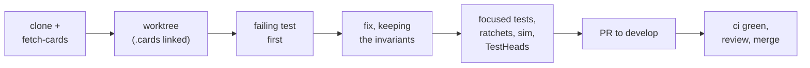

# Contributing

This is the contributor's guide: how to set up a checkout, run the tests the
way the project expects, read the ratchets that will fail on you, and get a
change merged. It is written for a Go developer who does not yet know Magic
engine internals or Forge. Unfamiliar words (IR, primitive, ratchet, chain
head) are in the [glossary](glossary.md).



## Prerequisites

| Need | Version | Why |
|---|---|---|
| Go | the `go` line in `go.mod` | Go 1.21 or later downloads it itself under the default `GOTOOLCHAIN=auto` |
| `git`, `make`, `bash` | any recent | the Makefile and scripts |
| Node | 22.12 or newer, **only** for `web/` | the browser client build and its tests (`web/README.md`) |

No cgo and no C toolchain are needed; gorge has no third-party Go
dependencies.

## Clone and fetch the card corpus

```sh
git clone https://github.com/adams-shaun/gorge && cd gorge
make fetch-cards      # Forge card + token scripts at FORGE_REF into .cards/ (about 140 MB on disk)
make compile-cards    # parse them into the IR cache, .cards/ir-<fingerprint>.gob.gz
make report           # corpus coverage against the implemented primitives
```

[Getting started](../getting-started.md#1-fetch-and-compile-the-card-corpus)
shows what `make report` prints. The scripts come from gorge's fork
[adams-shaun/forge](https://github.com/adams-shaun/forge) (`FORGE_REPO`) at
the commit pinned by `FORGE_REF` in the `Makefile`; every coverage number and
golden test is relative to that pin. They are GPL-3.0, gorge is Apache-2.0,
so they live only in the gitignored `.cards/` and are **never committed**,
not even a line pasted into a test. See
[The three repositories](../repos/index.md#licensing-and-the-forge-card-scripts).

When the pin moves, `make fetch-cards` also clears Go's test cache, because
the corpus lives outside the module and `go test` cannot see that it changed.

Optionally enable the repository's git hooks:

```sh
git config core.hooksPath .githooks
```

`pre-commit` (and `pre-merge-commit`) runs `go run ./cmd/pkgmap -check` when
you add, delete or rename a Go file, so a new package without a tier entry in
`docs/site/architecture/packages.tiers.json` fails at commit time rather than
in CI. `pre-push` runs the race detector, one package at a time, only when
you push `main` with `RACE=1` set.

## Work in a worktree

Make each change in its own branch, and if you keep several going at once,
in its own [git worktree](https://git-scm.com/docs/git-worktree), so your main
checkout stays clean. Branch from `develop`, which is where changes land:

```sh
git fetch origin
git worktree add ../gorge-myfix -b myfix origin/develop
ln -s "$PWD/.cards" ../gorge-myfix/.cards      # the corpus is untracked: link it in
cd ../gorge-myfix
```

!!! warning "A worktree without `.cards/` reads green and tests nothing"
    A worktree carries only tracked files. Every corpus-dependent test loads
    cards through `testutil.CorpusRegistry(t)`, which **skips** when `.cards/`
    is missing, so the package still prints `ok`, in a couple of
    milliseconds, having run almost nothing. If a run looks suspiciously
    fast, rerun with `-v` and look for
    `SKIP ... no .cards/ corpus present`. CI refuses to run without the
    corpus for exactly this reason.

## Run tests focused, inside the budget

Run **one package and one `-run` pattern at a time**:

```sh
go test -run 'TestOmniscienceInHandGrantsNothing' ./engine/rules/
go test -v -run '^TestHeads$/^2seats$' ./engine/rules/
```

On a shared Linux machine with systemd, the maintainers cap every run at the
per-test budget, and you can do the same:

```sh
systemd-run --user --scope -q -p MemoryMax=4G -p CPUQuota=400% \
  env GOMAXPROCS=4 GOMEMLIMIT=3GiB \
  go test -timeout 2m -run 'TestEveryRepoDeckIsFullySupported' -v ./engine/rules/
```

- **The budget.** Every single test fits **4 GB RSS, 4 vCPU and 1 minute of
  wall time**. A test outside it is a defect: split it into chunk tests that
  share fixtures, never trim what it checks. `cmd/testbudget` enforces it in
  the post-merge suite ([why](../architecture/invariants.md#every-test-fits-the-budget)).
- **Do not use `go test ./...` as your inner loop.** `make test` runs exactly
  that (with `-p=2`): the full suite, which CI runs.
- **Never `-count=1`.** It defeats the test cache and buys nothing: Go
  already reruns a test whose inputs changed.
- **Load the corpus only through `testutil.CorpusRegistry(t)`**, never
  `cards.LoadRegistry`: the shared registry opens once per test binary,
  while a fresh one costs hundreds of MB.

## Lint

```sh
gofmt -l $(git ls-files '*.go')     # must print nothing
go vet ./engine/rules/              # the packages you touched
go run ./cmd/gentypes -check        # if you changed server/protocol
```

`make lint` runs all three across the tree, plus the web client's
`svelte-check` and `eslint`, so it needs Node and `web/node_modules`. CI's
`lint` job runs the Go half (`gofmt`, `go vet ./...`, `gentypes -check`).

## The ratchets you will hit

A **ratchet** is a test whose expected value is a committed table and which
fails in both directions: a new gap fails, and a gap your change closed is
now a stale entry that fails too. You delete the entry in the same commit;
you never add one. The why behind each is on
[Invariants](../architecture/invariants.md#ratchets-only-shrink).

[Testing](testing.md#ratchets-and-goldens-what-a-failure-means) lists each one, what its failure means and
what to do.

## Commits and pull requests

**Branches.** Changes land on `develop` by pull request. The maintainers
periodically merge a `develop → main` snapshot when its checks are green; nothing
is pushed to `main` directly. Open your PR **against `develop`**. ([Branch flow](../repos/index.md#branch-flow).)

**Commit messages.**

- Subject `kind(area): what changed`, as in the history:
  `fix(effects): …`, `feat(bots): …`, `test(spellbench): …`, `docs(design): …`.
- The body says **why**: the rule you implemented with its Comprehensive
  Rules number (`CR 113.6`), what was wrong and where, and what you measured.
  If you counted how many corpus cards share the bug's shape, give the
  numbers ([measure the class, not the card](first-card-fix.md#5-measure-the-class-not-the-card)).
- If `TestHeads` moved, name the first diverging event and its cause.
- Plain messages: **no attribution trailers** (`Co-Authored-By:`,
  "Generated with …") and no issue-tracker references.

**The pull request.** The template (`.github/pull_request_template.md`) asks
for an overview, the changes by area, how you tested, and notes for
reviewers. `make pr PR_BASE=develop` pushes your branch and opens (or
refreshes) the PR with a generated change overview; it needs an
authenticated `gh`, and `DRY=1` prints the body without pushing.

**Checklist.** Modelled on the first outside contribution,
[`786510b3f`](https://github.com/adams-shaun/gorge/commit/786510b3f):

- [ ] A test that fails without your change, in the package you changed,
      named for the behaviour, and a control that shows the card still works
      where it should.
- [ ] `gofmt -l` is empty for your files; `go vet` on the packages you touched.
- [ ] `go run ./cmd/gentypes -check` if you changed `server/protocol`.
- [ ] Focused `go test` of the packages you touched, **with `.cards/` present**.
- [ ] `make sim`: every game prints `replay OK`.
- [ ] `go test -run '^TestHeads$' ./engine/rules/` passes, or the heads were
      re-pinned with a named cause.
- [ ] Any ratchet entry your change closed is deleted in the same commit.

**What CI runs on your PR.** `lint` (`gofmt`, `go vet ./...`,
`gentypes -check`); `test`: the corpus is fetched at `FORGE_REF`, the
packages are split across six shards, Go's test cache from the base branch
lets unchanged packages report `(cached)`, and `TestHeads` runs as its own
step; `examples` (`scripts/examples-smoke.sh`, the Python and Java agents); and
`wire-matrix` ([Wires](../architecture/wires.md)). A PR that touches `docs/site/` or `mkdocs.yml` also gets a strict
docs build.

## Reproduce a feedback report

A player bug report filed from a game on a gorge server carries a replayable
snapshot (`match.json`, `log.json`, the seat's `view.json`). `cmd/repro`
turns it into a failing test:

```sh
go run ./cmd/repro <feedback-dir>                     # replay, verify the chain head, print the board
go run ./cmd/repro -list <feedback-dir>               # the timeline of recorded answers (intents)
go run ./cmd/repro -at N <feedback-dir>               # stop at intent N
go run ./cmd/repro -omniscient <feedback-dir>         # show every hand
go run ./cmd/repro -emit-test ./engine/rules <feedback-dir>   # copy the snapshot, write a failing test skeleton
```

Try it on the committed fixture:

```sh
go run ./cmd/repro cmd/repro/testdata/feedback/20260914T120000Z-fb01
```

```text
== feedback report 20260914T120000Z-fb01 (table t1, match 1) ==
snapshot: captured: match.json log.json view.json
replayed 26 of 26 recorded intents (151 events); recorded head 67b55d2eb519629d
turn 2, round 1, main1 (step main1) — active: seat 0, priority: seat 0
...
```

Exit status 0 means the rebuilt event stream matched the recording event for
event. `DIVERGED` names the first mismatching event; a corpus pin change
since the report was filed is a real and expected cause, so read that event
before assuming an engine bug. The `-emit-test` skeleton uses
`feedback.EngineAt(t, dir, n)` from `testkit/testutil/feedback`; replace its
TODO with your assertion.

## Documentation

This site is `docs/site/`, built by MkDocs Material from the root
`mkdocs.yml` and published from `main`. To preview it:

```sh
go run ./cmd/pkgmap > docs/site/architecture/_generated_packages.md   # the generated package tables
python3 scripts/docs_sets.py --dirac docs/site/support/dirac-sets.json # the set tables, without gorge's columns
uvx --with mkdocs-material==9.7.7 mkdocs serve                        # or: pip install -r docs/site/requirements.txt
```

[Regenerating the tables](../support/regenerating.md) has the full set tables. The
build is `--strict`: a broken link fails it. CI also parses every
Mermaid diagram in a headless browser (`scripts/docs_mermaid_check.py`),
because `--strict` does not. Link between pages with relative `.md` paths,
and to code as `https://github.com/adams-shaun/gorge/blob/main/<path>`.

## Where next

- [Your first card fix](first-card-fix.md): one bug from report to merged fix.
- [Testing](testing.md): helpers, oracle scenarios and the ratchets in depth.
- [The card pipeline](card-pipeline.md): how a script becomes behaviour, and
  how coverage is measured.
- [Repository layout](repo-layout.md): the tree, the tiers, and where a
  change goes.
- [Invariants](../architecture/invariants.md): the rules every change keeps.
- [The three repositories](../repos/index.md): what lives in gorge-compliance
  and why gorge never imports a companion.
- [Glossary](glossary.md).
