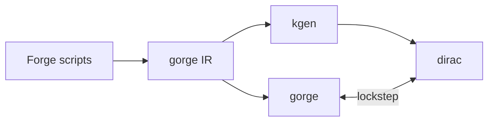

# Engines

gorge is the full rules engine. dirac is a smaller, much faster one that must play every card it supports exactly as gorge does.
{ .gg-lede }

<ul class="gg-facts">
  <li><strong>Speed:</strong> games per core-second and the cost of a dirac transition, measured and dated, are on <a href="../performance/index.md">Performance</a></li>
  <li><strong>No allocation</strong> in a dirac transition or copy</li>
  <li><strong>2 to 4 seats</strong> on dirac, up to 8 on gorge</li>
</ul>

-   [**Coverage**](../support/sets.md)

    Supported cards by Standard set, per engine.

-   [**Use the engines**](using.md)

    Run the tools, or embed them in Go.

-   [**Search and nets**](search-and-nets.md)

    Which searches run where, and the net runtime.

-   [**Play dirac from Go**](lab.md)

    Games, forks, policies and batches in a few lines.

-   [**Training data and nets**](training-data.md)

    Record games, load a trained net.

-   [**How gorge works**](../architecture/index.md)

    Events, rules, views, and the dirac internals.

-   [**Speed**](../performance/index.md)

    Numbers, method, and design invariants.

