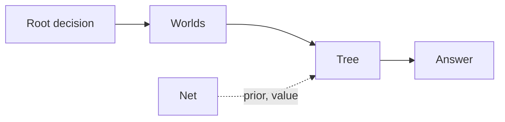

# Search and nets

Search needs an engine that is cheap to copy and step. A net needs a runtime that evaluates it in pure Go. This page says what ships, and where each piece runs.

## Which search runs where

| Search | gorge | dirac |
|---|:-:|:-:|
| PUCT tree over redealt worlds (`bots/azmcts`) | full | none |
| Determinised rollouts (`bots/searchseat`) | full | none |
| Heuristic bot, no search | full | full (`hbot`) |
| Search primitives: copy, step, hide, redeal | full | full |

dirac ships the primitives a search uses and its own bot. It ships no tree search, and `gorged -engine dirac` refuses a search policy.
[What dirac offers a search](../architecture/dirac/search.md) lists the operations.

## gorge's tree search

=== "Settings"

    Defaults from `azmcts.DefaultOptions`: 100 simulations per decision, exploration constant 1.5, first-play reduction 0.1, at most 6 candidates, 1,000 steps per simulation.
    Four decision kinds are searched: priority, attackers, blockers and target. `FullKinds` adds modes, may-triggers, small choices and multi-target picks.
    Every other decision goes to the default bot. Simulations have no rollouts: each leaf is scored once, by a heuristic or by a net.

=== "Worlds"

    The world source decides what the search may know.

    fair `redeal` re-deals everything the seat can't see, from its own observations.
    `redeal-closed` also hides the opponent's deck list, drawing a believed list from a corpus you supply.

    clairvoyant clones the real engine. The source for it is not in this repository, and the seat refuses it unless a command injects one.

=== "Hosted"

    `az-redeal` is the hosted entry: the `redeal` world, 100 simulations, no net, constructed or Commander, up to four seats, experimental tier.
    `gorged.RegisterNetBot` links a policy that loads a net at startup and adds `-<policy>-net`, `-<policy>-decks`, `-<policy>-belief` and related flags.

The determinised-rollout seat (`bots/searchseat`) samples K worlds per decision (default 8), rolls each out and overrides the bot only when a candidate wins by a margin.
By default it covers attackers and the cast choice.

Per-simulation cost is on [Bot speed](../performance/bots.md).

## The net runtime

Nets run in pure Go, with no cgo and no external ML runtime. Two packages read the same `.dzgw` file.

-   **`bots/gonet`**

    Loads `mlp` and `gnn` nets. Caches evaluations and card vectors. The graph net uses AVX-512 kernels when the CPU has them.

-   **`bots/netsimd`**

    Whole-layer AVX-512 kernels for the `mlp` net, with a scalar twin that gives the same bits. A library today; only its tests import it.

| What | Limit |
|---|---|
| Architectures | `mlp` and `gnn` in gonet; `mlp` in netsimd |
| netsimd widths | `d`, `ff`, `card_d`, `head_hidden` multiples of 32; `d_emb` any; 1 to 64 trunk blocks |
| Fast path | `d` = `head_hidden` = 64 |
| CPU paths | AVX-512 (F, BW, DQ, VL) on amd64; scalar Go everywhere else, and for `ForceScalar` |
| Raw card width | gonet 68 or 100; netsimd 68, 84 or 100 |

The file format and how a net is loaded are on [Training data and nets](training-data.md).
