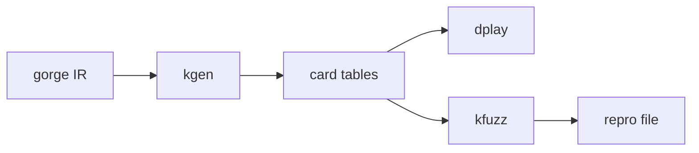

# Build, play and check dirac



dirac's tools all read the card tables. `make dirac-tables` builds them under the corpus. Without a corpus the build still passes and corpus tests skip.

## kgen

Compiles card pools into binary tables, and says which cards dirac plays.

```sh
go run -trimpath ./dirac/cmd/kgen -supported fdn        # name, true or false, per card
go run -trimpath ./dirac/cmd/kgen -show fdn "Abrade"    # one card's compiled form
go run -trimpath ./dirac/cmd/kgen -refuse "Card" -why "what differs" -repro fdn:autopay:12
```

`-refuse` names a card dirac won't play, with a game that shows the difference. `-unrefuse` undoes it.

## dplay

Plays dirac alone: a JSON line per game, a summary at the end.

```sh
go run -trimpath ./dirac/cmd/dplay -pairs 20 -a hbot -b random
```

Seats are `random`, `first`, `hbot` (the port of gorge's heuristic bot) or `sbt`. `-config` picks the verified surface, `lockstep-autopay` or `lockstep-full`.
`-sample-replay 0.1` writes a tenth of the games as replay records that `kfuzz -replay` re-runs on gorge. The output format is in
[`dirac/docs/running.md`](https://github.com/adams-shaun/gorge/blob/main/dirac/docs/running.md).

## kfuzz, khbot, ksbt

`kfuzz` plays one seeded game on both engines and compares them at every decision. The first difference is written as a repro file.
`khbot` and `ksbt` do the same for the two bots. How the check works: [the lockstep oracle](../architecture/dirac/oracle.md).

```sh
go run -trimpath ./dirac/oracle/cmd/kfuzz -kernel fdn -pairs 20 -seed 1 -surface autopay -out /tmp/repros
go run -trimpath ./dirac/oracle/cmd/kfuzz -repro /tmp/repros/repro.json -events 20
```

## sbv2dirac

Serves dirac as a SpellBench v2 engine over stdin and stdout. `-corpus` picks the corpus, `-decks` a directory of gorge deck files to offer by name.
See [SpellBench v2](../api/spellbench-v2.md).

All flags: [every flag](flags.md).
