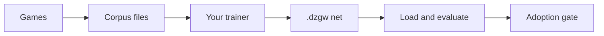
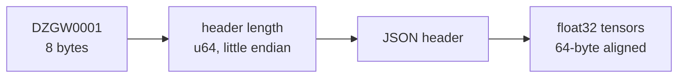

# Training data and nets

Training happens outside this repository. What the repository defines is the data going out and the net coming back in.



## Data out: record games

A seat records the decisions it makes through a callback. The driver fills in the game fields and the outcome, and writes the lines.

=== "Searched decisions"

    `azmcts.Seat.SetRecorder` receives one `policynet.VisitRecord` per searched decision.
    Each holds the redacted state the seat saw, the options its candidates use, the search's visits, prior and value, and the move played.
    The feature set it encodes under is `SeatConfig.RecordFeatures` (default `mz`). Format: `azvisits-v1`, one JSON object per line.

=== "Scored decisions"

    `heuristic.PolicyNetBot.SetRecorder` receives every decision a net-driven seat scores.
    `policynet.LoadOnPolicy` reads the lines back: `onpolicy-v1`, with the exact floats scored, the chosen options and the outcome.

=== "Dirac games"

    `dplay -out games.jsonl -sample-replay 0.1` writes a tenth of its games as `koracle-game-1` records. Each holds the decks, seed and every action.
    `kfuzz -replay` re-runs one on gorge.

Every corpus line carries an encoder hash, and a reader refuses a file whose hash is not one of this build's feature sets, or that mixes hashes. The record schemas are documented in `bots/policynet/visits.go` and `bots/policynet/onpolicy.go`.
The commands that write corpus files are not in this repository.

## Net in: the `.dzgw` file



The JSON header names the format (`dzgw-1`), the architecture (`mlp` or `gnn`), its sizes under `config`, the encoder constants under `consts`, the layer-norm epsilons and each tensor's name, shape, offset and byte count.
It may carry `encoder_hash`; if it does, the loader refuses a net trained on a different encoder.

| Constant | Value |
|---|---|
| `DENSE_W` (state scalars) | 92 (68 accepted: a net from before the Commander block reads only the first 68) |
| `OPT_DENSE_W` (option scalars) | 28 (24 accepted: a net from before the relative-seat columns reads only the first 24) |
| `SLOT_ROWS` (option slots) | 128 |
| `TABLE_ROWS` (hashed rows) | 16,384 |
| `GROUPS` (card pools) | 4 |
| `RAW_W` (card width) | 100 now; older nets 84 or 68 |

The other net format is `.gpol` (`policynet.LoadCheckpointFile`): magic `GPOL`, a schema version, the encoder hash, the geometry, then float32 weights.
It refuses to load on a hash or geometry mismatch. Oracle feature sets can't be written to it.

## Load and evaluate

```go
net, err := gonet.Shared("net.dzgw") // one shared net per path
model := policynet.NewExternal(net, policynet.FeaturesEntity)
```

`gonet.Shared` loads once per path and caches evaluations by encoded state. A hosting binary wires the model into a seat with `gorged.RegisterNetBot`.
The seat answers the kinds the net covers and hands the rest to the default bot.

## The adoption gate

A net's policy reaches the default bot only through a held-out run:

- 400 games per deck pair, at a seed nobody developed against, seats traded;
- at least +3 percentage points over the current bot, pooled;
- no pair worse than −5 points, and no new stalls or errors.

The rungs before that, and the rules for honest play, are on [Training and adoption](../bots/training-and-adoption.md).
