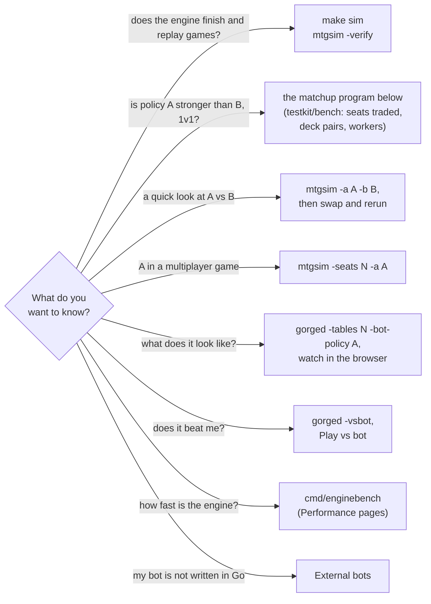

# Bot-vs-bot games

This page is for people who want to pit bot strategies against each other:
to check that a change to a policy helps, to compare two policies, or just to
watch them play. It covers the tools gorge ships for that, the registered
policies, how to run a fair matchup with seeds and N games, how to read the
result (and how many games a given difference needs), replay verification,
reproducibility and speed. Wiring in a bot written in another language is
covered in [External bots](../bots/index.md).

*Every command and output here was run on 2026-10-20 at commit `ad3777023`
(corpus pin `098b0553`), on a 32-core Linux box capped to 4 CPUs.*

## Which tool?



| Tool | Seats | Who plays | Fair seating | Use it for |
|---|---|---|---|---|
| `mtgsim` ([source](https://github.com/adams-shaun/gorge/blob/main/cmd/mtgsim/main.go)) | 1-8 | `-a` on seat 0, `-b` on seat 1, the built-in heuristic elsewhere; built-in decks; one core | no: swap by hand | smoke tests, replay checks, quick looks |
| your program on [`testkit/bench`](https://github.com/adams-shaun/gorge/blob/main/testkit/bench/bench.go) | 2 | any two policies, any decks, parallel and deterministic | yes, every game | real comparisons |
| `gorged` startup tables | 1-8 | one policy for every bot seat, `-decks` directory | n/a | watching, demos |
| `cmd/enginebench` | | | | engine speed, not bot strength ([Engine speed](../performance/engine.md)) |

The maintainers' larger benchmark harness lives in a private companion
repository; it is built on the same `testkit/bench` package this page uses,
so the loop, seeding and seat assignment are identical.

## The registered policies

A **policy** is a named bot strategy registered in the
[`bots`](https://github.com/adams-shaun/gorge/blob/main/bots/registry.go)
registry. A program links them with a blank import of `bots/all` and builds
one with `bots.New(name, bots.Options{...})`. To list what a build has:

```sh
go run ./cmd/spellbench-gorge-agent -list-policies
```

```text
az-redeal	az-redeal (AlphaZero search)	experimental
bot	Bot	production
forge-heuristic	Forge heuristic	experimental
lethal-pressure	Lethal Pressure	experimental
sb-tactical	sb-tactical (SpellBench tactical heuristic)	experimental
```

A running server lists the subset it offers to humans, with descriptions and
each policy's recorded strength claim, at `GET /api/bot-policies`.

| Policy | Formats, seats | What it does |
|---|---|---|
| `bot` | constructed and commander, any | the production baseline heuristic. With automatic mana payment it simulates combat to choose attacks and blocks ([`bots/bot`](https://github.com/adams-shaun/gorge/blob/main/bots/bot/bot.go)) |
| `forge-heuristic` | constructed and commander, any | the heuristic bot plus targeting rules derived from Forge's AI (prefer land colours, prominent colour, skip copies that would die) and a rule to hold removal for a bigger threat; no combat simulation ([`bots/forgeheuristic`](https://github.com/adams-shaun/gorge/blob/main/bots/forgeheuristic/forgeheuristic.go)) |
| `lethal-pressure` | constructed and commander, any | the heuristic with its own lethal-pressure decision rules; `gorged`'s default `-bot-policy` ([`bots/lethalpressure`](https://github.com/adams-shaun/gorge/blob/main/bots/lethalpressure/lethalpressure.go)) |
| `sb-tactical` | constructed, 2 seats | a scored tactical heuristic ported from the SpellBench project: values creatures, timing, races and removal from what the seat can see. Needs the card registry ([`bots/sbtactical`](https://github.com/adams-shaun/gorge/blob/main/bots/sbtactical/sbtactical.go)) |
| `az-redeal` | constructed, 2 seats | Monte Carlo tree search: 100 simulations per searched decision over hidden cards redealt from its own observations, and `bot` everywhere else. About 250 ms per searched decision ([`bots/azredeal`](https://github.com/adams-shaun/gorge/blob/main/bots/azredeal/azredeal.go)) |

`sb-tactical` and `az-redeal` are *environment* policies: the driver hands
them a rebuilt game to search or score, and that rebuild uses each seat's real
decklist (never the hidden cards themselves). That is why a server never
seats them against a person, and why they need a driver that supports them:
the matchup program below does, `mtgsim` does not.

**Options.** A policy may declare options (`bots.Info.Options`: key, type,
default, help). `gorged` sets them with `-bot-opt <policy>.<key>=<value>`,
`-bot-config <policy>=<file.json>` or `GORGED_BOT_<POLICY>_<KEY>`; your own
program passes `bots.Options{Config: map[string]string{...}}`. **None of the
built-in policies declares an option today**, so this matters only for a
policy you register yourself.

## A quick look with `mtgsim`

`mtgsim` plays games one after another on one goroutine. Game *i* uses seed
`-seed + i` for the engine and the bots, so a run is a pure function of its
flags. `-a` and `-b` put registered policies on seats 0 and 1:

```sh
go run ./cmd/mtgsim -seats 2 -games 100 -seed 1 -a forge-heuristic -b bot -decks uw-tempo,mono-red-goblins
```

```text
seed 1: 2 seats,    348 intents,   1899 events,  13 turns, winner=mono-red-goblins, chain=2124efdf7be30c65
seed 2: 2 seats,    223 intents,   1259 events,  10 turns, winner=mono-red-goblins, chain=a18fe2b836f122d9
seed 3: 2 seats,    244 intents,   1409 events,  10 turns, winner=mono-red-goblins, chain=9c8e7ad5eee07bc5
...
seed 100: 2 seats,    266 intents,   1470 events,  10 turns, winner=mono-red-goblins, chain=d43a07279ca9dd83
```

Each game prints one line naming the **winning deck**, not the winning
policy. Seat 0 always holds the first deck, so a deck advantage and a policy
advantage are mixed up in one run. Swap the policies and run again over the
same seeds, then add up per policy:

| Run | uw-tempo (seat 0) | mono-red-goblins (seat 1) | wins |
|---|---|---|---|
| `-a forge-heuristic -b bot` | forge-heuristic | bot | uw-tempo 13, mono-red-goblins 87 |
| `-a bot -b forge-heuristic` | bot | forge-heuristic | uw-tempo 25, mono-red-goblins 75 |

forge-heuristic won 13 + 75 = 88 of 200 (44%). Each 100-game run took about
2 s and 340 MB. Tally the winners with
`... | grep -o 'winner=[a-z-]*' | sort | uniq -c`.

`mtgsim`'s limits, all from its source:

- **The winner is a deck name.** In a mirror (`-decks uw-tempo,uw-tempo`)
  both seats have the same name and the line cannot tell you who won.
- **Built-in decks only.** `-decks` takes the names of the embedded repo
  decks (`testkit/testutil/decks`), not file paths.
- **Environment policies do not work.** `-a sb-tactical` fails with
  `Deps.Cards is nil`; `-a az-redeal` runs but never searches, because
  `mtgsim` calls the plain `Decide` and the policy falls back to `bot`.
- **Seats without `-a`/`-b`** play the built-in heuristic with manual mana
  tapping, which is `bot` without automatic payment. A named policy gets
  automatic payment.

## A fair matchup with `testkit/bench`

For a comparison you can trust, play both policies on both sides of every
deck pair and let a scheduler keep the books. gorge exports exactly that as
the `testkit/bench` package: `bench.RunPairs` plays *N* games per deck pair,
**puts policy A in seat 0 in even games and in seat 1 in odd games**, gives
every seat its own seed (the game seed XOR seat+1), runs games on a worker
pool, and folds the results in game order so the tally does not depend on the
number of workers. `bench.PlayGame` is the drive loop, with the watchdogs and
the driver support environment policies need.

The program below is a complete matchup tool on top of it. Put it in a
directory next to your gorge checkout:

```sh
mkdir matchup && cd matchup
go mod init example.com/matchup
go mod edit -require github.com/adams-shaun/gorge@v0.0.0 -replace github.com/adams-shaun/gorge=../gorge
# save the program below as main.go
go build -o matchup .
```

??? example "`main.go` (100 lines)"

    ```go
    // Command matchup plays two registered bot policies against each other over
    // deck pairs, trading seats every game, and prints policy A's win rate.
    package main

    import (
    	"flag"
    	"fmt"
    	"log"
    	"math"
    	"os"

    	"github.com/adams-shaun/gorge/bots"
    	_ "github.com/adams-shaun/gorge/bots/all" // link every built-in policy
    	"github.com/adams-shaun/gorge/engine/cards"
    	"github.com/adams-shaun/gorge/engine/replay"
    	"github.com/adams-shaun/gorge/engine/rules"
    	"github.com/adams-shaun/gorge/engine/seat"
    	"github.com/adams-shaun/gorge/testkit/bench"
    	"github.com/adams-shaun/gorge/testkit/testutil"
    )

    func main() {
    	a := flag.String("a", "forge-heuristic", "policy A")
    	b := flag.String("b", "bot", "policy B")
    	pairs := flag.String("pairs", "uw-tempo:mono-red-goblins", `deck pairs "x:y,z:w", or "all"`)
    	games := flag.Int("games", 20, "games per deck pair (even, so seats balance)")
    	seed := flag.Uint64("seed", 1, "base seed")
    	workers := flag.Int("workers", 4, "games in flight")
    	corpus := flag.String("cards", ".cards", "corpus directory")
    	verify := flag.Bool("verify", false, "replay every game and check its chain head")
    	flag.Parse()

    	reg, err := testutil.OpenCorpusRegistry(*corpus)
    	if err != nil {
    		log.Fatal(err)
    	}
    	pds, err := bench.ParsePairs(*pairs, testutil.LegacyDeckNames())
    	if err != nil {
    		log.Fatal(err)
    	}
    	// A seat constructor per side: bench hands it the per-seat seed.
    	ctor := func(policy string) bench.SeatCtor {
    		return func(s uint64) seat.Seat {
    			st, err := bots.New(policy, bots.Options{Seed: s, AutoPayMana: true, Deps: bots.Deps{Cards: reg}})
    			if err != nil {
    				log.Fatal(err)
    			}
    			return st
    		}
    	}
    	// Seat 0 always holds the pair's first deck; bench decides which
    	// policy sits there (A in even games, B in odd ones).
    	play := func(pos int, gameSeed uint64, g int, seats [2]seat.Seat) (bench.Outcome, error) {
    		pd := pds[pos]
    		decks := make([][]*cards.Card, 2)
    		for i, name := range []string{pd.A, pd.B} {
    			if decks[i], err = testutil.LoadRepoDeck(reg, name); err != nil {
    				return bench.Outcome{}, err
    			}
    		}
    		cfg := rules.Config{Seed: gameSeed, Names: []string{pd.A, pd.B}, Decks: decks,
    			Tokens: reg.Tokens, NameUniverse: reg.Universe()}
    		cfg.LoopGuard = rules.WithDefaultObjectCap(cfg.LoopGuard)
    		hooks := bench.Hooks{EnvSeats: true, HonestRoot: true} // drive search/env seats as the server does
    		o, e, err := bench.PlayGame(cfg, seats[:], 0, 400000, hooks)
    		if err == nil && *verify {
    			if re, rerr := replay.Replay(e.L, cfg); rerr != nil || re.L.Head() != e.L.Head() {
    				err = fmt.Errorf("seed %d: replay diverged: %v", gameSeed, rerr)
    			}
    		}
    		return o, err
    	}
    	res, err := bench.RunPairs(*seed, *games, pds, ctor(*a), ctor(*b), play, *workers, nil)
    	if err != nil {
    		log.Fatal(err)
    	}
    	var wins, decided int
    	for _, r := range res {
    		fmt.Printf("%-40s A %3d  B %3d  draws %d  stalls %d  seat0 wins %d\n",
    			r.PD, r.AWins, r.BWins, r.Draws, r.Stalls, r.SeatWins[0])
    		wins += r.AWins
    		decided += r.AWins + r.BWins
    	}
    	if decided == 0 {
    		os.Exit(1)
    	}
    	p := float64(wins) / float64(decided)
    	half := 1.96 * math.Sqrt(p*(1-p)/float64(decided))
    	fmt.Printf("%s vs %s: A won %d of %d decided games = %.1f%% (95%% CI +/- %.1f pp)\n",
    		*a, *b, wins, decided, 100*p, 100*half)
    }
    ```

Run it from the gorge checkout, so `.cards` resolves:

```sh
cd ../gorge
../matchup/matchup -a forge-heuristic -b bot -games 20 -verify
```

```text
uw-tempo:mono-red-goblins                A  12  B   8  draws 0  stalls 0  seat0 wins 2
forge-heuristic vs bot: A won 12 of 20 decided games = 60.0% (95% CI +/- 21.5 pp)
```

20 games, every one replay-verified, in 0.5 s. Note `seat0 wins 2`: the deck
in seat 1 won 18 of 20. The deck pairing dominates a single pair, which is
why the seats trade and why you want many pairs.

**A round robin over every deck pair.** `-pairs all` plays every unordered
pair of the 12 pinned constructed decks (66 pairs):

```sh
../matchup/matchup -a forge-heuristic -b bot -pairs all -games 20
../matchup/matchup -a bot -b bot -pairs all -games 20      # the control
```

```text
forge-heuristic vs bot: A won 577 of 1320 decided games = 43.7% (95% CI +/- 2.7 pp)
bot vs bot: A won 639 of 1320 decided games = 48.4% (95% CI +/- 2.7 pp)
```

Each run: 1,320 games in 6.5 s wall (24 s CPU) on 4 cores, 1.4 GB peak RSS.
The control matters: `bot` against itself is 50% by symmetry, and 48.4% is
what noise looks like at this size. forge-heuristic's 43.7% sits outside the
control's interval, so on this run it is weaker than `bot` in 1v1
constructed.

The other two policies run the same way. These are 20-game smoke runs, far
too small to rank anything:

| Command | Result | Wall time |
|---|---|---|
| `-a sb-tactical -b bot -games 20 -verify` | A 13, B 7 | 0.8 s |
| `-a az-redeal -b bot -games 4 -verify` | A 2, B 2 | 3.7 s |

**Your own decks.** `testutil.LoadRepoDeck` reads only the embedded repo
decks. To play deck files of your own (for example from
[`deckimport`](play.md#decks)), load them with
`_, cards, err := deck.Load(reg, path)` from `engine/deck`, and build the
pair list yourself instead of calling `bench.ParsePairs`.

**Your own policy.** Write a type that implements
[`seat.Seat`](https://github.com/adams-shaun/gorge/blob/main/engine/seat/seat.go),
register it in an `init` with `bots.Register(bots.Entry{Info: ..., New: ...})`,
and blank-import its package in `main.go`; `-a yourpolicy` then works. The
[External bots](../bots/index.md) section covers the seat contract.

## Multiplayer games

`testkit/bench.RunPairs` is two-seat. For three to eight seats use `mtgsim`:
`-seats N` deals the first N pinned decks (or `-decks`, one name per seat),
`-a` takes seat 0, and the rest play the built-in heuristic.

```sh
go run ./cmd/mtgsim -seats 8 -games 2 -verify -a forge-heuristic
```

```text
seed 0: 8 seats,   3691 intents,  17042 events,  48 turns, winner=mono-red-goblins, chain=d9188de47705f5ea
  replay OK (chain d9188de47705f5ea)
seed 1: 8 seats,   4020 intents,  18404 events,  53 turns, winner=mono-red-goblins, chain=fd1629b46e20cd5f
  replay OK (chain fd1629b46e20cd5f)
```

Two 8-seat games in 2 s. To balance seats, rotate the deck list across runs
so the policy under test meets every deck in every seat. `mtgsim` plays the
Commander decks as 20-life constructed games; a Commander-format comparison
needs a program that sets `rules.Config`'s format and commander fields
itself.

## Watching bots play

To see a policy in action rather than count its wins, run bot-only tables
and open the lobby:

```sh
go run ./cmd/gorged -addr 127.0.0.1:8090 -dir /tmp/gorge-watch -feedback /tmp/gorge-play-feedback \
  -tables 4 -seats 2 -format constructed,commander -commander-seats 4 \
  -bot-policy forge-heuristic -pace 1s
```

Every bot seat on these tables plays `-bot-policy`; a server cannot put two
different policies at one table. `-pace` slows the game for humans, the
**Deck win rates** board in the lobby tallies finished games, and each
finished match has a replay at `/t/<table>/m/<k>`. See
[Play in the browser](play.md#tables-formats-decks-and-seats) for the table
flags.

## Reading the result

**Count decided games.** Draws and stalls (a game a watchdog stopped) are
neither a win nor a loss; leave them out of the rate and look at why they
happened. A livelock or a panic stall is an engine bug.

**How many games?** A win rate from *n* independent decided games has a 95%
interval of about ±1.96·√(p(1−p)/n), widest at p = 50%. The table gives the
games needed at 50%:

| Difference from 50% | Games for a 95% interval this narrow | Games to detect it 80% of the time |
|---|---|---|
| 10 points (60%) | 97 | 197 |
| 5 points (55%) | 385 | 785 |
| 3 points (53%) | 1,068 | 2,181 |
| 2 points | 2,401 | 4,906 |
| 1 point | 9,604 | 19,623 |

So a 20-game run (±22 points) tells you almost nothing, and a policy change
worth 2 points needs about five thousand games. The normal approximation is
also poor below about 30 games.

**Run a control.** Play the baseline against itself with the same pairs, games
and seeds. If the control is not within its interval of 50%, something in the
setup favours a side.

**Look at the structure.** `seat0 wins` and the per-pair lines show how much
the deck pairing, rather than the policy, decides games. A policy that only
wins one archetype's games is a different finding from one that is a little
better everywhere.

## Replays and determinism

Every game in gorge is a pure function of its configuration (decks, seed) and
the answers the seats gave, which the event log records. `-verify` (in
`mtgsim`, and in the program above) replays each finished game from that log
and compares the rebuilt event chain head with the live one:

```text
seed 0: 4 seats,   1420 intents,   6944 events,  33 turns, winner=death-n-taxes, chain=c273bc17c18d495d
  replay OK (chain c273bc17c18d495d)
```

A `replay diverged at event N` line is an engine bug: please report it with
the command that produced it.

Determinism also means a run is reproducible:

- **Same build, same corpus, same flags, same output.** Rerunning a
  `matchup` command prints the same lines, and so does changing `-workers`:
  a 2-pair, 40-game run printed byte-identical output with `-workers 1` and
  `-workers 4`.
- **The seed is the game.** `mtgsim` game *i* uses `-seed + i`. `RunPairs`
  gives pair *p*, game *g* the seed `base + p·games + g`, so the first 20
  games of a 40-game run are the 20-game run. On a server, table *i* has seed
  `-seed + i − 1` and match *k* derives its own from that; a play-vs-bot game
  draws a fresh random seed and returns it from `POST /api/games`.
- **A different engine or corpus is a different game.** Record the gorge
  commit and `.cards/cards.lock` with any result you keep; a move of
  `FORGE_REF` or an engine change can change every game.

## Speed

| Measured | Result |
|---|---|
| `mtgsim`, 2 seats, heuristic policies | 100 games in about 2 s, one core, 340 MB |
| `make sim` (20 verified 4-seat games) | 3.6 s |
| matchup, 66 pairs × 20 games, 4 workers | 1,320 games in 6.5 s, 1.4 GB |
| `az-redeal` | about 250 ms per searched decision (its registry entry) |

Tips:

- Parallelism comes from `-workers` (games in flight). Set `GOMAXPROCS` to
  the cores you want to use; more workers than cores buys nothing.
- Memory is mostly the loaded corpus plus one engine per game in flight; on a
  shared machine cap it, for example
  `systemd-run --user --scope -p MemoryMax=4G -p CPUQuota=400% env GOMAXPROCS=4 ../matchup/matchup ...`.
- Search policies cost hundreds of times more per decision than the
  heuristics. On a server, `-bot-search-slots` bounds how many searched
  decisions run at once; they queue rather than play worse.
- Engine throughput is measured separately by `cmd/enginebench`; see
  [Engine speed](../performance/engine.md).
