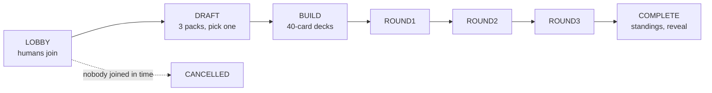

# Draft events

gorge can run a complete limited event: four seats open three packs, draft
them, build 40-card decks and play a round robin. Any seat can be a person or a
bot, and bots take part in every phase. This page shows how to host events with
`gorged`, how to run them headless with `draftsim`, and how to compose your own
workflows with `labdemo` and the `draftlab` library.

The commands and output below are from 2026-10-31.

## Host events with `gorged -events`

Draft events are part of the public `gorged` binary and are off by default.
Turn them on with `-events`:

```sh
make fetch-cards   # once: the pinned card corpus, into .cards/
make web           # once, before gorged is built: the browser client
go run ./cmd/gorged -addr 127.0.0.1:8090 -dir /tmp/gorge-draft -events
```

```text
gorged: 4 tables of 4 on 127.0.0.1:8090 (dir /tmp/gorge-draft)
gorged: draft events on (/api/events, dir /tmp/gorge-draft/events)
```

Open `http://127.0.0.1:8090/` and use *Draft a 4-player pod* in the lobby. That
entry appears only on a server that serves events, and goes to `/events/new`.
A `gorged` built before `make web` still serves the whole API, but pages answer
`503 web build missing`.

With `-events`, the startup art fill also covers every card in every draftable
set (553 card names) as well as the deck files, so a first start spends a while
fetching from Scryfall at a limited rate. Play is not affected. Add
`-prewarm=false` to skip the fill, and cards are then fetched as packs first show
them; `-art-dir` keeps the cache across a wiped `-dir`.

A server without `-events` behaves as if events did not exist:
`GET /api/capabilities` says `{"events":false}`, every `/api/events` path is a
404, and `<dir>/events` is never created.

Use a fresh `-dir` for each server. Two servers sharing one directory corrupt
each other ([Play in the browser](play.md#persistence-and-restarts)).

## How an event runs



- **Lobby.** The creator chooses a set, a series format and each seat. Each human
  seat gets a private invite link, shown once. With one human, the client sends
  you straight to your own link. The event starts when every human has joined.
- **Draft.** You pick one card and pass the rest: left in packs 1 and 3, right in
  pack 2. A seat picks whenever a pack is waiting for it, and bots pick
  immediately. An FDN pod is 42 picks per seat; a BLB pod is 39.
- **Build.** A deck is at least 40 cards: any cards from your own pool, plus free
  basic lands in any number. The client offers the bot builder's suggestion and an
  automatic land split. You save a deck, then ready it.
- **Rounds.** Three rounds of 1v1 series, seat 0 against 3 and 1 against 2, then 0
  against 2 and 1 against 3, then 0 against 1 and 2 against 3. Each game is an
  ordinary table that you can watch or replay.
- **Complete.** Standings follow the Magic Tournament Rules: match points (win 3,
  draw 1), then opponents' match-win percentage, game-win percentage and opponents'
  game-win percentage, then seat index.

Other seats' picks and decks stay hidden until the event is COMPLETE. Until then a
seat sees counts only, and `GET /api/events/{id}/log` is redacted for it.

## What you can choose

**Sets.** Packs follow the MTGJSON booster configurations. A hosted event uses the
Arena collation (`play-arena`); `draftsim` and `labdemo` can also cut paper Play
Boosters (`play`).

| Code | Set | Pack size | Bot pick ratings |
|---|---|---|---|
| `FDN` | Foundations | 14 | 17Lands games-in-hand win rate |
| `BLB` | Bloomburrow | 13 | a heuristic from card facts |

**Bot seats** have a game policy, a drafter and a builder. `GET /api/events/personas`
lists the drafter and builder names, `rating-colour` (the default) and `best23`. Both
name the same pair: the `rating-colour` drafter, which scores a card by its rating plus
how well it fits the colours picked so far, and the `best23` builder, which plays the
colour pair with the best 23 cards and adds 17 basics.

The game policy is any hosted policy that does not read opponents' decklists:
`bot`, `lethal-pressure`, `forge-heuristic` and `forge-heuristic-hold` in a plain
build. Asking for one that does is refused:

```text
{"code":"bad_request","message":"eventhost: policy \"sb-tactical\" reads every seat's real decklist (Env); draft events refuse Env policies"}
```

**Series format.** Best of 1 (the default) or best of 3. In best of 3 the loser of
a game chooses who plays first in the next one (MTR 2.2), and a human can sideboard
between games. A bot keeps its deck.

**Pick timer.** Only a pod with two or more humans has one. A single human drafts
at their own pace. An expired pick is taken by the seat's own drafter and logged as
automatic. Nothing about a deadline is saved, so a restart re-arms each timer at its
full length.

| `pick_timer` | Limit per pick |
|---|---|
| `standard` (the default with two or more humans) | 75 s for a 15-card pack, falling to 7 s for the last card |
| `relaxed` | the standard limit × 1.5 |
| `off` | none |

**Limits.**

| Limit | Value | What happens |
|---|---|---|
| Seats | exactly 4; up to 4 may be human | anything else is a 400 |
| Events not yet COMPLETE | 4 (`-max-events`) | a further create is a 409 `capacity` |
| Lobby | 15 minutes with an unjoined human seat | with at least one human joined, bots fill the empty seats and the event starts; with none, it is cancelled |
| A human who stops acting | 2 hours | the server acts for them: auto-pick, auto-submit or concede |

## Restarts

An event resumes from its own log. Everything needed is under
`<dir>/events/<id>/`: `event.json`, `log.jsonl` and `decks/`. A game that was in
progress is aborted and played again from the start on a new table with a new seed,
and the log records both facts. A table's name carries its attempt number. After
stopping a server in round 1 and starting it on the same `-dir`, the event's two
live series read, with the other fields left out:

```text
{"table":"e1-r1-s03-g1-a2","state":"live","attempt":2}
{"table":"e1-r1-s12-g1-a2","state":"live","attempt":2}
```

## Run an event over HTTP

The browser client uses the same API as any other program. The full route table is
in [HTTP API: Draft events](../api/http.md#draft-events). Four bots need no one to
join, so the event runs straight through the draft and the build:

```sh
curl -s -X POST http://127.0.0.1:8090/api/events -H 'content-type: application/json' -d '{
  "set": "FDN",
  "seats": [{"kind":"bot"}, {"kind":"bot","policy":"lethal-pressure"},
            {"kind":"bot","policy":"forge-heuristic"}, {"kind":"bot"}]}'
```

```text
{"event":"e1","invites":null,"state":{"event":"e1","set":"FDN","phase":"ROUND1","round":1,"best_of":1,"pick_timer":"off", ...
```

A human seat works through its invite token, sent as `Authorization: Bearer`:

| Step | Request | Real reply, shortened |
|---|---|---|
| Create | `POST /api/events` with `{"kind":"human"}` in a seat | `{"event":"e4","invites":[{"seat":0,"token":"…","join":"/e/e4?seat=0&token=…"}], …}` |
| Join | `POST /api/events/e4/join` `{"name":"Ann"}` | phase `DRAFT`, `you` 0 |
| See the pack | `GET /api/events/e4/pack` | `{"round":1,"pick_no":1,"pack":[{"id":"c1","name":"Strix Lookout", …}, …]}` |
| Pick | `POST /api/events/e4/pick` `{"round":1,"pick_no":1,"id":"c1"}` | the next pack; after 42 picks, `waiting` is true and the phase is `BUILD` |
| See the pool | `GET /api/events/e4/pool` | `pool` plus `suggestion`, the bot builder's deck |
| Check a deck | `POST /api/events/e4/deck/check` `{"main":[…],"basics":[4,4,3,3,3]}` | `{"valid":true,"total":40,"auto_lands":[2,4,3,3,5]}` |
| Save it | `POST /api/events/e4/deck` with the same body | the same, plus `"rev":1` |
| Ready | `POST /api/events/e4/ready` `{"rev":1}` | phase `ROUND1` |

Each live series for your seat then carries a `join` link to its table:

```text
{"round":1,"a":0,"b":3,"best_of":1,"state":"live","table":"e4-r1-s03-g1-a1","attempt":1,"score":[0,0],"winner":null,"join":"/t/e4-r1-s03-g1-a1?seat=0&token=…&event=e4"}
```

The seat then plays through the ordinary
[decision loop](../api/http.md#the-decision-loop). The event sends its own frames
(`event_state`, `draft_pack`, `pod_progress`, `series_update`) to a stream session
after `POST /api/events/{id}/subscribe`
([Wire protocol](../api/protocol.md)).

## Run events headless with `draftsim`

`draftsim` needs no server and no browser. `make draftsim` builds it and plays two
FDN events, replaying each one from its own log and each game from its chain:

```text
$ make draftsim
go build -trimpath -o bin/draftsim ./cmd/draftsim
bin/draftsim -set FDN -seed 1 -events 2 -verify
event 1: seed 1, set FDN (play-arena), drafter rating-colour, builder best23
  round 1 seat 0 (lethal-pressure) vs seat 3 (lethal-pressure): winner seat 3 turns 11 head 14b4ac72c8b56212 replay OK
  round 1 seat 1 (bot) vs seat 2 (forge-heuristic): winner seat 1 turns 19 head 8fa59c64fc1474ef replay OK
  round 2 seat 0 (lethal-pressure) vs seat 2 (forge-heuristic): winner seat 2 turns 22 head 3349f3473a6bd77a replay OK
  round 2 seat 1 (bot) vs seat 3 (lethal-pressure): winner seat 3 turns 31 head 97ba2df4621a59f7 replay OK
  round 3 seat 0 (lethal-pressure) vs seat 1 (bot): winner seat 0 turns 41 head 022b40d05194e9bd replay OK
  round 3 seat 2 (forge-heuristic) vs seat 3 (lethal-pressure): winner seat 2 turns 34 head b9be96e94f486128 replay OK
event 1: replay OK (208 log entries, 6 games)
  standings: seat persona                pts    MW    OMW    GW    OGW
    2 FDN/rating-colour/forge-heuristic   6  0.667  0.444  0.667  0.444
    3 FDN/rating-colour/lethal-pressure   6  0.667  0.444  0.667  0.444
    0 FDN/rating-colour/lethal-pressure   3  0.333  0.556  0.333  0.556
    1 FDN/rating-colour/bot      3  0.333  0.556  0.333  0.556
event 2: seed 2, set FDN (play-arena), drafter rating-colour, builder best23
  ...
event 2: replay OK (208 log entries, 6 games)
```

Both events finished in under 2 seconds in total. The event seed drives the packs,
the picks and the game seeds, so the same flags give the same log byte for byte.

| Flag | Default | Meaning |
|---|---|---|
| `-set` | `FDN` | `FDN` or `BLB` |
| `-collation` | `play-arena` | `play-arena` or `play` |
| `-seed`, `-events` | `1`, `1` | the first event's seed, and how many events; each later event adds one to the seed |
| `-seats` | `4` | pod size, 4 or 8 |
| `-mode` | `draft` | `draft`, or `sealed` (6 packs per seat, unpicked) |
| `-structure` | round robin at 4 seats, Swiss at 8 | `roundrobin`, `swiss`, or `none` to stop after building |
| `-rounds` | the structure's own | how many rounds to play |
| `-players` | `lethal-pressure,bot,forge-heuristic,lethal-pressure` | one policy for every seat, or exactly one per seat. A policy that reads decklists is refused |
| `-drafter`, `-builder` | `rating-colour`, `best23` | the pick and build logic |
| `-verify` | off | replay events and games, and exit non-zero on the first mismatch |
| `-draftlog` | none | append every pick to a CSV in 17Lands' `draft_data` shape |
| `-v` | off | print each seat's policy and deck summary |

`draftsim` plays best of 1 only. Two more shapes it can run:

```sh
go run ./cmd/draftsim -seats 8 -players bot -seed 3 -verify
go run ./cmd/draftsim -mode sealed -structure none -seed 3 -v
```

!!! note "Hosted and headless differ"
    Eight seats, sealed and Swiss are available in `draftsim` and `draftlab`. A
    hosted event is always a 4-seat draft played as a round robin.

## Compose a workflow with `labdemo`

`cmd/labdemo` is a worked example of the `draftlab` Go library. It plays some
random-deck games, fixes a player policy, builds decks from sealed pools, drafts an
8-seat Swiss pod and plays the built decks against a benchmark catalog of opponents:

```text
$ go run ./cmd/labdemo -seed 1 -out /tmp/labdemo
frozen player bot@1
labdemo seed 1: set FDN, collation "", player bot@1
step 1 random-deck games: 4 played, 4 finished
step 3 sealed builds: 8 decks
step 4 pods: 1 pod(s) of 8 seats, 12 games (12 finished)
step 5 gauntlet: 16 hero(es), 320 games (320 finished)
hero sealed 1 / bot@1: 16-4-0 0.800 ci95 [0.584, 0.919]
...
hero p7 FDN draft / bot@1: 8-12-0 0.400 ci95 [0.219, 0.613]
artifacts: /tmp/labdemo
```

That run took about 3 seconds. Its figures come from one small seeded run and say
nothing about bot strength. `-out` writes:

| File | What |
|---|---|
| `draft_data.csv` | one row per pick, in 17Lands' `draft_data` shape |
| `game_data.csv` | one row per player per game, in 17Lands' `game_data` shape |
| `decks.json` | the built decks and where they came from |
| `manifests.json` | what each step ran: agents with versions, seeds, limits, results |
| `events/pod1.log.jsonl` | the pod's replayable event log |

The whole run is a pure function of its flags, so two runs with the same flags write
identical files. `-player`, `-drafter` and `-builder` also accept
an external program in any language; see [gorge-agent/1](../api/gorge-agent.md). To
use the same pieces from Go, start from
[`draft/draftlab`](https://pkg.go.dev/github.com/adams-shaun/gorge/draft/draftlab)
and read
[`cmd/labdemo/workflow.go`](https://github.com/adams-shaun/gorge/blob/main/cmd/labdemo/workflow.go).

## Data sources

The FDN pick ratings come from [17Lands](https://www.17lands.com) public datasets,
licensed under [CC BY 4.0](https://creativecommons.org/licenses/by/4.0/). They are
per-card games-in-hand win rates from FDN Premier Draft games, and the file
`draft/limited/pickbot/ratings/FDN.json` records its source and attribution. The client shows the credit on any page those ratings shape. The set
and booster data is trimmed from [MTGJSON](https://mtgjson.com) (MIT). Both are
credited in
[`NOTICE`](https://github.com/adams-shaun/gorge/blob/main/NOTICE).

## Where next

- [Architecture of draft events](../architecture/draft.md): the packages, and how an
  event replays from its log.
- [HTTP API: Draft events](../api/http.md#draft-events): every route.
- [gorge-agent/1](../api/gorge-agent.md): drive a seat from another language.
