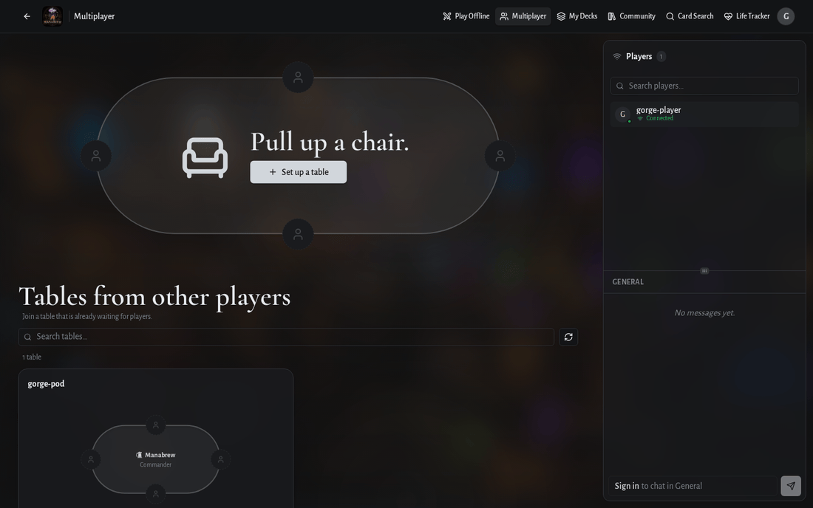
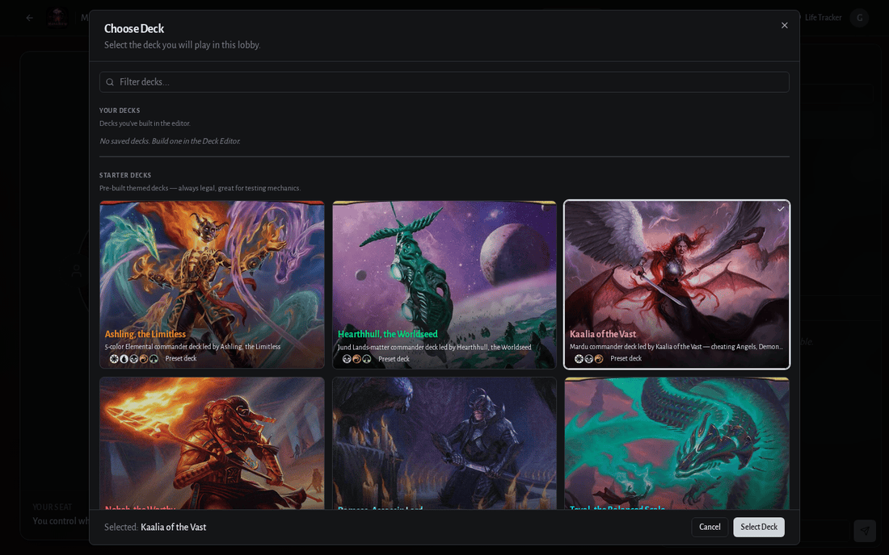
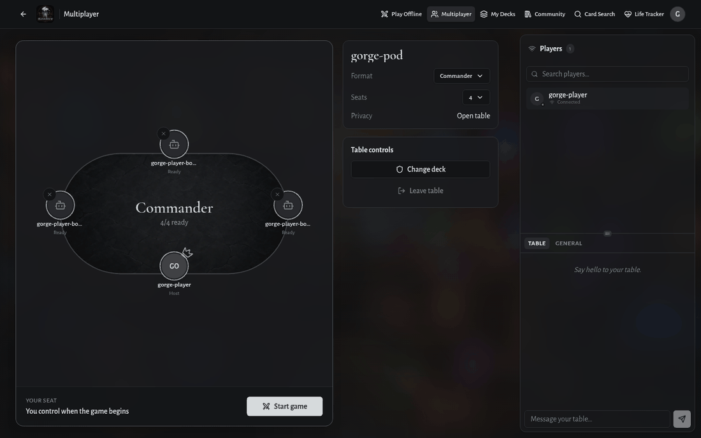
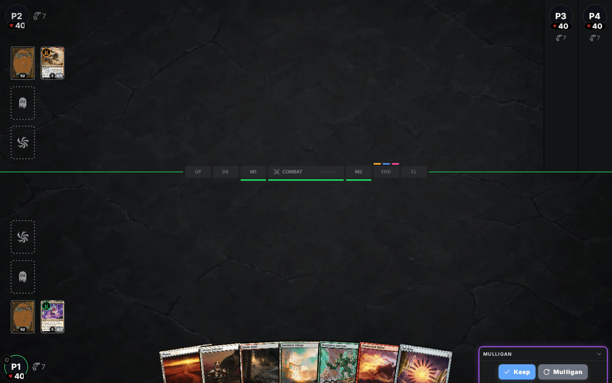
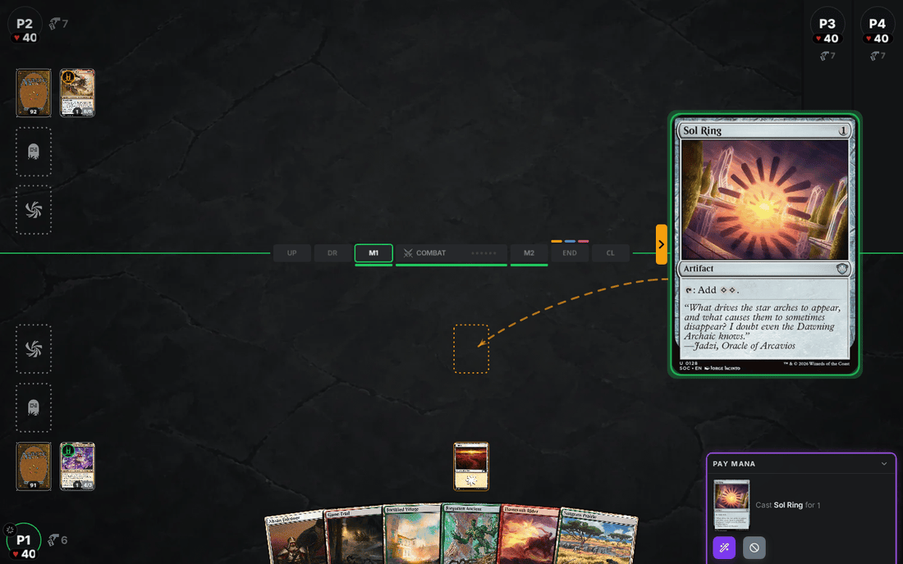
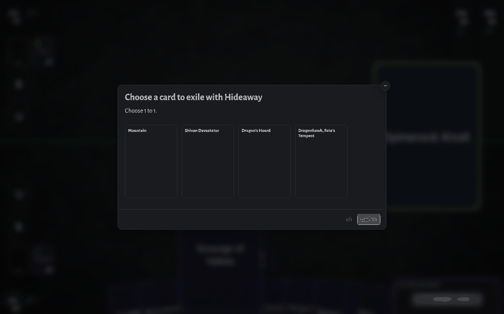
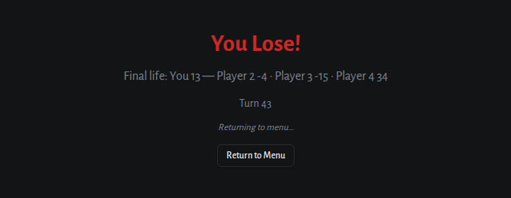
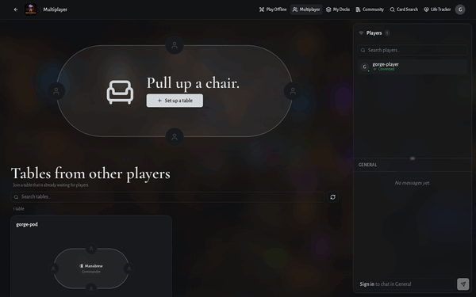

# Play gorge in ManaBrew's client

Play gorge from [ManaBrew](https://docs.manabrew.app/)'s own client (its lobby, deck library, table and bots) with gorge as the rules engine. This page covers the processes involved, a four-seat Commander pod, what changes while you play, dirac, and troubleshooting.

Commands, logs and screenshots are from 2026-11-19: ManaBrew v3.42.7 (commit `0193f13`), its web client in headless Chrome, and gorge with the ManaBrew wire changes of [#1960](https://github.com/adams-shaun/gorge/pull/1960). A gorge from before #1960 refuses every deck the client sends and sends prompts the client cannot read.

## How the pieces fit

ManaBrew has no setting for a remote engine. Its engine runs either in the browser or on a room's
host, and every seat in a multiplayer room talks to that host through ManaBrew's relay. So a gorge
game needs four processes, and a fifth for card art:

| Process | What it does | Where it comes from |
|---|---|---|
| `gorged -manabrew` | Runs the game and serves each seat over the [ManaBrew wire](../api/manabrew.md) (SSE plus POST) | This repository |
| `manabrew-server` | ManaBrew's relay: the lobby, rooms, and the WebSocket every client connects to | ManaBrew |
| `tools/manabrew-bridge/bridge.mjs` | Hosts one relay room; when the game starts it creates it on `gorged` and carries each seat's messages between the relay and `gorged` | This repository |
| The ManaBrew web client | What you play in | ManaBrew |
| `manabrew-hub` | ManaBrew's account and deck service; the web client looks up every card's art through it | ManaBrew |

The bridge is original code under gorge's licence. It speaks ManaBrew's published relay and seat protocols, contains no ManaBrew source, and rewrites nothing inside a message.
[Its README](https://github.com/adams-shaun/gorge/tree/main/tools/manabrew-bridge) lists every setting.
ManaBrew itself is AGPL-3.0 and is not part of gorge: you build it from its own repository.

The ports on this page are `gorged` on 8081, the relay on its default 9443, the hub on 8090 and the
web client on its default 1420. Any free ports work; keep the settings that name them in step.

## 1. Prerequisites

- Go (the version in `go.mod`), and gorge's card corpus: `make fetch-cards` once in a gorge checkout
  ([Install and build](install.md)).
- Node 22 or later, and Yarn 1 (`corepack yarn@1.22.22` works without installing it).
- Rust with `cargo`, for ManaBrew's relay and its in-browser bots, plus the `wasm32-unknown-unknown`
  target and `wasm-pack`:

```sh
rustup target add wasm32-unknown-unknown
cargo install wasm-pack        # or: cargo binstall wasm-pack
```

- A ManaBrew checkout (`git clone https://github.com/witchesofthehill/manabrew`), with its
  JavaScript dependencies:

```sh
cd manabrew
yarn install --frozen-lockfile
```

## 2. Start gorged

From the gorge checkout:

```sh
go run ./cmd/gorged -addr 127.0.0.1:8081 -dir /tmp/gorge-manabrew \
  -manabrew -vsbot -format commander -tables 0 -pace 0 \
  -manabrew-think 10m -prewarm=false
```

```text
gorged: manabrew routes mounted at /api/manabrew/v0/tables/
gorged: 0 tables of 4 on 127.0.0.1:8081 (dir /tmp/gorge-manabrew)
```

- `-manabrew` mounts the ManaBrew routes, and `-vsbot` lets `POST /api/games` create games on demand,
  which is how the bridge starts each one.
- `-format commander` makes the tables Commander pods; `-tables 0` runs no bot-only tables beside them.
- `-pace 0` drops the 50 ms pause after every decision, which only exists to make bot tables watchable.
- `-manabrew-think 10m` gives each seat ten minutes per decision before its caretaker bot answers for
  it. Without it a seat waits forever.
- `-prewarm=false` skips fetching card art for gorge's own browser client, which this setup doesn't use.

Use a `-dir` of your own: two servers sharing one persistence directory corrupt each other.

## 3. Start ManaBrew's relay

From the ManaBrew checkout:

```sh
MANABREW_SERVER_KEY=forge FORGE_HOST=127.0.0.1 yarn dev:relay
```

`yarn dev:relay` is `cargo run --release -p manabrew-server`; the first build takes a few minutes.
The relay listens on `FORGE_PORT` (default 9443) and answers health checks on `FORGE_HEALTH_PORT`
(9444). `MANABREW_SERVER_KEY` is the password every client gives it. These runs used a release binary
built with `cargo build --release -p manabrew-server` and the same variables.

## 4. Start the bridge

From the gorge checkout:

```sh
RELAY=ws://127.0.0.1:9443 RELAY_PASSWORD=forge GORGE=http://127.0.0.1:8081 \
  ROOM_NAME=gorge-pod node tools/manabrew-bridge/bridge.mjs
```

```text
[bridge +0.0s] room "gorge-pod" created (035f6ea8-88aa-421b-8861-1ff05ac4c81d); gorged at http://127.0.0.1:8081
[bridge +0.1s] room Lobby: empty
```

The room stays open; after each game it goes back to the lobby for the next one. One bridge hosts one
room; start another with a different `ROOM_NAME` for a second table.

## 5. Start ManaBrew's hub, for card art

The web client has no card images of its own. For each card gorge sends it asks Scryfall for the
card by name, or by set and collector number when gorge knows the printing, and a client started with `yarn web` sends that request through ManaBrew's hub (its
`/api/scryfall/` route), which is `https://api.manabrew.app` unless you say otherwise. On
2026-11-19 the public hub answered that route with 404, so a client pointed at it shows a blank
frame with the card's name for every card on the table. Run the hub yourself, from the ManaBrew
checkout:

```sh
cargo build --release -p manabrew-hub
mkdir -p /tmp/manabrew-hub
HUB_HOST=127.0.0.1 HUB_PORT=8090 HUB_DB_PATH=/tmp/manabrew-hub/hub.db \
  HUB_PRESET_DECKS_DIR=public/preset_decks ./target/release/manabrew-hub
```

```text
manabrew-hub listening addr=127.0.0.1:8090 db=/tmp/manabrew-hub/hub.db
refreshed Scryfall bulk index path=/tmp/manabrew-hub/scryfall-default-cards.jsonl.gz printings=120210
```

The hub downloads Scryfall's bulk card list (about 80 MB) when it starts, and passes the client's
lookups on to `api.scryfall.com`. The images themselves come straight from `cards.scryfall.io`, so the
browser needs to reach that too. Skip this step and the game still plays; you just play it without
art.

## 6. Start the web client

From the ManaBrew checkout:

```sh
VITE_RELAY_HOST=127.0.0.1 VITE_RELAY_PORT=9443 VITE_RELAY_PASSWORD=forge \
  VITE_HUB_API_URL=http://127.0.0.1:8090 yarn web
```

`yarn web` generates ManaBrew's protocol types, builds its WebAssembly engine if it is out of date,
and serves the client at <http://localhost:1420/>. The `VITE_RELAY_*` variables make your relay the
client's default instead of ManaBrew's public one, and `VITE_HUB_API_URL` sends the client's hub
requests, card lookups among them, to your hub.

!!! note "Not verified here"
    The full `yarn web` also builds ManaBrew's in-browser card archive from the Forge card data in its
    `forge` submodule, which this checkout didn't have. The screenshots come from the same client
    started as `yarn gen:types`, then `wasm-pack build --target web --out-dir src/wasm --out-name wasm
    manabrew-rs/crates/wasm` (the bots' engine, without the card archive), then `npx vite` with the
    same `VITE_*` variables. A table hosted by the bridge needs no card archive: gorge runs the
    rules. ManaBrew's offline games do.

Open <http://localhost:1420/>, accept the terms, and pick a nickname. The other players see it.

## 7. Sit down, choose decks, start

Open **Multiplayer**. The bridge's room is listed under *Tables from other players*:

<figure markdown>

<figcaption>The relay's lobby, with the bridge's room.</figcaption>
</figure>

Press **Join table**. If the room shows the format *Any*, the client asks you to choose one first:
choose **Commander**. You are the first player in, so you are the table's host, and you choose when
the game starts. Press **Choose a deck**. Any Commander deck in the dialog works; the starter decks
are ManaBrew's own precons:

<figure markdown>

<figcaption>Choosing a deck.</figcaption>
</figure>

To fill the other seats with ManaBrew's bots, press **Add a bot** three times and pick a deck for
each. The bots run in your browser, sit at the table as ordinary relay seats, and play through
gorge like everyone else. Friends on the same relay can take seats instead. When every seat is
ready, press **Start game**:

<figure markdown>

<figcaption>Four seats ready. Only the host sees <b>Start game</b>.</figcaption>
</figure>

The bridge logs the start, and the game it made on `gorged`:

```text
[bridge +292.6s] game started: gorge-player@1313, gorge-player-bot-mwncrfhd, gorge-player-bot-mwncrnrx, gorge-player-bot-mwncrscq
[bridge +292.6s] gorged refused the seats' decks (400): {"code":"bad_request","message":"seat 0 deck \"Kaalia of the Vast\": cards the engine cannot play yet: Master of Cruelties (needs kw:CARDNAME can only attack alone.)"}
[bridge +292.6s] playing gorge's own pool decks instead
[bridge +292.6s] gorged table g1 match 1
```

gorge plays every seat's own deck when it can play every card in all of them. When one deck holds a
card gorge doesn't support yet, as Kaalia's did here, `gorged` refuses the decks and the bridge deals
gorge's own pool Commander decks to every seat instead, so the game still starts. Set `POOL_FALLBACK=0`
on the bridge to refuse the game instead. [Coverage](../support/sets.md) says what gorge supports.

## 8. Play

The game opens on the mulligan decision. The board is ManaBrew's own: your side at the bottom, one
opponent's board at the top, and the other players as portraits you can switch to.

<figure markdown>

<figcaption>Turn 1: Keep or Mulligan.</figcaption>
</figure>

Cards you can play are outlined in orange. Click a land to play it; click a spell to cast it, and the
panel at the bottom right asks you to pay. **Auto** pays from your untapped sources; you can also click
the lands yourself:

<figure markdown>

<figcaption>Paying for a spell.</figcaption>
</figure>

Choices open as a dialog. This one is Wood Elves' search of the library for a Forest card:

<figure markdown>

<figcaption>A choice prompt, sent by gorge and drawn by ManaBrew.</figcaption>
</figure>

Mid-game, with an opponent's bot attacking; the panel asks for blockers:

<figure markdown>

<figcaption>Player 2 attacks.</figcaption>
</figure>

What is different from a ManaBrew-hosted game:

- **More priority stops.** gorge gives every player priority in every step and after every change
  to the stack, on every turn, so you are asked to pass far more often than with ManaBrew's engine
  ([why, and how a client skips them](../api/manabrew.md#skipping-to-your-next-turn)). Leave
  **AUTOPASS** on: on other players' turns the client then passes for you. On your own turn,
  **END TURN** passes to the end of the turn, and **NEXT TURN** or **PASS** moves on from a stop the
  client didn't skip. Clicking **AUTOPASS** switches it to **FULL CTRL**, which stops everywhere.
- **The rules are gorge's.** Every legal action, target and payment comes from gorge, and gorge
  refuses an answer it doesn't accept. The bridge logs a refusal as `gorged refused a response`.
- **The bots are ManaBrew's.** A bot added with **Add a bot** is ManaBrew's own AI, running in the
  host's browser. It sees gorge's prompts exactly as you do. gorge's own bots don't sit at these
  tables, except as a seat's caretaker after `-manabrew-think` runs out.
- **Conceding and losing.** **Concede** is in the menu under the gear beside your portrait. A seat
  that concedes or dies can keep observing the table; the bots play on without it, much faster than
  with a human seat stopping at every priority window.
- **Game over.** When one player is left, every seat sees ManaBrew's game-over screen, and the bridge
  logs `game over on turn N; winner player-K` and reports the result to the relay. The bridge then ends
  the relay game, so the screen shows for a moment and the client returns to the lobby, where the
  room is ready for the next game.

<figure markdown>

<figcaption>Game over on turn 43, seen from a seat that had conceded.</figcaption>
</figure>

The screenshots come from one game, lobby to game-over, a frame about every ten seconds. The player passed every turn after the first few and conceded at 13 life; three bots played it out:

<figure markdown>

<figcaption>Turns 1 to 43 in about 40 seconds.</figcaption>
</figure>

## 9. Optional: dirac

`gorged -engine dirac` runs the [dirac engine](dirac.md) behind the same wire. Through the server,
dirac seats two players only today, and it plays only the decks it checked at startup, so every
game uses gorge's pool decks:

```sh
make dirac-tables     # once
go run ./cmd/gorged -addr 127.0.0.1:8082 -dir /tmp/gorge-manabrew-dirac \
  -manabrew -vsbot -engine dirac -seats 2 -tables 0 -pace 0 -manabrew-think 10m -prewarm=false
RELAY=ws://127.0.0.1:9443 GORGE=http://127.0.0.1:8082 SEATS=2 FORMAT=Standard \
  ROOM_NAME=dirac-duel node tools/manabrew-bridge/bridge.mjs
```

```text
[bridge +10.6s] gorged refused the seats' decks (400): {"code":"bad_request","message":"-engine dirac plays only the decks it checked at startup, not a submitted deck: use the gorge engine"}
[bridge +10.6s] playing gorge's own pool decks instead
[bridge +10.6s] gorged table g1 match 1
[bridge +13.8s] game over on turn 22; winner player-1
```

That game was two of ManaBrew's `loadgen` seats (below), not the browser.

### Without a browser: loadgen

ManaBrew's `loadgen` is a headless seat client with ManaBrew's simple AI. A pod of four plays a whole
game with no browser, which is a quick check that a gorge change still speaks the wire. Build it with
`cargo build --release -p loadgen` in the ManaBrew checkout. It reads a deck file
(`{label, format, cards:[{name, count, set, cardNumber}]}`), sends no commander name, and starts the game
as soon as two seats are ready, so give the bridge `GATE=1` and a `COMMANDERS` file:

```sh
GATE=1 ONCE=1 COMMANDERS=commanders.json RELAY=ws://127.0.0.1:9443 GORGE=http://127.0.0.1:8081 \
  ROOM_NAME=smoke TRANSCRIPT=smoke.jsonl node tools/manabrew-bridge/bridge.mjs &
# then, four times, one second apart, each with its own PREFIX and DECK:
RELAY=ws://127.0.0.1:9443 RELAY_PASSWORD=forge ROOM=smoke FORMAT=Commander PREFIX=seat0 AS_BOT=1 \
  DECK=deck0.json DURATION_S=900 ./target/release/loadgen
```

On 2026-11-19 four Foundations Commander decks played to game over on turn 35 in about 15 seconds, with
every deck accepted and no refused response. `loadgen` doesn't notice the end of the game; stop the
seats yourself.

### Checking the wire: wirecheck

`TRANSCRIPT` writes every frame both ways as JSONL. The tool used while making gorge's wire match
ManaBrew, `wirecheck`, reads such a transcript and deserialises each gorge frame with ManaBrew's own
Rust protocol types (`manabrew-protocol`, which ManaBrew's TypeScript types are generated from),
printing one line per kind of frame that fails and the path to the failing field. It links ManaBrew's
AGPL crate, so it is not in this repository; any program that deserialises `state` frames as
`manabrew_protocol::transport::StateUpdate` and `prompt` frames as `AgentPrompt` does the same check.

## 10. Troubleshooting

**Cards show only their names, on blank frames.** The client could not look the cards up. Check that
the hub of step 5 is running and that the client was started with `VITE_HUB_API_URL` pointing at it;
the browser's console shows the failing `/hub-api/api/scryfall/` requests. ManaBrew's public hub
answers them with 404.

**The room isn't in the lobby.** Check the client's relay: the Players list shows who is connected, so
if you are alone and the bridge's room is missing, the client is probably on ManaBrew's public relay.
Restart `yarn web` with the `VITE_RELAY_*` variables. The bridge prints `relay refused the sign-in`
when `RELAY_PASSWORD` doesn't match the relay's `MANABREW_SERVER_KEY`.

**A port is taken.** `ss -lptn` lists the listeners. The web client's 1420 is fixed by ManaBrew's
`vite.config.ts` (`strictPort`), so free it rather than moving it; move `gorged` with `-addr` and the
relay with `FORGE_PORT`, and update `GORGE` and `RELAY` on the bridge to match.

**The game starts with decks you didn't choose.** That is the pool fallback: the bridge's log has the
reason, usually a card gorge can't play yet (`cards the engine cannot play yet: …`). A message such
as `seat 0 deck is not a ManaBrew deck: json: cannot unmarshal string into … color` means a `gorged`
from before #1960; rebuild it.

**Start game does nothing.** The bridge's log shows `could not start the game on gorged` with the
reason when `POST /api/games` fails; check that `gorged` runs with `-manabrew -vsbot` at the bridge's
`GORGE` address. In a Commander room the client needs two seats before it offers **Start game**.

**A prompt doesn't show.** The bridge logs each refused answer and every `gorge error`. Pass the
seat's stops with **PASS** or **END TURN**, check that **AUTOPASS** isn't **FULL CTRL**, and look at
the frames with `TRANSCRIPT`: the prompt gorge sent is a `gorge->bridge[player-N]` line with
`"kind":"prompt"`. If gorge sent it and the client shows nothing, the client could not read it; that is
a wire bug to file against gorge with the frame attached.

**A resolved ability stays in the stack panel.** In an earlier run for this page the client kept showing
Orb of Dragonkind's ability after it had resolved, while gorge's `gameView.stack` was empty. Its cause
was not tracked down; it doesn't affect play.

**A seat that conceded reads "You Lose!".** In the run behind the last screenshot the conceding seat
got ManaBrew's "You Lose!" heading rather than its "You conceded" one; the client picks the heading
from the seat's status in the final state.

**The game ends but a seat stays on the board.** The bridge ends the relay game once every seat's
stream has reported game over. If a seat's stream dropped, stop the bridge with Ctrl-C and start it
again; the room is recreated.
