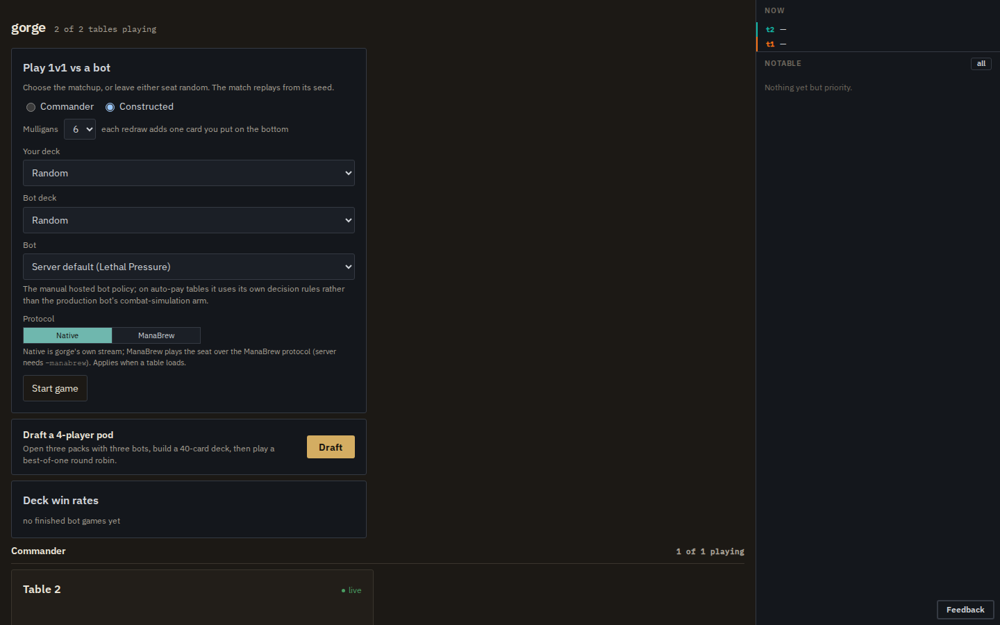

# Play in the browser

Play against gorge's bots or friends in a browser. You need the corpus and the built client from [Install and build](install.md). Command output below is from 2026-11-02; the screenshots are from 2026-10-20.

## Play against a bot

```sh
go run ./cmd/gorged -addr 127.0.0.1:8080 -dir /tmp/gorge-play \
  -feedback /tmp/gorge-play-feedback -vsbot
```

```text
gorged: 4 tables of 4 on 127.0.0.1:8080 (dir /tmp/gorge-play)
```

Leave it running; Ctrl-C stops it. Open <http://127.0.0.1:8080/>. The lobby lists the bot-only tables and, because of `-vsbot`, a **Play 1v1 vs a bot** panel:

<figure markdown>

<figcaption>The lobby at <code>/</code>.</figcaption>
</figure>

Pick a format, your deck, the bot's deck (or leave either on *Random*) and a bot, then press
**Start game**. The server makes a private table and returns a seat token, the browser moves
to that table's join URL, `/t/g1?seat=0&token=…`, and the game starts with the mulligan
decision.

Pick a format, your deck, the bot's deck (or *Random*) and a bot, then **Start game**. The server makes a private table and returns a seat token. The browser opens `/t/g1?seat=0&token=…` and the game starts at the mulligan.

- `-vsbot` arms the panel. Without it the server is spectator-only.
- `-addr 127.0.0.1:8080` listens on loopback only. The default `:8080` is every interface ([On a network](#on-a-network)).
- `-dir` is the persistence directory; give each server its own ([why](#persistence-and-restarts)).
- `-feedback` is where bug reports go (default `feedback/` in the current directory).

Card images come from [Scryfall](https://scryfall.com), cached under `<dir>/art` or `-art-dir`. Startup fills the cache for every dealt deck at a limited rate. `art: named lookup …: 429, retrying` means Scryfall asked it to slow down; missing art never blocks a game. `-prewarm=false` makes no outbound requests until a page asks.

## The table

<figure markdown>

<figcaption>Your seat at <code>/t/g1?seat=0&amp;token=…</code> on turn 1, before any art was cached.</figcaption>
</figure>

| Region | What it does |
|---|---|
| Seat headers | name, life, hand, library and graveyard counts; graveyard and exile open on click |
| Centre strip | the turn and the phase track (click a step to set a stop there), the **AUTO** (auto-pass), **AUTO MANA** (pay with a suggested plan when casting), **ACTIONS** (every option on offer) and **DONE** (submit a multi-pick) buttons; drag it to resize the opponents' share of the screen |
| Hand | cards rise on hover; a card with something on offer has a coloured ring and a **CAST** or **PLAY** button. Battlefield cards offer their abilities the same way |
| Action cluster | the big button says what passing will do (*Pass — Move to Draw*); above it **Undo**, **Resolve all** while the stack is live, and **End turn** or **Until my turn** |
| Rail | players, the stack (with per-card "always pass" yields), the pending decision, the game log, and **Restart**, **Concede**, **Options** |
| Prompt dock | targets, modes, attackers and blockers, scry and surveil arrangement, discard, library search, naming a card, and the mana payment panel when you pay by hand |

Attack and block by clicking creatures; the dock offers *Attack with all*, *No attack* and *No blocks*. **Restart** starts a new game with the same decks and bot and a fresh seed.

Default keys: Space passes, Enter ends the turn, Shift+Enter skips the rest of it, Esc stops a run of passes, Ctrl+Shift+Z undoes, `1`-`9` pick an option, Shift+A attacks with all, Shift+N declares no blocks, Shift+P auto-pays. `?` lists every key; **Options → Keymap** rebinds them (source: `web/src/lib/keymap.ts`). Every control is covered in [Gameplay options](../web/gameplay.md).

**Options** sets how much the client passes for you (presets *Casual*, the default, *No tells* and *Full control*, per-step stops, trigger ordering, step delay) and the board layout ([Table layouts](../web/layouts.md)). Settings live in your browser's local storage.

The **Protocol** switch, in the lobby and in Options, picks how a seat talks to the server: *Native* (gorge's own stream), *ManaBrew* or *SpellBench v2* ([Wires](../architecture/wires.md)). ManaBrew needs `-manabrew` and SpellBench v2 needs `-sbv2`. A wire the server doesn't offer is disabled, and the table plays over Native.

- **ManaBrew:** same game and prompts. The protocol has no event log and no payment plans, so the log holds only what the page has seen and starts empty after a reload, Auto-pay taps through the mana window's Auto-fill, and the window doesn't mark which sources it would tap. **Auto-pass when all I could do is make mana** (default on) skips priority stops ManaBrew's own engine never poses.
- **SpellBench v2:** same game and prompts, two players only; a Commander table or one with more seats plays over Native, with no warning. The board moves when you're asked something. CAST always pays with the suggested plan, so there is no **Auto-pay** switch or mana window (to pay another way, or an X above 0, tap lands first). A land that makes any colour gives the first one. The server answers triggered costs and combat damage division. The log starts empty after a reload and an undo leaves the undone lines in it.

### Mulligans and mana

A play-vs-bot game takes its London mulligan allowance from the lobby (0 to 6; the panel defaults to 6). Startup tables use `-mulligans` (default 7; 0 skips the pregame round).

Human seats get **automatic mana payment plans** (`-auto-mana`, on by default): CAST pays with a suggested plan, and the ACTIONS menu and payment panel let you tap by hand. Bots use the same plans (`-bot-auto-mana`).

### Undo

Undo rolls the live match back to the decision you last answered; repeat to walk back one action at a time, and the bots re-decide from there.

- Refused at a table with more than one human.
- The rewind replays the same seed, so a shuffle you undo past comes back in the same order and you can learn your next draws.

### Spectating

Anyone who opens a table without a seat token is a spectator, with a transport to scrub back through the match. Each finished match has a frozen replay at `/t/<table>/m/<k>` ([Replays](replays.md)).

| Flag | Default | Applies to |
|---|---|---|
| `-spectator public\|omniscient` | `public` (hands hidden) | startup tables `t1`…`tN`, including a `-humans` table |
| `-vsbot-spectator public\|omniscient` | `public` | play-vs-bot tables |

## Play against other people

A human or mixed game uses startup table `t1`; `-humans` names which of its seats are people and the rest are bots.

```sh
go run ./cmd/gorged -addr 127.0.0.1:8080 -dir /tmp/gorge-pvp -feedback /tmp/gorge-play-feedback \
  -tables 1 -seats 2 -humans 0,1 -prewarm=false
```

```text
gorged: 1 tables of 2 on 127.0.0.1:8080 (dir /tmp/gorge-pvp)
gorged: table t1 seat 0 joins at http://127.0.0.1:8080/t/t1?seat=0&token=355b74faa5e846cd7071dc95e1cff758
gorged: table t1 seat 1 joins at http://127.0.0.1:8080/t/t1?seat=1&token=9579ac2e8bcbdd267ded59a62195d63e
```

Send each player their own line. A token is random per start, grants one seat at one table, and is the only credential. `-seat-token devtoken` (local use only) fixes seat 0's token to `devtoken` and each later human seat's to `devtoken-<seat>`.

- One browser tab plays one seat, chosen by the URL. To play both seats on one machine, open each join URL in its own tab.
- `-humans` applies to `t1` only and makes it single-match rather than perpetual.
- Other seats are bots using `-bot-policy`. Two people and two bots in a Commander pod: `-format commander -seats 4 -humans 0,1`.
- There is no turn clock.
- `-spectator omniscient` shows every hand to anyone who opens `/t/t1` without a token. Don't use it with people at the table.

For a draft instead of a single game, see [Draft events](draft.md).

## Tables, formats, decks and seats

`gorged` runs `-tables` perpetual bot-only tables beside any play-vs-bot games; they are the lobby's "watch the bots" half, and the deck win-rate board is computed from their finished games. The flags that shape them (`-tables`, `-seats`, `-format`, `-commander-seats`, `-seed`, `-pace`, `-cooldown`, `-perpetual`, `-mulligans`, `-decks`, `-max-on-demand-tables`) are in [gorged flags](../web/flags.md). Worth knowing:

- `-tables 0` runs only play-vs-bot games and events. Play-vs-bot tables are always two seats, one human and one bot.
- `-format` is a comma-separated list; table *i* takes `formats[(i-1) mod n]`.
- Table *i* uses seed `-seed + i - 1`; match *k* of a table derives its seed from that.
- `-pace 0` is flat out; `1.5s` is watchable.

### Decks

`GET /api/decks` lists the decks with format, archetype and commander. The built-in directory is `testkit/testutil/decks`. A file that names a commander is a Commander deck and everything else is constructed. Each Commander deck is validated at startup, and a card the corpus can't resolve stops the server before it listens. (Count them with `ls testkit/testutil/decks`; the pool changes.)

`cmd/deckimport` converts a plain-text decklist, the usual export format with one card per line and the
count first, into a deck file. It drops the sideboard, turns a Commander section into the `commander` field
and reports any card the corpus lacks. Save a list as `/tmp/burn.txt`:

```text
4 Lightning Bolt
4 Chain Lightning
4 Lava Spike
4 Rift Bolt
4 Monastery Swiftspear
4 Goblin Guide
4 Eidolon of the Great Revel
4 Skullcrack
4 Searing Blaze
4 Light Up the Stage
20 Mountain

Sideboard
2 Smash to Smithereens
```

Then convert it:

```sh
mkdir -p /tmp/mydecks
go run ./cmd/deckimport -in /tmp/burn.txt -out /tmp/mydecks/my-burn.json -name "My Burn" -archetype burn
```

```text
== My Burn (custom) ==
cards:   60   resolved: 60   (100.0%)
sideboard cards dropped: 2
all cards present in corpus
written: /tmp/mydecks/my-burn.json
```

The command exits non-zero if the corpus lacks a card, and `-force` writes the file anyway.

`-decks` replaces the built-in pool, so copy the built-in files in too if you want both:

```sh
cp testkit/testutil/decks/*.json /tmp/mydecks/
go run ./cmd/gorged -addr 127.0.0.1:8080 -dir /tmp/gorge-mine -feedback /tmp/gorge-play-feedback \
  -decks /tmp/mydecks -tables 0 -vsbot
```

The new deck shows in the lobby's pickers under its `-name`. "Present in corpus" means every card has
a Forge script, not that gorge implements every ability on it: [Card support](../support/sets.md) says
what is supported.

## Bots at the table

Every bot seat runs a registered **policy**, a named strategy ([the list](../bots/catalogue.md#the-six-registered-bots)), inside the `gorged` process, deterministically from the match seed. The flags are in [gorged flags](../web/flags.md): `-bot-policy` (default for startup tables and for a play-vs-bot game that names none), `-bot-policies` (the set the lobby offers), `-bot-common-sense`, `-bot-search-slots`, `-bot-search-parallelism`, `-max-search-tables` and `-sb-agent name=/path` ([SpellBench v2 agents](../bots/spellbench.md)). Search policies queue when slots are busy and never play worse for it.

`sb-tactical` and `az-redeal` read every seat's real decklist, so a server never seats them against a person; naming one in `-bot-policies` is refused at startup ([message](troubleshooting.md#a-flag-is-refused-at-startup)).

Per-policy options use `-bot-opt <policy>.<key>=<value>`, the environment variable `GORGED_BOT_<POLICY>_<KEY>` or `-bot-config <policy>=<file.json>`, highest precedence first. `gorged -h` lists each policy's options.

## A paired bot

A server can seat a bot beside you that weighs each of your decisions as it arrives ([Play with a bot beside you](../web/paired-play.md) covers what you see and what it can't). It only advises. It is off by default; start the server with `-paired-bot az-closed`.

| Flag | Default | Meaning |
|---|---|---|
| `-paired-bot NAME` | off | the default paired bot: `az-closed` (needs no trained network) or a closed-list search policy linked into the binary |
| `-paired-bot-sims N` | 100 | simulations per request (`az-closed`) |
| `-paired-bot-decks DIR` | the server's decks | decks it guesses an opponent's list from (`az-closed`) |
| `-paired-bot-searches N` | 2 | searches at once across the server; others wait |
| `-paired-bot-shared` | off | also offer it on `t1` when it seats more than one human |
| `-pod-bot-decks DIR` | off | registers `az-closed-maxn`, the search for Commander pods of up to four seats |
| `-pod-bot-sims N` | 64 | simulations per searched decision (`az-closed-maxn`) |

`az-closed` plays two-seat constructed games. A table that leaves the paired bot at the default gets the first offered bot that plays its format at its seat count, so with `-pod-bot-decks` a four-seat Commander pod gets `az-closed-maxn`. That bot also seats as a pod's bot opponent: `-events-bot-policy az-closed-maxn` makes it the draft events' default. Its belief should be decks like the pod's own; `make pod-bot-decks` writes one from a Commander draft simulation. Nobody else at the table sees the advice, and it never reaches the log or a replay. It runs on the gorge engine only.

## Persistence and restarts

`-dir` (default `gorged-data`) holds `tables.json` and every match's event log. On restart the server
resumes what is in the directory:

- If `tables.json` already has tables, the flags that shape tables (`-tables`, `-seats`, `-format`, …) are
  ignored, though the startup line prints the new seat count.
- A directory written by an older binary resumes with every field that binary didn't know set to its zero
  value. The zero `Format` is `constructed`, a real value, so nothing tells you a `-format` was dropped.
- Play-vs-bot games are dropped, because their tokens lived only in the process. Their logs stay under
  `<dir>/g<N>` and their ids are never reused.

!!! danger "One persistence directory per server"
    Two servers sharing one `-dir` silently corrupt each other's matches. Give every server its own
    directory, and start from an empty one whenever you change table flags or upgrade the binary.

## Reporting a bug from a game

The **Feedback** button, bottom right of every page, sends your description, an optional screenshot and
some client diagnostics to `POST /api/feedback`. The server writes the report under `-feedback`, separate
from `-dir` so wiping state never loses a report. When the report came from a table, it also snapshots the
match:

```text
/tmp/gorge-play-feedback/20261020T173634Z-f0256b83/
  report.json   the text, the page URL, the table and seat
  match.json    the table config and the deck contents
  log.json      the event log at the moment of the report
  view.json     the reporting seat's own redacted view
```

That snapshot replays exactly. `cmd/repro` rebuilds the game and prints the board at the report point:

```sh
go run ./cmd/repro /tmp/gorge-play-feedback/20261020T173634Z-f0256b83
```

```text
== feedback report 20261020T173634Z-f0256b83 (table g1, match 1) ==
snapshot: captured: match.json log.json view.json
replayed 4 of 4 recorded intents (34 events); recorded head 7f24e17580718ec6
turn 1, round 1, beginning (step upkeep) — active: seat 1, priority: seat 0
seat 0 You: life 20, library 53, hand 7, graveyard 0, exile 0
seat 1 Bot: life 20, library 53, hand 7, graveyard 0, exile 0
pending: seat 0 priority: turn 1, upkeep — You have priority (2 options)
```

`-list` prints the timeline of recorded answers, `-at N` stops at answer N, `-omniscient` shows every hand,
and `-emit-test <pkg>` turns the snapshot into a failing Go test skeleton. Exit status 0 means the replay
matched the recording event for event. [Troubleshooting](troubleshooting.md#repro-prints-diverged) explains a
`DIVERGED` result, and `gorged review` serves a snapshot in the browser ([Replays](replays.md#review-a-saved-game)).

## On a network

To let other machines connect, listen on a reachable address such as the default `:8080`. The join lines print `127.0.0.1`; replace it with the machine's LAN address.

`gorged` has **no login, no TLS and no rate limiting**. The per-seat token in a join URL is the only credential. Anyone who can reach the port can:

- list and watch every startup table (hands hidden unless `-spectator omniscient`);
- start play-vs-bot games up to `-max-on-demand-tables`, spending your CPU;
- create draft events up to `-max-events`, if `-events` is on;
- submit feedback reports, written to your disk, capped at 12 MiB each (`maxFeedbackBytes` in `server/gorged/feedback.go`).

A seat token travels in the URL query string, so it lands in browser history and proxy logs. Feedback reports strip it from the page URL, but a join URL is itself a credential.

Beyond a trusted LAN, keep `gorged` on loopback behind something that adds authentication and TLS, such as an SSH tunnel or a reverse proxy with a login. `-pprof` is refused unless the listener is loopback, and a proxy in front of it would expose it anyway.

## Every flag

[gorged flags](../web/flags.md) lists every startup flag, generated from the flag definitions; `go run ./cmd/gorged -h` prints the same list.

Everything the browser does goes through the [HTTP API](../api/http.md), so you can drive or inspect a server
with `curl`.
