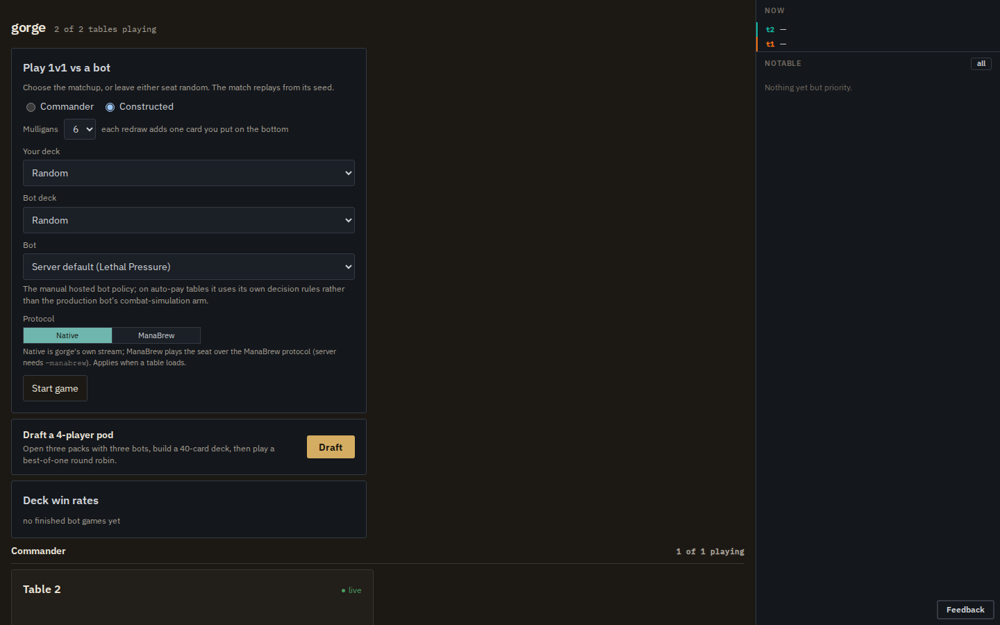

# Play in the browser

This page is for people who want to play against gorge's bots, against friends, or both, in
a browser. It covers starting `gorged`, what each screen does, the flags that shape tables,
decks and bots, filing a bug report from a game, and what you are exposed to on a network.
You need the corpus and the browser client from [Install and build](install.md); the client
has to be built before `gorged` is.

The commands and responses are from 2026-10-31, and the screenshots from 2026-10-20. The
client's behaviour was checked against its source in `web/src`.

## Play against a bot

```sh
go run ./cmd/gorged -addr 127.0.0.1:8080 -dir /tmp/gorge-play \
  -feedback /tmp/gorge-play-feedback -vsbot
```

```text
gorged: 4 tables of 4 on 127.0.0.1:8080 (dir /tmp/gorge-play)
gorged: art prewarm: 1124 distinct card names from testkit/testutil/decks
```

Leave it running; Ctrl-C stops it. Open <http://127.0.0.1:8080/>. The lobby lists the bot-only
tables the server is running and, because of `-vsbot`, a **Play 1v1 vs a bot** panel:

<figure markdown>

<figcaption>The lobby at <code>/</code>.</figcaption>
</figure>

Pick a format, your deck, the bot's deck (or leave either on *Random*) and a bot, then press
**Start game**. The server makes a private table and returns a seat token, the browser moves
to that table's join URL, `/t/g1?seat=0&token=…`, and the game starts with the mulligan
decision.

The flags in that command:

- `-vsbot` arms the panel. Without it the server is spectator-only: you can watch bot tables,
  but nothing can sit down.
- `-addr 127.0.0.1:8080` listens on loopback only. Without the flag `gorged` listens on `:8080`,
  every interface; see [On a network](#on-a-network).
- `-dir` is the persistence directory. Give each server its own
  ([why](#persistence-and-restarts)).
- `-feedback` is where bug reports go. The default is `feedback/` in the current directory, which
  is gitignored at the root of a checkout.

The server fetches card images from [Scryfall](https://scryfall.com) and caches them under
`<dir>/art`, or under `-art-dir` if you set it. At startup it fills that cache in the
background for every card in every deck, at a limited rate. A line such as
`art: named lookup Amulet of Vigor: 429, retrying in 1m0s` means Scryfall asked it to slow down;
it backs off, and missing art never blocks a game. `-prewarm=false` makes no outbound requests
until a page asks for an image.

## The table

<figure markdown>

<figcaption>Your seat at <code>/t/g1?seat=0&amp;token=…</code> on turn 1, before any art was cached.</figcaption>
</figure>

| Region | What it does |
|---|---|
| Seat headers | name, life, hand, library and graveyard counts; graveyard and exile open on click |
| Centre strip | the turn and the phase track (click a step to set a stop there), the **AUTO** (auto-pass), **AUTO MANA** (pay with a suggested plan when casting), **ACTIONS** (every option on offer) and **DONE** (submit a multi-pick) buttons; drag it to resize the opponents' share of the screen |
| Hand | cards rise on hover; a card with something on offer has a coloured ring and a **CAST** or **PLAY** button. Battlefield cards offer their abilities the same way |
| Action cluster | the big button says what passing will do (*Pass — Move to Draw*); above it **Undo**, **Resolve all** while the stack is live, and **End turn** or **Until my turn** |
| Rail | players, the stack (with per-card "always pass" yields), the pending decision, the game log, and **Restart**, **Concede**, **Options** |
| Prompt dock | targets, modes, attackers and blockers, scry and surveil arrangement, discard, library search, naming a card, and the mana payment panel when you pay by hand |

Attacks and blocks are made by clicking creatures on the board; the dock offers *Attack with
all*, *No attack* and *No blocks*. **Restart** starts a new game with the same decks and bot and
a fresh seed.

The default keys, which **Options → Keymap** rebinds and `?` lists:

| Key | Action | Key | Action |
|---|---|---|---|
| Space | pass priority once | `1`–`9` | pick option N |
| Enter | end turn | Shift+A | attack with all |
| Shift+Enter | skip the rest of the turn | Shift+N | no blocks |
| Esc | stop a run of passes | Shift+P | auto-pay |
| Ctrl+Shift+Z | undo | `L` | show or hide the log |
| Ctrl+Shift+O | options | `Z` | zoom the card under the pointer |
| `G`, `X` | graveyard or exile of the seat under the pointer | `S` | stack identical permanents |

**Options** sets how much the client passes for you: presets (*Casual*, the default; *No tells*;
*Full control*), which opponent actions stop you, a per-step stop grid for each player's turn,
trigger auto-ordering, a step delay and the board layout. Settings live in your browser's local
storage.

The lobby's **Protocol** switch chooses how a seat talks to the server: *Native*, gorge's own
stream, or *ManaBrew*, which needs a server started with `-manabrew`
([Wires](../architecture/wires.md)). Leave it on *Native* unless you're testing that wire.

### Mulligans and mana

A play-vs-bot game takes its London mulligan allowance from the lobby (0 to 6; the panel defaults
to 6). Startup tables use `-mulligans` (default 1; 0 skips the pregame round).

The server offers **automatic mana payment plans** to human seats (`-auto-mana`, on by default):
CAST pays with a suggested plan, and the ACTIONS menu and the payment panel let you tap by hand
instead. Bots use the same plans (`-bot-auto-mana`, on by default).

### Undo

Undo rolls the live match back to the decision you last answered, so pressing it repeatedly walks
back one of your actions at a time. The bots then re-decide from there.

- Undo is refused at a table with more than one human, because the other player can't be asked.
- The rewind replays the same seed, so a shuffle you undo past comes back in the same order, and
  you can then know your next draws. Reseeding would break replay.

### Spectating

Anyone who opens a table without a seat token is a spectator, with a transport to scrub back
through the match and the log open by default. Each finished match has a frozen replay at
`/t/<table>/m/<k>`. [Replays](replays.md) covers both.

How much a spectator sees is the server's choice:

| Flag | Default | Applies to |
|---|---|---|
| `-spectator public\|omniscient` | `public` (hands hidden) | the startup tables `t1`…`tN`, including a `-humans` table |
| `-vsbot-spectator public\|omniscient` | `public` (hands hidden) | the play-vs-bot tables |

## Play against other people

A human or mixed game uses table `t1` of the startup tables. `-humans` names which of its seats
are people, and the rest are bots.

```sh
go run ./cmd/gorged -addr 127.0.0.1:8080 -dir /tmp/gorge-pvp -feedback /tmp/gorge-play-feedback \
  -tables 1 -seats 2 -humans 0,1 -prewarm=false
```

```text
gorged: 1 tables of 2 on 127.0.0.1:8080 (dir /tmp/gorge-pvp)
gorged: table t1 seat 0 joins at http://127.0.0.1:8080/t/t1?seat=0&token=355b74faa5e846cd7071dc95e1cff758
gorged: table t1 seat 1 joins at http://127.0.0.1:8080/t/t1?seat=1&token=9579ac2e8bcbdd267ded59a62195d63e
```

Send each player their own line. A token is random per start, grants one seat at one table, and is
the only credential there is. For local testing, `-seat-token devtoken` fixes seat 0's token to
`devtoken` and the next human seat's to `devtoken-1`.

- **One browser tab plays one seat.** The seat comes from the URL when the page loads. To play both
  seats on one machine, open each join URL in its own tab.
- `-humans` applies to `t1` only, and makes it single-match rather than perpetual.
- Seats `-humans` doesn't name are bots, using `-bot-policy`. A four-seat Commander pod with two people
  and two bots is `-format commander -seats 4 -humans 0,1`.
- There is no turn clock: a human seat waits for its answer indefinitely.
- `-spectator omniscient` shows every hand to anyone who opens `/t/t1` without a token, including a
  player in a second tab. Don't use it on a table with people at it.

For a draft instead of a single game, see [Draft events](draft.md).

## Tables, formats, decks and seats

`gorged` runs `-tables` perpetual bot-only tables alongside any play-vs-bot games. They are the
"watch the bots play" half of the lobby, and the deck win-rate board is computed from their finished
games.

| Flag | Default | Meaning |
|---|---|---|
| `-tables N` | 4 | startup tables; `0` runs only play-vs-bot games and events |
| `-seats N` | 4 | seats per table, 1 to 8 |
| `-format list` | `constructed` | comma-separated `constructed`, `commander`; table *i* takes `formats[(i-1) mod n]` |
| `-commander-seats N` | 0 (= `-seats`) | seat count of the commander tables only |
| `-seed S` | 1 | seed of `t1`; table *i* uses `S+i-1`, and match *k* of a table derives its seed from that |
| `-pace D` | 50ms | sleep after every decision on bot tables; `0` is flat out, `1.5s` is watchable |
| `-cooldown D` | 5s | pause between matches on a perpetual table |
| `-perpetual` | true | start a new match when one ends |
| `-mulligans N` | 1 | London mulligans per player before turn 1 |
| `-decks dir` | `testkit/testutil/decks` | the deck JSON files every table and the lobby deal from |
| `-max-on-demand-tables N` | 32 | how many play-vs-bot tables the process keeps; these are always two seats, one human and one bot |

### Decks

The built-in directory holds 15 sixty-card constructed decks and 15 Commander decks;
`GET /api/decks` lists them with format, archetype and commander. The server splits whatever directory
you give it into two pools by one rule: a file that names a commander is a Commander deck, everything
else is constructed. Each Commander deck is validated at startup, and a card the corpus can't resolve
stops the server before it listens.

`cmd/deckimport` converts a plain-text decklist, the usual export format with one card per line and the
count first, into a deck file. It drops the sideboard, turns a Commander section into the `commander` field
and reports any card the corpus lacks. Save a list as `/tmp/burn.txt`:

```text
4 Lightning Bolt
4 Chain Lightning
4 Lava Spike
4 Rift Bolt
4 Monastery Swiftspear
4 Goblin Guide
4 Eidolon of the Great Revel
4 Skullcrack
4 Searing Blaze
4 Light Up the Stage
20 Mountain

Sideboard
2 Smash to Smithereens
```

Then convert it:

```sh
mkdir -p /tmp/mydecks
go run ./cmd/deckimport -in /tmp/burn.txt -out /tmp/mydecks/my-burn.json -name "My Burn" -archetype burn
```

```text
== My Burn (custom) ==
cards:   60   resolved: 60   (100.0%)
sideboard cards dropped: 2
all cards present in corpus
written: /tmp/mydecks/my-burn.json
```

The command exits non-zero if the corpus lacks a card, and `-force` writes the file anyway.

`-decks` replaces the built-in pool, so copy the built-in files in too if you want both:

```sh
cp testkit/testutil/decks/*.json /tmp/mydecks/
go run ./cmd/gorged -addr 127.0.0.1:8080 -dir /tmp/gorge-mine -feedback /tmp/gorge-play-feedback \
  -decks /tmp/mydecks -tables 0 -vsbot
```

The new deck shows in the lobby's pickers under its `-name`. "Present in corpus" means every card has
a Forge script, not that gorge implements every ability on it: [Card support](../support/sets.md) says
what is supported.

## Bots at the table

Every bot seat runs a registered **policy**, a named bot strategy
([the list](../bots/index.md#the-bots-gorge-ships)). Policies run inside the `gorged` process,
deterministically from the match seed.

| Flag | Default | Meaning |
|---|---|---|
| `-bot-policy name` | `lethal-pressure` | the policy of every bot seat on the startup tables, and of a play-vs-bot game that names none |
| `-bot-policies a,b,…` | empty = all eligible | the set the lobby offers |
| `-bot-common-sense` | off | a guard that drops removal aimed only at the bot's own permanents and answers the mulligan with the constructed rule |
| `-bot-search-slots N` | GOMAXPROCS/2 | concurrent searched decisions across the process; search policies queue, and never play worse for it |
| `-bot-search-parallelism N` | 1 | goroutines within one searched decision |
| `-max-search-tables N` | 8 | live play-vs-bot tables whose bot is a search policy |
| `-sb-agent name=/path` | | register an external stdio bot as a policy ([SpellBench v2 agents](../bots/spellbench.md)) |

`sb-tactical` and `az-redeal` read every seat's real decklist, so a server never seats them against a
person, and naming one in `-bot-policies` is refused at startup
([message](troubleshooting.md#a-flag-is-refused-at-startup)).

Per-policy options use `-bot-opt <policy>.<key>=<value>`, the environment variable
`GORGED_BOT_<POLICY>_<KEY>` or `-bot-config <policy>=<file.json>`, highest precedence first. Only `forge-heuristic`
declares an option, `hold-instant`, a bool that defaults to `false`; `forge-heuristic-hold` is that policy
with it armed.

## Persistence and restarts

`-dir` (default `gorged-data`) holds `tables.json` and every match's event log. On restart the server
resumes what is in the directory:

- If `tables.json` already has tables, the flags that shape tables (`-tables`, `-seats`, `-format`, …) are
  ignored, though the startup line prints the new seat count.
- A directory written by an older binary resumes with every field that binary didn't know set to its zero
  value. The zero `Format` is `constructed`, a real value, so nothing tells you a `-format` was dropped.
- Play-vs-bot games are dropped, because their tokens lived only in the process. Their logs stay under
  `<dir>/g<N>` and their ids are never reused.

!!! danger "One persistence directory per server"
    Two servers sharing one `-dir` silently corrupt each other's matches. Give every server its own
    directory, and start from an empty one whenever you change table flags or upgrade the binary.

## Reporting a bug from a game

The **Feedback** button, bottom right of every page, sends your description, an optional screenshot and
some client diagnostics to `POST /api/feedback`. The server writes the report under `-feedback`, separate
from `-dir` so wiping state never loses a report. When the report came from a table, it also snapshots the
match:

```text
/tmp/gorge-play-feedback/20261020T173634Z-f0256b83/
  report.json   the text, the page URL, the table and seat
  match.json    the table config and the deck contents
  log.json      the event log at the moment of the report
  view.json     the reporting seat's own redacted view
```

That snapshot replays exactly. `cmd/repro` rebuilds the game and prints the board at the report point:

```sh
go run ./cmd/repro /tmp/gorge-play-feedback/20261020T173634Z-f0256b83
```

```text
== feedback report 20261020T173634Z-f0256b83 (table g1, match 1) ==
snapshot: captured: match.json log.json view.json
replayed 4 of 4 recorded intents (34 events); recorded head 7f24e17580718ec6
turn 1, round 1, beginning (step upkeep) — active: seat 1, priority: seat 0
seat 0 You: life 20, library 53, hand 7, graveyard 0, exile 0
seat 1 Bot: life 20, library 53, hand 7, graveyard 0, exile 0
pending: seat 0 priority: turn 1, upkeep — You has priority (2 options)
```

`-list` prints the timeline of recorded answers, `-at N` stops at answer N, `-omniscient` shows every hand,
and `-emit-test <pkg>` turns the snapshot into a failing Go test skeleton. Exit status 0 means the replay
matched the recording event for event. [Troubleshooting](troubleshooting.md#repro-prints-diverged) explains a
`DIVERGED` result, and `gorged review` serves a snapshot in the browser ([Replays](replays.md#review-a-saved-game)).

## On a network

To let other machines connect, listen on a reachable address, such as the default `:8080`. The join lines the
server prints say `127.0.0.1`; replace that with the machine's LAN address when you send them.

`gorged` has **no login, no TLS and no rate limiting**. The only credential is the per-seat token in a join
URL. Anyone who can reach the port can:

- list and watch every startup table, with hands hidden unless you pass `-spectator omniscient`;
- start play-vs-bot games up to `-max-on-demand-tables`, and so spend your CPU;
- create draft events up to `-max-events`, if you pass `-events`;
- submit feedback reports, which are written to your disk, size-capped at 12 MiB each.

A seat token travels in the URL query string, so it ends up in browser history and in any proxy's access log.
Feedback reports strip it from the page URL before storing it, but a join URL is itself a credential.

Beyond a trusted LAN, keep `gorged` on loopback and put it behind something that adds authentication and TLS,
such as an SSH tunnel or a reverse proxy with a login. `-pprof` (runtime profiles) is refused unless the
listener is loopback, and a proxy in front of it would expose it anyway.

## Other flags

`go run ./cmd/gorged -h` prints every flag with its default. Those not covered above:

| Flag | Meaning |
|---|---|
| `-events`, `-max-events` | host [draft events](draft.md) |
| `-manabrew`, `-manabrew-addr`, `-manabrew-think` | serve the ManaBrew wire, on the main listener or a separate address, with an optional human-seat think timeout |
| `-sbv2` | serve SpellBench v2 seats over HTTP ([SpellBench v2](../api/spellbench-v2.md)) |
| `-engine` | the engine tables run on; a plain build links only `gorge` |
| `-prewarm-art-only`, `-prewarm-art-budget`, `-prewarm-art-max-consecutive-failures` | fill the art cache and exit, with optional limits |
| `-allow-decklist-bots` | lets a binary that links a trained-network bot run one that reads opponents' deck lists, on its bot-only table. A plain `gorged` links none |

Everything the browser does goes through the [HTTP API](../api/http.md), so you can drive or inspect a server
with `curl`.
