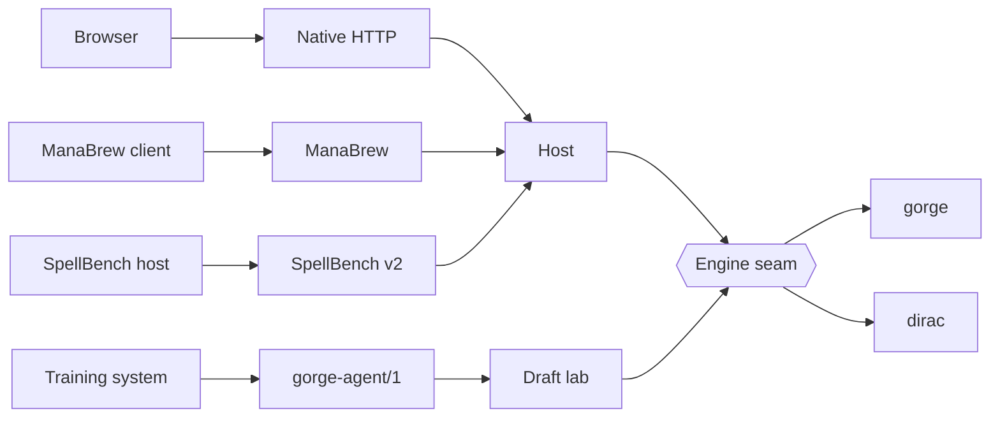

# Interfaces

Every way in to a game is an adapter in front of one engine seam. Pick the wire that fits your client. { .gg-lede }

- [:material-table: **Support matrix**](support.md)

    Which wire drives which engine, and how far.

- [:material-api: **HTTP API and stream**](../api/http.md)

    The native wire, with its event stream.

- [:material-cards-outline: **ManaBrew**](../api/manabrew.md)

    Play a seat from a ManaBrew client.

- [:material-speedometer: **SpellBench v2**](../api/spellbench-v2.md)

    Agents and benchmark hosts.

- [:material-code-braces: **Go embedding**](../api/go.md)

    Import the engine and write your own host.

- [:material-file-tree: **Wire tests**](../architecture/wires.md)

    The test behind every supported cell.

