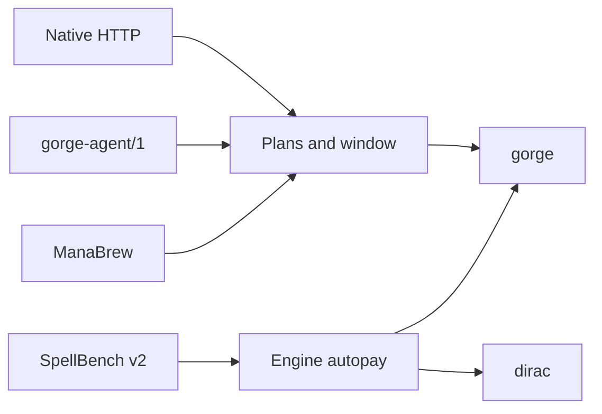

# Paying for spells

A seat pays for a spell through one of two surfaces: the engine pays for it, or the seat taps and chooses. Each wire poses one or both, and dirac poses only the first.
{ .gg-lede }

-   :material-credit-card-outline: **[Surfaces by wire](payment-detail.md)**

    What each wire shows a seat when a spell needs mana, with a flow per surface.

-   :material-table-eye: **[Compare the wires](payment-matrix.md)**

    One matrix: autopay, taps, plans, undo, X, alternative costs, restricted mana.

-   :material-compare: **[Other engines](payment-engines.md)**

    How Forge, XMage and MTG Arena present payment, for context.

-   :material-api: **[Wire specs](index.md)**

    The native, ManaBrew, SpellBench v2 and gorge-agent/1 references.

