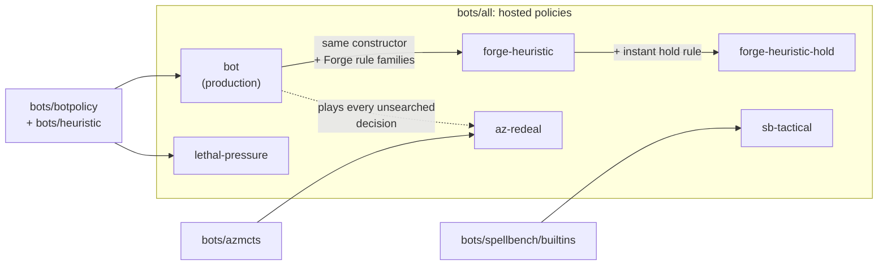

# Bots: cost and strength

gorge ships a handful of bot policies that a host can seat at a table. This
page lists them with what each costs to run and the strongest measured claim
about how well it plays, so a host operator can pick one and a bot author
knows the baselines to beat. Every strength claim below is the one the bot
registers in code, with the source it names; every cost marked
*measured 2026-10-27* was measured for this page at `25d71cadc`, on a heavily
loaded machine (see below). What each
policy does and how to choose one is on
[Bots and strategies](../bots/index.md#the-bots-gorge-ships).

## Where the numbers come from

Each policy registers itself in the bot registry
([`bots/registry.go`](https://github.com/adams-shaun/gorge/blob/main/bots/registry.go))
with a `bots.Info` record: a tier, a description, `Strength` claims (each with
the opponent, the setting and a source) and a `Cost`. `bots/all` imports the
policies a host offers. The registry is the source of truth (a running
server serves it at `GET /api/bot-policies`); this page is a readable copy
of it as of `25d71cadc` (2026-10-27).

## Hosted policies

| Policy | Tier | What it is | Strongest registered claim | Cost |
|---|---|---|---|---|
| `bot` | production | The default heuristic bot (`bots/bot`, built on `bots/heuristic` and `bots/botpolicy`). On auto-pay tables it simulates combat for attacks and blocks; it answers the London mulligan with Forge's rule. Of the Forge-style timing rules it arms only the combat-pump rule (an instant pump only in declare-blockers, and only when it saves or wins a fight). It is also the opponent model inside the search seats. | 53.17% [52.68, 53.65] constructed and 53.69% [52.73, 54.64] Commander against the plain auto-pay bot, on held-out auto-pay tables (commit `66aa546dd`, before the Forge mulligan); 31.5% [27.1, 36.2] against Forge's AI over 400 games (Forge bridge runs, 2026-10-20); with the combat-pump rule armed, 51.64% against a 50.21% bot-vs-bot control over 7,680 games per arm on the FDN Limited suite, and +1.24 points against `forge-heuristic` | **measured 2026-10-27 (load 16-20):** 9.5 ms per FDN game with manual taps, 12.8 ms with auto-pay, both seats, one core (105 and 78 games per core-second); about 19-29 µs per decision |
| `lethal-pressure` | experimental | The plain heuristic with the AR7 lethal-pressure attack rule; no combat simulation on any table, coin mulligan | 51.65% [50.10, 53.20] against the pre-AR7 bot, held-out, manual mana | as `bot` |
| `forge-heuristic` | experimental | The production bot's constructor with every Forge-derived rule family armed: removal timing, targeting, AI hints, deck-shape posture, attachments, spell timing, gang blocks | 32.0% [27.6, 36.7] against Forge's AI over 400 games, +0.5 points over `bot` (inside noise; Forge bridge run, 2026-10-20); 46.8% [41.9, 51.6] against `bot` before it gained the combat simulation. Rechecked 2026-10-21: 48.2% against `bot` over 1,320 games, with the bot-vs-bot control at 47.7% | as `bot` (same policy shape; not measured separately) |
| `forge-heuristic-hold` | experimental | `forge-heuristic` with the instant-speed hold rule forced on: it holds instants outside the respond, opponent post-combat and combat-trick windows (the same rule is the `hold-instant` option on `forge-heuristic`) | not measured | as `forge-heuristic` (not measured) |
| `sb-tactical` | experimental | The SpellBench scored heuristic in its hosted shape: it prices its plays through a payment planner and scores creature values, timing, races and removal from what its seat can see | 110-18 against the SpellBench `bot` arm on the Pauper kernel decks (benchmark seed), 87-41 on FDN mirrors; Elo 1507 against `bot`'s 1242 on the Pauper kernel | about 80 ms per game against `bot` on 8 workers (registered); per-decision time not measured |
| `az-redeal` | experimental | AlphaZero-style tree search: at each searched decision, 100 MCTS simulations over freshly re-dealt worlds rebuilt from the seat's own observations; `bot` plays every other decision | 70.5% [68.5, 72.5] against `bot` over 2,000 games (+20.5 pp over the 50.0% control); 25-simulation variant rated 1382 against `bot`'s 1264 on the Pauper kernel | 216-278 ms mean per searched decision at 100 sims, p95 380-550 ms (registered); **measured 2026-10-27:** see the MCTS row below |

The strength sources are gorge design notes:
[hosted bot packages](https://github.com/adams-shaun/gorge/blob/main/docs/design/2026-09-28-hosted-bot-packages.md),
[SpellBench agent design](https://github.com/adams-shaun/gorge/blob/main/docs/design/2026-09-28-spellbench-agent-design.md)
(§3.4, §12.5) and the
[A2 target rules](https://github.com/adams-shaun/gorge/blob/main/docs/design/2026-10-19-a2-target-rules.md);
the Forge AI claims cite their bridge runs. The 2026-10-21 recheck is the
matchup program on [Bot-vs-bot games](../guide/bot-games.md#a-fair-matchup-with-testkitbench)
(`-pairs all -games 20`). Percentages are win rates with 95% confidence
intervals.

## Measured cost, 2026-10-27

From `cmd/enginebench` at `25d71cadc`, Go 1.26.3, one pinned core
(`GOMAXPROCS=1`) of a Ryzen 9 9950X, two reps run concurrently on cores 2 and
3 (median and min-max), at a 1-minute load average of 16-20: the machine was
busy with other sessions' work, so every figure here is 15-27% slower than the
2026-10-25 quiet-machine run at `87ed64d3b` (load 0.5-4), of which a paired
A/B attributes 6-16% to code changes and the rest to the load
([Engine speed](engine.md#current-numbers)). The rows are the same runs as on
[Engine speed](engine.md#current-numbers).

| Policy (both seats) | FDN pair A | FDN pair B |
|---|---|---|
| `bot`, manual taps | 9.54 ms per game (105 games per core-second), 18.8 µs per decision | 9.53 ms (105), 19.3 µs |
| `bot`, auto-pay | 13.1 ms per game (76.4), 28.8 µs per decision | 12.5 ms (80.2), 29.1 µs |
| random legal action, auto-pay, for comparison | 14.3 ms per game (69.9), 26.1 µs per decision | 16.1 ms (62.2), 26.1 µs |
| `az -sims 100` (the `azmcts` search behind `az-redeal`, honest re-deal, heuristic leaf), roots from pairs A and B alternately | 183 ms of CPU per searched decision, 547 simulations per core-second | (pooled) |

The `az` row is `enginebench -row az -sims 100` (build tag
`enginebench_az`), three 30-second runs at once on cores 8-10 (load 17); it
times the search alone, not a hosted game, on roots from turns 5-8 of seeded
games that alternate FDN pairs A and B, so it is not the same measurement as
the registered 216-278 ms per searched decision, which was taken over whole
hosted games with other decks. On 2026-10-25 (load 0.5-4, `87ed64d3b`) the
same row measured 91.8 ms and 1,090 simulations per core-second; the same
day's paired A/B puts `25d71cadc` at 0.82 of `87ed64d3b` on it, so most of
the doubling is the load.

The cost of the heuristic bot is mostly the engine, not the policy: a game
between two bots takes about the same CPU as a game between two random
players (9.5-13.1 ms against 13.2-16.1 ms in this run), because the bot ends games in fewer turns (18
against 23-42); about 15% of a bot game's CPU is the bot's own code
([Engine speed](engine.md#where-the-time-goes)). The search
seat's cost is the engine too, many times over: each simulation clones and
steps a game.

## Support packages

Packages the hosted bots and outside policies build on:

| Package | What it is |
|---|---|
| `bots/botpolicy`, `bots/heuristic` | The one heuristic decision policy, and the bot types built on it (`NewBot`, the attack-simulation bot, the lethal-pressure bot) |
| `bots/sanity` | The common-sense decorator `bot`, `forge-heuristic` and `sb-tactical` apply when the host asks (`gorged -bot-common-sense`); it drops, for example, a hostile effect aimed only at the seat's own permanents |
| `bots/azmcts` | The PUCT tree search behind `az-redeal`: one seat's searched decisions, a value leaf (a learned value head or a frozen heuristic) |
| `bots/searchseat`, `bots/searchprobe` | A perfect-information Monte Carlo search seat, and an experimental history-conditioned search harness with a hidden-information world sampler; neither is a hosted policy |
| `bots/policynet`, `bots/gonet`, `bots/netsimd` | A feature encoder for a learned per-option policy, a pure-Go forward pass for MLP value networks, and an AVX-512 version of that forward pass with a scalar fallback |
| `bots/spellbench` (+`builtins`, `payexec`) | gorge's side of the [SpellBench](https://github.com/jackmaiorino/spellbench) arena: benchmark deck catalogs, the ported builtin bots and `sb-tactical`, and `payexec`, which lowers a payment plan onto the manual mana surface |
| `bots/traceboard` | The redacted per-seat board snapshot schema written into decision-trace records |

## Evaluating a policy yourself

`testkit/bench` (`PlayGame`, `RunPairs`) plays seeded games and deck-pair
matrices between any `seat.Seat` implementations, with watchdogs and livelock
recovery. `cmd/enginebench -row bot` measures the cost of the default bot on
the committed workload decks. The adoption ladder, the evaluation protocol and
the rules for bot code are in
[*Bot training and adoption*](../bots/training-and-adoption.md).
