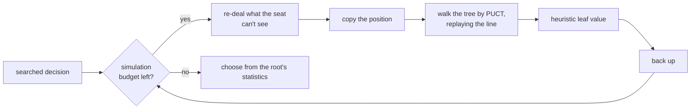

# Bot speed

What a bot costs to run, per game, per decision and per simulation, so that a host can size a table and a bot author can budget a search. For
what each policy does, see [Bots](../bots/index.md) and [Each bot in detail](../bots/catalogue.md#the-six-registered-bots). This page is about speed only.

## The heuristic bot

Both seats on gorge, FDN pairs, measured 2026-10-31 with one pinned core per run ([gorge's speed](engine.md#current-numbers)). A random player is there for
comparison, because it costs almost nothing itself.

<figure markdown="span">
--8<-- "performance/figs/bot-games.svg"
<figcaption>CPU per gorge game with the same policy on both seats. A bot game costs no more than a random one, because the bot ends games in fewer turns.</figcaption>
</figure>

??? info "The exact numbers"

    | Policy (both seats) | Pair A | Pair B |
    |---|---|---|
    | `bot`, manual taps | 9.55 ms a game, 19.1 µs a decision | 9.10 ms, 18.4 µs |
    | `bot`, auto-pay | 13.4 ms a game, 29.7 µs a decision | 11.9 ms, 27.7 µs |
    | random legal action, auto-pay | 14.3 ms a game, 25.9 µs a decision | 14.8 ms, 24.0 µs |


A bot game costs no more than a random one, because the bot ends games in fewer turns (18 against 23-42). About 15% of a bot game's CPU is
the bot's own code ([Where the time goes](engine.md#where-the-time-goes)). [Performance](index.md#the-numbers) has the cost of its port on dirac.

## Search, per simulation

A search bot's cost is the cost of one simulation times its budget. These rows run an AlphaZero-style PUCT search with a heuristic leaf, re-dealing
what the seat can't see for every simulation and answering every unsearched decision with the heuristic bot. One pinned core per run, three reps at once on
cores 24, 26 and 30, 20 CPU-seconds, 2026-10-31.



<figure markdown="span">
--8<-- "performance/figs/search-per-sim.svg"
<figcaption>Cost of one simulation, log-log. dirac's is 17-27 times cheaper than gorge's at every budget, and both grow with the budget because deeper trees replay longer lines. Vertical ticks are the range over three reps; gorge at 1,000 covers only 13-15 roots.</figcaption>
</figure>

<figure markdown="span">
--8<-- "performance/figs/search-per-decision.svg"
<figcaption>What that means per searched decision: a 100-simulation search costs about 5 ms on dirac and about 0.1 s on gorge; 1,000 simulations on gorge take about 2 s.</figcaption>
</figure>

??? info "The exact numbers"

    | Engine | Simulations per decision | µs per simulation | Simulations per core-second | ms per searched decision |
    |---|--:|--:|--:|--:|
    | dirac | 25 | 44.6 <small>(43.8-46.0)</small> | 22,400 | 1.11 |
    | dirac | 100 | 52.4 <small>(51.6-55.5)</small> | 19,100 | 5.23 |
    | dirac | 1,000 | 70.9 <small>(66.9-75.0)</small> | 14,100 | 70.7 |
    | gorge | 25 | 761 <small>(759-785)</small> | 1,315 | 19.0 |
    | gorge | 100 | 1,063 <small>(1,044-1,079)</small> | 940 | 106 |
    | gorge | 1,000 | 1,906 <small>(1,454-2,177)</small> | 525 | 1,907 |


The two engines are counted differently, so the ratio is approximate. dirac's rows divide a whole game's CPU, unsearched decisions included, by the
simulations it ran, on pair A. gorge's rows take the search's own CPU on priority roots from turns 5-8 of games
alternating pairs A and B. The gorge row at 1,000 simulations covers only 13-15 roots per run, which is why its spread is wide.

Cost per simulation grows with the budget because deeper trees replay longer lines. Almost all of a simulation is the rules engine replaying and
extending a line of play: in a 15-second CPU profile of gorge's row at 100 simulations, `Engine.Submit` is 82% cumulative.

These rows have no network leaf: `enginebench`'s `az` row has no network option, so a network's cost has to be measured with the network in question.

## Measuring it

For gorge:

```sh
go build -trimpath -tags enginebench_az -o eb-az ./cmd/enginebench
for n in 25 100 1000; do
  GOMAXPROCS=1 taskset -c 24 ./eb-az -row az -sims $n -secs 20
done
```

The search rows' JSON line reports `sims_per_cpu_s` and `ms_per_root`. dirac's rows ran a search on both seats through the port of it in the maintainers'
private companion module, so they can't be reproduced from this repository ([Search and bots](../architecture/dirac/search.md)).

To measure a policy inside whole games, `testkit/bench` (`PlayGame`, `RunPairs`) plays seeded games and deck-pair matrices between any `seat.Seat`
implementations. `cmd/enginebench -row bot` measures the default bot on the committed workload decks.
