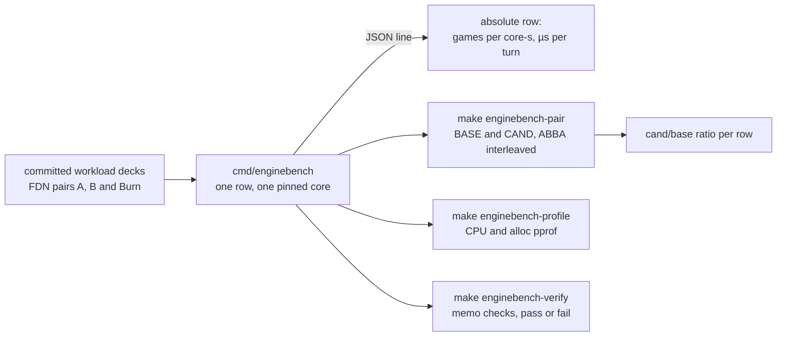

# gorge's speed

Engine speed matters twice: once for hosting games, and again because a search bot clones and steps the engine thousands of times per decision.
This page is for contributors changing engine code: what gorge's benchmark measures, how to run it, the current numbers and where the time
goes. For gorge against other engines see [Performance](index.md).

## What is measured



??? info "Every tool and what it outputs"

    | Tool | Measures | Output |
    |---|---|---|
    | `cmd/enginebench`, one row | `random` and `bot` play, `clone` and `step` per operation, `az` and `sampler` search rows, live heap after the corpus loads | one JSON line per run, with commit, Go version, CPU, `GOGC` and core pin |
    | `make enginebench-pair BASE= CAND=` | a paired, interleaved ABBA comparison of two revisions, each built from `git archive` | JSONL and a text table: per-row medians and the median candidate/base ratio |
    | `make enginebench-profile [REV=]` | CPU and allocation pprof per row, and the GC share | pprof files and printed tops |
    | `make enginebench-verify [REV=]` | a memo-verifying build; fails on errors, stalls, panics or stale memos | pass or fail |
    | `scripts/xengine-bench.sh` | the cross-engine rows ([How it is measured](methodology.md)) | `runs.jsonl` and a summary table |
    | `make sim` | 20 verified four-seat games | replay OK count |
    | `make gc-gate` | GC CPU share of one package's tests (default `./server/host`, budget 0.30) | ratio |


The workloads are four 17lands Foundations (FDN) decks and an mtg-kernel Burn deck in
[`cmd/enginebench/testdata/decks`](https://github.com/adams-shaun/gorge/blob/main/cmd/enginebench/testdata/decks/README.md). Pair A is UG vs WG,
and pair B is WR vs UR. Seats alternate every game and game `g` uses seed `base + g`, so a row is reproducible.

??? info "What each row runs"

    | Row | What it runs |
    |---|---|
    | `random` | whole games, uniform over every option, each mana tap asked |
    | `random -autopay` | whole games, uniform over auto-pay candidates (payment plans) |
    | `bot` | whole games, `heuristic.NewBot`, manual taps |
    | `bot -autopay` | the same with `EnableAutoPayMana` |
    | `clone` | `Engine.Clone` of a mid-game position |
    | `step` | clone, then submit one candidate |
    | `az -sims N` | `azmcts` with an honest re-deal; needs build tag `enginebench_az` ([Bot speed](bots.md)) |
    | `sampler` | the older rollout sampler |


## How to run

From a checkout with the corpus fetched (`make fetch-cards`):

```sh
go run -trimpath ./cmd/enginebench -row random -pair A -secs 20    # one row, one JSON line
make enginebench-profile REV=.
make enginebench-verify REV=.
```

Knobs for the `make` targets are `BUDGET` (wall seconds for the whole measured phase, default 60), `ROWS`, `REPS`, `SECS`, `PIN`, `GOGC`,
`BENCH_DIR` and `HEAVY_LOCK`. `scripts/enginebench-lib.sh` documents them.

## Current numbers

A 2026-11-05 paired comparison (`make enginebench-pair BASE=b78e4c8b1 CAND=HEAD`, pinned to one core, `GOMAXPROCS=1`, three ABBA reps per row) measured gorge
HEAD (`0ec285f67`) at 1.06-1.25× the `b78e4c8b1` baseline's CPU per turn on every row: ×1.24-1.25 on `random -autopay`, ×1.11-1.13 on `random`, ×1.12-1.13 on
`bot -autopay`, ×1.06-1.08 on `bot`, and ×1.05-1.10 on the Burn mirror. That regression is engine work, not a published number: until it is fixed, the rows
below are the `b78e4c8b1` baseline re-measured on 2026-11-05 as the base arm of that paired run — Go 1.26.3, `GOMAXPROCS=1`, 15 CPU-seconds a run, three reps
per row, Burn from its own paired run. The [comparison page](index.md) keeps gorge's 2026-11-02 baseline figures and measures dirac at HEAD. HEAD's `clone`
measures the same as the baseline and `step` about 5% more CPU with GC off.

<figure markdown="span">
--8<-- "performance/figs/regression.svg"
<figcaption>Read this first: HEAD costs 5-25% more CPU per turn than the b78e4c8b1 baseline on every row, worst on random auto-pay. The bars are the per-row range of the paired run's ratios; the dashed line is no change.</figcaption>
</figure>

<figure markdown="span">
--8<-- "performance/figs/gorge-rows.svg"
<figcaption>Whole games per core-second at the baseline. The Burn mirror plays fastest; with the bot on both seats, games end sooner, so bot rows beat random ones despite the bot's own cost.</figcaption>
</figure>

<figure markdown="span">
--8<-- "performance/figs/gorge-turn.svg"
<figcaption>CPU per turn, the steadier number across policies. Auto-pay (payment planning) is the expensive part: compare each row with its manual-tap partner.</figcaption>
</figure>

??? info "The exact numbers"

    | Row | Pair A | Pair B | Burn |
    |---|---|---|---|
    | `random -autopay`, games per core-second | 81.4 (80.8-82.1) | 75.7 (74.7-76.0) | 152 (149-153) |
    | `random -autopay`, µs per turn / per decision | 532 / 22.2 | 507 / 21.5 | 264 / 12.1 |
    | `random`, games per core-second | 87.7 (87.4-88.0) | 90.5 (85.2-91.3) | 178 (176-179) |
    | `random`, µs per turn / per decision | 273 / 9.99 | 275 / 10.5 | 161 / 7.37 |
    | `bot -autopay`, games per core-second | 87.5 (87.3-88.6) | 98.8 (96.0-99.0) | 125 (123-126) |
    | `bot -autopay`, µs per turn / per decision | 631 / 25.2 | 568 / 24.0 | 408 / 17.6 |
    | `bot`, games per core-second | 113 (113-114) | 126 (124-128) | 155 (154-156) |
    | `bot`, µs per turn / per decision | 485 / 17.3 | 443 / 16.2 | 328 / 13.1 |
    | Turns per game: `random -autopay` / `random` / bots | 23.1 / 41.8 / 18.2 | 26.1 / 40.2 / 17.9 | 24.9 / 34.8 / 19.6 |
    | Peak RSS, corpus loaded¹ | 360-409 MB | 368-405 MB | 363-407 MB |

    ¹ Peak RSS is set by the corpus, not the engine revision, and these runs are from the HEAD side of the paired comparison (one run per row, one core each; peak
    RSS is a distribution, so the range spans rows). Live heap after the corpus loads is 36 MB, the same on both arms.

    | One operation, pair A roots (turns 5-8) | No GC | With GC | Per operation |
    |---|--:|--:|---|
    | `clone` | 12.9 µs | 27.2 µs | 195 KB, 50 mallocs |
    | `step` | 43.5 µs | 71.2 µs | 369 KB, 140 mallocs |


## Comparing two revisions

Absolute rows on a shared machine mostly measure the machine: pinned rows repeat to within a few per cent inside one session, and unpinned
rows on a loaded machine move by 15-30%. To judge a change, compare it with its base, interleaved in one session:

```sh
make enginebench-pair BASE=main CAND=.                         # BUDGET=60s for the whole run
make enginebench-pair BASE=main CAND=. PIN=24 REPS=3           # pinned to one core, GOMAXPROCS=1
make enginebench-pair BASE=main CAND=. BUILD_ARGS="-tags enginebench_az" ROWS="-row az -sims 100"
```

The table it prints ends each row with the ratio. A value above 1 means the candidate is faster, for a higher-is-better unit:

```text
row                   unit             base med    cand med  cand/base  per-rep ratios
clone A               ops/cpu-s           27705       28020      1.015  1.064 0.967
```

That line came from two reps of the same code, with `BUDGET=30 PIN=26 REPS=2 ROWS='-row clone'`, so it also shows the size of the noise.

## Where the time goes

CPU profiles of one 20-second pair-A run each, 2026-11-05 at `0ec285f67` (HEAD; the profiles describe the current code, regression included), pinned to one core,
`GOMAXPROCS=1`. Flat time is grouped by package, and `engine/rules` includes its sub-packages.

<figure markdown="span">
--8<-- "performance/figs/profile.svg"
<figcaption>Flat CPU by package. engine/rules, the legal-action walk and payment planning, is three-fifths of every run; the bot's own packages are 7.5% of a bot game.</figcaption>
</figure>

<figure markdown="span">
--8<-- "performance/figs/calltree.svg"
<figcaption>The hot path by call tree in the random auto-pay run. Listing what a player may do, with payments planned, dominates; the shares nest, so they don't sum.</figcaption>
</figure>

??? info "The exact numbers"

    | Package | `random -autopay` | `bot -autopay` |
    |---|--:|--:|
    | `engine/rules` (legal-action walk, payment planning, resolution, triggers) | 63.3% | 58.8% |
    | Go runtime (GC, allocation, maps) | 15.3% | 11.6% |
    | `engine/state` | 6.6% | 5.4% |
    | `engine/cards` | 6.2% | 5.4% |
    | `engine/effects` | 3.6% | 4.3% |
    | Go standard library | 4.4% | 5.2% |
    | `engine/events` | 0.6% | 1.0% |
    | `bots/botpolicy` + `bots/heuristic` | - | 7.1% + 0.4% |


By call tree (cumulative), in the random auto-pay run: `Engine.Submit` 63% and `Engine.Advance` 33% (they nest), payment planning
(`paymentActionsForPriority`) 35%, the legal-action walk over the hand (`legalWalk.handWalk`) 25%, and emitting events through `events.Apply`
(`Engine.emit`) 14%. In the bot run, the bot's own work is about 14% cumulative: building its board (`botpolicy.BoardFromGameInto`) 9.8% and deciding
(`heuristic.(*Bot).DecideBoard`) 4.2%. In both, the engine rather than the policy is most of the cost. Listing what a player may do, with payments planned,
is the hot path.

To reproduce:

```sh
go run -trimpath ./cmd/enginebench -row random -autopay -pair A -secs 20 -cpuprofile ra.cpu
go tool pprof -top -cum ra.cpu
```
