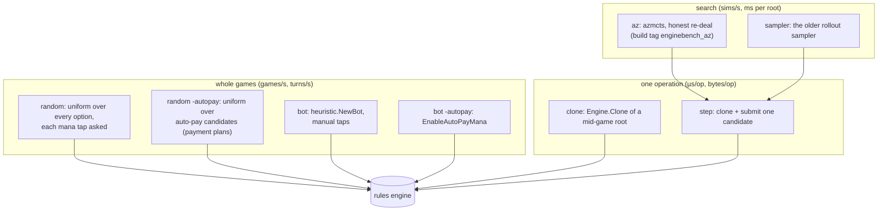

# gorge's engine speed

Engine throughput matters twice over: once for hosting games, and again
because search bots clone and step the engine thousands of times per
decision. This page is for contributors changing engine code: what gorge's
own benchmark measures, how to run it, the current numbers and where the time
goes. For gorge against other engines see [Performance](index.md); for how
those runs are made see [Methodology](methodology.md).

## What is measured

| Tool | Measures | Output |
|---|---|---|
| `cmd/enginebench` (one row) | Fixed workloads: `random` and `bot` play (turns, games and decisions per CPU-second); `clone` and `step` (µs per op with and without GC, bytes and mallocs per op, retained bytes per clone); `az` and `sampler` search rows (simulations per second, ms per root); live heap after the corpus loads | one JSON line per run, with the commit, Go version, CPU model, `GOGC` and core pin |
| `make enginebench-pair BASE= CAND=` | A paired, interleaved ABBA comparison of two revisions, each built from `git archive` | JSONL plus a text table: per-row median throughput and the median per-repetition candidate/base ratio |
| `make enginebench-profile [REV=]` | CPU and allocation pprof per row, and the GC share | pprof files and printed tops |
| `make enginebench-verify [REV=]` | A memo-verifying build; fails on errors, stalls, panics or stale memos | pass/fail |
| `scripts/xengine-bench.sh` | The cross-engine rows: gorge's `random`, `random -autopay`, `bot` and `bot -autopay` rows on both pairs, pinned, three reps, next to the other engines | `runs.jsonl` and a summary table |
| `make sim` | 20 verified four-seat games | replay OK count |
| `make gc-gate` | GC CPU share of one package's tests (default `./server/host`, budget 0.30) | ratio |

The workloads use four 17lands Foundations (FDN) draft decks (CC BY 4.0) and
an mtg-kernel Burn deck (MIT), in
[`cmd/enginebench/testdata/decks`](https://github.com/adams-shaun/gorge/blob/main/cmd/enginebench/testdata/decks/README.md).
Pair A is UG vs WG, pair B is WR vs UR. Seats alternate every game; game `g`
uses seed `base + g`, so a row is reproducible.

### The rows, and what each exercises



### How to run

```sh
go run ./cmd/enginebench -row random -pair A -secs 20          # one row, one JSON line
make enginebench-pair BASE=main CAND=.                          # paired A/B; BUDGET=60s for the whole run
make enginebench-pair BASE=main CAND=. PIN=24 REPS=3            # pinned to one core, GOMAXPROCS=1
make enginebench-pair BASE=main CAND=. BUILD_ARGS="-tags enginebench_az" ROWS="-row az -sims 100"
make enginebench-profile REV=.
make enginebench-verify REV=.
```

Knobs: `BUDGET` (wall seconds for the whole measured phase, default 60),
`ROWS`, `REPS`, `SECS`, `PIN`, `GOGC`, `BENCH_DIR`, `HEAVY_LOCK` (see
`scripts/enginebench-lib.sh`).

!!! warning "Noise"
    The reference machine is a shared 32-thread Ryzen 9 9950X (Go 1.26.3)
    whose load varies from about 5 to 80. Pinned single-core rows with nothing
    else on the core repeat to within 1-5% (the spreads below); unpinned rows
    on a loaded machine move ±15-30%. **Only paired, interleaved A/B ratios
    are trustworthy for judging a change**; treat absolute numbers as
    indicative of this machine.

## Current numbers

Measured 2026-10-20 at `ad3777023`, Go 1.26.3, `GOMAXPROCS=1`, each run
pinned to one core (24, 26 or 28; three reps of a row at once), 30 CPU-seconds
per run, load average 5-7, by `scripts/xengine-bench.sh gorge` (the play rows)
and single `enginebench` runs (the rest). Median of three reps, min-max in
brackets.

| Row | Pair A | Pair B |
|---|---|---|
| `random -autopay`, games per core-second | 92.3 (91.9-93.9) | 86.8 (85.4-86.8) |
| `random -autopay`, µs per turn / per decision | 471 / 19.7 | 445 / 18.9 |
| `random` (manual taps), games per core-second | 103 (102-103) | 108 (106-108) |
| `random`, µs per turn / per decision | 232 / 8.5 | 233 / 8.5 |
| `bot -autopay`, games per core-second | 103 (102-103) | 111 (110-112) |
| `bot -autopay`, µs per turn / per decision | 540 / 21.5 | 509 / 21.0 |
| `bot` (manual taps), games per core-second | 134 (132-136) | 144 (144-145) |
| `bot`, µs per turn / per decision | 412 / 14.7 | 388 / 14.0 |
| Turns per game: `random -autopay` / `random` / bots | 22.9 / 41.9 / 18 | 26.0 / 39.8 / 18 |
| Peak RSS of a play run (corpus loaded) | 346-355 MB | 347-348 MB |

| Row (pair A, one run each, same date and build) | Value |
|---|---|
| `clone`, mid-game roots (turns 5-8) | 13.6 µs per clone without GC, 28.3 µs with GC; 181 KB and 50 mallocs per clone |
| `step` (clone + submit one candidate) | 39.3 µs without GC, 59.0 µs with GC; 357 KB and 132 mallocs per step |
| `az -sims 100` (azmcts, honest re-deal, heuristic leaf) | 1,129 simulations per core-second, 88.6 ms per searched root (332 roots) |
| `sampler` (the older rollout sampler) | 109 rollouts per core-second, 242 ms per root |
| Live heap after the corpus loads | 36 MB |

Running the three reps of a row at once costs little: a `random -autopay`
pair-A run alone on core 24 the same afternoon gave 95.6 games per
core-second, 3.5% above the concurrent median. The 2026-10-07 single-core row
set (random A 75.7 games/s, bot A 121 games/s, clone 16.5 µs, MCTS-100 595
sims per CPU-second) ran with `GOMAXPROCS=1` at load 34-80, so the change
since then mixes the machine's load with the code's; use `make enginebench-pair` to compare
revisions.

## Where the time goes

CPU profiles of one 20-second pair-A run each (`enginebench -cpuprofile`,
same build, core 24/26), flat time grouped by package (packages under 1%
omitted; `engine/rules` includes `engine/rules/pay`):

| Package | `random -autopay` | `bot -autopay` |
|---|--:|--:|
| `engine/rules` (legal-action walk, payment planning, resolution, triggers) | 64.1% | 56.2% |
| Go runtime (GC, allocation, maps) | 12.0% | 11.8% |
| `engine/state` | 7.2% | 7.1% |
| `bots/botpolicy` + `bots/heuristic` (the bot) | - | 5.8% + under 1% flat |
| `engine/cards` | 5.0% | 4.4% |
| `engine/effects` | 4.4% | 4.0% |
| `engine/events` | 1.3% | under 1% |
| Go standard library (`strings` and others) | about 2% | about 4% |

By call tree (cumulative), in the random auto-pay run: `Engine.Submit` 72%
and `Engine.Advance` 39% (they nest); offering the auto-pay priority options
(`paymentActionsForPriority`) 25%; the legal-action walk over the hand
(`legalWalk.handWalk`) 24% and over the battlefield 10%; emitting events
through `events.Apply` (`Engine.emit`) 17%. In the bot run the bot's own
work is about 15% cumulative: building its board (`botpolicy.BoardFromGameInto`,
9.9%) and deciding (`heuristic.(*Bot).DecideBoard`, 5.1%). So in both rows
the engine, not the policy, is most of the cost: listing what a player may
do, with payments planned, is the hot path.

To reproduce: `go run ./cmd/enginebench -row random -autopay -pair A -secs 20 -cpuprofile ra.cpu`,
then `go tool pprof -top -cum ra.cpu`, or `make enginebench-profile`.

## Trajectory

These are historical results, kept as recorded; rows before 2026-10-06 are
not comparable with later ones (see the baseline break).

| Date | Commit(s) | Workload | Result |
|---|---|---|---|
| 2026-09-21 | `4744d8a7`, `1c485b7d` | PIMC search teacher | 496 → 171 ms per decision at 4 workers |
| 2026-09-27 | `a60dfcd9e` | bot sweep | −16.6% sweep CPU; `rules` tests 50 s → 15 s |
| 2026-09-27 | `bc14fd36a`, `43a60ba67`, … | bot sweep | manual taps −24…32%, auto-pay −22…47% |
| 2026-09-30 | `a4af596` vs `e0496f062` | `enginebench`, pinned | `main` 7–25% slower than the published baseline; live heap 143 MB; top hotspot an index rebuild at 12.4% |
| 2026-09-30 → 10-01 | `308f7e0b9` → `9226f882e` | SpellBench-style MCTS games | MCTS 3.9× less CPU / 4.9× less wall; other search seats 5–8× |
| 2026-10-05 | `08f248918` | `rules` test gate | −44% CPU, −47% allocation |
| 2026-10-06 | `a6107d0df`, `d55a968a8`, `a3b5123a3`, `b75197f98`, `3f88c20d0` | corpus image, event log, decision arena | live heap 143 → ~41 MB. **Baseline break:** random/bot rows now recycle games through a spare pool |
| 2026-10-07 | ~`49c8224ce` | `enginebench`, `GOMAXPROCS=1` | vs 2026-09-30: random A 4.3×, Burn 2.9×, bot A 3.5×, auto-pay 2.3×, MCTS-100 1.8×, MCTS-1000 2.7× (crosses the baseline break; directional only) |
| 2026-10-07 | heap-attack branch | self-play | +10.8% combined; allocated objects −30% |
| 2026-10-09/10 | quiet-machine series | MCTS-100 | +10.4% median |
| 2026-10-20 | `ad3777023` | `enginebench`, pinned, 3 reps (this page) | see Current numbers; live heap 36 MB |

The engine-speed method and the first pinned comparison are written up in
the archived `2026-09-30-gorge-engine-speed.md`
([archive index](https://github.com/adams-shaun/gorge/blob/main/docs/design/ARCHIVE.md)).

## Tracking over time

A plan to record a nightly anchored series and chart it on this site is
described on [Tracking over time](tracking.md).
