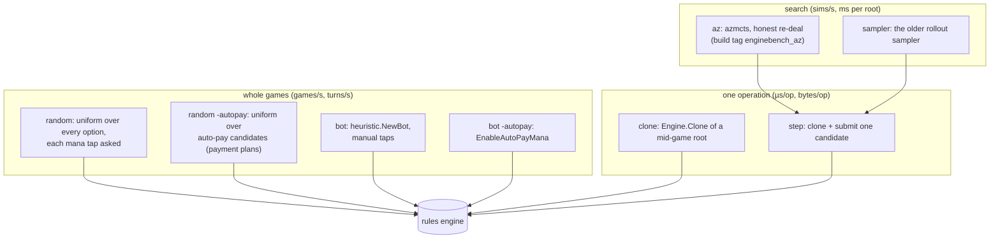

# gorge's engine speed

Engine throughput matters twice over: once for hosting games, and again
because search bots clone and step the engine thousands of times per
decision. This page is for contributors changing engine code: what gorge's
own benchmark measures, how to run it, the current numbers and where the time
goes. For gorge against other engines see [Performance](index.md); for how
those runs are made see [Methodology](methodology.md).

## What is measured

| Tool | Measures | Output |
|---|---|---|
| `cmd/enginebench` (one row) | Fixed workloads: `random` and `bot` play (turns, games and decisions per CPU-second); `clone` and `step` (µs per op with and without GC, bytes and mallocs per op, retained bytes per clone); `az` and `sampler` search rows (simulations per second, ms per root); live heap after the corpus loads | one JSON line per run, with the commit, Go version, CPU model, `GOGC` and core pin |
| `make enginebench-pair BASE= CAND=` | A paired, interleaved ABBA comparison of two revisions, each built from `git archive` | JSONL plus a text table: per-row median throughput and the median per-repetition candidate/base ratio |
| `make enginebench-profile [REV=]` | CPU and allocation pprof per row, and the GC share | pprof files and printed tops |
| `make enginebench-verify [REV=]` | A memo-verifying build; fails on errors, stalls, panics or stale memos | pass/fail |
| `scripts/xengine-bench.sh` | The cross-engine rows: gorge's `random`, `random -autopay`, `bot` and `bot -autopay` rows on both pairs, pinned, three reps, next to the other engines | `runs.jsonl` and a summary table |
| `make sim` | 20 verified four-seat games | replay OK count |
| `make gc-gate` | GC CPU share of one package's tests (default `./server/host`, budget 0.30) | ratio |

The workloads use four 17lands Foundations (FDN) draft decks (CC BY 4.0) and
an mtg-kernel Burn deck (MIT), in
[`cmd/enginebench/testdata/decks`](https://github.com/adams-shaun/gorge/blob/main/cmd/enginebench/testdata/decks/README.md).
Pair A is UG vs WG, pair B is WR vs UR. Seats alternate every game; game `g`
uses seed `base + g`, so a row is reproducible.

### The rows, and what each exercises



### How to run

```sh
go run ./cmd/enginebench -row random -pair A -secs 20          # one row, one JSON line
make enginebench-pair BASE=main CAND=.                          # paired A/B; BUDGET=60s for the whole run
make enginebench-pair BASE=main CAND=. PIN=24 REPS=3            # pinned to one core, GOMAXPROCS=1
make enginebench-pair BASE=main CAND=. BUILD_ARGS="-tags enginebench_az" ROWS="-row az -sims 100"
make enginebench-profile REV=.
make enginebench-verify REV=.
```

Knobs: `BUDGET` (wall seconds for the whole measured phase, default 60),
`ROWS`, `REPS`, `SECS`, `PIN`, `GOGC`, `BENCH_DIR`, `HEAVY_LOCK` (see
`scripts/enginebench-lib.sh`).

!!! warning "Noise"
    The reference machine is a shared 32-thread Ryzen 9 9950X (Go 1.26.3)
    whose load varies from about 5 to 80. Pinned single-core rows with nothing
    else on the core repeat to within 1-5% (the spreads below); unpinned rows
    on a loaded machine move ±15-30%. **Only paired, interleaved A/B ratios
    are trustworthy for judging a change**; treat absolute numbers as
    indicative of this machine.

## Current numbers

Measured 2026-10-27 at `25d71cadc`, Go 1.26.3, `GOMAXPROCS=1`, each run
pinned to one core, 30 CPU-seconds per run, by `scripts/xengine-bench.sh gorge`
(the play rows: two reps of a row at once on cores 2 and 3, the only two
physical cores whose SMT siblings were idle) and single `enginebench` runs on
cores 8-10 (the rest). **The machine was heavily loaded: 1-minute load average
16-20** (other sessions' kernel self-play and test runs on most other cores),
so these absolutes sit 15-27% below the quiet-machine figures of 2026-10-25
(load 0.5-4, `87ed64d3b`: random A 97.0, bot A 124 games per core-second).
Median of two reps, min-max in brackets.

| Row | Pair A | Pair B |
|---|---|---|
| `random -autopay`, games per core-second | 69.9 (68.9-70.9) | 62.2 (61.3-63.2) |
| `random -autopay`, µs per turn / per decision | 625 / 26.1 | 617 / 26.1 |
| `random` (manual taps), games per core-second | 76.0 (74.5-77.5) | 73.6 (72.7-74.5) |
| `random`, µs per turn / per decision | 313 / 11.5 | 341 / 12.3 |
| `bot -autopay`, games per core-second | 76.4 (75.3-77.6) | 80.2 (76.8-83.7) |
| `bot -autopay`, µs per turn / per decision | 723 / 28.8 | 706 / 29.1 |
| `bot` (manual taps), games per core-second | 105 (103-107) | 105 (105-105) |
| `bot`, µs per turn / per decision | 527 / 18.8 | 532 / 19.3 |
| Turns per game: `random -autopay` / `random` / bots | 22.9 / 42.0 / 18 | 26.0 / 39.9 / 18 |
| Peak RSS of a play run (corpus loaded) | 352-368 MB | 360-365 MB |

| Row (one run each, same date and build, load 17-19) | Value |
|---|---|
| `clone`, pair-A mid-game roots (turns 5-8) | 20.5 µs per clone without GC, 43.9 µs with GC; 199 KB and 50 mallocs per clone |
| `step` (clone + submit one candidate), pair A | 72.3 µs without GC, 114 µs with GC; 381 KB and 144 mallocs per step |
| `az -sims 100` (azmcts, honest re-deal, heuristic leaf; roots from games alternating pairs A and B) | 547 (544-642) simulations per core-second, 183 ms per searched root (three reps at once, cores 8-10) |
| `sampler` (the older rollout sampler, same alternating roots) | 52.9 rollouts per core-second, 474 ms per root |
| Live heap after the corpus loads | 41 MB (87ed64d3b measures the same 41 MB in this setup) |

**What moved, and why.** Absolute rows on a loaded machine mostly measure the
machine, so the same day's paired, interleaved A/B (`make enginebench-pair
BASE=87ed64d3b CAND=.`, ABBA, pinned to one core, `GOMAXPROCS=1`, load 16-38)
separates the code's share. Against `87ed64d3b`, the revision of the previous
numbers, `25d71cadc` is slower on every row; median candidate/base ratio,
per-rep spread in brackets:

| Row | cand/base | Reps |
|---|--:|---|
| `random` A / B | 0.885 / 0.854 | 4 × 10 s, core 2 |
| `random -autopay` A / B | 0.839 / 0.845 | 4 × 10 s, core 2 |
| `bot` A / B | 0.930 / 0.916 | 4 × 10 s, core 2 |
| `bot -autopay` A / B | 0.937 / 0.904 | 4 × 10 s, core 2 |
| `clone` / `step` | 0.959 / 0.846 | 4 reps, core 2 |
| `sampler` | 0.924 | 4 × 10 s, core 2 |
| confirmation: `bot` A, `random -autopay` A, `step` | 0.883 (0.72-0.99), 0.908 (0.76-1.24), 0.919 (0.86-0.93) | 6 × 15 s, core 9 |
| `az -sims 100` (build tag `enginebench_az`) | 0.823 (0.64-0.90) | 4 × 20 s, core 9 |

So roughly 6-16% of the drop is the code (741 commits, mostly card support,
landed between the two revisions; the slowdown is not yet bisected) and the
rest is the load. The base revision itself ran 20-35% below its own
2026-10-25 quiet-machine figures in the same session.

## Where the time goes

CPU profiles of one 20-second pair-A run each (`make enginebench-profile`,
2026-10-27 at `25d71cadc`, pinned to core 9, `GOMAXPROCS=1`, load 18-19), flat
time grouped by package (packages under 0.5% omitted; `engine/rules` includes
`engine/rules/pay`). GC marking (`runtime.gcDrain`) was 1.2% cumulative in
both runs.

| Package | `random -autopay` | `bot -autopay` |
|---|--:|--:|
| `engine/rules` (legal-action walk, payment planning, resolution, triggers) | 64.8% | 52.2% |
| Go runtime (GC, allocation, maps) | 16.6% | 14.8% |
| `engine/state` | 10.1% | 9.3% |
| `bots/botpolicy` + `bots/heuristic` (the bot) | - | 8.3% + 0.6% flat |
| `engine/cards` | 2.8% | 3.0% |
| `engine/effects` | 3.3% | 2.1% |
| `engine/events` | 0.5% | 1.4% |
| Go standard library (`strings` and others) | about 2% | about 6.5% |

By call tree (cumulative), in the random auto-pay run: `Engine.Submit` 71%
and `Engine.Advance` 40% (they nest); the legal-action walk over the hand
(`legalWalk.handWalk`) 29% and over the battlefield 10%; offering the
auto-pay priority options (`paymentActionsForPriority`) 26%; emitting events
through `events.Apply` (`Engine.emit`) 17%. In the bot run the bot's own
work is about 16% cumulative: building its board (`botpolicy.BoardFromGameInto`,
11.2%) and deciding (`heuristic.(*Bot).DecideBoard`, 4.6%). So in both rows
the engine, not the policy, is most of the cost: listing what a player may
do, with payments planned, is the hot path. Against the 2026-10-20 profile
(`ad3777023`), `engine/state` and the runtime take a larger share and the
bot's board building grew from 9.9% to 11.2%.

To reproduce: `go run ./cmd/enginebench -row random -autopay -pair A -secs 20 -cpuprofile ra.cpu`,
then `go tool pprof -top -cum ra.cpu`, or `make enginebench-profile`.

## Trajectory

These are historical results, kept as recorded; rows before 2026-10-06 are
not comparable with later ones (see the baseline break).

| Date | Commit(s) | Workload | Result |
|---|---|---|---|
| 2026-09-21 | `4744d8a7`, `1c485b7d` | PIMC search teacher | 496 → 171 ms per decision at 4 workers |
| 2026-09-27 | `a60dfcd9e` | bot sweep | −16.6% sweep CPU; `rules` tests 50 s → 15 s |
| 2026-09-27 | `bc14fd36a`, `43a60ba67`, … | bot sweep | manual taps −24…32%, auto-pay −22…47% |
| 2026-09-30 | `a4af596` vs `e0496f062` | `enginebench`, pinned | `main` 7–25% slower than the published baseline; live heap 143 MB; top hotspot an index rebuild at 12.4% |
| 2026-09-30 → 10-01 | `308f7e0b9` → `9226f882e` | SpellBench-style MCTS games | MCTS 3.9× less CPU / 4.9× less wall; other search seats 5–8× |
| 2026-10-05 | `08f248918` | `rules` test gate | −44% CPU, −47% allocation |
| 2026-10-06 | `a6107d0df`, `d55a968a8`, `a3b5123a3`, `b75197f98`, `3f88c20d0` | corpus image, event log, decision arena | live heap 143 → ~41 MB. **Baseline break:** random/bot rows now recycle games through a spare pool |
| 2026-10-07 | ~`49c8224ce` | `enginebench`, `GOMAXPROCS=1` | vs 2026-09-30: random A 4.3×, Burn 2.9×, bot A 3.5×, auto-pay 2.3×, MCTS-100 1.8×, MCTS-1000 2.7× (crosses the baseline break; directional only) |
| 2026-10-07 | heap-attack branch | self-play | +10.8% combined; allocated objects −30% |
| 2026-10-09/10 | quiet-machine series | MCTS-100 | +10.4% median |
| 2026-10-20 | `ad3777023` | `enginebench`, pinned, 3 reps | random A 103, bot A 134 games/core-s; clone 13.6 µs; MCTS-100 1,129 sims/core-s; live heap 36 MB |
| 2026-10-25 | `87ed64d3b` | `enginebench`, pinned, 3 reps, load 0.5-4 | random A 97.0, bot A 124 games/core-s; clone 10.8 µs; MCTS-100 1,090 sims/core-s; live heap 36 MB |
| 2026-10-27 | `25d71cadc` | `enginebench`, pinned, load 16-20 (this page) | see Current numbers; paired A/B against `87ed64d3b`: 0.84-0.96 on the play and copy rows, 0.82 on MCTS-100 |

The engine-speed method and the first pinned comparison are written up in
the archived `2026-09-30-gorge-engine-speed.md`
([archive index](https://github.com/adams-shaun/gorge/blob/main/docs/design/ARCHIVE.md)).

## Tracking over time

A nightly series anchored to a fixed revision is planned but not recorded
yet; [Tracking over time](tracking.md) says which parts exist.
