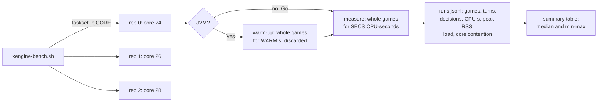

# How the engine comparison is measured

This page says exactly what the [cross-engine comparison](index.md) measures,
where the engines are and are not comparable, and how to rerun it on your own
machine. It is for anyone who wants to check the numbers, rerun them after a
change, or add another engine. Terms such as *decision* and *seat* are defined
in the [glossary](../contributing/glossary.md).

## What one run is

A **run** is one operating-system process that plays whole two-player games
between two fixed decks, single-threaded, pinned to one CPU core, for a fixed
amount of CPU time. A **row** is one engine, one player policy and one deck
pair; every row is run three times (three **reps**) and the tables report the
median with the min-max spread of the three.



## Metrics

| Metric | Definition | Why it is reported |
|---|---|---|
| games per core-second | measured games ÷ CPU seconds of the measured window | the headline: how many self-play games one core produces |
| ms per game | the inverse, in milliseconds | easier to read for the slow engines |
| µs per turn | CPU µs ÷ turns played | normalises game length; *turn* is each engine's own turn counter, which counts both players' turns in all four engines |
| µs per decision | CPU µs ÷ decisions answered | normalises game length per choice, but each engine splits a game into decisions differently (below), so compare it within one engine, not across |
| peak RSS | the process's maximum resident set size (`/usr/bin/time %M`), reported per row as a distribution over reps (median, then every rep) | memory cost of one game-playing process, card database included |

**Peak RSS is a distribution.** A Go process's peak is set by when the garbage
collector happens to run during corpus load and deck setup, so the reps of one
row can fall into two clusters rather than scatter around one value (the
dirty-dirac rows did, roughly 100 MB apart, until its game runner stopped
loading the whole corpus on 2026-10-26). The summary table therefore keeps
the median in `peak RSS MB` and lists every rep, sorted, in `RSS reps MB`;
compare the distributions, not the medians.

**CPU time** is the process's user + system time over the measured window, so
it includes every thread of the process: for the Go engines the garbage
collector, for the JVM engines the garbage collector, the JIT compiler and
XMage's AI search threads. With the process pinned to one core, CPU time and
wall time agree to within a few per cent. Forge's driver reports wall time per
game; on a pinned core that is the core-time the game used.

**Decisions** differ by engine:

| Engine | A decision is | Counted from |
|---|---|---|
| gorge | every `decision.Decision` the engine poses: priority, each mana tap (manual policies), each target, attack and block declarations, mulligans, choices | `enginebench` `detail.Decisions` |
| dirty-dirac | every intent the kernel asks a policy for | `kplay` `intents` per game |
| XMage | each `priority`, `selectAttackers` and `selectBlockers` call on the game thread (targets and other asks are not counted) | the driver's counter |
| mtg-kernel | every `advance_until_decision` call on the raw engine API (every priority window, each mana ability) | the driver's counter |
| Forge | not counted: the driver has no per-decision hook | - |

## The workload

Two FDN (Foundations) limited deck pairs from
[`cmd/enginebench/testdata/decks`](https://github.com/adams-shaun/gorge/blob/main/cmd/enginebench/testdata/decks/README.md),
the same files every engine reads:

| Pair | Seat A | Seat B |
|---|---|---|
| A | `FDN_top_04956_UG` | `FDN_top_20626_WG` |
| B | `FDN_top_07961_WR` | `FDN_top_02581_UR` |

They are 40-card decks of 17lands-sourced (CC BY 4.0) Premier Draft lists. FDN
is used because it is the one card pool every engine here plays in full:
FDN is one of dirty-dirac's generated, lockstep-verified card pools, while
gorge, XMage and Forge have every card.

**mtg-kernel** implements 245 of FDN's 286 card names at the measured commit
(and 452 card definitions in all, most of them for its Pauper pool). Pair A
is exactly its two FDN fixture decks, so it plays pair A; pair B needs four
cards it lacks (Goblin Negotiation, Leyline Axe, Drakuseth, Maw of Flames and
Imprisoned in the Moon), so it has no pair-B row. A second workload is played
for it: the **Burn mirror** (`burn.json`, the 60-card mono-red Pauper list
from mtg-kernel's own pool, MIT), which is its home deck. gorge, XMage and
Forge play Burn too; dirty-dirac does not (it has no generated pool for it). Burn is
played as Pauper constructed: 60 cards, 20 life.

Seats alternate every game, 20 life, 7-card hands, no mulligans except
where an engine's own AI decides one (XMage and Forge AIs may mulligan; the
gorge and dirty-dirac runs use their default of no mulligan round). Every game
has a turn cap (300 turns in `enginebench`, 100 in the other drivers); in the
published rows no game reached it, stalled or failed. The one exception was
left out of the tables: XMage's base `ComputerPlayer` on the Burn mirror casts
nothing, and every one of its games hit the cap without a winner.

## The player policies

The policy is the biggest difference between rows, so every row says which
one it uses. There are two classes.

**Random legal action** measures the engine almost alone: the policy is a few
lines, so the cost is listing the legal actions and applying the chosen one.

| Engine | Row | What the policy does |
|---|---|---|
| gorge | `random-autopay` | uniform over the priority options with mana paid automatically (payment plans, no individual taps), uniform over every other decision. The closest match to the other engines' random players. |
| gorge | `random` | uniform over every option including each individual mana tap, so it wastes mana and plays about twice as many turns per game |
| dirty-dirac | `random` | uniform over the kernel's options at every intent |
| XMage | `random` | at each priority, a uniformly random playable ability or pass (the rule of XMage's own MCTS rollout player `SimulatedPlayerMCTS`), random attackers, random blockers. Targets, modes and the other asks are answered by XMage's base `ComputerPlayer` heuristics, so this row carries some AI cost |
| mtg-kernel | `random` | the random policy of mtg-kernel's own benchmark (`random_action_for_decision` in `examples/bench_kernel.rs`): uniform over every legal action through the raw engine API, every priority window and every mana ability asked separately (like gorge's manual-tap `random`), each eligible attacker with probability 1/2, a block with probability 0.35. The driver adds one thing: a dual land's colour, which that policy (written for mono-coloured decks) does not choose, is picked at random from the colours the engine offers |
| Forge | - | Forge ships no random player; this comparison has no Forge random row |

**Each engine's own AI** measures what a game costs with the engine's built-in
bot on both seats. These AIs are not the same strength or the same algorithm,
so read these rows as "the price of a game with the bot this engine ships",
not as engine speed.

| Engine | Row | The AI |
|---|---|---|
| gorge | `bot` | the default heuristic bot (`heuristic.NewBot`), manual mana taps |
| gorge | `bot-autopay` | the same bot with auto-pay (`EnableAutoPayMana`) |
| dirty-dirac | `hbot` | a native port of gorge's auto-pay heuristic bot, which agrees with it on over 99.9% of priority decisions; compare it with gorge's `bot-autopay` |
| XMage | `simple` | the base `ComputerPlayer`: no look-ahead. Its games run long (it rarely races) |
| XMage | `mad` | `ComputerPlayer7`, "Computer - mad", the XMage client's default AI, at skill 1 (search depth 4, at most 3 s per decision) |
| Forge | `ai` | Forge's `PlayerControllerAi` with the default AI profile on both seats, as Forge plays AI-vs-AI matches |
| mtg-kernel | - | no row: its built-in searchers (the kernel-native search opponent, the model-guided search) are wired to its training and evaluation contracts and have no standalone game runner, so they were not driven here |

Separating engine cost from AI cost: within one engine, the random row is the
engine floor and the AI rows add the AI on top. In gorge the default bot plays
games *faster* than the random player, because it ends games sooner (about 18
turns against 23-42) and its decisions are cheap; in XMage, `mad` costs about
an order of magnitude more per turn than `random`, because its search copies
and simulates the game.

## Pinning, concurrency and noise

- Every run is one process pinned with `taskset -c CORE`; Go runs with
  `GOMAXPROCS=1`, and a JVM pinned to one core picks the serial garbage
  collector by itself (`-XX:+PrintFlagsFinal` shows `UseSerialGC` ergonomic).
  JVM heap is capped at `-Xmx2g`.
- The three reps of a row run **at the same time**, on cores 24, 26 and 28
  (three different physical cores of a 16-core / 32-thread Ryzen 9 9950X;
  their SMT siblings are not reserved). Rows and engines run one after
  another, never together. The concurrency cuts the wall time by three; the
  cost is that the reps share the chip's L3 cache and memory bandwidth with
  each other (and with whatever else runs on the machine).
- The 1-minute load average before and after each run is recorded, and so is
  **core contention**: the run's core's busy time (from `/proc/stat`) beyond
  the run's own CPU time. A rep with more than a few per cent of other work on
  its core is rerun; the summary prints the worst rep's contention.
- The box is shared with other work; the load average during the published
  run is printed beside every table. Variation between reps was small (see
  the min-max columns), which is the evidence that the numbers are stable at
  this load, not a guarantee that they hold on an idle machine.

## JVM warm-up

A JVM engine starts interpreted and gets faster as the JIT compiles its hot
code: XMage's random games went from 11 to about 60-75 turns per second over
the first 15 games (about 15 s) on this machine. Each JVM run therefore plays
whole games for `WARM` = 40 CPU-seconds first and discards them, then
measures for `SECS` = 60 CPU-seconds. The reported JVM numbers are **steady
state after warm-up**. Start-up (loading the card database: 8-10 s for XMage,
6 s for Forge) and warm-up are excluded from the per-game numbers but included
in peak RSS. The Go engines need no warm-up; `enginebench` plays a few games
before its timer starts, and its corpus load (and `kplay`'s, about 1-3 s) is
excluded the same way.

**The card cache is private and pre-warmed.** gorge and dirty-dirac both read
gorge's card corpus through its compiled IR cache (`ir-<fingerprint>.gob.gz`
beside the corpus, one per compiler build), and every compile prunes other
builds' caches from the same directory. On a `.cards` directory that other
builds share, a timed run could therefore find its cache evicted and pay a
whole-corpus recompile, costing seconds and several hundred MB of peak RSS.
The harness never points an engine at the shared directory: each invocation
makes a private copy of the corpus (a hardlink farm of the scripts plus the
lock file, under `$OUT/work`), warms each engine's cache there with one
untimed run before its first timed rep, and records in `run.txt` any batch
whose reps changed the private cache. Nothing is written into the shared
corpus. The copy is deleted at exit unless `KEEP_CARDS=1`. One asymmetry works against dirty-dirac: `kplay`
writes a JSON line per game (about 1 KB) inside its measured window, while
`enginebench` writes only its summary.

## What is not comparable

!!! warning "Read the comparison with these in mind"
    - **Rules coverage differs.** XMage and Forge implement every card and
      every format; gorge implements most of Forge's card corpus (the coverage
      ratchet is on the [support pages](../support/sets.md)); dirty-dirac is a
      two-player kernel that plays only its generated card pools. A faster engine that plays fewer
      cards is not doing the same job.
    - **Decisions are split differently.** gorge asks for each mana tap and
      each target; XMage's counted decisions are priority, attack and block
      only; Forge's are not counted. Compare µs per decision within an
      engine.
    - **The AIs differ in kind.** gorge's bot and dirty-dirac's port are
      cheap one-ply heuristics; XMage's `mad` is a depth-limited game-tree
      search; Forge's AI is a large rule-based player. Their game lengths
      differ too.
    - **XMage's random row is not fully random**: non-priority asks go to its
      base AI.
    - **mtg-kernel plays a few hundred cards.** It is a Rust kernel for a
      fixed pool (452 card definitions: its Pauper decks and 245 FDN names),
      against Forge's ~34,000-card corpus, about 94% of which gorge plays.
      Its FDN registry is behind a cargo feature (`limited-fdn-fixtures`),
      and that build is several times slower on the Burn mirror than the
      default build (32 against 157 games per core-second in a smoke run), so
      each workload uses the build that plays it: pair A the FDN build, Burn
      the default build.
    - **One machine, one load.** All numbers come from one shared machine at a
      moderate load. Relative positions are robust to that; absolute numbers
      are not.

## Rerunning it

The harness is [`scripts/xengine-bench.sh`](https://github.com/adams-shaun/gorge/blob/main/scripts/xengine-bench.sh)
(bash, with the stdlib-only
[`scripts/xengine-bench-summarize.py`](https://github.com/adams-shaun/gorge/blob/main/scripts/xengine-bench-summarize.py)
for the deck conversion and the table). It plays every engine that is set up
and prints the summary table; the raw per-run lines stay in
`$OUT/runs.jsonl`.

### 1. gorge alone (about 4 minutes)

```sh
git clone https://github.com/adams-shaun/gorge && cd gorge
make fetch-cards                 # the Forge card corpus, pinned, into .cards/
OUT=/tmp/xengine CORES="2 4 6" SECS=30 scripts/xengine-bench.sh gorge
```

Choose `CORES` on your machine: three idle cores on different physical cores
(`lscpu -e` shows which logical CPUs share a core).

### 2. XMage (one-time build about 2 minutes plus the download)

The XMage build comes from
[gorge-compliance](https://github.com/adams-shaun/gorge-compliance), which
builds XMage out of tree for its compliance oracle. The benchmark driver,
`XEngineBench.java`, lives there beside the oracle driver.

```sh
git clone https://github.com/adams-shaun/gorge-compliance && cd gorge-compliance
make xmage-oracle-setup XMAGE_ORACLE_DIR=$HOME/xmage    # JDK 17 + Maven + XMage at XMAGE_REF, built
D=$HOME/xmage
(cd $D/mage && $D/maven/bin/mvn -q -B -pl Mage.Tests dependency:build-classpath \
   -Dmdep.outputFile=$D/tests.cp -Dmdep.includeScope=test)
cd ../gorge
JAVA=$D/jdk/bin/java XMAGE_TESTS=$D/mage/Mage.Tests XMAGE_CP=$D/tests.cp \
XMAGE_BENCH=../gorge-compliance/oracle/xmageoracle/bench/org/mage/test/bench/XEngineBench.java \
OUT=/tmp/xengine CORES="2 4 6" SECS=60 WARM=40 scripts/xengine-bench.sh xmage
```

### 3. Forge

Forge is built by gorge-compliance's `make forge-oracle-setup` (forge-core,
forge-game and forge-ai at `FORGE_ORACLE_REF` from gorge's Forge fork, with
their classpath in `cp.txt`). The whole-game driver is `forge.oracle.GameReplay`
in the fork's `forge-oracle` module, on branch
[`oracle-harness`](https://github.com/adams-shaun/forge/tree/oracle-harness)
(since `abbeafb93a`); clone it with
`git clone -b oracle-harness https://github.com/adams-shaun/forge.git`.

```sh
cd gorge-compliance && make forge-oracle-setup FORGE_ORACLE_DIR=$HOME/forgeoracle
F=$HOME/forgeoracle
cd ../gorge
JAVA=$HOME/xmage/jdk/bin/java FORGE_CP=$F/cp.txt FORGE_RES=$F/forge/forge-gui/res \
FORGE_SRC=<forge checkout>/forge-oracle/src/main/java \
OUT=/tmp/xengine CORES="2 4 6" SECS=60 WARM=40 scripts/xengine-bench.sh forge
```

The Forge driver stops the JVM once `WARM + SECS` seconds of games are
written, and the warm-up games are dropped when the run is recorded.

### 4. dirty-dirac

dirty-dirac is the maintainers' private kernel, under active development
toward a full engine, so its row cannot be rerun from the public
repositories. Its published game rows were measured on 2026-10-26, and its search rows on 2026-10-20, on the kernel's
earlier state layout
([Performance](index.md#dirty-diracs-rows)), with the same script, which
calls the kernel's game runner `kplay` when `KPLAY` names a binary built from
the private module:

```sh
KPLAY=<kplay binary> OUT=/tmp/xengine CORES="24 26 28" SECS=30 scripts/xengine-bench.sh dirty-dirac
# each run: kplay -cards .cards -deckfile <the pair, as JSON> -pairs-file <200000 games, seats alternating>
#           -pairs 0 -a random|hbot -b random|hbot -wall 30s -out <games.jsonl>
```

### 5. mtg-kernel

[mtg-kernel](https://github.com/jackmaiorino/mtg-kernel) (MIT) was measured
at `058d075e30532b15a6417cafd7086e5b98fd88da` (2026-10-20) with the Rust
toolchain its `rust-toolchain.toml` pins (1.94.1), release profile (thin LTO,
one codegen unit). Its own benchmark, `examples/bench_kernel.rs`, plays
random Burn mirrors; gorge adds a small mode to it, `--xengine-json`, that
plays any two deck lists for a fixed CPU time with that benchmark's own random
policy and prints one JSON line. The mode is gorge's code (Apache-2.0 or MIT),
in [`cmd/enginebench/scripts/xengine/mtgkernel/`](https://github.com/adams-shaun/gorge/tree/main/cmd/enginebench/scripts/xengine/mtgkernel):
`xengine.rs` and `apply.py`, which copies it into a checkout and adds the
three-line dispatch to `bench_kernel`'s `main`. Nothing from mtg-kernel is
committed to gorge.

```sh
git clone https://github.com/jackmaiorino/mtg-kernel && cd mtg-kernel
git checkout 058d075e30532b15a6417cafd7086e5b98fd88da
(cd mtg-kernel && python3 ../../gorge/cmd/enginebench/scripts/xengine/mtgkernel/apply.py \
   ../../gorge/cmd/enginebench/scripts/xengine/mtgkernel/xengine.rs)
CARGO_TARGET_DIR=$PWD/target     cargo build --release -p mtg-kernel --example bench_kernel
CARGO_TARGET_DIR=$PWD/target-fdn cargo build --release -p mtg-kernel --example bench_kernel \
   --features limited-fdn-fixtures          # about 10 minutes each on 3-4 cores
cd ../gorge
MTGKERNEL_BENCH=../mtg-kernel/target-fdn/release/examples/bench_kernel MK_PAIRS=A \
  OUT=/tmp/xengine CORES="2 4 6" SECS=30 scripts/xengine-bench.sh mtg-kernel
MTGKERNEL_BENCH=../mtg-kernel/target/release/examples/bench_kernel MK_PAIRS=burn \
  OUT=/tmp/xengine CORES="2 4 6" SECS=30 scripts/xengine-bench.sh mtg-kernel
```

The driver refuses a deck with a card mtg-kernel does not fully support
(`preflight_fully_supported_deck`) instead of measuring something else, warms
up for `MK_WARM` (default 5) CPU-seconds, reads its CPU time from
`/proc/self/stat`, and counts halted games, engine errors and capped games
(none in the published run). The other engines play the Burn rows with
`PAIRS=burn`.

### Reading the output

`runs.jsonl` holds one line per run: `engine`, `row`, `pair`, `rep`, `core`,
`load1_before`/`load1_after`, `maxrss_mb`, `games`, `turns`, `decisions`,
`cpu_s`, `games_per_cpu_s`, `ms_per_game`, `us_per_turn`, `us_per_decision`,
`warmup_games`, `errors` (stalls, unfinished or harness-failed games) and
`other_busy` (the core contention above). Rerun the table with
`python3 scripts/xengine-bench-summarize.py $OUT/runs.jsonl`. The table's last
column, `RSS reps MB`, is every rep's peak RSS, sorted. `$OUT/summary.jsonl`
(`--json`) holds the same rows as JSON, with `min`, `median`, `max` and `reps`
for each rate and for `rss_mb`. `run.txt` records where the private corpus copy
was made and which IR caches each warm-up compiled.

## Search bots

The search rows measure what one MCTS simulation costs, the number that
decides how much look-ahead a search bot can afford. Each run is one process
on one pinned core, three reps at once, 30 seconds, FDN pair A (gorge's
`az` row alternates pairs A and B, two games each).

| Row | What runs | How cost is counted |
|---|---|---|
| gorge MCTS, heuristic leaf | `enginebench -row az -sims N` (build tag `enginebench_az`): the `azmcts` seat behind `az-redeal`, every simulation over a freshly re-dealt world of what the seat cannot see, a heuristic leaf value, gorge's heuristic bot playing every unsearched decision inside the search. It searches priority roots from turns 5-8 of seeded games that alternate pairs A and B | CPU time inside the search only, divided by simulations (`sims_per_cpu_s`) and by searched roots |
| dirty-dirac MCTS, heuristic leaf | the kernel's game runner with an MCTS seat on both sides (`-a az:sims=N -b az:sims=N`): the same algorithm shape (re-dealt worlds, the native port of gorge's heuristic bot as the in-search player), heuristic leaf | process CPU over whole games (searched and unsearched decisions, the engine between searches), divided by completed simulations; so it slightly overstates the search's own cost against the gorge row |
| dirty-dirac MCTS, network leaf | the same with `:gonet=<weights>`: a small multilayer perceptron (one 64-wide layer, about 2.4 MB of weights) evaluated in-process on the CPU as the leaf value | as above |

No network leaf is measured for gorge, because `enginebench`'s `az` row has no
network option. No mtg-kernel search row is published, for the reason given
under the player policies.

The cost split comes from profiles: for dirty-dirac the kernel's own
per-simulation timers (a `kprof` build of its runner), for gorge
`go tool pprof` on `enginebench -cpuprofile`.

```sh
go build -tags enginebench_az -o /tmp/eb-az ./cmd/enginebench
for n in 25 100 1000; do taskset -c 24 env GOMAXPROCS=1 /tmp/eb-az -row az -sims $n -secs 30; done
```

The dirty-dirac rows come from the private module's game runner, run as
`kplay -cards .cards -deckfile <pair A> -pairs-file <games> -pairs 0 -a az:sims=N[:gonet=W] -b az:sims=N[:gonet=W] -wall 30s`
with `GOMAXPROCS=1` on one pinned core.

## Adding an engine

An engine needs a driver that plays whole games between two `.dck` deck lists
on one thread, pinned, and reports games, turns, decisions and CPU time for a
measured window after any warm-up. Add a `<engine>_run` and `<engine>_all`
function to the script and a `KIND` to `--record` in the summarizer. Other
engines were not added because none is installed on the measuring machine.
