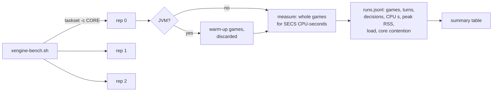

# How it is measured

This page says what the [engine comparison](index.md) measures, where engines aren't comparable, and how to measure it again on your
own machine. It is for anyone who wants to check the numbers or add an engine.

## What one run is

A **run** is one process playing whole two-player games between two fixed decks, single-threaded, pinned to one CPU core, for a fixed
amount of CPU time. A **row** is one engine, one policy and one deck pair. Each row runs three times at once, on three different physical
cores, and the tables report the median and the spread. Rows run one after another, never together.



| Metric | Definition |
|---|---|
| games per core-second | measured games ÷ CPU seconds of the measured window |
| ms per game | the inverse |
| µs per turn | CPU µs ÷ turns played; each engine's turn counter counts both players' turns |
| µs per decision | CPU µs ÷ decisions answered; decisions are counted differently per engine, below |
| peak RSS | the process's maximum resident set from `/usr/bin/time`, corpus load included |

**CPU time** is the process's user and system time, so it includes the garbage collector, and for a JVM the JIT compiler too. Forge's
driver reports wall time per game, which on a pinned core is the core-time the game used.

**Peak RSS is a distribution.** A Go process's peak depends on when the collector runs during corpus load, so one row's reps can fall in
two clusters. The summary keeps the median and lists every rep.

| Engine | A decision is |
|---|---|
| gorge | every `decision.Decision` posed: priority, each mana tap under manual policies, each target, attack and block declarations, mulligans, choices |
| dirac | every decision a policy is asked, after single options are answered in place |
| XMage | each `priority`, `selectAttackers` and `selectBlockers` call on the game thread |
| mtg-kernel | every `advance_until_decision` call on the raw engine API |
| Forge | not counted: the driver has no per-decision hook |

## The workload

Two FDN (Foundations) limited deck pairs from
[`cmd/enginebench/testdata/decks`](https://github.com/adams-shaun/gorge/blob/main/cmd/enginebench/testdata/decks/README.md), 40-card
Premier Draft lists sourced from 17lands (CC BY 4.0):

| Pair | Seat A | Seat B |
|---|---|---|
| A | `FDN_top_04956_UG` | `FDN_top_20626_WG` |
| B | `FDN_top_07961_WR` | `FDN_top_02581_UR` |

The second workload, the **Burn mirror** (`burn.json`), is the 60-card mono-red Pauper list from mtg-kernel's pool (MIT). gorge, XMage,
Forge and mtg-kernel play it, and no dirac pool holds it. mtg-kernel lacks four cards of pair B, so it plays pair A and Burn.

Seats alternate every game, at 20 life with 7-card hands. The gorge and dirac runs have no mulligan round, while XMage's and Forge's AIs may mulligan.
Every game has a turn cap: 300 in `enginebench`, 100 in the other drivers.

## The player policies

**Random legal action** measures the engine almost alone.

| Engine | Row | The policy |
|---|---|---|
| gorge | `random-autopay` | uniform over the priority options with mana paid automatically, uniform over every other decision. The closest match to the other engines' random players |
| gorge | `random` | uniform over every option including each mana tap, so it wastes mana and plays about twice as many turns |
| dirac | `random` | uniform over the options at every decision |
| XMage | `random` | at each priority a random playable ability or pass, random attackers and blockers; targets, modes and other asks go to its base `ComputerPlayer` |
| mtg-kernel | `random` | its own benchmark's policy, through the raw engine API: every priority window and mana ability asked separately |

**Each engine's own AI** measures what a game costs with the bot it ships. These differ in algorithm, so read them as prices, not as engine speed.

| Engine | Row | The AI |
|---|---|---|
| gorge | `bot`, `bot-autopay` | the default heuristic bot (`heuristic.NewBot`), with manual taps or `EnableAutoPayMana` |
| dirac | `hbot` | a native port of gorge's auto-pay heuristic bot; compare it with `bot-autopay` |
| XMage | `simple` | the base `ComputerPlayer`, with no look-ahead |
| XMage | `mad` | `ComputerPlayer7`, the client's default AI, at skill 1 (search depth 4, at most 3 s per decision) |
| Forge | `ai` | `PlayerControllerAi` with the default profile on both seats |

mtg-kernel has no row here. Its searchers are wired to its training contracts and have no standalone game runner.

## Pinning and noise

- Every run is pinned with `taskset -c CORE`. Go runs with `GOMAXPROCS=1`, and a JVM pinned to one core picks the serial collector by itself, with heap
  capped by `-Xmx2g`.
- The harness records the 1-minute load before and after each run, and **core contention**: the core's busy time beyond the run's own CPU
  time. A rep with more than a few per cent of other work on its core is rerun.
- Three reps share the chip's L3 cache and memory bandwidth with each other and with anything else on the machine, so load still moves the
  numbers. The min-max spread shows repeatability at that load and doesn't promise the same value on an idle machine.
- **JVM warm-up.** A JVM starts interpreted, so each run plays `WARM` seconds of games and discards them before measuring. Start-up and
  warm-up are excluded from the per-game numbers but included in peak RSS.
- **The card cache is private.** Every compile prunes other builds' IR caches from its directory, so a timed run on a shared `.cards` could pay a
  whole-corpus recompile. The harness makes a private hardlink copy of the corpus under `$OUT/work`, warms each engine's cache there with one
  untimed run, and records in `run.txt` any batch whose reps changed it.

## Measuring again

The harness is [`scripts/xengine-bench.sh`](https://github.com/adams-shaun/gorge/blob/main/scripts/xengine-bench.sh), with the stdlib-only
[`scripts/xengine-bench-summarize.py`](https://github.com/adams-shaun/gorge/blob/main/scripts/xengine-bench-summarize.py). Choose `CORES` as
idle cores on different physical cores (`lscpu -e` shows which share one). The script's header lists every knob.

### gorge

About three minutes at `SECS=20`, which is how the published rows were made:

```sh
git clone https://github.com/adams-shaun/gorge && cd gorge
make fetch-cards
OUT=/tmp/xengine CORES="24 26 30" SECS=20 scripts/xengine-bench.sh gorge
OUT=/tmp/xengine-burn CORES="24 26 30" SECS=15 PAIRS=burn scripts/xengine-bench.sh gorge
```

The output is one row per engine, policy and pair:

```text
| engine | policy | pair | reps | games/core-s | ms/game | µs/turn | µs/decision | turns/game | peak RSS MB | load1 | other busy | RSS reps MB |
| gorge | random-autopay | A | 3 | 69.9 (69.6-72.3) | 14.3 (13.8-14.4) | 620 (611-632) | 25.9 (25.5-26.3) | 22.7 | 360 | 16-18 | max 0% | 359 360 365 |
```

`$OUT/runs.jsonl` holds one line per run and `$OUT/summary.jsonl` the same table as JSON. `python3 scripts/xengine-bench-summarize.py $OUT/runs.jsonl`
reprints it.

### XMage

[gorge-compliance](https://github.com/adams-shaun/gorge-compliance) builds XMage out of tree for its compliance oracle, and the benchmark driver,
`XEngineBench.java`, sits beside the oracle driver. These rows were last run on 2026-10-20.

```sh
git clone https://github.com/adams-shaun/gorge-compliance && cd gorge-compliance
make xmage-oracle-setup XMAGE_ORACLE_DIR=$HOME/xmage
D=$HOME/xmage
(cd $D/mage && $D/maven/bin/mvn -q -B -pl Mage.Tests dependency:build-classpath \
   -Dmdep.outputFile=$D/tests.cp -Dmdep.includeScope=test)
cd ../gorge
JAVA=$D/jdk/bin/java XMAGE_TESTS=$D/mage/Mage.Tests XMAGE_CP=$D/tests.cp \
XMAGE_BENCH=../gorge-compliance/oracle/xmageoracle/bench/org/mage/test/bench/XEngineBench.java \
OUT=/tmp/xengine CORES="2 4 6" SECS=60 WARM=40 scripts/xengine-bench.sh xmage
```

### Forge

gorge-compliance's `make forge-oracle-setup` builds forge-core, forge-game and forge-ai with their classpath in `cp.txt`. The driver,
`forge.oracle.GameReplay`, is in the `forge-oracle` module on branch
[`oracle-harness`](https://github.com/adams-shaun/forge/tree/oracle-harness) of gorge's Forge fork. These rows were last run on 2026-10-20.

```sh
cd gorge-compliance && make forge-oracle-setup FORGE_ORACLE_DIR=$HOME/forgeoracle
F=$HOME/forgeoracle
cd ../gorge
JAVA=$HOME/xmage/jdk/bin/java FORGE_CP=$F/cp.txt FORGE_RES=$F/forge/forge-gui/res \
FORGE_SRC=<forge checkout>/forge-oracle/src/main/java \
OUT=/tmp/xengine CORES="2 4 6" SECS=60 WARM=40 scripts/xengine-bench.sh forge
```

### mtg-kernel

Measured at `058d075e30532b15a6417cafd7086e5b98fd88da` on 2026-10-20. gorge adds a small mode to its benchmark, `--xengine-json`, that plays any two
deck lists for a fixed CPU time with that benchmark's own policy. The mode is in
[`cmd/enginebench/scripts/xengine/mtgkernel/`](https://github.com/adams-shaun/gorge/tree/main/cmd/enginebench/scripts/xengine/mtgkernel).
Nothing from mtg-kernel is committed to gorge.

```sh
git clone https://github.com/jackmaiorino/mtg-kernel && cd mtg-kernel
git checkout 058d075e30532b15a6417cafd7086e5b98fd88da
(cd mtg-kernel && python3 ../../gorge/cmd/enginebench/scripts/xengine/mtgkernel/apply.py \
   ../../gorge/cmd/enginebench/scripts/xengine/mtgkernel/xengine.rs)
CARGO_TARGET_DIR=$PWD/target     cargo build --release -p mtg-kernel --example bench_kernel
CARGO_TARGET_DIR=$PWD/target-fdn cargo build --release -p mtg-kernel --example bench_kernel \
   --features limited-fdn-fixtures
cd ../gorge
MTGKERNEL_BENCH=../mtg-kernel/target-fdn/release/examples/bench_kernel MK_PAIRS=A \
  OUT=/tmp/xengine CORES="2 4 6" SECS=30 scripts/xengine-bench.sh mtg-kernel
MTGKERNEL_BENCH=../mtg-kernel/target/release/examples/bench_kernel MK_PAIRS=burn \
  OUT=/tmp/xengine CORES="2 4 6" SECS=30 scripts/xengine-bench.sh mtg-kernel
```

The driver refuses a deck with a card mtg-kernel doesn't fully support rather than measure something else.

### dirac

[dirac's source isn't in this repository yet](../architecture/dirac/index.md), and neither is its game runner, `kplay`, so these commands
can't be run from a clone of gorge. They are how the published rows were made. The game rows use the same script, which calls `kplay`
when `KPLAY` names a binary:

```sh
KPLAY=<kplay binary> OUT=/tmp/xengine CORES="24 26 30" SECS=20 scripts/xengine-bench.sh dirac
```

The transition rows are Go benchmarks, one core, reporting no allocations:

```sh
GOMAXPROCS=1 taskset -c 26 go test -trimpath -run XXX \
  -bench '^Benchmark(Transition(FDN|BLB|FDNPool)|CloneFDN)$' -benchmem -count 5 -benchtime 2s ./dirac
```

**Instructions per operation** don't depend on load the way nanoseconds do, so they are the number to compare between two commits. Run the test
binary under `perf stat` at two fixed counts and difference them, which cancels setup:

```sh
go test -trimpath -c -o dirac.test ./dirac
for n in 500000 1500000; do
  GOMAXPROCS=1 perf stat -x, -e instructions:u -o perf-$n.txt taskset -c 26 \
    ./dirac.test -test.run XXX -test.bench '^BenchmarkTransitionFDN$' -test.benchtime ${n}x
done
# (instructions at 1500000 - instructions at 500000) / 1000000
```

## Adding an engine

An engine needs a driver that plays whole games between two `.dck` lists on one thread and reports games, turns, decisions and CPU time for a
measured window after any warm-up. Add a `<engine>_run` and `<engine>_all` function to the script and a `KIND` to `--record` in the summarizer.
