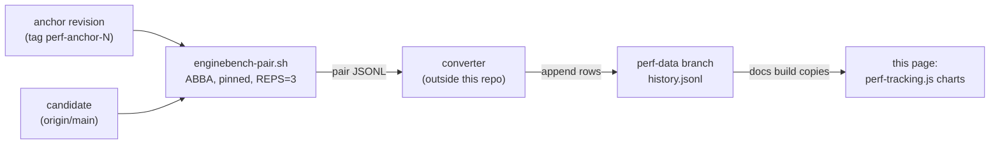

# Tracking engine speed over time

This page charts gorge's engine speed relative to a fixed **anchor**
revision, one chart per scenario and metric, so a slowdown shows up as a step
in a line rather than as a number someone has to remember. It is for
contributors checking whether a change moved the engine's speed. The data
comes from the `perf-data` branch's `history.jsonl`, which the docs build
(`.github/workflows/docs.yml`) copies to `perf/history.jsonl` on this site
when the branch exists.

!!! info "Status, 2026-10-20: no data yet"
    The `perf-data` branch and the `perf-anchor-1` tag do not exist yet
    (`git ls-remote origin perf-data` is empty), so the charts below show
    "no data". The recording plan and what is left before the first point
    are at the end of this page. Until then, the latest numbers are on
    [Engine speed](engine.md) and the cross-engine comparison on
    [Performance](index.md).

<div id="perf-charts">
  <p id="perf-status"><em>Loading performance history…</em></p>
</div>

## Why ratios, not absolute numbers

Benchmarks run on a shared machine whose load varies (see the noise warning on
[Engine speed](engine.md#how-to-run)), and hosted CI runners are noisier still.
Absolute throughput from one night to the next mostly measures the machine.
Each run therefore measures the candidate and a fixed anchor revision
**interleaved in the same session** (ABBA), and records the median
candidate/anchor ratio. `1.0` means "as fast as the anchor", `1.25` means 25%
faster for a higher-is-better metric. The absolute value is kept for context.

The shaded band on each chart is the min–max of the per-repetition ratios.
When the anchor is rotated, one run is published against both the old and the
new anchor so the series can be stitched. Random and bot rows changed
methodology on 2026-10-06 (games are now recycled through a spare pool), so
the first anchor must be on or after that date.

## Record schema

`history.jsonl` holds one JSON object per line: one row per run × scenario ×
metric.

```json
{"schema":1,"commit":"<40-hex>","commit_date":"2026-10-12T09:00:00Z","run_date":"2026-10-12T23:10:00Z",
 "anchor":"perf-anchor-1","scenario":"bot/A","metric":"turns_per_cpu_s","unit":"turns/cpu-s",
 "higher_is_better":true,"value":2269.0,"anchor_value":2210.0,"ratio_to_anchor":1.027,
 "reps":3,"ratios":[1.01,1.03,1.04],
 "host":{"id":"gorge-box","cpu":"AMD Ryzen 9 9950X","threads":32,"kernel":"6.17.0-41",
         "go":"go1.26.3","gomaxprocs":1,"pin":"cpu9","gogc":"default","load1_med":18.4},
 "harness":{"tool":"enginebench","secs":60,"bin_sha256":"…"}}
```

| Field | Meaning |
|---|---|
| `schema` | record version, currently `1` |
| `commit`, `commit_date` | the measured revision and its commit time |
| `run_date` | when the measurement ran |
| `anchor` | the anchor tag the run was paired against |
| `scenario`, `metric`, `unit` | what was measured, e.g. `bot/A` + `turns_per_cpu_s` |
| `higher_is_better` | direction of the metric (µs/op and bytes/op are lower-is-better) |
| `value`, `anchor_value` | absolute medians for candidate and anchor in this session |
| `ratio_to_anchor` | median per-repetition candidate/anchor ratio (the charted value) |
| `reps`, `ratios` | repetition count and each repetition's ratio (the band) |
| `host` | machine fingerprint: CPU, kernel, Go version, `GOMAXPROCS`, core pin, `GOGC`, median load |
| `harness` | tool, seconds per row, and the SHA-256 of the benchmark binary |

Planned metrics: random play (pairs A, B, Burn), bot play (pair A, manual and
auto-pay), clone µs and allocation, MCTS at 100 sims, the sampler, and live
heap. An optional separate series would track bot strength, measured outside
gorge.

## How the series is produced (plan)



The measurement is planned to run on the project's own benchmark machine,
nightly or after a batch of merges lands, with nothing else heavy running, in
about five minutes:

```sh
REV=$(git rev-parse origin/main); ANCHOR=$(git rev-parse perf-anchor-1)
PIN=9 BUDGET=300 REPS=3 BUILD_ARGS="-tags enginebench_az" \
ROWS="-row random -pair A;-row random -pair B;-row random -pair burn;-row bot -pair A;-row bot -pair A -autopay;-row clone;-row az -sims 100;-row sampler" \
  scripts/enginebench-pair.sh "$ANCHOR" "$REV" "$OUT"
```

A small converter, kept outside this repository, turns the pair output into
the schema above and appends it to `history.jsonl` on the orphan `perf-data`
branch, so performance data never lands on `main`.

Work remaining before the first published point (checked 2026-10-20 at
`ad3777023`):

1. ~~`enginebench` records the commit, Go version, CPU, `GOGC` and core
   pin.~~ Done: every result line carries `commit` (stamped with
   `-ldflags -X main.commit=` by `scripts/enginebench-build.sh`, since a
   `git archive` build has no VCS stamp), `go_version`, `cpu_model`, `gogc`
   and `pin` (`cmd/enginebench/provenance.go`). The binary's SHA-256 is not
   recorded yet; the converter would have to hash the binary itself.
2. ~~A `PIN=` option in `enginebench-pair.sh`.~~ Done: `PIN=<cpu>` runs every
   rep as `taskset -c $PIN env GOMAXPROCS=1`.
3. The JSON converter's first run against a real pair output.
4. Tag `perf-anchor-1` on or after 2026-10-06 and create the `perf-data`
   branch.
5. Optionally, an overnight backfill and a weekly bot-strength series.
