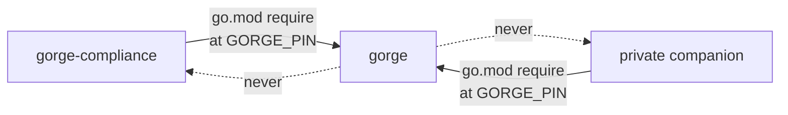
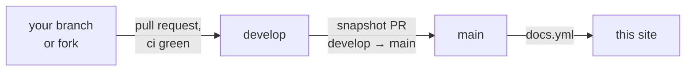
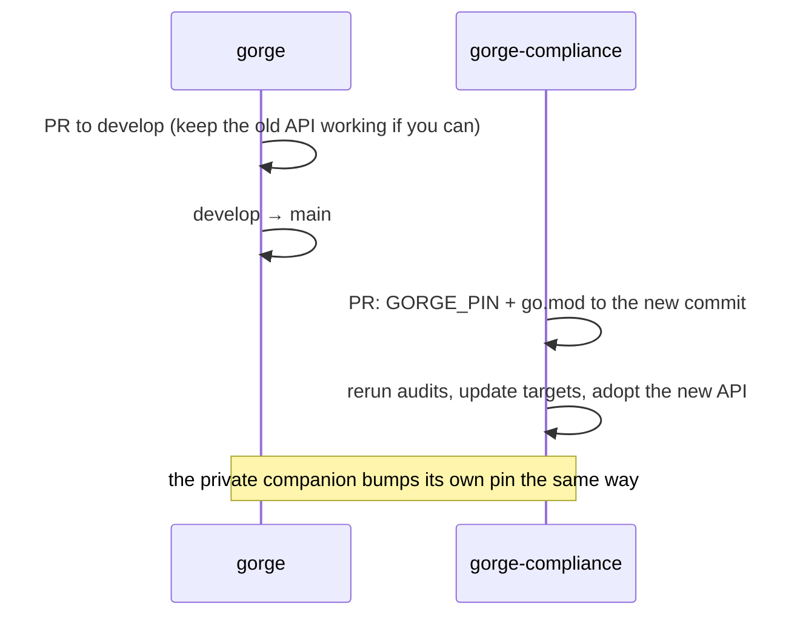

# The three repositories

gorge's work is split across three Git repositories with one-way
dependencies: the public engine, a public compliance repository that checks
it, and a private companion module that builds on it. This page is for anyone
deciding where a change belongs, or wondering why a file they expected is not
in this repository. It covers what each repository holds, which way the
imports run and what enforces that, licensing, how the companions pin gorge,
and how changes reach `main`.

*Verified 2026-10-27 against gorge `develop` @ `25d71cadc` and the two
companions as they stood that day. The draft move was re-checked on 2026-10-30.*

## At a glance

| | **gorge** | **gorge-compliance** | **private companion** |
|---|---|---|---|
| Visibility | public | public | private |
| Licence | Apache-2.0 | Apache-2.0 | (private) |
| Module | `github.com/adams-shaun/gorge` | `github.com/adams-shaun/gorge-compliance` | (private) |
| Holds | the rules engine, the reference server `gorged` with [draft events](../guide/draft.md), the baseline and hosted bots, the browser client, contributor tooling | the compliance oracles (gorge vs XMage vs Forge), the hand-written Oracle-text scenarios, the XMage-ported scenarios, the certification ratchet | machine learning and private experiments: training, networks, research bots; and the [dirty-dirac kernel](../architecture/dirty-dirac/index.md) |
| Depends on | nothing (the root `go.mod` has no `require` lines) | gorge, pinned by commit | gorge, pinned by commit |
| You need it to… | build, run, test or embed the engine | measure gorge against independent engines | nothing in gorge |

<figure>
<svg viewBox="0 0 760 280" width="100%" role="img" aria-label="Dependency direction between the three repositories: gorge-compliance and the private companion each import gorge at a pinned commit; gorge imports neither.">
<defs><marker id="rp-arr" viewBox="0 0 10 10" refX="9" refY="5" markerWidth="8" markerHeight="8" orient="auto-start-reverse"><path d="M0,0 L10,5 L0,10 z" class="dg-arrow-accent"/></marker></defs>
<rect x="270" y="20" width="220" height="150" rx="10" class="dg-box-accent"/>
<text x="380" y="48" text-anchor="middle" class="dg-text-bold">gorge</text>
<text x="380" y="66" text-anchor="middle" class="dg-text-muted">public · Apache-2.0</text>
<text x="380" y="92" text-anchor="middle" class="dg-text">engine/  server/  bots/  draft/</text>
<text x="380" y="112" text-anchor="middle" class="dg-text">cmd/  web/  testkit/  cli/</text>
<text x="380" y="138" text-anchor="middle" class="dg-text-muted">imports nothing outside</text>
<text x="380" y="154" text-anchor="middle" class="dg-text-muted">the standard library</text>
<rect x="10" y="40" width="200" height="110" rx="10" class="dg-box"/>
<text x="110" y="68" text-anchor="middle" class="dg-text-bold">gorge-compliance</text>
<text x="110" y="86" text-anchor="middle" class="dg-text-muted">public · Apache-2.0</text>
<text x="110" y="110" text-anchor="middle" class="dg-text">oracles, scenarios,</text>
<text x="110" y="128" text-anchor="middle" class="dg-text">certification ratchet</text>
<rect x="550" y="40" width="200" height="110" rx="10" class="dg-box-muted"/>
<text x="650" y="68" text-anchor="middle" class="dg-text-bold">private companion</text>
<text x="650" y="86" text-anchor="middle" class="dg-text-muted">private</text>
<text x="650" y="110" text-anchor="middle" class="dg-text">training, networks,</text>
<text x="650" y="128" text-anchor="middle" class="dg-text">research bots, dirty-dirac</text>
<line x1="210" y1="95" x2="266" y2="95" class="dg-line-accent" marker-end="url(#rp-arr)"/>
<line x1="550" y1="95" x2="494" y2="95" class="dg-line-accent" marker-end="url(#rp-arr)"/>
<text x="238" y="200" text-anchor="middle" class="dg-text-muted">imports gorge at</text>
<text x="238" y="216" text-anchor="middle" class="dg-text-mono">GORGE_PIN</text>
<text x="522" y="200" text-anchor="middle" class="dg-text-muted">imports gorge at</text>
<text x="522" y="216" text-anchor="middle" class="dg-text-mono">GORGE_PIN</text>
<text x="380" y="252" text-anchor="middle" class="dg-text">gorge never imports either</text>
<text x="380" y="270" text-anchor="middle" class="dg-text-muted">(no require lines: TestRootModuleHasNoRequires)</text>
<line x1="238" y1="104" x2="238" y2="186" class="dg-line-dashed"/>
<line x1="522" y1="104" x2="522" y2="186" class="dg-line-dashed"/>
</svg>
<figcaption>Arrows point from the importer to the imported module. Both companions build against one pinned gorge commit; the companions do not import each other.</figcaption>
</figure>

## gorge (this repository)

The deterministic, event-sourced rules engine and everything needed to use
it: the card compiler (`engine/cards`), the rules core (`engine/`), the
reference server (`server/gorged`, with its thin main in `cmd/gorged`), the
limited stack (`draft/`), the default and hosted bots (`bots/`), the Svelte
browser client (`web/`), public
test support for outside modules (`testkit/`, `cli/`), the architecture
ratchets (`internal/`), and the developer commands (`cmd/`). The full tree is
on [Repository layout](../contributing/repo-layout.md).

gorge is meant to build, test and run on its own: nothing here needs either
companion. It exposes a few **extension seams**, which are ordinary exported
gorge API:

| Seam | What plugs in |
|---|---|
| `bots.Register` (`bots/registry.go`) | a bot policy joins the registry the server offers |
| `server/gorged.RegisterNetBot` | a network-backed hosted bot, with its flags |
| `server/gorged.Extensions` | what a binary links into the server beyond the platform. gorge's own `cmd/gorged` fills it with `draft/gorgedevents`, and a binary that leaves `Events` empty is refused `-events` at startup (`TestEventsNeedAPlugin`) |
| `engine/rules`' exported oracle runner (`RunOracleScenarioJSON`, `RunOracleAuditScenarioJSON`, `CheckOracleScenarioJSON`) | gorge-compliance's scenario drivers |
| `testkit/` (`testutil`, `bench`, `paymirror`) and `cli/` | test fixtures, the head-to-head game runner, command-line plumbing |

Changing one of these is an API change for the companions, so it is
sequenced as described [below](#a-change-that-spans-repositories).

## gorge-compliance

[gorge-compliance](https://github.com/adams-shaun/gorge-compliance) exists to
give confidence in the rules engine. It checks gorge card by card against
three independent references and holds the results to coverage targets:

- **hand-written Oracle-text scenarios**: JSON files written from a card's
  printed text and the Comprehensive Rules by an author who has not read the
  card's script (`scenarios/oracle/`);
- **XMage**, an independent Java engine (MIT): generated scenarios are
  replayed in both engines and their snapshots diffed;
- **Forge**, the engine the card scripts come from, adjudicated against the
  other two;
- plus XMage's own interaction tests, translated into gorge's scenario schema
  (`scenarios/xmageport/`).

It drives gorge only through the exported oracle runner. gorge keeps that
runner (`engine/rules/oracle_*.go`), its unit tests, and nine residual
scenario files that its own card tests load
(`engine/rules/testdata/oracle/`), played by
`engine/rules/oracle_contract_test.go` (`TestOracleRunnerContract`) as the
runner's contract check. A scenario file lives in exactly one of the two
repositories.

gorge does **not** gate on gorge-compliance, but its published figures come
from there. A nightly job on gorge-compliance's `main` measures every set's
compliance status at the pinned gorge and force-pushes it as one commit to an
orphan **`docs-data`** branch: per-set status rows for Level A and Level B,
and a `meta.json` naming the gorge-compliance commit, the gorge pin,
`FORGE_REF` and the date. gorge's docs build fetches that branch and renders
the per-set table on [Card support](../support/sets.md); if the branch is
missing, the page falls back to its committed snapshot. The same nightly
workflow runs the `drift` check described under [Pinning](#pinning).

## The private companion

The maintainers' **private** companion module holds work built on top of
gorge that is not part of the public surface: machine learning, reinforcement
learning, private experiments and the dirty-dirac kernel. It imports gorge at a
pinned commit, the same way
gorge-compliance does ([Pinning](#pinning)); gorge never imports it, and
nothing in gorge needs it to build or test. The
[dirty-dirac pages](../architecture/dirty-dirac/index.md) describe that
kernel's design.

## Dependency direction and what enforces it

| Boundary | Enforced by |
|---|---|
| gorge imports no other module at all | `internal/archtest/gomod_test.go` `TestRootModuleHasNoRequires`: the root `go.mod` may carry no `require` directive and `go.sum` must be empty or absent. With no `require`, gorge *cannot* import either companion. |
| `engine/` imports nothing outside `engine/` | measured, not yet one test: `go list -deps ./engine/...` has no gorge package outside `engine/` and no non-standard-library package (checked 2026-10-20). Individual forbidden edges are pinned by `internal/archtest` `TestDependencyOrderHolds`; see [Invariants](../architecture/invariants.md#engine-imports-nothing-outside-engine). |
| The companions use only exported gorge API | Go's own visibility rules, plus gorge's `internal/` packages, which no other module can import. |

The direction matters for two reasons. gorge stays usable by anyone without
access to the private repository, and a change in gorge can never be blocked
on code its contributors cannot see.

## Licensing and the Forge card scripts

gorge compiles [Forge](https://github.com/Card-Forge/forge)'s card scripts.
Those scripts are **GPL-3.0**; gorge is **Apache-2.0**. So gorge ships a
compiler for the script format and never the scripts themselves:

- `make fetch-cards` downloads the scripts into `.cards/`, which is
  gitignored, at the commit pinned by `FORGE_REF` in the
  [`Makefile`](https://github.com/adams-shaun/gorge/blob/main/Makefile), from
  gorge's fork [adams-shaun/forge](https://github.com/adams-shaun/forge)
  (`FORGE_REPO`).
- [`engine/cards/boundary_test.go`](https://github.com/adams-shaun/gorge/blob/main/engine/cards/boundary_test.go)
  (`TestNoForgeScriptsTracked`) fails the build if a Forge script is tracked
  in the working tree, the index or `HEAD`. It recognises a script by its
  content, not its path.
- Replay fixtures strip embedded token-script text before they are committed
  (into the gitignored `cmd/repro/testdata/.tokens/`).
- Tests, docs and coverage tables name cards; they never contain script text.
- A script that disagrees with the printed card is fixed on the fork's
  `gorge` branch and offered upstream, never patched inside gorge.

gorge-compliance follows the same rule with its own guard
(`internal/boundary`) and reaches the corpus through a gitignored link to a
gorge checkout's `.cards/`. Its `NOTICE` credits XMage (MIT), from which its
set manifests and ported scenarios derive. gorge's own `NOTICE` credits the
MIT-licensed SpellBench adapter that `server/spellbench` and the
`cmd/spellbench-gorge-*` commands are derived from.

## Pinning

Both companions build against **one gorge commit**, expressed twice:

- a `GORGE_PIN` file at the repository root holding the full SHA, and
- a `require github.com/adams-shaun/gorge <pseudo-version>` line in `go.mod`
  naming the same commit, so `go build` fetches exactly that code from the
  module proxy.

A pin bump is a pull request in the companion, never a side effect. For
gorge-compliance it also reruns the scenario audits and the XMage pass and
updates every target, because each target (the certification ratchet, the
verdicts, the `known-divergent` rows) is a statement about the pinned commit.
The procedure is gorge-compliance's
[`docs/PINNING.md`](https://github.com/adams-shaun/gorge-compliance/blob/main/docs/PINNING.md).
A nightly `drift` job there builds against gorge `main` instead of the pin
and **reports** what would change without failing.

Pinning gorge also pins the card corpus: the companions read `FORGE_REF` from
the pinned gorge's `Makefile`.

Neither companion commits a `go.work` or a `replace` directive for gorge:
the pin is the only way gorge reaches them. To try gorge-compliance against
unmerged gorge work locally, a gitignored `go.work` that points at your gorge
checkout works; never commit one, because it overrides the pin.

## Branch flow

All three repositories land work the same way:

1. Changes land on **`develop`**, through a pull request whose `ci` workflow
   (lint plus a sharded test run with the corpus fetched) is green.
2. The maintainers' pipeline periodically snapshots
   `develop` to a `promote/develop-<stamp>` branch and opens a `develop → main`
   pull request from it, superseding older snapshot PRs. When its checks are
   green it is merged; a red snapshot is parked for a person.
3. Merges use **a merge commit, not a squash**, so
   `develop` and `main` keep sharing history. Nothing pushes `main` directly.
4. Pushes to `main` publish this site (`docs.yml`) and the card-coverage
   tables (`coverage.yml`, as a workflow artifact).

## A change that spans repositories

Because the arrows run one way, a cross-repository change always lands in
gorge first:

- **The gorge commit must be pushed** before a companion can pin it: the
  pseudo-version is resolved through the module proxy.
- **Prefer additive changes** to a seam (a new function beside the old one),
  so the companion can move at its own pace. An incompatible change breaks
  the companion only at its next pin bump, and the nightly drift report shows
  it before that.
- **Say so in the PR** when you change a seam listed [above](#gorge-this-repository),
  or a file format a companion reads (`server/protocol`'s frames, the
  `bots/gonet` network file, the `bots/policynet` checkpoint), so the
  maintainers can schedule the matching bump.

A change that fixes a card in gorge typically shows up in gorge-compliance as
a stale ratchet row (a scenario that now passes) at the next pin bump; that
row is deleted in the bump PR.
