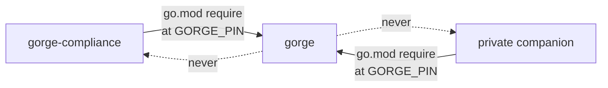
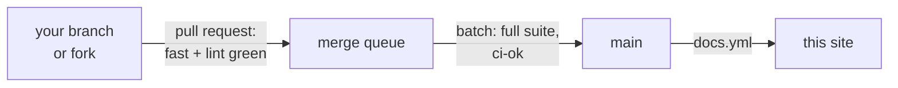
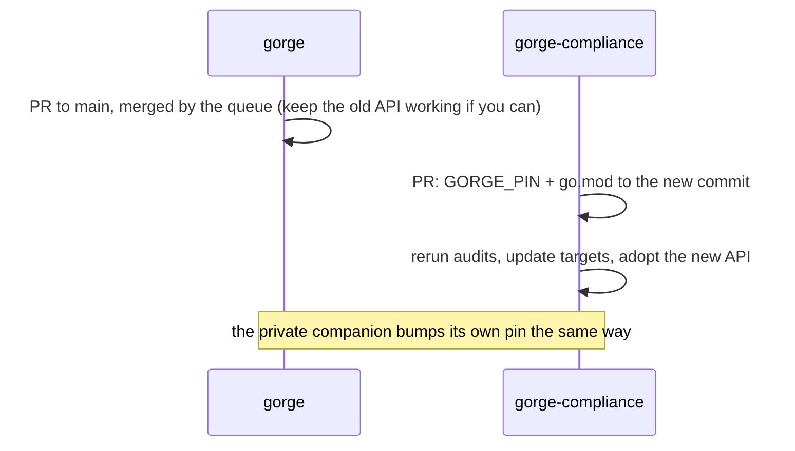

# The three repositories

Three Git repositories with one-way dependencies: the public engine, a public compliance
repository that checks it, and a private module that builds on it. Read this to decide where a
change belongs. It covers what each holds, which way imports run, licensing, pinning, and how
changes reach `main`.

| | **gorge** | **gorge-compliance** | **private companion** |
|---|---|---|---|
| Visibility | public | public | private |
| Licence | Apache-2.0 | Apache-2.0 | (private) |
| Module | `github.com/adams-shaun/gorge` | `github.com/adams-shaun/gorge-compliance` | (private) |
| Holds | both rules engines, gorge and dirac, the reference server `gorged` with [draft events](../guide/draft.md), the bots, the browser client, contributor tooling | the compliance oracles (gorge vs XMage vs Forge), the hand-written Oracle-text scenarios, the XMage-ported scenarios, the certification ratchet | machine learning and private experiments: training, networks, research bots |
| Depends on | nothing (the root `go.mod` has no `require` lines) | gorge, pinned by commit | gorge, pinned by commit |
| You need it to… | build, run, test or embed the engine | measure gorge against independent engines | nothing in gorge |

<figure>
<svg viewBox="0 0 760 280" width="100%" role="img" aria-label="Dependency direction between the three repositories: gorge-compliance and the private companion each import gorge at a pinned commit; gorge imports neither.">
<defs><marker id="rp-arr" viewBox="0 0 10 10" refX="9" refY="5" markerWidth="8" markerHeight="8" orient="auto-start-reverse"><path d="M0,0 L10,5 L0,10 z" class="dg-arrow-accent"/></marker></defs>
<rect x="270" y="20" width="220" height="150" rx="10" class="dg-box-accent"/>
<text x="380" y="48" text-anchor="middle" class="dg-text-bold">gorge</text>
<text x="380" y="66" text-anchor="middle" class="dg-text-muted">public · Apache-2.0</text>
<text x="380" y="92" text-anchor="middle" class="dg-text">engine/  dirac/  server/  bots/</text>
<text x="380" y="112" text-anchor="middle" class="dg-text">draft/  cmd/  web/  testkit/  cli/</text>
<text x="380" y="138" text-anchor="middle" class="dg-text-muted">imports nothing outside</text>
<text x="380" y="154" text-anchor="middle" class="dg-text-muted">the standard library</text>
<rect x="10" y="40" width="200" height="110" rx="10" class="dg-box"/>
<text x="110" y="68" text-anchor="middle" class="dg-text-bold">gorge-compliance</text>
<text x="110" y="86" text-anchor="middle" class="dg-text-muted">public · Apache-2.0</text>
<text x="110" y="110" text-anchor="middle" class="dg-text">oracles, scenarios,</text>
<text x="110" y="128" text-anchor="middle" class="dg-text">certification ratchet</text>
<rect x="550" y="40" width="200" height="110" rx="10" class="dg-box-muted"/>
<text x="650" y="68" text-anchor="middle" class="dg-text-bold">private companion</text>
<text x="650" y="86" text-anchor="middle" class="dg-text-muted">private</text>
<text x="650" y="110" text-anchor="middle" class="dg-text">training, networks,</text>
<text x="650" y="128" text-anchor="middle" class="dg-text">research bots</text>
<line x1="210" y1="95" x2="266" y2="95" class="dg-line-accent" marker-end="url(#rp-arr)"/>
<line x1="550" y1="95" x2="494" y2="95" class="dg-line-accent" marker-end="url(#rp-arr)"/>
<text x="238" y="200" text-anchor="middle" class="dg-text-muted">imports gorge at</text>
<text x="238" y="216" text-anchor="middle" class="dg-text-mono">GORGE_PIN</text>
<text x="522" y="200" text-anchor="middle" class="dg-text-muted">imports gorge at</text>
<text x="522" y="216" text-anchor="middle" class="dg-text-mono">GORGE_PIN</text>
<text x="380" y="252" text-anchor="middle" class="dg-text">gorge never imports either</text>
<text x="380" y="270" text-anchor="middle" class="dg-text-muted">(no require lines: TestRootModuleHasNoRequires)</text>
<line x1="238" y1="104" x2="238" y2="186" class="dg-line-dashed"/>
<line x1="522" y1="104" x2="522" y2="186" class="dg-line-dashed"/>
</svg>
<figcaption>Arrows point from the importer to the imported module. Both companions build against one pinned gorge commit; the companions do not import each other.</figcaption>
</figure>

## gorge (this repository)

Both engines and everything to use them ([layout](../contributing/repo-layout.md)); it builds, tests and runs alone. Its **extension seams** are exported API:

| Seam | What plugs in |
|---|---|
| `bots.Register` (`bots/registry.go`) | a bot policy joins the registry the server offers |
| `server/gorged.RegisterNetBot` | a network-backed hosted bot, with its flags |
| `server/gorged.Extensions` | what a binary links into the server: its events plugin, extra flags, the `gorged review` loader, and further engines for `-engine`. gorge's own `cmd/gorged` passes `draft/gorgedevents`, and a binary that leaves `Events` empty is refused `-events` at startup (`TestEventsNeedAPlugin`) |
| `engine/game` | what a host needs from a running game; `engine/game/gorgegame` and `dirac/adapter` implement it |
| `engine/rules`' exported oracle runner (`RunOracleScenarioJSON`, `RunOracleAuditScenarioJSON`, `CheckOracleScenarioJSON`) | gorge-compliance's scenario drivers |
| `testkit/` (`testutil`, `bench`, `paymirror`) and `cli/` | test fixtures, the head-to-head game runner, command-line plumbing |

Changing a seam is an API change for the companions: [sequence it](#a-change-that-spans-repositories).

## gorge-compliance

[gorge-compliance](https://github.com/adams-shaun/gorge-compliance) exists to
give confidence in the rules engine. It checks gorge card by card against
three independent references and holds the results to coverage targets:

- **hand-written Oracle-text scenarios**: JSON files written from a card's
  printed text and the Comprehensive Rules by an author who has not read the
  card's script (`scenarios/oracle/`);
- **XMage**, an independent Java engine (MIT): generated scenarios are
  replayed in both engines and their snapshots diffed;
- **Forge**, the engine the card scripts come from, adjudicated against the
  other two;
- plus XMage's own interaction tests, translated into gorge's scenario schema
  (`scenarios/xmageport/`).

It drives gorge only through the exported oracle runner. gorge keeps that
runner (`engine/rules/oracle_*.go`), its unit tests, and the residual
scenario files its own card tests load
(`engine/rules/testdata/oracle/`), played by
`engine/rules/oracle_contract_test.go` (`TestOracleRunnerContract`) as the
runner's contract check. A scenario file lives in exactly one of the two
repositories.

gorge does **not** gate on gorge-compliance, but its published figures come
from there. A nightly job on gorge-compliance's `main` measures every set's
compliance status at the pinned gorge and force-pushes it as one commit to an
orphan **`docs-data`** branch: per-set status rows for Level A and Level B,
and a `meta.json` naming the gorge-compliance commit, the gorge pin,
`FORGE_REF` and the date. gorge's docs build fetches that branch and renders
the per-set table on [Card support](../support/sets.md), with that date and
corpus in its caption; if the branch is missing, the gorge columns say the data
isn't available. The same nightly
workflow runs the `drift` check described under [Pinning](#pinning).

## The private companion

The maintainers' private companion module holds machine learning, reinforcement learning and private
experiments. It imports gorge at a pinned commit, the same way gorge-compliance does
([Pinning](#pinning)). gorge never imports it, and nothing in gorge needs it to build or test.

## Dependency direction and what enforces it

| Boundary | Enforced by |
|---|---|
| gorge imports no other module at all | `internal/archtest/gomod_test.go` `TestRootModuleHasNoRequires`: the root `go.mod` may carry no `require` directive and `go.sum` must be empty or absent. With no `require`, gorge *cannot* import either companion. |
| `engine/` imports nothing outside `engine/` | named edges in `internal/archtest` (`TestDependencyOrderHolds`, `TestEngineTierImportsNeitherDraftNorDirac`); see [Invariants](../architecture/invariants.md#engine-imports-nothing-outside-engine). |
| Nothing private or generated is committed | `internal/archtest` `TestPublicBoundary`: no generated card tables, private paths, or imports of the private module. |
| The companions use only exported gorge API | Go's own visibility rules, plus gorge's `internal/` packages, which no other module can import. |

The direction keeps gorge usable without the private repository, and a gorge change can never be
blocked on code its contributors cannot see.

## Licensing and the Forge card scripts

gorge compiles [Forge](https://github.com/Card-Forge/forge)'s card scripts.
Those scripts are **GPL-3.0**; gorge is **Apache-2.0**. So gorge ships a
compiler for the script format and never the scripts themselves:

- `make fetch-cards` downloads the scripts into `.cards/`, which is
  gitignored, at the commit pinned by `FORGE_REF` in the
  [`Makefile`](https://github.com/adams-shaun/gorge/blob/main/Makefile), from
  gorge's fork [adams-shaun/forge](https://github.com/adams-shaun/forge)
  (`FORGE_REPO`).
- [`engine/cards/boundary_test.go`](https://github.com/adams-shaun/gorge/blob/main/engine/cards/boundary_test.go)
  (`TestNoForgeScriptsTracked`) fails the build if a Forge script is tracked
  in the working tree, the index or `HEAD`. It recognises a script by its
  content, not its path.
- Replay fixtures strip embedded token-script text before they are committed.
- Tests, docs and coverage tables name cards; they never contain script text.
- A script that disagrees with the printed card is fixed on the fork and offered
  upstream, never patched inside gorge.

gorge-compliance follows the same rule with its own guard and reaches the corpus through a
gitignored link to a gorge checkout's `.cards/`. Its `NOTICE` credits XMage (MIT);
[gorge's `NOTICE`](https://github.com/adams-shaun/gorge/blob/main/NOTICE) names every third-party
data source.

## Pinning

Both companions build against **one gorge commit**, expressed twice:

- a `GORGE_PIN` file at the repository root holding the full SHA, and
- a `require github.com/adams-shaun/gorge <pseudo-version>` line in `go.mod`
  naming the same commit, so `go build` fetches exactly that code from the
  module proxy.

A pin bump is a pull request in the companion, never a side effect. For
gorge-compliance it also reruns the scenario audits and the XMage pass and
updates every target, because each target (the certification ratchet, the
verdicts, the `known-divergent` rows) is a statement about the pinned commit.
The procedure is gorge-compliance's
[`docs/PINNING.md`](https://github.com/adams-shaun/gorge-compliance/blob/main/docs/PINNING.md).
A nightly `drift` job there builds against gorge `main` instead of the pin
and **reports** what would change without failing.

Pinning gorge also pins the card corpus: the companions read `FORGE_REF` from
the pinned gorge's `Makefile`.

Neither companion commits a `go.work` or a `replace` for gorge; the pin is the only way gorge reaches
them. To try gorge-compliance against unmerged gorge work, use a gitignored local `go.work`.

## Branch flow

Both repositories merge with a merge commit, never a squash, and nothing pushes `main` directly.
gorge lands through the Mergify queue (step 1); gorge-compliance differs (step 2).

1. **gorge.** Branch from `origin/main` (`git worktree add ../gorge-myfix -b myfix origin/main`) and open
   the PR against `main` (`make pr`). Mergify queues every non-draft PR (no label, no approval) once its
   `fast` and `lint` checks pass; `fast` is `scripts/ci-fast.sh` (the diff's packages and their test
   importers, with `-short`). Mergify batches up to 10 queued PRs on a `mergify/merge-queue/*` branch,
   where `.github/workflows/ci.yml` runs the full suite once per batch: the six test shards, `examples`,
   `wire-matrix` and `dirac-slices` (and `browser`, which is not part of `ci-ok`). The batch merges when
   `ci-ok` is green; a red batch is split. A fix for a red `main` goes on a `hotfix/*` branch (or carries
   the `hotfix` label) and is batched first. The whole `dirac/oracle` runs on `main` from
   `.github/workflows/oracle.yml` about every 6 hours, never on a PR or a batch. Details:
   [Contributing](../contributing/index.md#commits-and-pull-requests).
2. **gorge-compliance** lands work on `develop` and snapshots it to a `promote/develop-<stamp>` pull
   request to `main`; it merges when its checks are green.
3. **Publishing.** A push to `main` publishes this site (`docs.yml`, which also builds on pull
   requests, daily and on dispatch) and the card-coverage tables (`coverage.yml`, as a workflow
   artifact).

## A change that spans repositories

Because the arrows run one way, a cross-repository change always lands in
gorge first:

- **Push the gorge commit first**: the pseudo-version resolves through the module proxy.
- **Prefer additive changes** to a seam (a new function beside the old one); the companion moves at
  its own pace, and the nightly drift report shows an incompatible change before its next bump.
- **Say so in the PR** when you change a seam [above](#gorge-this-repository) or a format a
  companion reads (`server/protocol` frames, the `bots/gonet` network file, the `bots/policynet`
  checkpoint).

A change that fixes a card in gorge typically shows up in gorge-compliance as
a stale ratchet row (a scenario that now passes) at the next pin bump; that
row is deleted in the bump PR.
