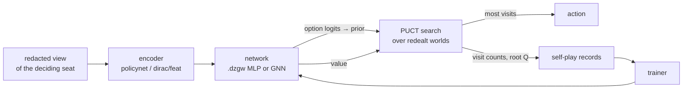
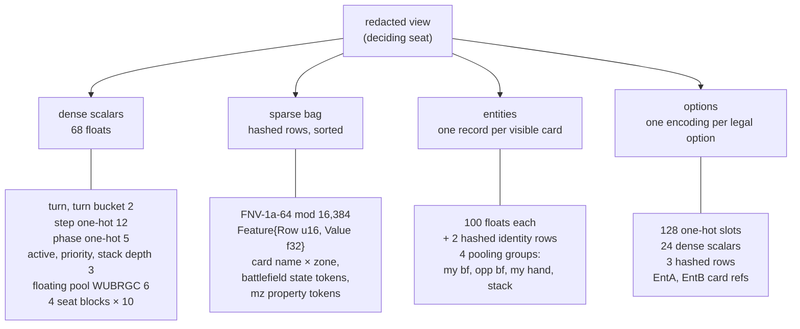
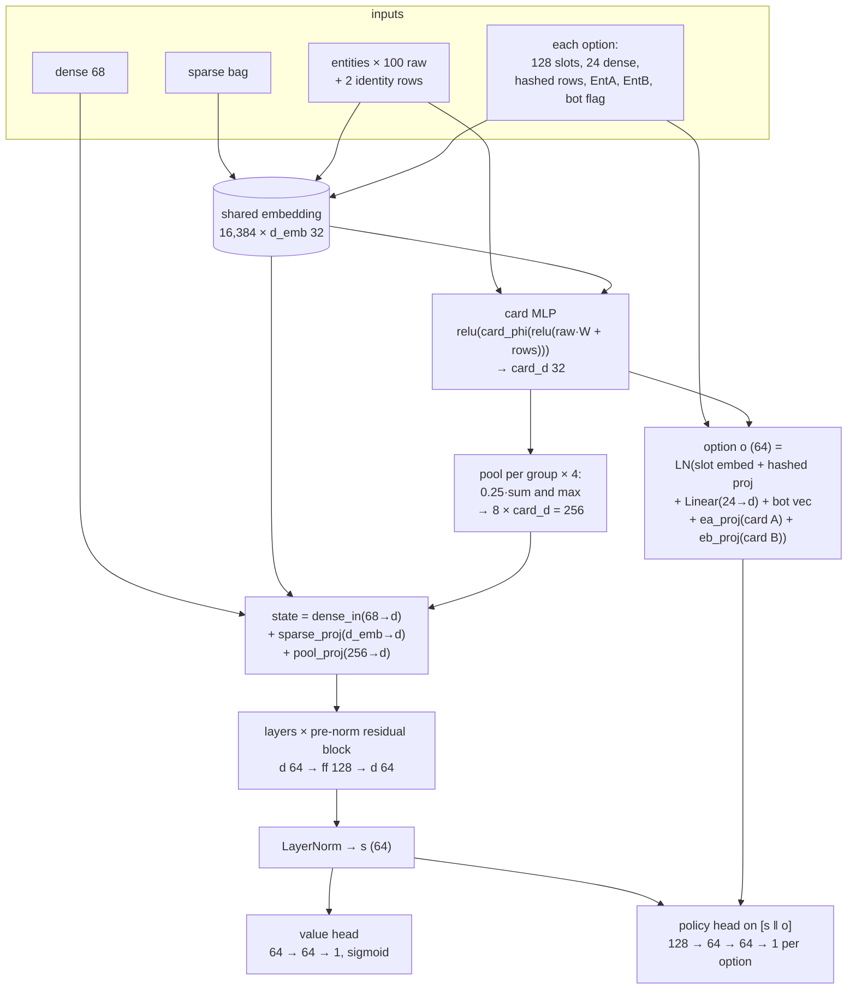
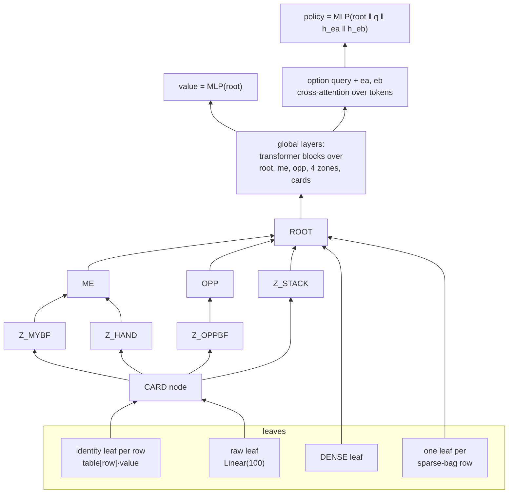
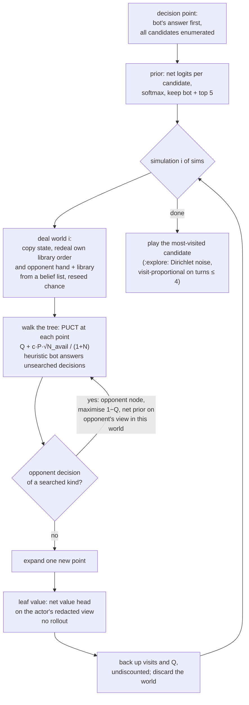
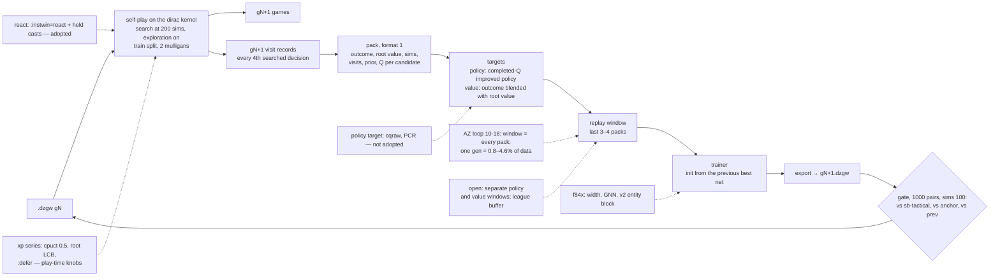

# How the bot works, drawn

The search bot reads the deciding seat's redacted view, encodes it into a fixed set of tensors, scores every option and the state with a small network, and runs PUCT over redealt worlds using those scores as priors and leaf values. Self-play with that search produces the training data for the next network. This page draws each stage, with sizes read from the code.

Code links are to gorge at [b14b8a543][at]. The trainer is not in this repository; this page describes it in words. Net shapes were read from the `.dzgw` headers of the nets themselves. The kernel's encoder is gorge's [`dirac/feat`][feat-doc].

<ul class="gg-facts">
  <li><strong>68 + 100</strong> floats: the dense state block, and each visible card's record</li>
  <li><strong>602,370</strong> parameters in the production MLP, 87% of them the embedding table</li>
  <li><strong>100 sims</strong> per searched decision in production, one redealt world each</li>
  <li><strong>2.84 µs</strong> per MLP eval with AVX-512, against 33.2 µs in plain Go</li>
</ul>

## 1. The state encoding

Two encoders produce the same bytes. gorge's `bots/policynet` encodes a `view.View`; `dirac/feat` encodes the kernel state directly. The contract: `dirac/feat` produces "byte-for-byte what policynet.EncodeStateWith and EncodeOptionsWith produce from gorge's redacted view.View of the deciding seat" ([`dirac/feat/doc.go`][feat-doc] lines 1-7). The lockstep oracle asserts it at every decision: state, every option, its list position and the list length (`oracle.FeatCheck`, [`dirac/oracle/featref.go`][featref] lines 344-354; tests `TestFeatVanilla` and `TestFeatFDN` in [`dirac/oracle/feat_test.go`][feattest], and `TestV2BlockFiresAndMatchesGorge` in [`dirac/feat/v2block_test.go`][v2test]).

The feature sets grew v1 → mz → entity. Production nets use **entity**: the mz set plus one vector per visible card ([`bots/policynet/features.go`][features] lines 21-39).

=== "Dense block: 68 floats"

    `DenseWidth = 68` ([`policynet.go`][policynet] line 79; [`dirac/feat/state.go`][featstate] line 16).

    | Offset | Width | Contents |
    |---|---|---|
    | 0 | 1 | turn |
    | 1 | 1 | turn bucket, min(turn, 40)/40 |
    | 2–13 | 12 | step one-hot |
    | 14–18 | 5 | phase one-hot |
    | 19–21 | 3 | viewer is active, viewer has priority, stack depth |
    | 22–27 | 6 | viewer's floating mana, W U B R G C |
    | 28–67 | 40 | 4 seat blocks × 10, viewer first: life, hand, library, graveyard, battlefield count, creatures, total power, total toughness, untapped permanents, untapped lands |

    Source: `policynet.go` lines 81-94, 132-147, 229-239.

=== "Sparse bag"

    Rows hash into a 16,384-row table (`TableRows = 1 << 14`, `policynet.go` line 33) by FNV-1a-64 (lines 41-48). Each entry is `Feature{Row uint16, Value float32}` (lines 61-64).

    - v1 tokens are one `name|zone` per card in my hand, every battlefield, every graveyard, every exile and every stack entry, plus a `Name|tapped|attacking|sick|counters` token per battlefield card (lines 148-155).
    - The mz set adds per-card properties (types, current P/T, keywords, tapped, sick, can-attack and can-block, counters, attached, damage, attacking), per-seat available mana and the stack's spell APIs (`features.go` lines 21-28).
    - The bag is stably sorted by row with duplicates kept, and re-sorted after the mz rows (`policynet.go` lines 148, 286; `features.go` lines 201-216). Its length varies; `dirac/feat` preallocates 512 (`state.go` line 115).

=== "Options"

    One encoding per legal option ([`bots/policynet/option.go`][option]):

    - 128 one-hot slots (`OptionSlotWidth`, line 89; blocks at lines 91-107): option kind 24, decision kind 13, card type 12, colour 6, MV bucket 9, mode 6, alt cost 1, keyword 32, zone/ownership 8. Slots 111–127 are unused.
    - 24 dense scalars (`OptionDenseWidth`, lines 205-232): the card's P, T, remaining toughness, damage, tapped, sick, attacking, is-player; attacker P/T/damage/delta for blocks; cost total, cost minus mana, tap-out, amount, alt cost, required, list index, MV, activated this turn, counters, attached, group.
    - 3 hashed rows (lines 23-27): card identity, identity × target descriptor, option kind; mz adds the spell API row.
    - `EntA`, `EntB`: 1 + the entity index of the option's own card and of its related card (a blocked attacker, an attacked planeswalker), 0 for none (lines 40-45).

    dirac caps a decision at `MaxOptions = 512` ([`dirac/types.go`][types] line 116).

### Entity records: 100 floats per visible card

Entities are every stack entry, every battlefield card of every seat, and the viewer's hand. Graveyards and exile are not entities, and the opponent's hand enters only as its count ([`bots/policynet/entity.go`][entity] lines 34-35, 308-314). `EntityRawWidth = 100` (`entity.go` line 113; `dirac/feat/state.go` line 17).

| Columns | Contents |
|---|---|
| 0–9 | card type bits |
| 10–12 | power/4, (toughness − damage)/4, damaged |
| 13–44 | 31 keywords + other |
| 45–51 | tapped, sick, can attack, can block, attacking, blocking, blocked |
| 52–55 | counters: +1/+1, −1/−1, loyalty, other |
| 56–58 | attached, attached to mine, hosts |
| 59–66 | mine, zone (bf / hand / stack), castable, MV/5, instant speed, face down |
| 67 | constant 1 |
| 68–83 | relational block: targeted by me / by the opponent, target counts by zone, stack X, kicked, combat foes and their power and toughness, dies, kills |
| 84–99 | **v2 block**: colour W U B R G C (84–89), pips W U B R G generic /5 (90–95), category removal / creature / ramp / trick (96–99) |

Each entity also carries up to two hashed identity rows, `ent|name|<Name>` (omitted face down) and `ent|api|<SpellAPI>` (`entity.go` lines 530-535). The width went 68 → 84 → 100 (`entity.go` lines 113-121). The loader accepts 68 or 100 ([`bots/gonet/gonet.go`][gonet] lines 251-254), and the trainer zero-pads narrower shards. The number of entities is unbounded in policynet; in dirac it is bounded by `MaxObj = 192` ([`dirac/state.go`][state] line 15).

!!! success "The v2 block"
    It was written, found dead twice (policynet wrote no values; then `relCard` cleared `raw[68:]`), fixed, and gated: F_V2 0.4594 vs F_NONE 0.4402 against g26, 8,000 games per arm, **+0.019 ±0.008** (~2.4σ). It is kept, and the kernel encoder went to width 100 on 2026-10-25. The ±0.008 is about one standard error of the difference (0.019 / 0.008 ≈ 2.4), not the 95% half-width used elsewhere on these pages. The story is on [Net width](net-width.md#the-v2-entity-block-written-found-dead-fixed) and the gate on [GNN](gnn.md#2-other-questions-settled-that-night).

## 2. The MLP

Production nets are the trainer's `MLPNet` exports in the `.dzgw` format. The file is the magic `DZGW0001`, a u64 header length, a JSON header (`format:"dzgw-1"`, `arch`, `config`, `consts`, tensor table, optional `encoder_hash`), padding to 64 bytes, then float32 tensors under their PyTorch names. gorge's loader is [`bots/gonet/gonet.go`][gonet] lines 187-194 and 231-313, and [Training data and nets](../engines/training-data.md) describes the format. The loader requires DENSE_W 68, OPT_DENSE_W 28 (or 24 for a net from before the relative-seat option columns), TABLE_ROWS 16384, SLOT_ROWS 128, GROUPS 4 and RAW_W 68 or 100.

The forward pass is the trainer's model, mirrored in [`bots/gonet/gonet.go`][gonet] lines 18-30. Options never attend to each other, and there are no auxiliary heads. In training a candidate's logit is the sum of its options' scores, log-softmaxed within the state. In the search, attacker and blocker candidates are instead scored as a subset Bernoulli likelihood, Σ log σ(s_in) + Σ log(1 − σ(s_out)) ([`bots/policynet/candidate.go`][candidate] lines 26-46), so training and search compose those two kinds differently.

**Production shape.** Every production net read has
`{"d":64,"ff":128,"layers":1,"d_emb":32,"card_d":32,"head_hidden":64,"policy_layers":2,"value_layers":1}`.
The trainer's own defaults are much larger; every loop passes this config explicitly.

**Parameter count.** With R = RAW_W, the production shape has 524,288 table parameters (16,384 × 32) and 74,850 + 32R others. The embedding table is 87% of the net.

| Net | RAW_W | Parameters |
|---|---|---|
| az-c6 g1–g7, az-inst8 | 68 | 601,346 |
| g26 (the f84 line's production reference) | 84 | 601,858 |
| M_CTL, M_CTLX | 100 | 602,370 |
| Pauper g1–g8 | 100 | 602,370 |
| hosted az-c3, az-c4, az-c5 | — | — (wrappers kept privately; az-c5 loads the c5 net) |

Source: header reads of each net file, and the trainer's model code.

**Inference.** [`bots/gonet`][gonet-pkg] runs any MLP or GNN in plain float32. [`bots/netsimd`][netsimd-doc] is hand-written AVX-512 for widths that are multiples of 32, with dedicated kernels when d = head_hidden = 64, "the production shape" (`netsimd/doc.go` lines 7-15; [`netsimd.go`][netsimd] line 229). It runs at 2.84 µs per eval against gonet's 33.2 µs, with parity within 7.4e-6 over 2,266 decisions. The private net evaluator picks netsimd, then gonet, then a remote server. [Search and nets](../engines/search-and-nets.md#the-net-runtime) lists what ships.

## 3. The GNN

`GraphNet` (the trainer's model; Go forward [`bots/gonet/gnn.go`][gnn] lines 11-36, parity test `TestGNNParity`) builds a tree per state and runs attention over it.

- Node types 8: ROOT, ME, OPP, Z_MYBF, Z_OPPBF, Z_HAND, Z_STACK, CARD; 7 fixed nodes per state. Edge types 8: identity, raw, dense, sparse, card-zone, zone-player, stack-root, player-root. Both are learned vectors added to the tokens.
- Message passing: `passes` bottom-up rounds, card → zone → player → root, each a pre-norm attention of a node over itself and its children with a segment softmax, then a GELU FFN.
- Global layers: pre-norm transformer blocks over all non-leaf tokens, then a LayerNorm.
- Heads: value from the root; one cross-attention block for the option query, then a policy MLP on a 4d input.

| Net | d | Heads | Global layers | ff | Passes | Head hidden | Parameters |
|---|---|---|---|---|---|---|---|
| G_S | 64 | 4 | 2 | 256 | 1 | 64 | 933,634 |
| G_M | 128 | 4 | 2 | 512 | 1 | 128 | 2,096,642 |
| G_BIG | 256 | 8 | 4 | 1024 | 1 | 256 | 8,263,170 |

All three use RAW_W 100 and d_emb 32. Source: the nets' headers and G_BIG's training config.

Results are on [GNN](gnn.md): G_M beats the 602,370-parameter MLP at equal sims (0.5302; 0.5282 on a second seed, 4,000 games each) and loses at equal time (G_M@100 vs MLP@400 0.4855), because it costs 18× per searched move. Why the shape is wrong for this search, and what might fix it, is in [the same page](gnn.md#why-the-graphnet-is-the-wrong-shape-for-this-search).

## 4. The search

The production spec is `az:sims=100:autopay:oppnodes:oppfull:morekinds:closedlist:topk=6`. gorge's [`bots/azmcts`][azmcts] is the reference; a port of it runs on the dirac kernel.

-   **Score**

    `Q + c·P·sqrt(N_avail)/(1+N)`, where N_avail counts the simulations in which the child was offered (information-set MCTS availability). An unvisited child takes parent Q − FPU (0.1). Ties go to the lower index, so the bot's own answer wins them. Every value is the searching seat's win probability ([`tree.go`][tree] lines 259-305; the kernel port matches).

-   **cpuct**

    Both default options say 1.5 ([`options.go`][options] lines 347-352, and the kernel port). The training loops and gates pass `cpuct=0.5`, which the xp series measured at +3.0 ±1.3 points vs sb-tactical at sims 100 ([AZ loop](az-loop.md#6-the-diagnosis)).

-   **Worlds**

    One fresh redeal per simulation, so 100 sims means 100 worlds ([`seat.go`][seat] lines 66-67; [`azredeal.go`][azredeal] lines 66-71). A world keeps public state, zone sizes and known cards, and redeals the seat's own library order and the opponent's hand and library ([`redeal.go`][redeal] lines 52-60). Cached worlds (PIMC over K fixed deals) exist and are off; `:worlds=8:nodecache=64` lost at equal sims (0.4173) and equal time (0.4923).

-   **Closed list**

    The opponent's hidden cards come from a list drawn from a belief corpus (the FDN train split), uniformly among lists whose colour identity covers every colour the opponent has shown, never from the real list (`redeal.go` lines 22-27; [`belief.go`][belief] lines 12-24). Closing the list cost az-c3 at most about 2 points (61.2% vs 63.0% vs sb-tactical).

-   **Candidate cap**

    The bot's answer is always first. With `topk=6` the search enumerates every candidate (up to 512), forms the prior over all of them, and keeps the bot's plus the five highest-prior (`options.go` lines 151-169, 343). The kernel tree holds at most 64 candidates per point. At most 1,000 environment submits per simulation.

-   **Priors**

    The net scores every option on the deciding seat's redacted view, with the bot's picks flagged; candidates take the single option's score, the subset likelihood for attackers and blockers, or the sum for fuller kinds; then softmax. Without a net the prior is uniform ([`candidates.go`][candidates] lines 901-1020).

-   **Leaf**

    The net's value head, clamped to [0, 1] ([`env.go`][env] lines 859-878). With no net (generation 0) it is the frozen heuristic 1/(1+exp(−LeafScore/20)), LeafScore = life + 2·hand + material ([`teacher.go`][teacher] lines 88-102). **No rollouts** (`tree.go` lines 1-8, and the kernel port).

-   **Opponent nodes**

    With `oppnodes`, an opponent decision of a searched kind with two or more candidates becomes a tree point, choosing by 1 − Q with the net's prior on the opponent's view in that world; `oppfull` gives those points the same autopay and top-k ranking (`options.go` lines 231-279).

-   **Noise and the final move**

    At evaluation there is no noise and the most-visited candidate is played. With `:explore` (self-play), Dirichlet α 0.3, ε 0.25 is mixed into the root prior, and the move is sampled in proportion to visits on turns ≤ 4 ([`search.go`][search] lines 274-277, and the kernel's play driver).

**Cost.** A g26 self-play generation measured 43.3 µs and 2.94 net evals per simulation on the kernel. The kernel runs the c6 search 21× faster per simulation than gorge (33 vs 686 µs on the full FDN pool) and plays 22× the games per core-hour. **Scaling.** With M_CTL against itself, 400 vs 100 sims scores 0.5384 ±0.0154 and 1600 vs 400 0.5375 ±0.022; 3200 vs 1600 is flat at 0.499 ([GNN](gnn.md#3-search-scaling-m_ctl-against-itself), [Search](search.md#3-win-rate-against-simulations)).

## 5. The training loop

=== "Self-play"

    Both seats play the search bot at 200 simulations with the previous generation's net and exploration on, on the train split, with two mulligans from the heuristic; entity features are recorded at every 4th searched decision. Self-play runs on the dirac kernel. g26's generation: 3,776 games and 81,713 visit records in 480.7 s.

=== "Pack and targets"

    - **Pack.** Columnar shards of 200,000 records, with outcome, root value, sims and choice per state, and visits, prior and Q per candidate. Holdout is games with crc32(id) % 20 == 0.
    - **Policy target `cq`.** The completed-Q improved policy, softmax(log(P + 1e-8) + (c_visit + max N)·c_scale·qnorm), qnorm the per-state min-max of completed Q. The loops use a small scale on the normalised Q, so the improved policy stays close to the prior.
    - **Value target.** A blend of the game outcome and the search's root value, weighted equally in the loops. The trainer has no TD(λ) target.
    - **Loss.** Policy cross-entropy over the candidate log-softmax plus BCE on value.

=== "Trainer"

    Each generation starts from the previous best net, chosen by holdout policy CE + value log loss. g26's run reached its best holdout early, with holdout policy CE 0.6206 against 0.9735 for uniform.

    **Window.** f84 uses the last 4 own packs, f84x sploop and Pauper the last 3, az-c6 every pack so far.

=== "Gate"

    The eval split, seed 78, 1,000 pairs at 100 sims, against sb-tactical, the az-c6 g7 anchor and the previous generation. The f84 loop always continues from the newest net. The Pauper loop moves a champion title when the 95% lower bound clears 0.5, and also always continues from the newest net. g26's gates: vs sb-tactical 0.7850 ±0.0180, vs g7 0.6195 ±0.0213, vs prev 0.5065 ±0.0219, 2,000 games each.

!!! warning "Loss ranks nets backwards"
    Holdout loss has repeatedly ranked nets in the opposite order to play: the v2-off arm had the better loss and the worse play, and the [GNN page](gnn.md) counts five such inversions. Every decision on these pages is made on play gates.

## Related

- [What dirac offers a search](../architecture/dirac/search.md): a simulation as copy, redeal and reseed, walk with hbot, expand one node, value the leaf once.
- The kernel's own design records the same facts: `dirac/feat` reproduces policynet's bytes without importing it, the oracle asserts that equality at every decision, and g7's net (d 64, ff 128, one block, a 16,384×32 table) costs about 130k multiply-adds per eval.

[at]: https://github.com/adams-shaun/gorge/tree/b14b8a543b1ae0d401af3bf6c3e2d5ebde2c52af
[feat-doc]: https://github.com/adams-shaun/gorge/blob/b14b8a543b1ae0d401af3bf6c3e2d5ebde2c52af/dirac/feat/doc.go
[featref]: https://github.com/adams-shaun/gorge/blob/b14b8a543b1ae0d401af3bf6c3e2d5ebde2c52af/dirac/oracle/featref.go#L344-L354
[feattest]: https://github.com/adams-shaun/gorge/blob/b14b8a543b1ae0d401af3bf6c3e2d5ebde2c52af/dirac/oracle/feat_test.go
[v2test]: https://github.com/adams-shaun/gorge/blob/b14b8a543b1ae0d401af3bf6c3e2d5ebde2c52af/dirac/feat/v2block_test.go
[features]: https://github.com/adams-shaun/gorge/blob/b14b8a543b1ae0d401af3bf6c3e2d5ebde2c52af/bots/policynet/features.go#L21-L39
[policynet]: https://github.com/adams-shaun/gorge/blob/b14b8a543b1ae0d401af3bf6c3e2d5ebde2c52af/bots/policynet/policynet.go#L79
[featstate]: https://github.com/adams-shaun/gorge/blob/b14b8a543b1ae0d401af3bf6c3e2d5ebde2c52af/dirac/feat/state.go#L16
[option]: https://github.com/adams-shaun/gorge/blob/b14b8a543b1ae0d401af3bf6c3e2d5ebde2c52af/bots/policynet/option.go
[types]: https://github.com/adams-shaun/gorge/blob/b14b8a543b1ae0d401af3bf6c3e2d5ebde2c52af/dirac/types.go#L116
[entity]: https://github.com/adams-shaun/gorge/blob/b14b8a543b1ae0d401af3bf6c3e2d5ebde2c52af/bots/policynet/entity.go
[gonet]: https://github.com/adams-shaun/gorge/blob/b14b8a543b1ae0d401af3bf6c3e2d5ebde2c52af/bots/gonet/gonet.go
[gonet-pkg]: https://github.com/adams-shaun/gorge/tree/b14b8a543b1ae0d401af3bf6c3e2d5ebde2c52af/bots/gonet
[gnn]: https://github.com/adams-shaun/gorge/blob/b14b8a543b1ae0d401af3bf6c3e2d5ebde2c52af/bots/gonet/gnn.go#L11-L36
[state]: https://github.com/adams-shaun/gorge/blob/b14b8a543b1ae0d401af3bf6c3e2d5ebde2c52af/dirac/state.go#L15
[candidate]: https://github.com/adams-shaun/gorge/blob/b14b8a543b1ae0d401af3bf6c3e2d5ebde2c52af/bots/policynet/candidate.go#L26-L46
[netsimd-doc]: https://github.com/adams-shaun/gorge/blob/b14b8a543b1ae0d401af3bf6c3e2d5ebde2c52af/bots/netsimd/doc.go#L7-L15
[netsimd]: https://github.com/adams-shaun/gorge/blob/b14b8a543b1ae0d401af3bf6c3e2d5ebde2c52af/bots/netsimd/netsimd.go#L229
[azmcts]: https://github.com/adams-shaun/gorge/tree/b14b8a543b1ae0d401af3bf6c3e2d5ebde2c52af/bots/azmcts
[tree]: https://github.com/adams-shaun/gorge/blob/b14b8a543b1ae0d401af3bf6c3e2d5ebde2c52af/bots/azmcts/tree.go#L259-L305
[options]: https://github.com/adams-shaun/gorge/blob/b14b8a543b1ae0d401af3bf6c3e2d5ebde2c52af/bots/azmcts/options.go#L347-L352
[seat]: https://github.com/adams-shaun/gorge/blob/b14b8a543b1ae0d401af3bf6c3e2d5ebde2c52af/bots/azmcts/seat.go#L66-L67
[azredeal]: https://github.com/adams-shaun/gorge/blob/b14b8a543b1ae0d401af3bf6c3e2d5ebde2c52af/bots/azredeal/azredeal.go#L66-L71
[redeal]: https://github.com/adams-shaun/gorge/blob/b14b8a543b1ae0d401af3bf6c3e2d5ebde2c52af/bots/azmcts/redeal.go#L52-L60
[belief]: https://github.com/adams-shaun/gorge/blob/b14b8a543b1ae0d401af3bf6c3e2d5ebde2c52af/bots/searchprobe/belief.go#L12-L24
[candidates]: https://github.com/adams-shaun/gorge/blob/b14b8a543b1ae0d401af3bf6c3e2d5ebde2c52af/bots/azmcts/candidates.go#L901-L1020
[env]: https://github.com/adams-shaun/gorge/blob/b14b8a543b1ae0d401af3bf6c3e2d5ebde2c52af/bots/azmcts/env.go#L859-L878
[teacher]: https://github.com/adams-shaun/gorge/blob/b14b8a543b1ae0d401af3bf6c3e2d5ebde2c52af/bots/searchprobe/teacher.go#L88-L102
[search]: https://github.com/adams-shaun/gorge/blob/b14b8a543b1ae0d401af3bf6c3e2d5ebde2c52af/bots/azmcts/search.go#L274-L277
