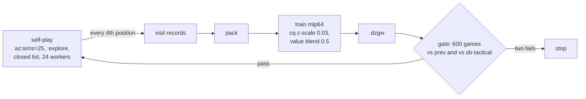

# The AZ loop, and why it went flat

*2026-10-08 → 10-21*

The AlphaZero-style loop trains the d64 MLP on its own search's visit counts, generation by generation, and gates each generation in play. This page covers the hosted lineage (az-c3, az-c4, az-c5), the from-scratch az-c6 loop to g7, the kernel-versus-gorge generation test (loop2), and the 2026-10-18 → 10-21 work that showed the loop had stopped learning, and why. The f84x line that followed is on [Net width](net-width.md) and [Policy target and react](policy-target-and-react.md).

!!! abstract "Verdict"
    - az-c4 (C4 of the census-on series) was adopted as the hosted bot; C5 improved on it only within noise (0.528 [48.8, 56.8]).
    - The az-c6 loop plateaued at g6–g7 (vs prev 0.490, 0.500). More generations with the same recipe, on either engine, did not move it.
    - Adopted from the diagnosis: cpuct 0.5 with root LCB and `:defer=0.1` at play, and more sims at play time. The training recipe moved to the f84x from-scratch loop and the policy-target and react A/Bs.

!!! warning "Records lost"
    The c-series training tree (its plan, the loop data and eval summaries), the az-c5 run and the stage-0 run no longer exist. The tree was "rebuilt from scratch (2026-10-16)" after the training store was lost, and they are not in the 2026-10-25 archive. The c-series numbers below come from the design notes and the retrain write-up that recorded them, both kept privately.

## 1. Question

Can search-labelled self-play make the hosted search bot stronger, generation after generation, and what stops it?

## 2. The loop

The census-on c-series recipe: 40 minutes of `az:sims=25` self-play per generation with the closed list, opponent nodes, autopay and top-k 6; train-split decks, seed 9400+n, 24 workers, every 4th position recorded. mlp64 (d 64, ff 128, 1 layer, card_d 32, head 64), at most 8 epochs, patience 6. Gates are 300 pairs (600 games) at 100 sims, seed 78: vs full search with no net, vs sb-tactical, vs the previous generation. A generation passes at ≥ 50% vs the previous and an sb-tactical score no lower than the previous one's; two consecutive fails stop the series. Decks: DraftZero FDN Limited, 28,366 train and 3,150 eval, London mulligan up to 2.

## 3. The hosted lineage: c3, c4, c5

**c3, open list (2026-10-09).** Each row is 600 paired games, 100 sims, FDN eval decks, seed 78, Wilson 95%.

| c3 against | W-L | Score | 95% CI | ms per searched decision |
|---|---|---|---|---|
| sb-tactical | 378-222 | 63.0% | [59.1, 66.8] | 314 |
| no-net search | 335-265 | 55.8% | [51.8, 59.8] | 202 |
| c2 | 307-293 | 51.2% | [47.2, 55.1] | 344 |

Earlier generations vs sb-tactical: c1 58.5% [54.5, 62.4], c2 61.7% [57.7, 65.5].

**Closing the opponent's list (2026-10-13 → 10-14).** The search had redealt hidden cards from both real lists. Old c3 scored 61.2% vs sb-tactical with a closed list at play time against 63.0% open, so the list was worth at most about 2 points. The census-on retrain, every row 600 games:

| Gen | Self-play games/s | Positions | vs full search | vs sb-tactical | vs prev | vs census-off C3 | Gate |
|---|---|---|---|---|---|---|---|
| C1 | 17.6 | 777,838 | 54.7% | 59.8% | — | 46.8% | first |
| C2 | 11.8 | 494,113 | 58.1% | 63.8% | 51.7% | 52.2% | pass |
| C3 | 13.9 | 562,420 | 59.3% | 65.8% | 51.7% | 52.7% | pass |
| C4 | 13.5 | 524,846 | 60.8% | 67.8% | 53.7% | 55.2% | pass, best |
| C5 | 12.8 | 523,750 | 61.8% | 67.5% | 49.8% | 56.0% | fail 1 |
| C6 | 15.8 | 608,750 | 60.7% | 66.7% | 48.7% | 56.5% | fail 2, stopped |

C4 landed as the hosted bot az-c4 (gorge 9ba4de165, 2026-10-14). Its gates with Wilson intervals: vs sb-tactical 407-193, 67.8% [64.0, 71.4]; vs the same closed search without a net 365-235, 60.8% [56.9, 64.7]; vs C3 322-278, 53.7% [49.7, 57.6].

**c5 (2026-10-15).** Warm start from az-c4 after the payment fixes, four generations, lr 3e-4, 4 epochs, 40 minutes of self-play per generation on 24 workers (32,000 / 28,000 / 32,000 / 32,000 games). 600-game gates:

| Net | vs az-c4 | vs sb-tactical |
|---|---|---|
| az-c4 on this build | — | 0.690 (414-186) [65.2, 72.6]; 0.663 before the payment fixes |
| g1 | 0.522 (313-287) | 0.712 (427-173) |
| g2 | 0.503 (302-298) | 0.710 (426-174) |
| g3 | 0.517 (310-290) | 0.705 (423-177) |
| g4 = C5 | 0.528 (317-283) [48.8, 56.8] | 0.723 (434-166) [68.6, 75.8] |

The design note observes that about 1,200 paired games would be needed to put the interval above 50%.

## 4. az-c6 from scratch, g1–g7

*2026-10-16 → 10-17.* g1 is `az:sims=100…:explore` with no net; later generations play `az:sims=25…:topk=6:gonet=prev:explore`, 45 minutes, seed 9600+n, every 4th decision recorded, 24 workers. Training uses the `cq` policy target with c-scale 0.03 and value blend 0.5, starting from the previous best, with every pack so far in the replay buffer. Gates: 150 pairs (300 games), seed 78, eval split. No CI was printed; at 300 games it is about ±0.05.

<figure markdown="span">
--8<-- "research/figs/c6-loop.svg"
</figure>

| Gen | vs sb-tactical | vs prev | Self-play games (rate) |
|---|---|---|---|
| g1 | 180-120 = 0.600 | — | 8000 (3.9 games/s) |
| g2 | 197-103 = 0.657 | 168-132 = 0.560 | 16000 (6.4) |
| g3 | 204-96 = 0.680 | 156-144 = 0.520 | 32000 (12.2) |
| g4 | 202-98 = 0.673 | 153-147 = 0.510 | 32000 (12.7) |
| g5 | 206-94 = 0.687 | 158-142 = 0.527 | 32000 (12.5) |
| g6 | 218-82 = 0.727 | 147-153 = 0.490 | 28000 (10.8) |
| g7 | 216-84 = 0.720 | 150-150 = 0.500 | 24000 (9.2) |

## 5. Kernel or gorge for self-play

*A one-hour test and loop2, 2026-10-18.*

=== "One-hour test"

    One hour of the c6 recipe on each engine from g7, 2 cores each; both corpora trained from g7 and gated against g7.

    | Engine | Games | Visit records | Gate vs g7, kernel, 1,500 pairs | Gate vs g7, gorge, 150 pairs |
    |---|---|---|---|---|
    | gorge | ~4,920 | 94,083 | 0.501 ±0.018 | 0.490 ±0.057 |
    | dirac kernel (the private self-play runner) | 132,298 | 2,494,899 | 0.536 ±0.018 | 0.527 ±0.056 |

    The g7-vs-g7 control scored 0.508 ±0.025. vs sb-tactical (300 games): g7 0.720 ±0.051, kernel-hour net 0.747 ±0.049, gorge-hour net 0.713 ±0.051.

=== "loop2"

    Two lines from g7, three generations each. The kernel line (k) self-plays at sims=2000 in the private self-play runner; the mainline (g) at sims=25 in gorge. 45 minutes of self-play on 4 pinned cores per generation; training starts from the previous net at lr 3e-4 on az-c6's packs g1–g7 plus the line's own, 4 epochs; the net has 601,346 parameters. gorge gates are 300 games (±0.05), kernel gates 3,000 games (±0.018).

    | Gen | Self-play | vs sb-tactical (gorge) | vs prev (gorge) | vs prev (kernel) |
    |---|---|---|---|---|
    | k8 | 1464 games, 26,684 records | 0.713 ±0.051 | 0.483 ±0.057 | 0.514 ±0.018 |
    | k9 | 1375 games, 25,630 records | 0.727 ±0.050 | 0.497 ±0.057 | 0.507 ±0.018 |
    | k10 | 1402 games, 25,847 records | 0.700 ±0.052 | 0.493 ±0.057 | 0.500 ±0.018 |
    | g8 | 163,349 records | 0.703 ±0.052 | 0.487 ±0.057 | — |
    | g9 | 133,241 records | 0.730 ±0.050 | 0.500 ±0.057 | — |
    | g10 | 128,010 records | 0.717 ±0.051 | 0.483 ±0.057 | — |

    Neither line moved. One generation's records were 0.8% (k) or 4.6% (g) of the replay buffer, which pinned the net to g7; sims=2000 bought 18× fewer games.

## 6. The diagnosis

*2026-10-18 → 10-21.*

**Search beats training.** On the kernel's scale (3,000 games vs the kernel's sb-tactical port, ±0.017), g7 with more search beat every trained arm:

g7, sims 25

g7, sims 100 (reference)

loop2 g10

window cut to g9+g10

ff512

retrained from scratch

loop2 k10

from scratch, 10 epochs

the one-hour kernel net

g7, sims 400

g7, sims 1600

<ul class="gg-legend gg-bars__key"><li><i class="gg-seg gg-seg--unv"></i>g7 at 100 sims or fewer</li><li><i class="gg-seg gg-seg--ref"></i>a trained arm at 100 sims</li><li><i class="gg-seg gg-seg--ok"></i>g7 with more search</li></ul>

| Arm | vs sb-tactical |
|---|---|
| g7, sims 25 | 0.564 |
| g7, sims 100 (reference) | 0.618 |
| g7, sims 400 | 0.681 |
| g7, sims 1600 (1,000 games, ±0.028) | 0.702 |
| loop2 g10 | 0.625 |
| window cut to g9+g10 | 0.627 |
| ff512 | 0.629 |
| retrained from scratch | 0.634 |
| loop2 k10 | 0.638 |
| from scratch, 10 epochs | 0.640 |
| the one-hour kernel net | 0.644 |

These are not comparable with the gorge sb-tactical numbers above: the same g7 scores 0.618 here and 0.720 in gorge, because the kernel's fallback bot at the time was a weaker stand-in. With gorge's heuristic bot ported natively, g7 scores 0.708 ±0.016 on the kernel.

**The xp series (2026-10-19 → 10-21)** then tested search knobs and a new training recipe on the kernel:

- cpuct 0.5 with root LCB, sims 100: +5.0 ±1.4 points vs sb-tactical (3,000 games per arm); cpuct 0.5 alone +3.0 ±1.3; in gorge +3.63 ±1.19.
- sims 400 → 1600: +3.8 ±1.3; 1600 → 6400: +1.5 ±2.0.
- `:defer=0.1`: +0.1 ±1.2 at sims 400, and own-upkeep instant casts fell from 50% to 0.3%. Adopted.
- Knowing the opponent's deck list at sims 1600: +0.6 ±1.2; knowing the hand: +2.8 ±1.2. Belief work parked.
- The P2 recipe (cpuct 0.5, every decision recorded, visit targets, root-value blend, a window of the last three own packs): 0.556 vs g7 at iteration 4 with sims 200, against 0.524 at iteration 4 for the old c6 recipe (3,000 games per point, ±0.018).
- Best play: g7 at sims 400 with cpuct 0.5 and root LCB, 0.784 ±0.015 vs sb-tactical.

**KL(visits‖prior).** The trained prior already agreed with the search that trained it, so the policy target carried almost no new information:

| Measurement | KL mean | KL median |
|---|---|---|
| kclair i1 pack | 0.0949 | 0.0434 |
| kfresh i1 (closed-list control) | 0.0842 | 0.0400 |
| kfresh i2 | 0.0905 | 0.0433 |
| sploop pack_g8, 40k states (2026-10-24) | 0.076 | — |

On the g8 pack the top-1 visit matched the prior's top-1 87% of the time, and 39% of states had a root Q span below 0.02. The packs behind the 2026-10-21 reading (kvb0.5 i5, kvb0 i2, az-c6 g7) and its script survive, but its output was not saved; see [records missing](index.md#records-missing).

!!! note "Reading"
    The visits at sims=25–100 and cpuct 0.5 with at most six candidates rarely disagree with the prior, and the value target is half the search's own root value, so the loop distils itself. The xp series showed that search knobs paid more than any training arm.
