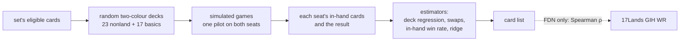

# Cold-start card valuation

*2026-10-14 → 11-03*

Can simulated games alone grade every card of a new Limited set well enough to draft with, before any human data exists? Scored against 17Lands FDN Premier Draft (791,159 games), with BLB planned as the holdout set.

!!! abstract "Verdict"
    **Adopted as a prior.** The az-c4 hand+deck values seeded draft RL stage 1, and the TRK list is the only card prior for Star Trek. Agreement with 17Lands plateaus near 0.5 for scripted pilots and reaches 0.57–0.61 with a trained search pilot. Never run: the BLB holdout, the synergy screen and the fixed-point iteration.

## Setup

`cmd/cardval` was written in gorge, built on the draftlab composition API, and now lives in the private module. It deals random two-colour decks: 23 nonland cards (15 creatures, 8 others) and 17 basics from the 265 eligible FDN cards, 10 colour pairs, and plays them through `draftlab.PlayGame` at about 600 games/s on 8 workers.

- **Estimators:** deck logistic regression (±1 per card plus a went-first term), paired swaps, in-hand (GIH) win rate, drawn minus undrawn, and hand + deck regression.
- **Pilots:** the heuristic bot, a lethal-pressure bot, az-c4 search (25 sims) and the az search with no net.
- **Noise:** deck win rate has a true sd of 9.4 points; game noise equals it at about 28 games per deck.

## Results, 2026-10-14

Spearman against 17Lands GIH WR over the 262 cards with 500+ games.

| Pilot, estimator | Games | ρ | Split-half |
|---|---|---|---|
| rarity alone | — | 0.22 | — |
| bot, deck regression | 188,244 | 0.50 | 0.96 |
| bot, in-hand | 188,244 | 0.49 | 0.97 |
| lethal-pressure, deck regression | 500,000 | 0.51 | — |
| paired swaps | 499,987 | 0.465 | 0.74 |
| az-c4, in-hand | 20,000 | 0.57 | 0.83 |
| az-c4, deck regression | 20,000 | 0.48–0.51 | — |
| no-net az, in-hand | 20,000 | 0.50 | — |

The bot's deck-regression curve plateaus at 0.50:

10k

30k

100k

300k

500k

<ul class="gg-legend gg-bars__key"><li><i class="gg-seg gg-seg--ok"></i>Spearman ρ against 17Lands, bot pilot, deck regression, on a 0–1 scale: 10k 0.377, 30k 0.426, 100k 0.467, 300k 0.498, 500k 0.500</li></ul>

**Biases** (bot, 500k games; mean simulated percentile minus 17Lands in-hand percentile):

| Group (cards) | Bias |
|---|---:|
| sacrifice text (7) | −34.0 |
| MV 2 (60) | −12.6 |
| MV 1 (30) | −7.5 |
| instants (36) | −5.0 |
| creatures (162) | −3.2 |
| removal (25) | +1.4 |
| MV 3 (70) | +3.8 |
| MV 4 (44) | +5.1 |
| lifegain (24) | +6.1 |
| sorceries (29) | +8.8 |
| MV 6+ (30) | +11.7 |
| enchantments (18) | +22.6 |

Rank agreement among board wipes is −0.20. The run directory is gone, so these figures can't be recomputed; they come from the experiment's write-up, kept privately.

**Does agreement predict drafting?** No. In the stage-0 gauntlet (bot pilot, seeds 201–224, 6,144 games per row) a drafter using bot in-hand values scored 51.2% (50.0–52.5), az-c4 hand+deck 50.6% (49.4–51.9), 17Lands ratings 48.0% (46.8–49.3), and az-c4 in-hand, the list that agreed best with 17Lands, 45.6%. See [draft RL](draft-rl.md).

## Later lists (2026-10-16, 2026-11-03)

Published with full tables under [card strength](card-strength/index.md): FDN bot 80k games ρ 0.518 and az-c6 g3 20k games ρ 0.609 (both in-hand, 2026-10-16), and the TRK no-net list of 11,000 games (2026-11-03), whose FDN calibration at 3,000 games scored ρ 0.403. The az-c6 g3 net was trained on FDN, so that list is not cold-start.
