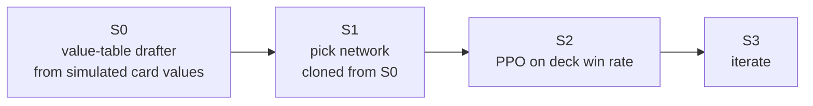

# Draft RL

*Simulated card values → behaviour cloning → PPO, 2026-10-14 → 10-16*

Can a drafter trained on the win rate of the decks it builds beat a drafter that uses 17Lands ratings?

!!! abstract "Verdict"
    S0 and S1 adopted (on main). S2 not adopted: PPO on self-league reward does not transfer to the gauntlet. Open: a reward against a fixed field rather than its own league.

The design note is kept privately; the gates it fixed in advance and its results are below.

## Gates, fixed in advance

- S0 ≥ BR + ⅔·(B17 − BR), where BR is random-from-pool and B17 the 17Lands-rating drafter; under the bot pilot ≥ 40.6%.
- S1: top-1 agreement with its teacher ≥ 85% and gauntlet non-inferior.
- S2: S2 − S1 ≥ +3 points (paired, lower 95% bound > 0) and S2 ≥ B17 − 1 point.
- Baselines under the bot pilot: rating-colour 48.1%, random-from-pool 31.5%.

## Results

-   passes **S0 passes**

    az-c4 hand+deck values became S1's teacher.

-   passes **S1 passes**

    98.3% top-1 agreement with its teacher; on main.

-   fails **S2 does not pass**

    +1.9 points over S1, 95% −0.2 to +4.1; "rewarded only for beating its own league".

**S0** (bot pilot, seeds 201–224, 6,144 games per row):

bot in-hand

az-c4 hand+deck

az-c4 deck regression

17Lands ratings

no-net az in-hand

az-c4 in-hand

<ul class="gg-legend gg-bars__key"><li><i class="gg-seg gg-seg--ok"></i>simulated card values</li><li><i class="gg-seg gg-seg--unv"></i>17Lands ratings, the control</li></ul>

| Drafter values | Score |
|---|---|
| 17Lands ratings (control) | 48.0% (46.8–49.3) |
| bot in-hand | 51.2% (50.0–52.5) |
| az-c4 hand+deck | 50.6% (49.4–51.9) |
| az-c4 deck regression | 48.4% (47.1–49.6) |
| no-net az in-hand | 47.1% (45.8–48.3) |
| az-c4 in-hand | 45.6% (44.4–46.9) |

Under the az-c4 pilot (G0): 17Lands 44.8% [43.6–46.1], bot in-hand 43.0%, az-c4 hand+deck 47.1% [45.8–48.3], random 24.8%.

**S1** (behaviour cloning): 30,000 pods, 5.04M picks, about 90,000 parameters, 44 minutes on CPU; top-1 agreement 98.3%. Gauntlet, net against teacher: bot pilot 50.1% against 50.5%; az-c4 pilot 46.3% [45.0, 47.5] against 47.1%.

**S2** (PPO; pilot C5 gen 4, 256 pods per iteration, 40 iterations, stopped on plateau): 1,024-game gates s1 .450, i10 .465, i20 .445, i30 .467, i40 .452. Paired check, 32 pods, 4,096 games per side: S1 .439, iteration 29 .458 (+1.9 points, 95% −0.2 to +4.1, z 1.76), iteration 39 .457 (+1.8, z 1.67). League reward rose from .49 to .54.

## Second attempt, 2026-10-16

On an unmerged branch, with logs kept privately and no write-up. Values came from an 80,000-game bot card-valuation run and from the az-c6 g3 search pilot; behaviour cloning took 6,000 pods from the bot list's in-hand values (1,008,000 picks).

- Bot-pilot gates (seeds 201–224): B17 0.481 [0.468, 0.493]; S0 from bot values 0.479 [0.467, 0.492]; random 0.314.
- az-c6 g3 pilot (16 events, about 4,096 games): B17 0.456 [0.441, 0.471]; S0 0.433 [0.418, 0.448]; S1 0.434 [0.419, 0.449].
- PPO quick gates (8 events, about 2,048 games): B17 0.475 [0.454, 0.497]; iteration 3 0.474 [0.453, 0.496]; iteration 6 0.463; iteration 9 0.451. Rollout reward rose (iteration 9 0.533 [0.517, 0.550]) while the gate fell, the same pattern as S2. Stopped after iteration 10.

## Data

The first run's directory, including the S2 checkpoint at iteration 29, is gone. The second attempt's logs and its 2026-10-16 card values are kept privately; the values are published as the FDN lists under [card strength](card-strength/FDN.md).
