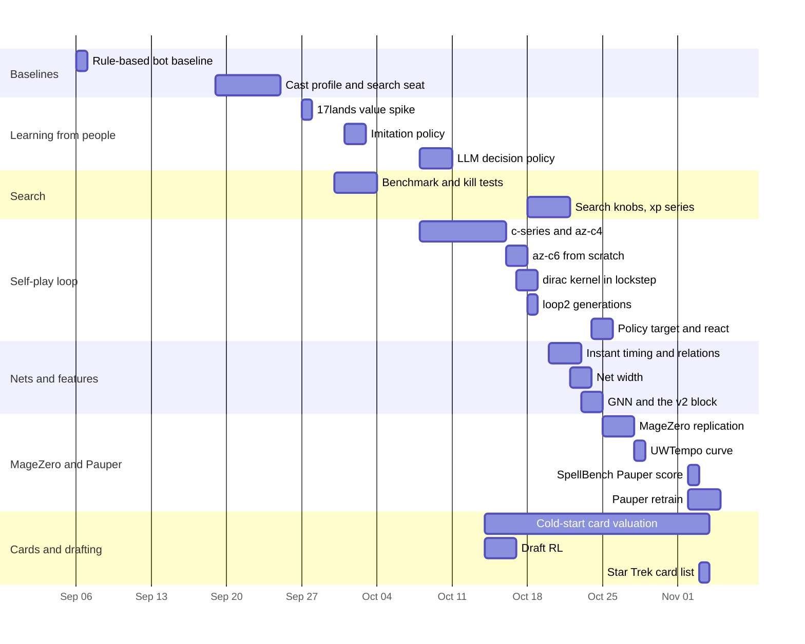

# Research

What gorge's maintainers tried in order to make the bots play better, what each attempt measured, and what was kept. Every decision here was made on play gates, never on training loss.
{ .gg-lede }

<ul class="gg-facts">
  <li><strong>24 questions</strong> asked between 2026-09-06 and 2026-11-04</li>
  <li><strong>15 findings</strong> that held up, each with its gate</li>
  <li><strong>+5.0 points</strong> from two search settings, more than any training change of that period</li>
  <li><strong>0.5 ρ</strong> where simulated card values plateau against 17Lands with scripted pilots</li>
</ul>

-   :material-sitemap: [**How the bot works**](architecture.md)

    The state encoding, the MLP and the GNN, the search and the training loop, drawn with sizes read from the code.

-   :material-cards: [**Card strength lists**](card-strength/index.md)

    Per-set card values from simulated games alone: Star Trek and Foundations, with every card in a CSV.

-   :material-compare-horizontal: [**MageZero replication**](../bots/magezero-replication.md)

    Their graph encoder and engine against ours, like for like.

-   :material-flask: **Programs**

    One page per line of work, from [search](search.md) and [the self-play loop](az-loop.md) to the [Pauper retrain](pauper-retrain.md).

The code these pages describe is split. gorge holds the engines, the encoder (`bots/policynet`), the net runtime (`bots/gonet`, `bots/netsimd`), the reference search (`bots/azmcts`) and the hosted bots. The trainer, the networks and their weights, the self-play drivers and the experiment scripts are not in this repository, so the runs here can't be repeated from a clone of gorge. The run data behind every table is kept privately.

!!! note "How to read the numbers"
    - A score is the first-named side's share of games, seats swapped, unless the row says Elo or points.
    - ± is a 95% interval unless a page says otherwise. At 4,000 games it is about ±0.0155; at 2,000, ±0.022; at 600, about ±0.04; at 300, about ±0.05.
    - sb-tactical scores from different engines and binaries are not comparable with each other: the same g7 net scores 0.618 on one and 0.720 on another. Compare within a row or a page.

## Timeline

adopted adopted.
partly adopted part of it adopted, or adopted for a narrow use.
not adopted not adopted, parked or flat.

| Dates | Question | Arms and gates | Result | Verdict |
|---|---|---|---|---|
| 09-06 | How strong is the rule-based bot, and where does it lose? | botpolicy vs the legacy fuzz driver, 120 deck pairs; 60,000 games | 57.67% pooled ±0.40 points | adopted the baseline |
| 09-19 → 09-24 | Can a learned cast profile or a search teacher beat the bot? | SPSA cast profile (11 weights); PIMC search-teacher seat; distillation, ExIt, PPO (14 arms); 4,000-game held-out gates | cast profile 50.92% [49.38, 52.47], fails its +3 gate; search seat 53.7% [52.2, 55.2] vs 50.4% control (+3.3 points); every learned arm reproduces the bot | partly adopted search seat (opt-in); learned arms not |
| 09-27 | Do 17lands game states teach the value head? | FDN-only and Constructed value corpora | numbers survive only in a maintainer's note ([records missing](#records-missing)) | not adopted |
| 09-30 → 10-03 | How much does search buy, and which knobs matter? | clairvoyant, PIMC-1/4, IS-MCTS; cpuct; fitted leaf; 1,000 human decisions; held-out play gates | agreement with humans flat from 100 to 10,000 sims (balanced 0.630 → 0.633 PIMC-1, ±0.033); fitted leaf +3.71 points held-out (n=1024); cpuct no effect | adopted fitted leaf. [Search](search.md) |
| 10-01 → 10-02 | Does a policy imitating top 17lands players beat the bot? | imitation net as a cast veto; 10,240-game play gates | numbers survive only in a maintainer's note ([records missing](#records-missing)) | not adopted parked |
| 10-08 → 10-15 | Can search-labelled self-play make the hosted bot stronger? | c-series open list, closed list, census on; c5 warm start; 600-game gates | C4 67.8% [64.0, 71.4] vs sb-tactical; C5 0.528 [48.8, 56.8] vs C4 | adopted az-c4 hosted; az-c5 within noise. [AZ loop](az-loop.md) |
| 10-08 → 10-10 | Can a fine-tuned LLM improve the search's picks? | Qwen3.5-9B SFT, DPO, blend into search; 2,370 decisions; 7,100-game gate | DPO − bot +0.0019 ±0.0021 per decision; blend vs search 50.48% [49.32, 51.64] | not adopted [LLM policy](llm-decision-policy.md) |
| 10-14 → 11-03 | Can simulation alone grade a new set's cards? | bot, lethal-pressure, az-c4, no-net pilots; five estimators; 20k–500k games | ρ vs 17Lands: bot plateaus 0.50; az-c4 in-hand 0.57; az-c6 g3 0.609 | adopted as a draft prior. [Card valuation](card-valuation.md) |
| 10-14 → 10-16 | Can a drafter trained on deck win rate beat 17Lands ratings? | S0 value table, S1 BC, S2 PPO; 6,144-game gauntlets; 4,096 paired | S0 51.2% vs 48.0%; S2 − S1 +1.9 points (−0.2, +4.1) | partly adopted S0, S1; S2 not. [Draft RL](draft-rl.md) |
| 10-16 → 10-17 | az-c6 from scratch; the cost of a searched decision | c6 g1–g7; exact speedups; cached worlds; 300-game gates; 300–1,000-game semantic gates | g7 0.720 vs sb-tactical, 0.500 vs g6; 79.2 → 65.0 ms per decision (exact) | partly adopted c6 g7 the anchor; cached worlds not. [AZ loop](az-loop.md#4-az-c6-from-scratch-g1g7) |
| 10-17 → 10-18 | A 2-player FDN kernel 20× faster than gorge, in lockstep | dirac kernel vs gorge; 100k-game census; 1M vanilla | 33 vs 686 µs/sim (21×); 99.47% of 100k FDN games clean | adopted [dirac](../architecture/dirac/index.md) |
| 10-18 | More generations, on either engine | kernel line sims 2000; mainline sims 25; 300- and 3,000-game gates | k10 vs k9 0.500 ±0.018; g10 vs g9 0.483 ±0.057 | flat the recipe pins the net. [AZ loop](az-loop.md#5-kernel-or-gorge-for-self-play) |
| 10-18 → 10-21 | What moves strength past 0.72: search knobs or training? | sims, cpuct, root LCB, defer, belief; P2 recipe; 3,000-game paired gates | cpuct 0.5 + root LCB +5.0 ±1.4 points; P2 0.556 vs g7 (±0.018) | adopted knobs at play; P2 recipe into the next line. [AZ loop](az-loop.md#6-the-diagnosis) |
| 10-20 → 10-22 | Does the net time instants and take kills? Can it see stack targets? | relational entity block; f84 control; rules at play; 2,000-game gates | f84 flat 0.775–0.794 vs sb-tactical; rules only move casts | partly adopted block yes; rules no. [Instant timing](instant-timing.md) |
| 10-22 → 10-23 | Is the net too narrow? | W64, W128, from scratch; 4,000-game gates | W128 0.4514 ±0.0154 vs g26 | not adopted width dead. [Net width](net-width.md) |
| 10-23 → 10-24 | Does a GNN beat the MLP inside search? | G_S, G_M, G_BIG; root, leaf, prior, distil; 4,000-game gates | equal sims G_M 0.5302 ±0.0155; equal time 0.4855 | parked [GNN](gnn.md) |
| 10-23 → 10-24 | Does the v2 entity block (colour, pips, category) pay? | F_V2 vs F_NONE; 8,000 games per arm | +0.019 ±0.008 (one standard error, ≈2.4σ) | adopted [GNN page](gnn.md#2-other-questions-settled-that-night) |
| 10-24 → 10-25 | Is the policy target the bottleneck? | cq vs cqraw vs PCR; 4,000-game gates | q9 vs c9 0.50475; p9 vs c9 0.5016 (±0.0155) | not adopted [Policy target](policy-target-and-react.md) |
| 10-25 | Can self-play learn instant timing? | react rule + held casts vs control; 4,000-game gate + litmus | r6 vs c6 0.4965; opponent-turn share 20.9% → 35.2% | adopted [React](policy-target-and-react.md#the-react-rule-and-held-cast-recording) |
| 10-25 → 10-27 | Does MageZero's graph encoder or engine beat ours like for like? | their data with our net and the reverse; engines on identical lists | faithful replication (0.885 vs their 0.905); NetGraph 27× the MLP's cost on CPU | not adopted [MageZero](../bots/magezero-replication.md) |
| 10-28 | Does our loop learn MageZero's UWTempo curve? | opponents hbot, search 300 (two seeds); 1,000 games per generation | g17 0.7765 [0.7496, 0.8012] vs their 0.646 | replicated in shape. [UWTempo](uwtempo.md) |
| 11-02 | Where does M_CTLX stand on SpellBench Pauper? | 8 bots; 1,792 games | 1446.0 Elo [1392, 1511], top five not separated | net adds little [SpellBench](spellbench-score.md) |
| 11-02 → 11-04 | Does a net trained on the Pauper pool beat M_CTLX? | from-scratch loop g1–g8; 2,000-game title gates | g1 vs M_CTLX 0.5630 [0.5412, 0.5846]; g8 vs g6 0.5292 [0.5073, 0.5510] | adopted g8 champion. [Pauper](pauper-retrain.md) |
| 11-03 | A cold-start card list for Star Trek | no-net az pilot; 11,000 games | split-half ρ 0.758; FDN calibration ρ 0.403 | published as a prior. [TRK](card-strength/TRK.md) |

The 09-06 and 09-19 rows have no page of their own: their write-ups are not published, and the figures above are the record.

## Every head-to-head gate on one axis

<figure markdown="span">
--8<-- "research/figs/gates.svg"
</figure>

Hover a point for its games and interval. The rows are self-paired play gates, in the order they were run; their nets, engines and opponents differ, so read each against 0.5, not against its neighbours.

## What we know

-   **1. Search is the strongest lever.**

    With the MLP, strength grows up to about 1600 sims and is flat from 1600 to 3200: 400 vs 100 0.5384 ±0.0154; 3200 vs 1600 0.499 ±0.022. [Search](search.md#3-win-rate-against-simulations)

-   **2. cpuct 0.5 with root LCB is worth +5.0 ±1.4 points**

    vs sb-tactical at sims 100, more than any training arm of that period (best +2.7). [AZ loop](az-loop.md#6-the-diagnosis)

-   **3. The FDN self-play loop is flat after about seven generations**

    on every recipe tried: az-c6 g7 vs g6 0.500; loop2 k10 vs k9 0.500 ±0.018; f84 26 generations at 0.50 vs prev. [AZ loop](az-loop.md), [instant timing](instant-timing.md)

-   **4. The prior already agrees with its own search.**

    KL(visits‖prior) 0.076 and 87% top-1 agreement on a 40k-state pack; 39% of states have a root Q span under 0.02. [Policy target](policy-target-and-react.md#policy-target-quality)

-   **5. Changing the policy target does not help.**

    cqraw 0.50475 and PCR 0.5016 against cq at g9, 4,000 games each. [Policy target](policy-target-and-react.md)

-   **6. Width does not help.**

    The 2,287,618-parameter W128 MLP scores 0.4514 ±0.0154 vs g26 against W64's 0.4723. [Net width](net-width.md)

-   **7. A GNN wins per simulation and loses per second.**

    G_M 0.5302 at equal sims; 0.4855 at equal time, because it costs 18× per searched move. [GNN](gnn.md)

-   **8. Holdout loss is not a strength measure.**

    Distillation lowered holdout policy CE from 0.625 to 0.606 and play did not move (0.496–0.500); the v2-off arm had the better loss and the worse play. [GNN](gnn.md)

-   **9. Card features pay a little.**

    The v2 entity block adds +0.019 ±0.008 (one standard error) over 8,000 games per arm. [Architecture](architecture.md#entity-records-100-floats-per-visible-card)

-   **10. Instant timing is a training-signal problem, not a rule problem.**

    Rules at play only move casts to main 1. Recording held casts as zero-visit candidates moves opponent-turn share 20.9% → 35.2% at equal strength (0.4965). Humans: 49.6%. [React](policy-target-and-react.md#the-react-rule-and-held-cast-recording)

-   **11. Closing the opponent's list costs little.**

    Old c3 61.2% closed vs 63.0% open against sb-tactical; knowing the opponent's deck list at sims 1600 is worth +0.6 ±1.2 points. [AZ loop](az-loop.md)

-   **12. Against fixed opponents the loop learns fast.**

    UWTempo 0.379 → 0.7765 in 17 generations against search-300 monos; MageZero 0.347 → 0.646. [UWTempo](uwtempo.md)

-   **13. Training on the pool you play pays.**

    Pauper g1 beat FDN-trained M_CTLX 0.5630 [0.5412, 0.5846] and took the title six generations running. [Pauper](pauper-retrain.md)

-   **14. Simulated card values plateau near ρ 0.5 against 17Lands**

    with scripted pilots, and reach 0.57–0.61 with a trained search pilot. Agreement with 17Lands does not predict drafting strength: the best-agreeing list drafted worst, 45.6%. [Card valuation](card-valuation.md)

-   **15. PPO on self-league reward does not transfer.**

    Draft S2 +1.9 points (−0.2, +4.1) over S1; league reward rose while the gauntlet did not. [Draft RL](draft-rl.md)

## Numbers that disagree

Where two figures on these pages seem to contradict each other, this is why.

| What | The figures | Why they differ |
|---|---|---|
| g7 against sb-tactical | 0.618 on the dirac kernel, 0.720 in gorge, 0.708 on the kernel later | The kernel's fallback bot was a weaker stand-in at first; with gorge's heuristic bot ported natively, g7 scores 0.708 ±0.016. |
| Does cpuct matter? | no effect (2026-10-01); +3.0 ±1.3 points (2026-10-19) | Different searches: the first had a heuristic leaf and no opponent nodes, the second a net prior and leaf with opponent nodes. |
| cpuct 0.5 alone | +3.0 ±1.3 on the kernel; +3.63 ±1.19 in gorge | The same knob measured on two engines. |
| The v2 entity block | +0.0231 (~1.05σ, 4,000 games); +0.019 ±0.008 (8,000 games per arm) | Two experiments. The first was one pack against g26; the second is the one kept. Its ±0.008 is one standard error of the difference, not a 95% interval. |
| Does search flatten past 400 sims? | g26 400 vs 100 0.5351 ±0.0109, "flattens past ~400"; M_CTL 1600 vs 400 0.5375 | The earlier note does not hold for M_CTL: it flattens between 1600 and 3200 (0.499). |
| The MLP's size | 601,346; 601,858; 602,370 parameters | The raw card width: 68, 84 or 100 columns. The production MLP is 602,370 parameters. 2,287,618 is the W128 arm, not a production net. |
| Which GNN scored 0.5266 vs g26 | G_MX | An earlier summary credited it to G_M. G_M scored 0.5302 and 0.5282 against the same-data MLP. |
| GNN cost | 7.5×, 18×, 96× per searched move; ~1000× per game | The first three are G_S, G_M and G_BIG in search with the AVX-512 forward; the last is G_BIG uncached, before that forward existed. |
| M_CTLX on SpellBench | 1446.0, 1459.3, 1359.4 Elo | Three boards: sb-score, sb-g6, and sb-fresh with a latency cap that makes the search budget depend on wall time. |
| The bot's card values | 0.518 (2026-10-16, 80k games); 0.48–0.50 (2026-10-14, 100k–500k games) | Different builds: search, payment-plan and manual-tap fixes landed between them. Which change moved it is untested. |
| Sacrifice-card bias | −34.0 (7 cards); −20.3 (25 cards) | Two group definitions on two runs; the 7-card run's data is gone. |
| Instants and sorceries bias | instants −5.0 vs −19.4; sorceries +8.8 vs −10.3 | The same two runs (2026-10-14 vs 2026-10-16). |
| The bot's split-half reliability | 0.957; 0.96 | The same figure, rounded differently; neither primary file survives. |
| MageZero's UWTempo curve | 0.646 at g17 over five monos; 0.645 excluding MonoU; "37% → 64%" | Their README chart leaves out MonoU. |
| Entity format number | format 3; format 2 | The relational block's run notes and its specification number it differently. |
| The policy-target and react A/Bs | strength not comparable with each other | The react A/B ran with the v2 block zeroed in both arms; the relative result stands. |

## Open questions

Open as of 2026-11-04:

- **Value-only MCTS, MLP vs GNN.** A uniform-prior search with each net as the leaf only, G_M vs MLP at equal sims, 2,000 pairs; head swaps under both value-only and PUCT. A note cites a MageZero "+8" with value-only MCTS; no file records that figure.
- **GPU equal time.** The GNN served from the GPU against the MLP on CPU, at equal wall time.
- **GNN speed.** If the grid confirms the edge: bring the GNN under 4× the MLP's cost per eval (18× today for G_M on CPU) through leaf-parallel batched search with virtual loss, incremental entity encoding, fp16/bf16 on GPU and int8 on CPU, distilling G_M into a G_S-size GNN, and a value cache across worlds.
- **Separate policy and value windows.** The policy head trains on the latest generation or two, the value head on the full window (the trainer has one window today). Gate at g6 and g9, 4,000 games, adopt at ≥ 0.52; health check KL(visits‖prior) from 0.07 to ≥ 0.2.
- **A league buffer.** Self-play plus model-vs-model cross-play, against self-play alone.

Other open lines:

- A value target that leans on real outcomes (value blend 0.5 → 0.15 or 0) and a TD(λ) target; the trainer has no TD target ([architecture](architecture.md#5-the-training-loop)).
- A gate opponent that punishes tapped-out boards, so that holding instants can be rewarded.
- Draft PPO against a fixed field rather than its own league; the card-valuation BLB holdout.
- A SpellBench board at the Pauper run-2 build, with gorge-bot in the gate set.

## Records missing

Programs or numbers whose primary records could not be found.

| Program | What is missing | What survives |
|---|---|---|
| Imitation policy from 17lands (2026-10-01 → 10-02) | The run directory (results, run log, play results); the dev-set accuracy (about 0.65 balanced) and the cast-veto play gates exist only in a maintainer's note | Spec, plan and code on unmerged gorge branches; the blocker counts in an unmerged commit |
| 17lands value spike (2026-09-27) | The run directory; the AUC figures exist only in a maintainer's note | Two unmerged gorge branches; the 17lands replay data |
| Search kill tests (2026-10-01) | The two results files: per-arm game counts and intervals of the cpuct sweep and of the fitted leaf's dev/held-out split | The summary row on gorge's [Bot speed](../performance/bots.md) page before 55ce18b20 |
| AZ c-series (2026-10-08 → 10-14) | The loop's plan and its eval summaries | The design notes and the retrain write-up, kept privately |
| az-c5 (2026-10-15) | The run directory | Its design note, kept privately |
| KL(visits‖prior) diagnosis, 2026-10-21 | The output of the pack diagnosis on three packs (the 0.07-nats reading); its log was cut before the KL lines | The script, the packs, and nearby readings in two later reports |
| Perf ledger for the search benchmark | The results file | A summary in the replication report |
| Stage-0 clairvoyant AZ (2026-09-28) | The result file | One line in a gorge report removed from the tree in 01caa6d37 |
| Play-line analysis (2026-10-16) | No sweep was run; results sections are empty except one (payment choice: 157,459 casts, all single-plan, stage 0 aborted) | Reports on unmerged branches and their design notes |
| Cold-start card values, 2026-10-14 runs | The run directory | The experiment write-up, kept privately |
| Draft RL S2 run | The run directory and its checkpoint | The design note's results sections |
| LLM QLoRA working data | The training and bridge directories | The write-up, kept privately; the gate output in a working log |
| Instant timing vs humans, per card | The human and bot computation scripts and outputs | One summary line in the run notes |
| Trek draft pickbot ratings | Never generated; the Trek draft used the rarity and body heuristic | The Trek draft's result note |
| TRK second batch | Planned, never run | — |
| Two loop write-ups | Not readable when this record was assembled | The f84 line's run notes |
