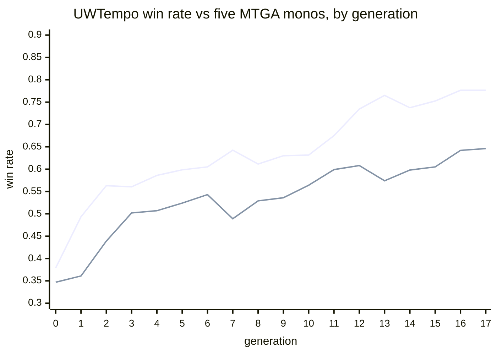

# MageZero's UWTempo curve, on dirac

*2026-10-28*

[MageZero replication](../bots/magezero-replication.md#uwtempo-training-curve) reports this run alongside the action spaces, the data swaps between their graph net and our MLP, and the engine comparison. This page holds the run's full record. MageZero's README reports a UWTempo deck learning from 0.35 to about 0.65 against five MTGA mono decks over 17 generations. Does the same loop, run with gorge's engine, net and search, learn the same curve?

!!! abstract "Verdict"
    **Replicated in shape.** Both systems climb steeply for the first few generations, flatten through the value-only stretch, and step up again when the policy prior switches on at g12 (L 0.6750 → 0.7345; MageZero 0.599 → 0.608). Ours starts higher (0.379 against 0.347), gains more from the first net (+0.11 against +0.01) and ends higher (0.7765 and 0.7840 against 0.646). The cause of the gap is not separated: the network, engine, opponent pilot and trainer all differ, and from g12 our policy prior also shapes the opponent nodes. Our UWTempo search is clairvoyant.

<figure markdown="span">
--8<-- "bots/magezero/uwtempo-curve.svg"
</figure>

## Setup

The loop is the same self-play loop as the other pages, adapted to MageZero's schedule.

- **Per generation:** 1,000 games, 200 against each of five MTGA mono decks (B, G, R, U, W). UWTempo's seat is the search bot with the full-information options and no exploration noise (their `noise.enabled=false`). **This search is clairvoyant**: it sees hidden cards.
- **Schedule:** sims 150 for g0–g6 and 300 from g7. The policy prior is off (uniform, `:ptemp=1e9`, value-only search) through g11 and on from g12 (`:ptemp=1.5`), as in their coordinator schedule.
- **Records:** UWTempo's seat only. Value label TD 0.92 (their ParallelDataGenerator label). Window: the last 10 generations (their `replay_buffer_gens`). Net g+1 trains from scratch at g1 and from net g after.
- **Net:** the production d64 MLP config with a visit-count policy target and no value blending.
- **Decks:** their lists, with no substitutes.
- **Arms**, all started on 2026-10-28 and run to g17:
    - **K**: the mono decks are piloted by the heuristic bot (`hbot`).
    - **L**: the mono decks are piloted by the same clairvoyant search at 300 sims.
    - **L2**: L with a second seed.

**Opponent calibration.** MageZero's opponents are minimax pilots. Which of ours is their equal? UWTempo win rate against the five monos, by pilot:

| UWTempo pilot ↓ / opponent pilot → | hbot | search 25 | search 100 | search 300 | their minimax |
|---|---|---|---|---|---|
| hbot | 0.163 | 0.117 | 0.100 | 0.092 | 0.16 |
| search, 150 sims, no net | 0.513 | 0.445 | 0.399 | 0.372 | 0.347 |

Our search at 300 sims sits closest to their minimax (0.372 against their gen0 0.347), so arm L is the like-for-like arm.

## Results

UWTempo win rate averaged over the five monos, 1,000 games per point (Wilson 95% shown at g0 and g17; about ±0.03 throughout). MageZero's column is their published per-generation average over the same five decks.

| Gen | K (vs hbot) | L (vs search 300) | L2 (seed 2) | MageZero |
|---|---|---|---|---|
| 0 | 0.5065 [0.4755, 0.5374] | 0.3790 [0.3494, 0.4095] | 0.3800 | 0.347 |
| 1 | 0.6095 | 0.4935 | 0.4945 | 0.361 |
| 2 | 0.6880 | 0.5630 | 0.5825 | 0.439 |
| 3 | 0.7005 | 0.5605 | 0.5950 | 0.502 |
| 4 | 0.6885 | 0.5860 | 0.5740 | 0.507 |
| 5 | 0.7575 | 0.5985 | 0.6025 | 0.524 |
| 6 | 0.7280 | 0.6050 | 0.5925 | 0.543 |
| 7 | 0.7725 | 0.6425 | 0.6640 | 0.489 |
| 8 | 0.7660 | 0.6115 | 0.6650 | 0.529 |
| 9 | 0.7670 | 0.6300 | 0.6605 | 0.536 |
| 10 | 0.7570 | 0.6315 | 0.6510 | 0.564 |
| 11 | 0.7760 | 0.6750 | 0.6770 | 0.599 |
| 12 | 0.8380 | 0.7345 | 0.7470 | 0.608 |
| 13 | 0.8560 | 0.7650 | 0.7635 | 0.574 |
| 14 | 0.8435 | 0.7375 | 0.7740 | 0.598 |
| 15 | 0.8465 | 0.7525 | 0.7600 | 0.605 |
| 16 | 0.8495 | 0.7765 | 0.7575 | 0.642 |
| 17 | 0.8675 [0.8451, 0.8871] | 0.7765 [0.7496, 0.8012] | 0.7840 [0.7574, 0.8084] | 0.646 |

Arm L against MageZero alone (upper line: arm L; lower line: MageZero):

MageZero's README quotes the average excluding MonoU (`avg4_exU`): 0.366 at g0 to 0.645 at g17, with a maximum of 0.666 at g16.

## What it answers

This answers "can our loop learn a matchup" with yes, in a setting with fixed opponents. It does not bear on the flat self-play loop on FDN, where the opponent is the learner itself ([AZ loop](az-loop.md)). An earlier comparison of training throughput with MageZero, from 2026-09-24, is kept privately.
