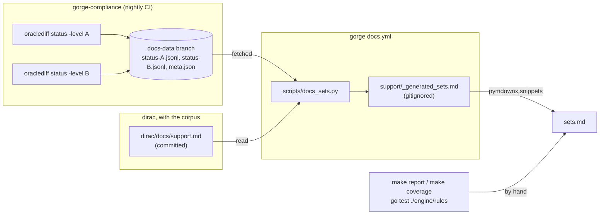

# Regenerating the tables

How each number on [Card support by set](sets.md) is produced, so you can
re-measure it and a reviewer can check it. The tables are generated at every
docs build; the rest of the page's figures are commands you run.

## Where each number comes from

| Number on the page | Source | How it reaches the page |
|---|---|---|
| per-set playable, Level A, Level B, roll-ups, every-set table | gorge-compliance's `oraclediff status` | nightly, through its `docs-data` branch; rendered at every docs build |
| certified-set and Level A/B headline rows | the same status | the same |
| dirac per-set and corpus-wide supported and lowered | `dirac/docs/support.md` | read from that committed page at every docs build ([below](#dirac-refreshing-the-support-page)) |
| corpus cards, playable, tokens, top missing primitives | gorge, `make report` | run it; `coverage.yml` publishes it on every push to `main` |
| playable by card type | gorge, `make coverage` | the same workflow |
| parse diagnostics | gorge, `forgec compile` | run it |
| repo-deck ratchet and parameter census | `TestEveryRepoDeckIsFullySupported`, `TestEveryRepoDeckParamsAreRead` | their log lines |
| verdict counts | gorge-compliance, `oracle/compliance/verdicts/*.jsonl` | [counting command](#gorge-compliance-the-per-set-status) |



## How the docs build gets the numbers

[`.github/workflows/docs.yml`](https://github.com/adams-shaun/gorge/blob/main/.github/workflows/docs.yml)
builds the site, strictly, on pushes to `main` (and `develop`, a trigger left
over from the retired landing train), on pull requests, on a daily 17:17 UTC
rebuild (after gorge-compliance's nightly job), on `repository_dispatch` from
gorge-compliance and on manual runs. Only a `main` build that is not a pull
request deploys. Before the build, it:

1. generates the package map (`go run ./cmd/pkgmap`);
2. checks the web-client pages against the client source (`scripts/docs_web_test.py`);
3. runs `scripts/docs_sets_test.py`, then `scripts/docs_sets.py`. The renderer
   reads dirac's committed support page (`--dirac-support dirac/docs/support.md`) and, when the fetch succeeds,
   **gorge-compliance's orphan `docs-data` branch** (`status-A.jsonl`,
   `status-B.jsonl`, `meta.json`).

After `mkdocs build --strict`, `scripts/docs_mermaid_check.py` parses every Mermaid diagram.

gorge-compliance's nightly `compliance` job (09:41 UTC) writes `docs-data`: after
`make compliance-status` it runs Level A over every set and Level B over the sets whose Level A row
says `"printed": true`, then force-pushes one commit, so only the latest state is kept. It publishes
only when `make compliance-status` passes; after a failed night the tables keep the last data and
their captions give its date and corpus. The repository is public, so no token is needed. If the
branch is missing, the tables render from dirac's support page and the gorge columns say the data
was not available.

## The renderer: `scripts/docs_sets.py`

gorge keeps the renderer. It writes `docs/site/support/_generated_sets.md`,
which is gitignored and never committed. The file has sections marked
for `pymdownx.snippets`, and `sets.md` includes each one by name:

| Section | Contents |
|---|---|
| `headline` | one row per engine and measure, with the commits and corpus measured |
| `sets` | the per-set table: every set gorge-compliance audits against a printed list, plus every set on dirac's support page, joined by set code |
| `rollup` | the roll-up by set type, then every set |
| `charts` | one chart per engine over the Standard sets |
| `glance` | the one-tile-per-Standard-set summary |
| `slices` | the lockstep slice table, from `--slices` |
| `edh` | Commander deck coverage from `forgec edhcover`'s `.coverage/edh.json` (`--edh`); "not available" without it |

To render and build locally:

```sh
python3 scripts/docs_sets.py status-A.jsonl --level-b status-B.jsonl --meta meta.json \
  --dirac-support dirac/docs/support.md
uvx --with mkdocs-material==9.7.7 mkdocs build --strict -d ../gorge-site
python3 -m unittest discover -s scripts -p 'docs_sets_test.py'
```

Every input is optional, but at least one of the status file and the support page is needed; a set
code only one source has still gets a row. `--commit` and `--date` override `meta.json`; `-o PATH`
redirects the output. Standard library only; it publishes counts and percentages, never card text.

**Playable %** is `1 − (unsupported + not in corpus) / cards`; **Level A %** (or **B %**) is the
share of cards with no problem at that level (`no printed list` is a pseudo-problem, not
subtracted). Without a printed list, Level A is a lower bound (≥).

## gorge-compliance: the per-set status

To reproduce `docs-data` by hand, clone
[gorge-compliance](https://github.com/adams-shaun/gorge-compliance). It
measures the gorge commit in its `GORGE_PIN`, not your checkout, and resolves
that commit through `go.mod`. It reads gorge's corpus through a `.cards` link:

```sh
git clone https://github.com/adams-shaun/gorge-compliance.git
cd gorge-compliance
make cards GORGE_ROOT=../gorge      # links ../gorge/.cards here

# Level A over every XMage set manifest: one JSON line per set
go run ./cmd/oraclediff status -all -json -level A -procs 4 > status-A.jsonl

# Level B over the sets with a printed card list
sets=$(python3 -c 'import json,sys; print(",".join(r["set"] for r in map(json.loads, open(sys.argv[1])) if r.get("printed")))' status-A.jsonl)
go run ./cmd/oraclediff status -all -json -level B -procs 4 -sets "$sets" > status-B.jsonl
```

`-procs` caps child processes. Neither command needs XMage or Forge built (both read the committed
verdicts); only *writing new verdicts* does (`make compliance-pass`, a heavy JVM run). Each output
line is one set:

| Field | Meaning |
|---|---|
| `set`, `name`, `set_type`, `released`, `formats` | set code, name, XMage set type, release date, formats it is legal in |
| `level`, `declared` | the level checked; the level the set is declared at, if any |
| `printed` | whether gorge-compliance has a full printed card list for the set |
| `cards` | cards the claim covers |
| `outstanding`, `problem_cards` | problems, and distinct cards with at least one |
| `buckets` | problems by reason: `unsupported`, `not in corpus`, `template gap`, `no verdict`, `diverge`, `harness`, `stale verdict`, `no printed list`, … |

`make compliance-status` in gorge-compliance writes the same data as a
dashboard, `oracle/compliance/status.md`.

**Verdict counts** come from counting the committed verdict rows:

```sh
cat oracle/compliance/verdicts/*.jsonl | python3 -c '
import sys, json, collections
rows = [json.loads(l) for l in sys.stdin if l.startswith("{")]
print(len(rows), "verdicts over", len({r["card"] for r in rows}), "cards")
print(collections.Counter(r["status"] for r in rows).most_common())'
```

## dirac: refreshing the support page

The docs build has no corpus, so it reads dirac's figures from
[`dirac/docs/support.md`](https://github.com/adams-shaun/gorge/blob/main/dirac/docs/support.md)
(stamped with the last commit that touched it). A clone with the corpus refreshes it:

```sh
make dirac-tables
DIRAC_UPDATE_SUPPORT=1 go test -run TestSupportDocIsCurrent ./dirac/kgen   # rewrites dirac/docs/support.md
```

The page has no per-slice lockstep results. CI's `dirac-slices` job writes `slices-summary.json`
(`scripts/dirac_slices_summary.py`, from kfuzz's summary lines) and uploads it on main runs; the docs
workflow downloads the newest for the lockstep column and "Lockstep slices" table, and says "not
measured" without one. `go run ./dirac/cmd/kgen -supported fdn` lists one pool's cards.

**The evidence behind those counts** is in `dirac/support/evidence/`. `scripts/dirac-evidence.sh <out>`
plays the evidence corpus (committed FDN and BLB slices, pauper real decks, one synthetic pool per
Standard list) and `scripts/dirac-first-refusals.py evidence <out>` writes the lists. The full FDN
and BLB deck pools are unpublished, so a clone cannot earn more FDN or BLB evidence than the slices.

## gorge: corpus coverage

You need the Forge corpus once (`make fetch-cards compile-cards`, about 140 MB
on disk, pinned to `FORGE_REF` in the
[Makefile](https://github.com/adams-shaun/gorge/blob/main/Makefile)). Then
run:

```sh
make report      # cards / playable / tokens, then the top 25 missing primitives
make coverage    # .coverage/summary.md and .coverage/coverage.md: by type, colour, mana value
```

`make report` prints the corpus pin, the `cards: … playable: …` line, the
`tokens:` line, then the missing-primitive ranking. Both targets read the IR
cache in `.cards/`. The [card coverage](https://github.com/adams-shaun/gorge/blob/main/.github/workflows/coverage.yml)
workflow publishes `make coverage`'s tables as a job summary and artifact on
every push to `main`.

**Parse diagnostics.** `forgec compile` prints one line per diagnostic and a
total (`compiled <n> cards, <n> tokens, <n> diagnostics`).

!!! warning "Compile into a copy if `.cards` is shared"
    `forgec compile` rewrites the IR cache and prunes all but the newest four
    cache files in the directory. If several checkouts share one `.cards` (a symlinked
    worktree), compile into a scratch copy instead. The walker doesn't follow
    symlinks, so copy the folders:

    ```sh
    mkdir -p ../corpus-copy
    cp -rL .cards/cardsfolder .cards/tokenscripts .cards/cards.lock ../corpus-copy/
    go build -o bin/forgec ./cmd/forgec
    bin/forgec compile -dir ../corpus-copy
    ```

## gorge: the repo-deck ratchets

```sh
make test-one PKG=./engine/rules RUN='TestEveryRepoDeckIsFullySupported|TestEveryRepoDeckParamsAreRead' V=1
```

The two log lines (`ratchet: N of <total> …`, `param census: N of <total> …`) are the live counts. The
cards are the files in `engine/rules/testdata/known-unsupported/` and `paramcensus/` (a directory is
absent while empty). Without `.cards` both tests skip and the package still prints `ok`: check that the
log lines are there.
