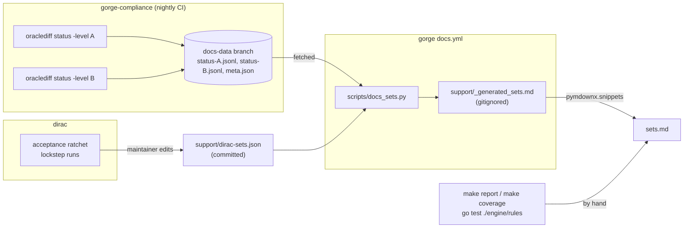

# Regenerating the tables

This page says how each number on [Card support by set](sets.md) is produced,
so a contributor can re-measure it and a reviewer can check it. Most of the
page is generated at every docs build. The rest is a hand measurement that
names the commit it was taken at.

## Where each number comes from

| Number on the page | Source | How it reaches the page |
|---|---|---|
| per-set playable, Level A, Level B, roll-ups, every-set table | gorge-compliance's `oraclediff status` | nightly, through its `docs-data` branch; rendered at every docs build |
| certified-set and Level A/B headline rows | the same status | the same |
| dirac per-set accepted / cards, corpus-wide accepted, lockstep games | dirac's acceptance ratchet and lockstep runs | a committed snapshot, `docs/site/support/dirac-sets.json`, edited by a maintainer |
| corpus cards, playable, tokens, top missing primitives | gorge, `make report` | by hand |
| playable by card type | gorge, `make coverage` | by hand |
| parse diagnostics | gorge, `forgec compile` | by hand |
| repo-deck ratchet and parameter census | gorge, `go test ./engine/rules/ -run …` | by hand |
| verdict counts | gorge-compliance, `oracle/compliance/verdicts/*.jsonl` | by hand |
| XMage's card-count claim | the XMage README | by hand |



## How the docs build gets the numbers

[`.github/workflows/docs.yml`](https://github.com/adams-shaun/gorge/blob/main/.github/workflows/docs.yml)
builds the site on pushes to `main` and `develop` and on pull requests. It
deploys from `main` on a push, on the daily 17:17 UTC rebuild (after gorge-compliance's nightly job), or on a manual
run. Before the build, it:

1. generates the package map (`go run ./cmd/pkgmap`);
2. fetches the engine-speed history from gorge's orphan `perf-data` branch
   when it exists (no such branch on 2026-10-31);
3. runs `scripts/docs_sets_test.py`, then `scripts/docs_sets.py`. The renderer
   reads the committed dirac snapshot and, when the fetch succeeds,
   **gorge-compliance's orphan `docs-data` branch** (`status-A.jsonl`,
   `status-B.jsonl`, `meta.json`).

gorge-compliance's nightly `compliance` job (09:41 UTC) writes `docs-data`.
After `make compliance-status`, it runs two status commands. The first covers
Level A over every set. The second covers Level B over the sets whose Level A
row says `"printed": true`. The job then force-pushes the results as one
commit, so only the latest state is kept. gorge-compliance is public, so the
docs build needs no token. If the branch is missing or the fetch fails, the
tables still render from the dirac snapshot, and the gorge columns say
the data was not available.

## The renderer: `scripts/docs_sets.py`

gorge keeps the renderer. It writes `docs/site/support/_generated_sets.md`,
which is gitignored and never committed. The file has three sections marked
for `pymdownx.snippets`, and `sets.md` includes each one by name:

| Section | Contents |
|---|---|
| `headline` | one row per engine and measure, with the commits measured |
| `sets` | the per-set table: every set gorge-compliance audits against a printed list, plus every set in dirac's snapshot, joined by set code |
| `rollup` | the roll-up by set type, then every one of the 589 sets |

To render and build locally:

```sh
python3 scripts/docs_sets.py status-A.jsonl --level-b status-B.jsonl --meta meta.json \
  --dirac docs/site/support/dirac-sets.json
uvx --with mkdocs-material==9.7.7 mkdocs build --strict -d /tmp/gorge-site
python3 -m unittest discover -s scripts -p 'docs_sets_test.py'
```

Every input is optional, but the renderer needs at least one of the status
file and the snapshot. A set code that only one source has still gets a row.
`--commit` and `--date` override `meta.json`'s values, and `-o PATH` writes
somewhere else. The renderer uses only the Python standard library, skips any
input line that isn't a JSON object, and publishes only counts and
percentages, never card text.

It computes **playable %** as `1 − (unsupported + not in corpus) / cards`,
and **Level A %** (or **Level B %**) as the share of cards with no problem at
that level. `no printed list` is a per-set pseudo-problem, not a card, so it
isn't subtracted. For a set without a printed list, Level A is shown as a
lower bound (≥).

## gorge-compliance: the per-set status

To reproduce `docs-data` by hand, clone
[gorge-compliance](https://github.com/adams-shaun/gorge-compliance). It
measures the gorge commit in its `GORGE_PIN`, not your checkout, and resolves
that commit through `go.mod`. It reads gorge's corpus through a `.cards` link:

```sh
git clone https://github.com/adams-shaun/gorge-compliance.git
cd gorge-compliance
make cards GORGE_ROOT=../gorge      # links ../gorge/.cards here

# Level A over all 589 XMage set manifests: one JSON line per set
go run ./cmd/oraclediff status -all -json -level A -procs 4 > status-A.jsonl

# Level B over the sets with a printed card list
sets=$(python3 -c 'import json,sys; print(",".join(r["set"] for r in map(json.loads, open(sys.argv[1])) if r.get("printed")))' status-A.jsonl)
go run ./cmd/oraclediff status -all -json -level B -procs 4 -sets "$sets" > status-B.jsonl
```

`-procs` caps the gate's child processes. Neither command needs XMage or
Forge to be built: both read the committed verdicts. Only *writing new
verdicts* needs the engines (`make compliance-pass`, a heavy JVM run). Each
output line is one set:

| Field | Meaning |
|---|---|
| `set`, `name`, `set_type`, `released`, `formats` | set code, name, XMage set type, release date, formats it is legal in |
| `level`, `declared` | the level checked; the level the set is declared at, if any |
| `printed` | whether gorge-compliance has a full printed card list for the set |
| `cards` | cards the claim covers |
| `outstanding`, `problem_cards` | problems, and distinct cards with at least one |
| `buckets` | problems by reason: `unsupported`, `not in corpus`, `template gap`, `no verdict`, `diverge`, `harness`, `stale verdict`, `no printed list`, … |

`make compliance-status` in gorge-compliance writes the same data as a
dashboard, `oracle/compliance/status.md`.

**Verdict counts** come from counting the committed verdict rows:

```sh
cat oracle/compliance/verdicts/*.jsonl | python3 -c '
import sys, json, collections
rows = [json.loads(l) for l in sys.stdin if l.startswith("{")]
print(len(rows), "verdicts over", len({r["card"] for r in rows}), "cards")
print(collections.Counter(r["status"] for r in rows).most_common())'
```

## dirac: refreshing the snapshot

dirac's source isn't in this repository, so no job here can re-measure it. Its per-set figures live in a
small committed file,
[`docs/site/support/dirac-sets.json`](https://github.com/adams-shaun/gorge/blob/main/docs/site/support/dirac-sets.json),
which holds:

- the snapshot date;
- the gorge commit it pins;
- the corpus-wide accepted / cards count;
- accepted / cards for each set in its acceptance ratchet;
- the games, agreements, stalls and disagreements of each lockstep-verified
  set.

To refresh it, a maintainer re-runs dirac's acceptance ratchet and its
lockstep runs, then copies the counts into this file and opens a pull request. The ratchet's pins are always the live counts, so the
copy is mechanical. The renderer checks that every accepted count is within
its card count and that each lockstep row adds up. `docs_sets_test.py` loads
the committed file.

## gorge: corpus coverage

You need the Forge corpus once (`make fetch-cards compile-cards`, about 140 MB
on disk, pinned to `FORGE_REF` in the
[Makefile](https://github.com/adams-shaun/gorge/blob/main/Makefile)). Then
run:

```sh
make report      # cards / playable / tokens, then the top 25 missing primitives
make coverage    # .coverage/summary.md and .coverage/coverage.md: by type, colour, mana value
```

`make report` prints the corpus pin, the `cards: … playable: …` line, the
`tokens:` line, and then the missing-primitive ranking. `make coverage` writes
the by-type table. Both read the IR cache in `.cards/` and take a few seconds.
The [card coverage](https://github.com/adams-shaun/gorge/blob/main/.github/workflows/coverage.yml)
workflow also publishes `make coverage`'s tables as a job summary and artifact
on every push to `main`.

**Parse diagnostics.** `forgec compile` prints one line per diagnostic and a
total (`compiled 34074 cards, 854 tokens, 2 diagnostics`).

!!! warning "Compile into a copy if `.cards` is shared"
    `forgec compile` rewrites the IR cache and prunes every other cache file in
    the directory. If several checkouts share one `.cards` (a symlinked
    worktree), compile into a scratch copy instead. The walker doesn't follow
    symlinks, so copy the folders:

    ```sh
    mkdir -p /tmp/corpus-copy
    cp -rL .cards/cardsfolder .cards/tokenscripts .cards/cards.lock /tmp/corpus-copy/
    go build -o bin/forgec ./cmd/forgec
    bin/forgec compile -dir /tmp/corpus-copy
    ```

## gorge: the repo-deck ratchets

```sh
go test ./engine/rules/ -run 'TestEveryRepoDeckIsFullySupported|TestEveryRepoDeckParamsAreRead' -v
```

The two log lines are the live counts (`ratchet: N of 1123 …` and
`param census: N of 1123 …`). The named cards are the files in
[`engine/rules/testdata/known-unsupported/`](https://github.com/adams-shaun/gorge/tree/main/engine/rules/testdata/known-unsupported)
and `engine/rules/testdata/paramcensus/`, one JSON file per card. Without `.cards`, both tests skip and the package
still prints `ok`, so check that the log lines are there.
