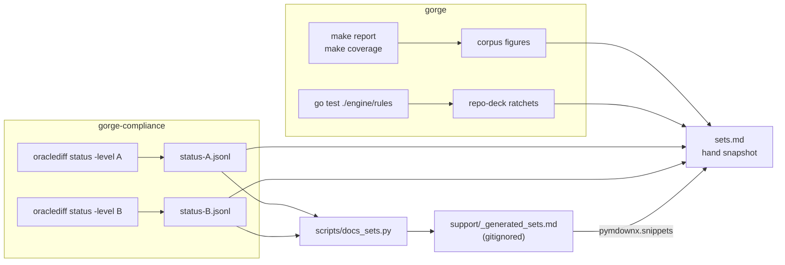

# Regenerating the tables

This page says exactly how each number on [Card support by set](sets.md) is
produced, so a contributor can re-measure it and a reviewer can check it. Every
command below was run on 2026-10-20 at gorge `ad3777023` and gorge-compliance
`736a826f5190`; the timings are on 4 cores. It also says how the docs build gets
the numbers today, and what it does not do yet.

## Where each number comes from

| Number on the page | Source | Command | Cost |
|---|---|---|---|
| corpus cards, playable, tokens, top missing primitives | gorge | `make report` | ~3 s |
| playable by card type | gorge | `make coverage` | ~3 s |
| parse diagnostics | gorge | `bin/forgec compile` (see the warning below) | ~2 s |
| repo-deck ratchet and parameter census | gorge | `go test ./engine/rules/ -run '…'` | ~2 s |
| per-set playable, Level A, roll-ups, estimates | gorge-compliance | `oraclediff status -all -json -level A` | ~1 min 50 s |
| per-set Level B | gorge-compliance | `oraclediff status -all -json -level B -sets …` | ~20 s |
| verdict counts | gorge-compliance | count the rows in `oracle/compliance/verdicts/*.jsonl` | instant |
| dirty-dirac per-pool counts | the private companion module | its card generator's coverage report | maintainers only |
| XMage's card-count claim | the XMage README | read by hand | — |

None of these needs XMage or Forge to be built. Only *writing new verdicts*
does (`make compliance-pass` in gorge-compliance, a heavy JVM run); the status
commands read the verdicts already committed.



## gorge: corpus coverage

You need the Forge corpus once (`make fetch-cards compile-cards`, about 25 MB,
pinned to `FORGE_REF` in the
[Makefile](https://github.com/adams-shaun/gorge/blob/main/Makefile)). Then:

```sh
make report      # cards / playable / tokens, then the top 25 missing primitives
make coverage    # .coverage/summary.md and .coverage/coverage.md: by type, colour, mana value
```

`make report` prints the corpus pin, then
`cards: 34074  playable: 32082 (94.2%)` and `tokens: 854`, then the
missing-primitive ranking the page reproduces. `make coverage` writes the
by-type table. Both read the IR cache in `.cards/` and take a few seconds.

The [card coverage](https://github.com/adams-shaun/gorge/blob/main/.github/workflows/coverage.yml)
workflow also publishes `make coverage`'s tables as a job summary and artifact
on every push to `main`.

**Parse diagnostics.** `forgec compile` prints one line per diagnostic and a
total (`compiled 34074 cards, 854 tokens, 2 diagnostics`).

!!! warning "Compile into a copy if `.cards` is shared"
    `forgec compile` rewrites the IR cache and prunes every other cache file in
    the directory. If several checkouts share one `.cards` (a symlinked
    worktree), compile into a scratch copy instead. The walker does not
    follow symlinks, so copy the folders:

    ```sh
    mkdir -p /tmp/corpus-copy
    cp -rL .cards/cardsfolder .cards/tokenscripts .cards/cards.lock /tmp/corpus-copy/
    go build -o bin/forgec ./cmd/forgec
    bin/forgec compile -dir /tmp/corpus-copy
    ```

## gorge: the repo-deck ratchets

```sh
go test ./engine/rules/ -run 'TestEveryRepoDeckIsFullySupported|TestEveryRepoDeckParamsAreRead' -v
```

The two log lines are the live counts (`ratchet: 2 of 1123 …`,
`param census: 16 of 1123 …`). The named cards are the files in
[`engine/rules/testdata/known-unsupported/`](https://github.com/adams-shaun/gorge/tree/main/engine/rules/testdata/known-unsupported)
and
[`engine/rules/testdata/paramcensus/`](https://github.com/adams-shaun/gorge/tree/main/engine/rules/testdata/paramcensus),
one JSON file per card. Without `.cards` both tests skip and the package still
prints `ok`: check that the log lines are there.

## gorge-compliance: the per-set status

[gorge-compliance](https://github.com/adams-shaun/gorge-compliance) measures
the gorge commit in its `GORGE_PIN`, not your checkout, and resolves it through
`go.mod`. It reads gorge's corpus through a `.cards` link:

```sh
git clone https://github.com/adams-shaun/gorge-compliance.git
cd gorge-compliance
make cards GORGE_ROOT=../gorge      # links ../gorge/.cards here

# Level A over all 589 XMage set manifests: one JSON line per set
go run ./cmd/oraclediff status -all -json -level A -procs 4 > status-A.jsonl

# Level B over the sets that have a printed card list (21 today)
go run ./cmd/oraclediff status -all -json -level B -procs 4 \
  -sets "$(ls oracle/compliance/printed | sed 's/\.json$//' | paste -sd,)" > status-B.jsonl
```

`-procs` caps the gate's child processes (at most 4). Each line is one set:

| Field | Meaning |
|---|---|
| `set`, `name`, `set_type`, `released`, `formats` | set code, name, XMage set type, release date, formats it is legal in |
| `level`, `declared` | the level checked; the level the set is declared at, if any |
| `printed` | whether gorge-compliance has a full printed card list for the set |
| `cards` | cards the claim covers |
| `outstanding`, `problem_cards` | problems, and distinct cards with at least one |
| `buckets` | problems by reason: `unsupported`, `not in corpus`, `template gap`, `no verdict`, `diverge`, `harness`, `stale verdict`, `no printed list`, … |

The Level B run also prints a ratchet line to stderr when a set has improved
past its recorded floor (on 2026-10-20: BIG, EOE, FDN and FRA).
`make compliance-status` in gorge-compliance writes the same data as a
dashboard, `oracle/compliance/status.md`.

**Verdict counts** are a count over the committed verdict rows:

```sh
cat oracle/compliance/verdicts/*.jsonl | python3 -c '
import sys, json, collections
rows = [json.loads(l) for l in sys.stdin if l.startswith("{")]
print(len(rows), "verdicts over", len({r["card"] for r in rows}), "cards")
print(collections.Counter(r["status"] for r in rows).most_common())'
```

## The renderer: `scripts/docs_sets.py`

gorge keeps the renderer. It turns the status JSONL into
`docs/site/support/_generated_sets.md`, which `sets.md` includes at its end
through `pymdownx.snippets`. The fragment is gitignored; when it is absent the
page shows only its hand snapshot. Only counts and percentages are published,
never card text.

```sh
python3 scripts/docs_sets.py status-A.jsonl --level-b status-B.jsonl \
  --commit "$(git -C ../gorge-compliance rev-parse HEAD)" --date "$(date +%F)"
uvx --with mkdocs-material==9.7.7 mkdocs build --strict -d /tmp/gorge-site
```

`docs_sets.py` needs only the Python standard library and skips any line that
is not a JSON object. `--level-b` is optional; without it the audited-sets
table shows Level A problem counts instead of Level B. Options: `-o PATH`,
`--commit SHA`, `--date YYYY-MM-DD` (both shown in the fragment's header).

It computes **playable %** as `1 − (unsupported + not in corpus) / cards`, and
**Level A %** (or **Level B %**) as the share of cards with no problem at that
level. `no printed list` is a per-set pseudo-problem, not a card, so it is not
subtracted.

## dirty-dirac

dirty-dirac's card tables are generated in gorge's private companion module.
Its generator writes a coverage report per pool (cards in the pool, cards
lowered, and every refusal with its reason), and a maintainer copies the
per-pool counts onto the page. Pool membership on the page was checked against
Forge's edition files at `FORGE_REF` (`res/editions/Foundations.txt` and
`Bloomburrow.txt`, the `[cards]` and `[special guests]` sections). Nothing
public regenerates these numbers.

## How the docs build gets the numbers

[`.github/workflows/docs.yml`](https://github.com/adams-shaun/gorge/blob/main/.github/workflows/docs.yml)
builds the site on pushes to `main` and `develop` and on pull requests, and
deploys from `main`. It generates the package map and fetches the
engine-speed history from the orphan `perf-data` branch, but **it no longer
generates the set table**: the compliance oracle moved to gorge-compliance on
2026-10-16, and gorge's CI has neither the oracle nor its verdicts. So the set
page is a hand snapshot, refreshed by running the commands above and editing
`sets.md`. gorge-compliance's nightly CI job already runs
`make compliance-status` and uploads `status.md` as an artifact, but nothing
carries it to the docs build yet.
