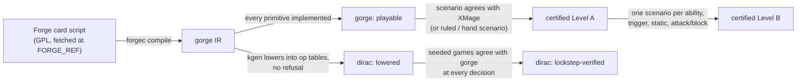

# Card support by set

This page says which *Magic* cards and sets each engine in the gorge family
supports, and what "supported" means for each. The word means something
different at every tier. The page is for players choosing a format, bot
authors choosing a card pool, and contributors looking for the card work with
the most leverage.

!!! info "Where the numbers come from"
    - **Generated at every docs build:** the engine headline table, the per-set
      table and the roll-ups. They join gorge-compliance's nightly per-set
      status with dirac's committed per-set snapshot. Each table's
      caption gives the date and Forge corpus it measured, which can trail the
      corpus pin below.
    - **Measured by hand on 2026-10-31:** the corpus figures, the leverage
      ranking and the repo-deck ratchets. These were measured at gorge
      `develop` @ `fb7579ace` with the Forge corpus pin (`FORGE_REF`)
      `91402ac511046c0b7ed0bb691a8a446ca7dfc873`.

    [Regenerating the tables](regenerating.md) gives the command behind each
    number.

## Headline

**gorge, playable:** **32,390 of 34,074** Forge card scripts (**95.1%**) at the
corpus pin. All 34,074 compile into gorge's IR (`make report`, 2026-10-31,
`fb7579ace`).

--8<-- "support/_generated_sets.md:headline"

## What "supported" means, engine by engine

Each tier certifies more than the one before it, and each has its own test.
Don't read a number from one tier as a claim at another. For example, 95.1%
of the corpus is *playable* in gorge. That says which primitives are
implemented. It doesn't say the cards behave correctly.

| Engine | A card is supported when | Checked by |
|---|---|---|
| gorge, **playable** | every primitive its compiled script references is implemented | `make report` (`Registry.Coverage`) |
| gorge, **certified Level A** | it is playable and its cast-and-resolve (or play-land, or counter-spell) scenario agrees with XMage, carries a ruled divergence, or passes a hand-written Oracle scenario | gorge-compliance's gate |
| gorge, **certified Level B** | Level A plus one XMage-compared scenario per activated ability, trigger mode, static ability and attack/block | gorge-compliance's gate |
| dirac, **lowered** | its generator (`kgen`) lowers every ability into the engine's op tables with no refusal | dirac's acceptance ratchet |
| dirac, **lockstep-verified** | games drawn from the set's pool play identically in dirac and gorge, compared at every decision | dirac's lockstep oracle |



### gorge: playable

A card is **playable** when every [primitive](../contributing/glossary.md) its
compiled script references is implemented. That covers each `api:` effect,
`trig:` trigger mode, `kw:` keyword, `stat:` static mode, `repl:` replacement
and the `count:` value heads its SVars read. Clone-style enters-the-battlefield
replacements also have to pass a shape gate. The check is
[`Registry.Coverage`](https://github.com/adams-shaun/gorge/blob/main/engine/cards/validate.go)
against `effects.Supported()`, run by `make report` over the whole corpus.

Playable is necessary, not sufficient. A card can be playable and still
misbehave. The effect may not read one of its `$` parameters, or a primitive
may handle the common shape but not this card's. Two ratchets watch the cards
that matter most, the ones in the repository's own decks (see
[The repo-deck ratchet](#the-repo-deck-ratchet)).

### gorge certified: Levels A and B

[gorge-compliance](https://github.com/adams-shaun/gorge-compliance) is the
public compliance repository. It pins one gorge commit and checks it card by
card against independent references. One reference is hand-written scenarios
derived from the card's Oracle text and the Comprehensive Rules. The other is
**XMage**, an independent Java engine. For each card, gorge-compliance
generates scenarios, replays them in both engines, diffs the two engines'
snapshots at each checkpoint, and records a **verdict** per (card, template,
scenario hash). **Forge** runs as a third leg to adjudicate disagreements.

| Level | Not covered |
|---|---|
| **A** | activated abilities, trigger modes, attacks and blocks, statics. Basic lands are skipped. A card XMage does not implement needs a hand scenario |
| **B** | a requirement no scenario template serves yet is reported as a *template gap* and waits for its template |

The definitions are the gate's own wording,
[`gate.LevelMeaning`](https://github.com/adams-shaun/gorge-compliance/blob/main/oracle/compliance/gate/gate.go).
A verdict stays valid only while gorge still meets its frozen expectation and
the scenario's hash is unchanged. A moved scenario shows as a *stale verdict*
until XMage replays it. A *harness* problem means the test rig, not the
engine, could not express the scenario.

**Declared sets and the ratchet.** A set is *declared* at a level in
[`declared.json`](https://github.com/adams-shaun/gorge-compliance/blob/main/oracle/compliance/declared.json),
and CI fails if a declared set has any problem at that level. Only a set with
a full printed card list can be declared, because XMage's set manifests omit
the cards XMage lacks. The certification ratchet,
[`ratchet.json`](https://github.com/adams-shaun/gorge-compliance/blob/main/oracle/compliance/ratchet.json),
holds every other set's problem count, and that count may only fall. All of
these targets describe the pinned gorge commit. Bumping the pin is a pull
request that re-measures them.

At gorge-compliance `9b83309` (`main`, 2026-10-29), the committed verdicts number
13,183 over 5,278 cards: 13,130 agree, 37 `xmage_wrong` (a ruled XMage error
with a CR citation), 11 harness, 3 diverge and 2 `gorge_wrong`.

### dirac: lowered and lockstep-verified

dirac is a second, much faster rules engine, and gorge is the reference it is checked against. Its
source isn't in this repository yet, and its per-set figures are published here. It doesn't interpret
card scripts. Instead, a generator (`kgen`) **lowers** each card's gorge IR into fixed op tables. A card
it cannot lower is *refused* with a named reason. kgen runs over the whole Forge corpus. An acceptance
ratchet pins the number of cards accepted, corpus-wide and per set. A fall fails, and a rise is re-pinned.

Being lowered is weaker than being verified. **Lockstep** verification runs
the engine beside gorge on the same decks and seed. It compares the options
offered at every decision and the state after every action. Each verified set
has a fixed slice of 1,500 seeded games. A game that hits a capacity limit, with
no disagreement up to that point, counts as *stalled*. Lockstep-verified sets are marked in the per-set table below. See
[dirac](../architecture/dirac/index.md) for the design.

dirac's per-set card list is the distinct card names in XMage's manifest
for the set that exist in the Forge corpus. That list can differ by a few cards
from gorge-compliance's count, which uses the printed card list where one
exists. Each engine's column uses its own denominator. dirac's
corpus-wide count is 34,072 distinct card names. `make report`'s 34,074 counts
script files.

### XMage and Forge, as reference points

These are the two engines gorge measures against. Their numbers are their own
claims or a plain count, not certifications.

| Engine | Claim | Source |
|---|---|---|
| XMage | "over 32 000 unique cards and more than 91 000 reprints across official sets" | the [XMage README](https://github.com/magefree/mage), read 2026-10-20 |
| Forge | no card-count claim in its README; its card corpus at gorge's pin holds **34,074** card scripts and 854 token scripts | `.cards/cards.lock` and `make report` |

Forge is where gorge's card scripts come from, so Forge's corpus is gorge's
denominator. XMage supplies the set manifests (589 sets, built from its set
classes) and the second opinion behind every verdict.

## Per-set support

The table has one row for every set that either gorge-compliance audits
against a full printed card list or dirac pins in its acceptance
ratchet. It is sorted newest first.

--8<-- "support/_generated_sets.md:sets"

- **Cards** is gorge-compliance's count: the printed card list for an audited
  set, otherwise XMage's manifest for the set.
- **Playable %** = 1 − (unsupported + not in corpus) / cards.
- **Level A %** and **Level B %** give the share of cards with no problem at
  that level. A set without a printed list can't be certified. Its Level A
  figure is marked ≥ because it is a hard lower bound: it counts the cards
  that already pass through a same-name verdict from an audited set, or as a
  basic land.
- **dirac lowered** is accepted / cards over dirac's own card list
  for the set.
- **Lockstep games** is agreeing games / games in the set's lockstep pool.

## Every set

gorge-compliance measures all 589 XMage set manifests, not only the audited
ones. For every set without a printed list, the figures are estimates, not
certifications.

--8<-- "support/_generated_sets.md:rollup"

### Method and error bars

1. **Denominator.** XMage's manifests omit cards XMage has not implemented.
   Across the audited sets, the manifest differs from the printed list by −16
   to +5 cards (gorge-compliance `main`, 2026-10-21). Reality Fracture is 5.6%
   short and The Hobbit 6.7% short. So the newest unaudited sets may be
   overstated by a few points, and older sets by under one point.
2. **Name folding** between XMage and Forge names: about ±1 card per set.
3. **Playable is not correct.** An audit finds problems that playable can't
   see. *Special Guests*, the one audited set not yet declared, sits below its
   playable figure at Levels A and B. Expect an unaudited set to land below
   its playable figure in the same way.
4. **Corpus-wide versus per-set.** The corpus-wide 95.1% counts distinct
   cards, including Un-sets and Alchemy. The roll-up counts each printing in
   each set. Both are correct. They answer different questions.

## Corpus coverage at the pin

`make report` at gorge `fb7579ace` (2026-10-31):

```text
corpus: 91402ac511046c0b7ed0bb691a8a446ca7dfc873 @ 91402ac511046c0b7ed0bb691a8a446ca7dfc873 (GPL-3.0, 34074 files)
cards: 34074  playable: 32390 (95.1%)
tokens: 854
```

All 34,074 scripts compile. `forgec compile` reports 2 diagnostics, both an
unsupported Specialize rider. Here is the breakdown by card type
(`make coverage`):

| Card type | Cards | Playable | % |
|---|---:|---:|---:|
| Creature | 18,754 | 17,957 | 95.8 |
| Instant | 3,810 | 3,686 | 96.7 |
| Sorcery | 3,551 | 3,406 | 95.9 |
| Enchantment | 3,470 | 3,369 | 97.1 |
| Artifact | 2,492 | 2,344 | 94.1 |
| Land | 1,170 | 1,166 | 99.7 |
| Planeswalker | 336 | 324 | 96.4 |
| Battle | 37 | 35 | 94.6 |
| Other (planes, schemes, …) | 454 | 103 | 22.7 |

### Where the leverage is

The report ranks each missing primitive by the number of cards it alone would
unlock. The top of the list is mostly non-tournament play:

- Alchemy's `api:MakeCard` and `api:Draft`
- Planechase: `trig:ChaosEnsues` and `trig:PlaneswalkedTo`
- Archenemy: `trig:SetInMotion` and `api:Abandon`
- Unfinity's stickers and attractions, and Unstable's Contraptions

For cards that see tournament play, the leverage is in the older keywords
further down.

| Rank | Primitive | Cards unlocked | Notes |
|---:|---|---:|---|
| 1 | `api:MakeCard` | 186 | Alchemy |
| 2 | `trig:ChaosEnsues` | 158 | Planechase |
| 3 | `trig:SetInMotion` | 84 | Archenemy |
| 4 | `trig:PlaneswalkedTo` | 62 | Planechase |
| 5 | `kw:StickerSheet` | 48 | Unfinity |
| 6 | `trig:CrankContraption` | 45 | Unstable / Unfinity |
| 7 | `api:Draft` | 42 | Alchemy, Conspiracy |
| 8 | `kw:Bushido` | 37 | Kamigawa block |
| 9 | `api:PutSticker` | 36 | Unfinity |
| 10 | `kw:Choose a Background` | 32 | Commander Legends: Baldur's Gate |
| 11 | `kw:Disturb` | 32 | Innistrad |
| 12 | `kw:Splice` | 30 | Kamigawa block |
| 13 | `kw:Soulshift` | 26 | Kamigawa block |
| 14 | `stat:AssignNoCombatDamage` | 26 | |
| 15 | `kw:Modular` | 24 | |
| 16 | `api:Learn` | 23 | Strixhaven |
| 17 | `kw:Visit` | 23 | Unfinity attractions |
| 18 | `api:AssembleContraption` | 22 | Unstable |
| 19 | `api:OpenAttraction` | 22 | Unfinity attractions |
| 20 | `api:Abandon` | 20 | Archenemy |
| 21 | `api:Intensify` | 20 | Alchemy |
| 22 | `kw:Starting intensity` | 20 | Alchemy |
| 23 | `shape:ETBReplacement Clone` | 20 | clone-style "enter as a copy" |

A card can miss several primitives, so the counts don't add up. Implementing
one primitive unlocks only the cards that miss nothing else.

## The repo-deck ratchet

Two [ratchets](../contributing/glossary.md) hold the 30 decks in
[`testkit/testutil/decks/`](https://github.com/adams-shaun/gorge/tree/main/testkit/testutil/decks)
(15 60-card constructed, 15 Commander) to full support. Each ratchet keeps one
file per card:

```text
$ go test ./engine/rules/ -run 'TestEveryRepoDeckIsFullySupported|TestEveryRepoDeckParamsAreRead' -v
acceptance_test.go:72: ratchet: 1 of 1123 distinct cards across the repo decks are not fully supported
paramcensus_test.go:3651: param census: 0 of 1123 distinct repo-deck cards carry at least one unread param or unmodelled cost token; 0 distinct param labels, 0 distinct cost labels
```

- **Not fully supported** (1 on 2026-10-31: Incinerate, missing `stat:CantRegenerate`). One file per
  card is in
  [`engine/rules/testdata/known-unsupported/`](https://github.com/adams-shaun/gorge/tree/main/engine/rules/testdata/known-unsupported).
- **Parameter census** (0 on 2026-10-31). A listed card would be playable with at least one `$` parameter
  or cost token that isn't read yet, one file per card in `engine/rules/testdata/paramcensus/`, a directory
  that doesn't exist while nothing is outstanding.

Both tests fail in **both** directions. A card that newly loses support fails,
and so does a table entry the build now supports. To fix a card, delete its
file.
