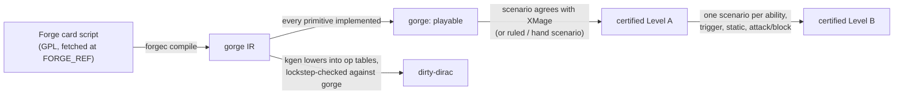

# Card support by set

This page says which *Magic* cards and sets each engine in the gorge family
supports, and what "supported" means for each, because the word means
something different at every tier. It is for players choosing a format, bot
authors choosing a card pool, and contributors looking for the card work with
the most leverage. Every number carries the command that produced it; the
[regeneration page](regenerating.md) shows how to re-measure each one.

!!! info "Snapshot: 2026-10-20"
    - **gorge corpus figures and ratchets:** gorge `develop` @ `ad3777023`,
      Forge corpus pin (`FORGE_REF`) `098b055313459c4b36c9e1f1d4e81a2c8aef815e`.
    - **Certification figures:** [gorge-compliance](https://github.com/adams-shaun/gorge-compliance)
      `main` @ `736a826f5190` (2026-10-18), measuring its pinned gorge
      `be95bda94` (an ancestor of `ad3777023`, same `FORGE_REF`), XMage pin
      `6b602a1c85e8`.
    - **dirty-dirac figures:** the generated card tables as committed on
      2026-10-18.

    The tables are a hand snapshot: the docs build does not re-measure them
    (see [Regenerating the tables](regenerating.md)). If the build found fresh
    status data, an *Automated measurement* section appears at the end of the
    page.

## Headline

| | Figure | Measured by |
|---|---|---|
| Forge card scripts at the pin | **34,074** cards, 854 tokens | `make report` |
| Playable in gorge, whole corpus | **32,082 / 34,074 (94.2%)** | `make report` |
| Standard, certified | all **20** Standard sets at **Level A** or better, **15** declared at **Level B**; 5,331 set entries, 5,326 passing Level B (**99.9%**) | `oraclediff status` (gorge-compliance) |
| XMage verdicts on record | **13,183** over 5,278 cards: 13,125 agree, 43 xmage_wrong, 11 harness, 4 diverge | gorge-compliance `oracle/compliance/verdicts/` |
| Repo decks (the ratchet) | **2 of 1,123** distinct cards not fully supported | `TestEveryRepoDeckIsFullySupported` |
| dirty-dirac | **FDN: 286 / 286** pool cards lowered; **BLB: 104 / 276** | the kernel's generated card tables |

<figure markdown style="width:100%">
<svg viewBox="0 0 760 328" width="100%" role="img" aria-label="Coverage funnel: 34,074 Forge card scripts; 34,074 parse; 32,082 playable in gorge; 5,177 certified at Level A; 4,158 certified at Level B; 381 lowered into dirty-dirac">
  <text class="dg-text-bold" x="218" y="28" text-anchor="end">Forge card scripts</text>
  <text class="dg-text-muted" x="218" y="43" text-anchor="end">corpus at FORGE_REF 098b0553</text>
  <rect class="dg-box" x="230" y="12" width="380" height="36" rx="4"/>
  <text class="dg-text-bold" x="620" y="28">34,074</text>
  <text class="dg-text-muted" x="620" y="43">100% of the corpus</text>
  <text class="dg-text-bold" x="218" y="80" text-anchor="end">Parse into gorge's IR</text>
  <text class="dg-text-muted" x="218" y="95" text-anchor="end">forgec compile: 2 diagnostics</text>
  <rect class="dg-box" x="230" y="64" width="380" height="36" rx="4"/>
  <text class="dg-text-bold" x="620" y="80">34,074</text>
  <text class="dg-text-muted" x="620" y="95">100% of the corpus</text>
  <text class="dg-text-bold" x="218" y="132" text-anchor="end">Playable in gorge</text>
  <text class="dg-text-muted" x="218" y="147" text-anchor="end">every primitive implemented</text>
  <rect class="dg-box-accent" x="230" y="116" width="369" height="36" rx="4"/>
  <text class="dg-text-bold" x="609" y="132">32,082</text>
  <text class="dg-text-muted" x="609" y="147">94.2% of the corpus</text>
  <text class="dg-text-bold" x="218" y="184" text-anchor="end">Certified, Level A</text>
  <text class="dg-text-muted" x="218" y="199" text-anchor="end">distinct cards, 20 declared sets</text>
  <rect class="dg-box-accent" x="230" y="168" width="148" height="36" rx="4"/>
  <text class="dg-text-bold" x="388" y="184">5,177</text>
  <text class="dg-text-muted" x="388" y="199">15.2% of the corpus</text>
  <text class="dg-text-bold" x="218" y="236" text-anchor="end">Certified, Level B</text>
  <text class="dg-text-muted" x="218" y="251" text-anchor="end">distinct cards, 15 sets declared B</text>
  <rect class="dg-box-accent" x="230" y="220" width="133" height="36" rx="4"/>
  <text class="dg-text-bold" x="373" y="236">4,158</text>
  <text class="dg-text-muted" x="373" y="251">12.2% of the corpus</text>
  <text class="dg-text-bold" x="218" y="288" text-anchor="end">dirty-dirac</text>
  <text class="dg-text-muted" x="218" y="303" text-anchor="end">lowered: FDN 286, BLB 104</text>
  <rect class="dg-box-solid" x="230" y="272" width="40" height="36" rx="4"/>
  <text class="dg-text-bold" x="280" y="288">381</text>
  <text class="dg-text-muted" x="280" y="303">1.1% of the corpus</text>
</svg>
<figcaption>The coverage funnel. Bar length is on a square-root scale so the
small stages stay visible. The certified stages count distinct card names in
the sets declared at that level; dirty-dirac's 381 distinct cards come from its
FDN and BLB pools, and 365 of them sit in sets certified at Level B (the other
16 are Special Guests reprints).</figcaption>
</figure>

## What "supported" means, engine by engine

Each tier certifies more than the one before it, and each has its own test.
Do not read a number from one tier as a claim at another: 94.2% of the corpus
is *playable* in gorge, which is a statement about implemented primitives, not
about behaving correctly.



### gorge: playable

A card is **playable** when every [primitive](../contributing/glossary.md) its
compiled script references is implemented: each `api:` effect, `trig:`
trigger mode, `kw:` keyword, `stat:` static mode, `repl:` replacement, the
`count:` value heads its SVars read, plus a shape gate for clone-style
enters-the-battlefield replacements. The check is
[`Registry.Coverage`](https://github.com/adams-shaun/gorge/blob/main/engine/cards/validate.go)
against `effects.Supported()`, run by `make report` over the whole corpus.

Playable is necessary, not sufficient. A card can be playable and still
misbehave: a `$` parameter the effect does not read, or a primitive that
handles the common shape but not this card's. Two ratchets watch the cards
that matter most, the ones in the repository's own decks (see
[The repo-deck ratchet](#the-repo-deck-ratchet)).

### gorge certified: Levels A and B

[gorge-compliance](https://github.com/adams-shaun/gorge-compliance) is the
public compliance repository. It pins one gorge commit and checks it card by
card against independent references: hand-written scenarios derived from the
card's Oracle text and the Comprehensive Rules, and **XMage**, an
independent Java engine. For each card it generates scenarios, replays them in
both engines, diffs the two engines' snapshots at each checkpoint, and records
a **verdict** per (card, template, scenario hash). A **Forge** leg is being
added for three-way adjudication; it only corroborates and never writes a
verdict.

| Level | A card passes when | Not covered |
|---|---|---|
| **A** | it is playable **and** its generated cast-and-resolve, play-land or counter-spell scenario agrees with XMage, or carries a ruled divergence (`xmage_wrong`, with a CR citation), or a hand-written Oracle scenario passes. Basic lands are skipped. A card XMage does not implement needs a hand scenario | activated abilities, trigger modes, attacks and blocks, statics |
| **B** | Level A **plus** one XMage-compared scenario per activated ability, trigger mode, static ability and attack/block | a requirement no scenario template serves yet is reported as a *template gap* and waits for its template |

The definitions are the gate's own wording,
[`gate.LevelMeaning`](https://github.com/adams-shaun/gorge-compliance/blob/main/oracle/compliance/gate/gate.go).
A verdict stays valid only while gorge still meets its frozen expectation and
the scenario's hash is unchanged; a moved scenario shows as a *stale verdict*
until XMage replays it.

**Declared sets and the ratchet.** A set is *declared* at a level in
[`declared.json`](https://github.com/adams-shaun/gorge-compliance/blob/main/oracle/compliance/declared.json),
and CI fails if a declared set has any problem at that level. Only a set with a
full printed card list can be declared, because XMage's set manifests omit the
cards XMage lacks. Every other set's problem count is held by the
certification ratchet,
[`ratchet.json`](https://github.com/adams-shaun/gorge-compliance/blob/main/oracle/compliance/ratchet.json),
which may only fall. All of these targets describe the pinned gorge commit;
bumping the pin is a pull request that re-measures them.

### dirty-dirac

dirty-dirac is a second, much faster rules kernel. It lives in gorge's private
companion module, but its supported sets are public. It does not interpret card
scripts: a generator (`kgen`) **lowers** each card's gorge IR into fixed op
tables, and a lockstep oracle runs the kernel beside gorge on the same decks
and seed, comparing the options offered at every decision and the state after
every action. A card is **supported** by dirty-dirac when the generator lowers
every one of its abilities; a card it cannot lower is *refused* with a named
reason and stays inert in the table. The FDN table is the one the lockstep
oracle runs against; the BLB table was first generated on 2026-10-18. See
[dirty-dirac](../architecture/dirty-dirac/index.md) for the design.

| Pool | Cards in the pool | Lowered | Pool contents |
|---|---:|---:|---|
| **FDN** (Foundations) | 286 | **286 (100%)** | the 276 cards of Forge's *Foundations* edition list (basics included) plus FDN's 10 Special Guests |
| **BLB** (Bloomburrow) | 276 | **104 (37.7%)** | the 266 cards of Forge's *Bloomburrow* edition list plus BLB's 10 Special Guests; 172 refused |

FDN's printed list in gorge-compliance has 517 cards because it adds 241
Jumpstart, starter and promo printings XMage files under FDN; those are outside
dirty-dirac's pool. dirty-dirac plays only within one pool, so a dirty-dirac
game uses FDN or BLB cards, never a mix.

### XMage and Forge, as reference points

These are the two engines gorge measures against. Their numbers are their own
claims or a plain count, not certifications.

| Engine | Claim | Source |
|---|---|---|
| XMage | "over 32 000 unique cards and more than 91 000 reprints across official sets" | the [XMage README](https://github.com/magefree/mage), read 2026-10-20 |
| Forge | no card-count claim in its README; its card corpus at gorge's pin holds **34,074** card scripts and 854 token scripts | `.cards/cards.lock` and `make report` |

Forge is where gorge's card scripts come from, so Forge's corpus is gorge's
denominator. XMage supplies the set manifests (589 sets, built from its set
classes) and the second opinion behind every verdict.

## Per-set matrix

Rows are every set gorge-compliance audits against a full printed card list:
the 20 Standard sets and *Special Guests*. FDN and BLB are the two dirty-dirac
pools.

<figure markdown style="width:100%">
<svg viewBox="0 0 700 584" width="100%" role="img" aria-label="Heat table of the 21 audited sets: playable, Level A and Level B percentages, and dirty-dirac support for FDN and BLB">
  <text class="dg-text-bold" x="12" y="26">Set · declared</text>
  <text class="dg-text-bold" x="186" y="26" text-anchor="end">Cards</text>
  <text class="dg-text-bold" x="266.0" y="26" text-anchor="middle">Playable</text>
  <text class="dg-text-bold" x="386.0" y="26" text-anchor="middle">Level A</text>
  <text class="dg-text-bold" x="506.0" y="26" text-anchor="middle">Level B</text>
  <text class="dg-text-bold" x="626.0" y="26" text-anchor="middle">dirty-dirac</text>
  <text class="dg-text-mono" x="12" y="56">FRA · B</text>
  <text class="dg-text" x="186" y="56" text-anchor="end">285</text>
  <rect class="dg-box-solid" fill-opacity="0.95" x="210" y="42" width="112" height="20" rx="3"/>
  <text class="dg-text-on" x="266.0" y="56" text-anchor="middle">100</text>
  <rect class="dg-box-solid" fill-opacity="0.95" x="330" y="42" width="112" height="20" rx="3"/>
  <text class="dg-text-on" x="386.0" y="56" text-anchor="middle">100</text>
  <rect class="dg-box-solid" fill-opacity="0.95" x="450" y="42" width="112" height="20" rx="3"/>
  <text class="dg-text-on" x="506.0" y="56" text-anchor="middle">100</text>
  <rect class="dg-box-muted" x="570" y="42" width="112" height="20" rx="3"/>
  <text class="dg-text-muted" x="626.0" y="56" text-anchor="middle">not lowered</text>
  <text class="dg-text-mono" x="12" y="80">HOB · B</text>
  <text class="dg-text" x="186" y="80" text-anchor="end">193</text>
  <rect class="dg-box-solid" fill-opacity="0.95" x="210" y="66" width="112" height="20" rx="3"/>
  <text class="dg-text-on" x="266.0" y="80" text-anchor="middle">100</text>
  <rect class="dg-box-solid" fill-opacity="0.95" x="330" y="66" width="112" height="20" rx="3"/>
  <text class="dg-text-on" x="386.0" y="80" text-anchor="middle">100</text>
  <rect class="dg-box-solid" fill-opacity="0.95" x="450" y="66" width="112" height="20" rx="3"/>
  <text class="dg-text-on" x="506.0" y="80" text-anchor="middle">100</text>
  <rect class="dg-box-muted" x="570" y="66" width="112" height="20" rx="3"/>
  <text class="dg-text-muted" x="626.0" y="80" text-anchor="middle">not lowered</text>
  <text class="dg-text-mono" x="12" y="104">MSH · B</text>
  <text class="dg-text" x="186" y="104" text-anchor="end">281</text>
  <rect class="dg-box-solid" fill-opacity="0.95" x="210" y="90" width="112" height="20" rx="3"/>
  <text class="dg-text-on" x="266.0" y="104" text-anchor="middle">100</text>
  <rect class="dg-box-solid" fill-opacity="0.95" x="330" y="90" width="112" height="20" rx="3"/>
  <text class="dg-text-on" x="386.0" y="104" text-anchor="middle">100</text>
  <rect class="dg-box-solid" fill-opacity="0.95" x="450" y="90" width="112" height="20" rx="3"/>
  <text class="dg-text-on" x="506.0" y="104" text-anchor="middle">100</text>
  <rect class="dg-box-muted" x="570" y="90" width="112" height="20" rx="3"/>
  <text class="dg-text-muted" x="626.0" y="104" text-anchor="middle">not lowered</text>
  <text class="dg-text-mono" x="12" y="128">SOS · B</text>
  <text class="dg-text" x="186" y="128" text-anchor="end">271</text>
  <rect class="dg-box-solid" fill-opacity="0.95" x="210" y="114" width="112" height="20" rx="3"/>
  <text class="dg-text-on" x="266.0" y="128" text-anchor="middle">100</text>
  <rect class="dg-box-solid" fill-opacity="0.95" x="330" y="114" width="112" height="20" rx="3"/>
  <text class="dg-text-on" x="386.0" y="128" text-anchor="middle">100</text>
  <rect class="dg-box-solid" fill-opacity="0.95" x="450" y="114" width="112" height="20" rx="3"/>
  <text class="dg-text-on" x="506.0" y="128" text-anchor="middle">100</text>
  <rect class="dg-box-muted" x="570" y="114" width="112" height="20" rx="3"/>
  <text class="dg-text-muted" x="626.0" y="128" text-anchor="middle">not lowered</text>
  <text class="dg-text-mono" x="12" y="152">TMT · B</text>
  <text class="dg-text" x="186" y="152" text-anchor="end">190</text>
  <rect class="dg-box-solid" fill-opacity="0.95" x="210" y="138" width="112" height="20" rx="3"/>
  <text class="dg-text-on" x="266.0" y="152" text-anchor="middle">100</text>
  <rect class="dg-box-solid" fill-opacity="0.95" x="330" y="138" width="112" height="20" rx="3"/>
  <text class="dg-text-on" x="386.0" y="152" text-anchor="middle">100</text>
  <rect class="dg-box-solid" fill-opacity="0.95" x="450" y="138" width="112" height="20" rx="3"/>
  <text class="dg-text-on" x="506.0" y="152" text-anchor="middle">100</text>
  <rect class="dg-box-muted" x="570" y="138" width="112" height="20" rx="3"/>
  <text class="dg-text-muted" x="626.0" y="152" text-anchor="middle">not lowered</text>
  <text class="dg-text-mono" x="12" y="176">ECL · A</text>
  <text class="dg-text" x="186" y="176" text-anchor="end">273</text>
  <rect class="dg-box-solid" fill-opacity="0.95" x="210" y="162" width="112" height="20" rx="3"/>
  <text class="dg-text-on" x="266.0" y="176" text-anchor="middle">100</text>
  <rect class="dg-box-solid" fill-opacity="0.95" x="330" y="162" width="112" height="20" rx="3"/>
  <text class="dg-text-on" x="386.0" y="176" text-anchor="middle">100</text>
  <rect class="dg-box-solid" fill-opacity="0.93" x="450" y="162" width="112" height="20" rx="3"/>
  <text class="dg-text-on" x="506.0" y="176" text-anchor="middle">99.6</text>
  <rect class="dg-box-muted" x="570" y="162" width="112" height="20" rx="3"/>
  <text class="dg-text-muted" x="626.0" y="176" text-anchor="middle">not lowered</text>
  <text class="dg-text-mono" x="12" y="200">TLA · B</text>
  <text class="dg-text" x="186" y="200" text-anchor="end">286</text>
  <rect class="dg-box-solid" fill-opacity="0.95" x="210" y="186" width="112" height="20" rx="3"/>
  <text class="dg-text-on" x="266.0" y="200" text-anchor="middle">100</text>
  <rect class="dg-box-solid" fill-opacity="0.95" x="330" y="186" width="112" height="20" rx="3"/>
  <text class="dg-text-on" x="386.0" y="200" text-anchor="middle">100</text>
  <rect class="dg-box-solid" fill-opacity="0.95" x="450" y="186" width="112" height="20" rx="3"/>
  <text class="dg-text-on" x="506.0" y="200" text-anchor="middle">100</text>
  <rect class="dg-box-muted" x="570" y="186" width="112" height="20" rx="3"/>
  <text class="dg-text-muted" x="626.0" y="200" text-anchor="middle">not lowered</text>
  <text class="dg-text-mono" x="12" y="224">SPM · A</text>
  <text class="dg-text" x="186" y="224" text-anchor="end">193</text>
  <rect class="dg-box-solid" fill-opacity="0.95" x="210" y="210" width="112" height="20" rx="3"/>
  <text class="dg-text-on" x="266.0" y="224" text-anchor="middle">100</text>
  <rect class="dg-box-solid" fill-opacity="0.95" x="330" y="210" width="112" height="20" rx="3"/>
  <text class="dg-text-on" x="386.0" y="224" text-anchor="middle">100</text>
  <rect class="dg-box-solid" fill-opacity="0.93" x="450" y="210" width="112" height="20" rx="3"/>
  <text class="dg-text-on" x="506.0" y="224" text-anchor="middle">99.5</text>
  <rect class="dg-box-muted" x="570" y="210" width="112" height="20" rx="3"/>
  <text class="dg-text-muted" x="626.0" y="224" text-anchor="middle">not lowered</text>
  <text class="dg-text-mono" x="12" y="248">EOE · A</text>
  <text class="dg-text" x="186" y="248" text-anchor="end">266</text>
  <rect class="dg-box-solid" fill-opacity="0.95" x="210" y="234" width="112" height="20" rx="3"/>
  <text class="dg-text-on" x="266.0" y="248" text-anchor="middle">100</text>
  <rect class="dg-box-solid" fill-opacity="0.95" x="330" y="234" width="112" height="20" rx="3"/>
  <text class="dg-text-on" x="386.0" y="248" text-anchor="middle">100</text>
  <rect class="dg-box-solid" fill-opacity="0.93" x="450" y="234" width="112" height="20" rx="3"/>
  <text class="dg-text-on" x="506.0" y="248" text-anchor="middle">99.6</text>
  <rect class="dg-box-muted" x="570" y="234" width="112" height="20" rx="3"/>
  <text class="dg-text-muted" x="626.0" y="248" text-anchor="middle">not lowered</text>
  <text class="dg-text-mono" x="12" y="272">FIN · A</text>
  <text class="dg-text" x="186" y="272" text-anchor="end">312</text>
  <rect class="dg-box-solid" fill-opacity="0.95" x="210" y="258" width="112" height="20" rx="3"/>
  <text class="dg-text-on" x="266.0" y="272" text-anchor="middle">100</text>
  <rect class="dg-box-solid" fill-opacity="0.95" x="330" y="258" width="112" height="20" rx="3"/>
  <text class="dg-text-on" x="386.0" y="272" text-anchor="middle">100</text>
  <rect class="dg-box-solid" fill-opacity="0.93" x="450" y="258" width="112" height="20" rx="3"/>
  <text class="dg-text-on" x="506.0" y="272" text-anchor="middle">99.4</text>
  <rect class="dg-box-muted" x="570" y="258" width="112" height="20" rx="3"/>
  <text class="dg-text-muted" x="626.0" y="272" text-anchor="middle">not lowered</text>
  <text class="dg-text-mono" x="12" y="296">TDM · B</text>
  <text class="dg-text" x="186" y="296" text-anchor="end">276</text>
  <rect class="dg-box-solid" fill-opacity="0.95" x="210" y="282" width="112" height="20" rx="3"/>
  <text class="dg-text-on" x="266.0" y="296" text-anchor="middle">100</text>
  <rect class="dg-box-solid" fill-opacity="0.95" x="330" y="282" width="112" height="20" rx="3"/>
  <text class="dg-text-on" x="386.0" y="296" text-anchor="middle">100</text>
  <rect class="dg-box-solid" fill-opacity="0.95" x="450" y="282" width="112" height="20" rx="3"/>
  <text class="dg-text-on" x="506.0" y="296" text-anchor="middle">100</text>
  <rect class="dg-box-muted" x="570" y="282" width="112" height="20" rx="3"/>
  <text class="dg-text-muted" x="626.0" y="296" text-anchor="middle">not lowered</text>
  <text class="dg-text-mono" x="12" y="320">DFT · B</text>
  <text class="dg-text" x="186" y="320" text-anchor="end">276</text>
  <rect class="dg-box-solid" fill-opacity="0.95" x="210" y="306" width="112" height="20" rx="3"/>
  <text class="dg-text-on" x="266.0" y="320" text-anchor="middle">100</text>
  <rect class="dg-box-solid" fill-opacity="0.95" x="330" y="306" width="112" height="20" rx="3"/>
  <text class="dg-text-on" x="386.0" y="320" text-anchor="middle">100</text>
  <rect class="dg-box-solid" fill-opacity="0.95" x="450" y="306" width="112" height="20" rx="3"/>
  <text class="dg-text-on" x="506.0" y="320" text-anchor="middle">100</text>
  <rect class="dg-box-muted" x="570" y="306" width="112" height="20" rx="3"/>
  <text class="dg-text-muted" x="626.0" y="320" text-anchor="middle">not lowered</text>
  <text class="dg-text-mono" x="12" y="344">FDN · B</text>
  <text class="dg-text" x="186" y="344" text-anchor="end">517</text>
  <rect class="dg-box-solid" fill-opacity="0.95" x="210" y="330" width="112" height="20" rx="3"/>
  <text class="dg-text-on" x="266.0" y="344" text-anchor="middle">100</text>
  <rect class="dg-box-solid" fill-opacity="0.95" x="330" y="330" width="112" height="20" rx="3"/>
  <text class="dg-text-on" x="386.0" y="344" text-anchor="middle">100</text>
  <rect class="dg-box-solid" fill-opacity="0.95" x="450" y="330" width="112" height="20" rx="3"/>
  <text class="dg-text-on" x="506.0" y="344" text-anchor="middle">100</text>
  <rect class="dg-box-solid" fill-opacity="0.95" x="570" y="330" width="112" height="20" rx="3"/>
  <text class="dg-text-on" x="626.0" y="344" text-anchor="middle">286 / 286</text>
  <text class="dg-text-mono" x="12" y="368">DSK · B</text>
  <text class="dg-text" x="186" y="368" text-anchor="end">276</text>
  <rect class="dg-box-solid" fill-opacity="0.95" x="210" y="354" width="112" height="20" rx="3"/>
  <text class="dg-text-on" x="266.0" y="368" text-anchor="middle">100</text>
  <rect class="dg-box-solid" fill-opacity="0.95" x="330" y="354" width="112" height="20" rx="3"/>
  <text class="dg-text-on" x="386.0" y="368" text-anchor="middle">100</text>
  <rect class="dg-box-solid" fill-opacity="0.95" x="450" y="354" width="112" height="20" rx="3"/>
  <text class="dg-text-on" x="506.0" y="368" text-anchor="middle">100</text>
  <rect class="dg-box-muted" x="570" y="354" width="112" height="20" rx="3"/>
  <text class="dg-text-muted" x="626.0" y="368" text-anchor="middle">not lowered</text>
  <text class="dg-text-mono" x="12" y="392">BLB · B</text>
  <text class="dg-text" x="186" y="392" text-anchor="end">279</text>
  <rect class="dg-box-solid" fill-opacity="0.95" x="210" y="378" width="112" height="20" rx="3"/>
  <text class="dg-text-on" x="266.0" y="392" text-anchor="middle">100</text>
  <rect class="dg-box-solid" fill-opacity="0.95" x="330" y="378" width="112" height="20" rx="3"/>
  <text class="dg-text-on" x="386.0" y="392" text-anchor="middle">100</text>
  <rect class="dg-box-solid" fill-opacity="0.95" x="450" y="378" width="112" height="20" rx="3"/>
  <text class="dg-text-on" x="506.0" y="392" text-anchor="middle">100</text>
  <rect class="dg-box-solid" fill-opacity="0.12" x="570" y="378" width="112" height="20" rx="3"/>
  <text class="dg-text" x="626.0" y="392" text-anchor="middle">104 / 276</text>
  <text class="dg-text-mono" x="12" y="416">OTJ · B</text>
  <text class="dg-text" x="186" y="416" text-anchor="end">276</text>
  <rect class="dg-box-solid" fill-opacity="0.95" x="210" y="402" width="112" height="20" rx="3"/>
  <text class="dg-text-on" x="266.0" y="416" text-anchor="middle">100</text>
  <rect class="dg-box-solid" fill-opacity="0.95" x="330" y="402" width="112" height="20" rx="3"/>
  <text class="dg-text-on" x="386.0" y="416" text-anchor="middle">100</text>
  <rect class="dg-box-solid" fill-opacity="0.95" x="450" y="402" width="112" height="20" rx="3"/>
  <text class="dg-text-on" x="506.0" y="416" text-anchor="middle">100</text>
  <rect class="dg-box-muted" x="570" y="402" width="112" height="20" rx="3"/>
  <text class="dg-text-muted" x="626.0" y="416" text-anchor="middle">not lowered</text>
  <text class="dg-text-mono" x="12" y="440">BIG · B</text>
  <text class="dg-text" x="186" y="440" text-anchor="end">30</text>
  <rect class="dg-box-solid" fill-opacity="0.95" x="210" y="426" width="112" height="20" rx="3"/>
  <text class="dg-text-on" x="266.0" y="440" text-anchor="middle">100</text>
  <rect class="dg-box-solid" fill-opacity="0.95" x="330" y="426" width="112" height="20" rx="3"/>
  <text class="dg-text-on" x="386.0" y="440" text-anchor="middle">100</text>
  <rect class="dg-box-solid" fill-opacity="0.95" x="450" y="426" width="112" height="20" rx="3"/>
  <text class="dg-text-on" x="506.0" y="440" text-anchor="middle">100</text>
  <rect class="dg-box-muted" x="570" y="426" width="112" height="20" rx="3"/>
  <text class="dg-text-muted" x="626.0" y="440" text-anchor="middle">not lowered</text>
  <text class="dg-text-mono" x="12" y="464">MKM · B</text>
  <text class="dg-text" x="186" y="464" text-anchor="end">279</text>
  <rect class="dg-box-solid" fill-opacity="0.95" x="210" y="450" width="112" height="20" rx="3"/>
  <text class="dg-text-on" x="266.0" y="464" text-anchor="middle">100</text>
  <rect class="dg-box-solid" fill-opacity="0.95" x="330" y="450" width="112" height="20" rx="3"/>
  <text class="dg-text-on" x="386.0" y="464" text-anchor="middle">100</text>
  <rect class="dg-box-solid" fill-opacity="0.95" x="450" y="450" width="112" height="20" rx="3"/>
  <text class="dg-text-on" x="506.0" y="464" text-anchor="middle">100</text>
  <rect class="dg-box-muted" x="570" y="450" width="112" height="20" rx="3"/>
  <text class="dg-text-muted" x="626.0" y="464" text-anchor="middle">not lowered</text>
  <text class="dg-text-mono" x="12" y="488">SPG · —</text>
  <text class="dg-text" x="186" y="488" text-anchor="end">144</text>
  <rect class="dg-box-solid" fill-opacity="0.8" x="210" y="474" width="112" height="20" rx="3"/>
  <text class="dg-text-on" x="266.0" y="488" text-anchor="middle">96.5</text>
  <rect class="dg-box-solid" fill-opacity="0.66" x="330" y="474" width="112" height="20" rx="3"/>
  <text class="dg-text-on" x="386.0" y="488" text-anchor="middle">93.1</text>
  <rect class="dg-box-solid" fill-opacity="0.23" x="450" y="474" width="112" height="20" rx="3"/>
  <text class="dg-text" x="506.0" y="488" text-anchor="middle">82.6</text>
  <rect class="dg-box-muted" x="570" y="474" width="112" height="20" rx="3"/>
  <text class="dg-text-muted" x="626.0" y="488" text-anchor="middle">not lowered</text>
  <text class="dg-text-mono" x="12" y="512">LCI · B</text>
  <text class="dg-text" x="186" y="512" text-anchor="end">291</text>
  <rect class="dg-box-solid" fill-opacity="0.95" x="210" y="498" width="112" height="20" rx="3"/>
  <text class="dg-text-on" x="266.0" y="512" text-anchor="middle">100</text>
  <rect class="dg-box-solid" fill-opacity="0.95" x="330" y="498" width="112" height="20" rx="3"/>
  <text class="dg-text-on" x="386.0" y="512" text-anchor="middle">100</text>
  <rect class="dg-box-solid" fill-opacity="0.95" x="450" y="498" width="112" height="20" rx="3"/>
  <text class="dg-text-on" x="506.0" y="512" text-anchor="middle">100</text>
  <rect class="dg-box-muted" x="570" y="498" width="112" height="20" rx="3"/>
  <text class="dg-text-muted" x="626.0" y="512" text-anchor="middle">not lowered</text>
  <text class="dg-text-mono" x="12" y="536">WOE · B</text>
  <text class="dg-text" x="186" y="536" text-anchor="end">281</text>
  <rect class="dg-box-solid" fill-opacity="0.95" x="210" y="522" width="112" height="20" rx="3"/>
  <text class="dg-text-on" x="266.0" y="536" text-anchor="middle">100</text>
  <rect class="dg-box-solid" fill-opacity="0.95" x="330" y="522" width="112" height="20" rx="3"/>
  <text class="dg-text-on" x="386.0" y="536" text-anchor="middle">100</text>
  <rect class="dg-box-solid" fill-opacity="0.95" x="450" y="522" width="112" height="20" rx="3"/>
  <text class="dg-text-on" x="506.0" y="536" text-anchor="middle">100</text>
  <rect class="dg-box-muted" x="570" y="522" width="112" height="20" rx="3"/>
  <text class="dg-text-muted" x="626.0" y="536" text-anchor="middle">not lowered</text>
  <text class="dg-text-muted" x="12" y="566">Shade: % of the set's cards, from 80% (lightest) to 100% (darkest). dirty-dirac cells: cards lowered / cards in its pool.</text>
</svg>
<figcaption>Per-set heat-table, newest set first. gorge-compliance
@ 736a826f5190, 2026-10-20; dirty-dirac tables as committed
2026-10-18.</figcaption>
</figure>

| Set | Name | Released | Declared | Cards | Playable % | Level A % | Level B % | Level B problems | dirty-dirac |
|---|---|---|---|---:|---:|---:|---:|---|---|
| FRA | Reality Fracture | 2026-10-02 | B | 285 | 100 | 100 | 100 | none | — |
| HOB | The Hobbit | 2026-08-14 | B | 193 | 100 | 100 | 100 | none | — |
| MSH | Marvel Super Heroes | 2026-06-26 | B | 281 | 100 | 100 | 100 | none | — |
| SOS | Secrets of Strixhaven | 2026-04-24 | B | 271 | 100 | 100 | 100 | none | — |
| TMT | Teenage Mutant Ninja Turtles | 2026-03-06 | B | 190 | 100 | 100 | 100 | none | — |
| ECL | Lorwyn Eclipsed | 2026-01-23 | A | 273 | 100 | 100 | 99.6 | 1 harness | — |
| TLA | Avatar: The Last Airbender | 2025-11-21 | B | 286 | 100 | 100 | 100 | none | — |
| SPM | Marvel's Spider-Man | 2025-09-26 | A | 193 | 100 | 100 | 99.5 | 1 template gap | — |
| EOE | Edge of Eternities | 2025-08-01 | A | 266 | 100 | 100 | 99.6 | 1 harness | — |
| FIN | Final Fantasy | 2025-06-13 | A | 312 | 100 | 100 | 99.4 | 2 stale verdict | — |
| TDM | Tarkir: Dragonstorm | 2025-04-11 | B | 276 | 100 | 100 | 100 | none | — |
| DFT | Aetherdrift | 2025-02-14 | B | 276 | 100 | 100 | 100 | none | — |
| FDN | Foundations | 2024-11-15 | B | 517 | 100 | 100 | 100 | none | **286 / 286** |
| DSK | Duskmourn: House of Horror | 2024-09-27 | B | 276 | 100 | 100 | 100 | none | — |
| BLB | Bloomburrow | 2024-08-02 | B | 279 | 100 | 100 | 100 | none | **104 / 276** |
| OTJ | Outlaws of Thunder Junction | 2024-04-19 | B | 276 | 100 | 100 | 100 | none | — |
| BIG | The Big Score | 2024-04-19 | B | 30 | 100 | 100 | 100 | none | — |
| MKM | Murders at Karlov Manor | 2024-02-09 | B | 279 | 100 | 100 | 100 | none | — |
| SPG | Special Guests | 2023-11-17 | none | 144 | 96.5 | 93.1 | 82.6 | 20 template gap, 5 unsupported, 2 diverge, 1 harness | — |
| LCI | The Lost Caverns of Ixalan | 2023-11-17 | B | 291 | 100 | 100 | 100 | none | — |
| WOE | Wilds of Eldraine | 2023-09-08 | B | 281 | 100 | 100 | 100 | none | — |
| **Standard total** | | | | **5,331** | **100** | **100** | **99.9** | **5** | |

*Playable %* = 1 − (unsupported + not in corpus) / cards. *Level A %* and
*Level B %* are the share of cards with no problem at that level. The four sets
declared only at Level A (ECL, SPM, EOE, FIN) are one or two cards short of B:
a harness failure is the test rig, not the engine, failing to express the
scenario, and a stale verdict waits for an XMage replay.

Level B rose from 93.8% (2026-10-12, 329 cards outstanding) to 99.9%
(5 outstanding).

## Corpus coverage at the pin

`make report` (gorge `ad3777023`, 2026-10-20):

```text
corpus: 098b055313459c4b36c9e1f1d4e81a2c8aef815e @ 098b055313459c4b36c9e1f1d4e81a2c8aef815e (GPL-3.0, 34074 files)
cards: 34074  playable: 32082 (94.2%)
tokens: 854
```

All 34,074 scripts compile; `forgec compile` reports 2 diagnostics, both
an unsupported Specialize rider. By card type (`make coverage`):

| Card type | Cards | Playable | % |
|---|---:|---:|---:|
| Creature | 18,754 | 17,760 | 94.7 |
| Instant | 3,812 | 3,664 | 96.1 |
| Sorcery | 3,549 | 3,366 | 94.8 |
| Enchantment | 3,470 | 3,337 | 96.2 |
| Artifact | 2,492 | 2,342 | 94.0 |
| Land | 1,170 | 1,163 | 99.4 |
| Planeswalker | 336 | 314 | 93.5 |
| Battle | 37 | 34 | 91.9 |
| Other (planes, schemes, …) | 454 | 102 | 22.5 |

### Where the leverage is

The report ranks each missing primitive by the number of cards it alone would
unlock. The top of the list is mostly non-tournament play: Alchemy's
`api:MakeCard` and `api:Draft`, Planechase (`trig:ChaosEnsues`,
`trig:PlaneswalkedTo`), Archenemy (`trig:SetInMotion`) and Unfinity's stickers
and Contraptions. For cards that see tournament play, the leverage is in the
older keywords further down.

| Rank | Primitive | Cards unlocked | Notes |
|---:|---|---:|---|
| 1 | `api:MakeCard` | 186 | Alchemy |
| 2 | `trig:ChaosEnsues` | 158 | Planechase |
| 3 | `trig:SetInMotion` | 84 | Archenemy |
| 4 | `trig:PlaneswalkedTo` | 62 | Planechase |
| 5 | `kw:StickerSheet` | 48 | Unfinity |
| 6 | `trig:CrankContraption` | 45 | Unstable / Unfinity |
| 7 | `api:Draft` | 42 | Alchemy, conspiracy |
| 8 | `kw:Bushido` | 37 | Kamigawa block |
| 9 | `kw:Shroud` | 37 | |
| 10 | `api:PutSticker` | 36 | Unfinity |
| 11 | `kw:Daybound` | 36 | Innistrad: Midnight Hunt / Crimson Vow |
| 12 | `kw:Nightbound` | 36 | Innistrad: Midnight Hunt / Crimson Vow |
| 13 | `kw:Rebound` | 35 | |
| 14 | `kw:Choose a Background` | 32 | Commander Legends: Baldur's Gate |
| 15 | `kw:Disturb` | 32 | Innistrad |
| 16 | `shape:ETBReplacement Clone` | 32 | clone-style "enter as a copy" |
| 17 | `stat:CantTarget` | 32 | |
| 18 | `kw:Splice` | 30 | Kamigawa block |
| 19 | `kw:Soulshift` | 26 | Kamigawa block |
| 20 | `stat:AssignNoCombatDamage` | 26 | |
| 21 | `kw:Banding` | 24 | |
| 22 | `kw:Modular` | 24 | |
| 23 | `api:Learn` | 23 | Strixhaven |
| 24 | `kw:Visit` | 23 | Unfinity attractions |
| 25 | `api:AssembleContraption` | 22 | Unstable |

A card can miss several primitives, so the counts do not add up, and
implementing one primitive unlocks only the cards that miss nothing else.

## The repo-deck ratchet

The 30 decks in
[`testkit/testutil/decks/`](https://github.com/adams-shaun/gorge/tree/main/testkit/testutil/decks)
(15 60-card constructed, 15 Commander) are held to full support by two
[ratchets](../contributing/glossary.md), each with one file per card:

```text
$ go test ./engine/rules/ -run 'TestEveryRepoDeckIsFullySupported|TestEveryRepoDeckParamsAreRead' -v
acceptance_test.go:72: ratchet: 2 of 1123 distinct cards across the repo decks are not fully supported
paramcensus_test.go:3292: param census: 16 of 1123 distinct repo-deck cards carry at least one unread param or unmodelled cost token; 12 distinct param labels, 1 distinct cost labels
```

**Not fully supported (2):**
[`engine/rules/testdata/known-unsupported/`](https://github.com/adams-shaun/gorge/tree/main/engine/rules/testdata/known-unsupported)

| Card | Missing primitive |
|---|---|
| Incinerate | `stat:CantRegenerate` |
| Vines of Vastwood | `stat:CantTarget` |

**Parameter census (16):**
[`engine/rules/testdata/paramcensus/`](https://github.com/adams-shaun/gorge/tree/main/engine/rules/testdata/paramcensus).
These cards are playable, but at least one `$` parameter or cost token in
their script is not read yet.

| Card | Unread |
|---|---|
| Avengers Quinjet, Heroic Return, Rescue, Pepper Potts | `api:ChangeZone.ValidTgtsDesc` |
| Captain Marvel, Apex Avenger | `api:PutCounter.TriggeredCounterMap` |
| Chord of Calling, Green Sun's Zenith | `api:ChangeZone.AIXMax` |
| Earthbender Ascension | `api:PutCounter.RememberAmount` |
| Glacial Chasm | `api:Sacrifice.ChangeNum` |
| Heroic Sacrifice | `api:Effect.ValidTgtsDesc`, `api:PutCounter.ValidTgtsDesc`, `api:ReplaceEffect.VarType` |
| Iron Man, Armored Avenger | `api:PutCounter.ValidTgtsDesc` |
| Methods of the Mighty | `api:Destroy.ValidTgtsDesc` |
| Overencumbered | cost token `Y` |
| Patriot, Shield Wielder | `api:Pump.ValidTgtsDesc` |
| Speed, Young Avenger | `api:Effect.ValidTgtsDesc` |
| Sundering Eruption | `stat:Continuous.AddHiddenKeyword` |
| World Shaper | `api:Mill.Optional` |

Both tests fail in **both** directions: a card that newly loses support fails,
and so does a table entry the build now supports. Fixing a card means deleting
its file.

## Other sets (estimated)

!!! warning "Estimates, not certifications"
    These sets have no printed card list in gorge-compliance, so they cannot be
    declared. The figures come from the same `oraclediff status -all -json
    -level A` run, over XMage's manifest for each set. *Playable %* is
    `(cards − unsupported − not in corpus) / cards`. *A-carried %* is the share
    that already passes Level A through a same-name verdict from an audited set
    or as a basic land: a hard lower bound on Level A, not an estimate of it.

The weakest older expansions are the Kamigawa block (Betrayers 81.8%,
Champions 82.1%, Saviors 82.4%; Bushido, Soulshift and Splice), Innistrad:
Midnight Hunt (83.5%) and Crimson Vow (88.6%; Daybound and Nightbound), and
Nemesis (83.9%).

**Roll-up by set type** (all 589 XMage manifests; a card reprinted in several
sets counts in each):

| Set type | Sets | Entries | Unsupported | Not in corpus | Playable % | A-carried % |
|---|---:|---:|---:|---:|---:|---:|
| Expansion | 117 | 26,562 | 844 | 0 | 96.8 | 24.8 |
| Core | 22 | 6,579 | 172 | 0 | 97.4 | 11.6 |
| Supplemental | 164 | 26,696 | 561 | 1 | 97.9 | 17.2 |
| Supplemental, Modern-legal | 8 | 2,025 | 79 | 0 | 96.1 | 10.2 |
| Supplemental, Standard-legal | 5 | 131 | 2 | 0 | 98.5 | 29.0 |
| Promotional | 223 | 8,723 | 259 | 0 | 97.0 | 18.1 |
| Magic Arena | 22 | 2,082 | 66 | 0 | 96.8 | 9.9 |
| Magic Online | 10 | 2,171 | 66 | 0 | 97.0 | 8.0 |
| Remix | 2 | 272 | 11 | 3 | 94.9 | 17.6 |
| Joke | 13 | 177 | 7 | 53 | 66.1 | 11.3 |
| Custom | 3 | 361 | 2 | 330 | 8.0 | 2.8 |
| **All** | **589** | **75,779** | **2,069** | **387** | **96.8** | **18.8** |

??? note "Every expansion, core set and Modern-legal supplemental set without a printed list (128), newest first"

    | Set | Name | Released | Cards | Unsupported | Playable % (est) | A-carried % |
    |---|---|---|---:|---:|---:|---:|
    | TRK | Star Trek | 2026-11-13 | 81 | 0 | 100.0 | 18.5 |
    | ACR | Assassin's Creed | 2024-07-05 | 136 | 13 | 90.4 | 8.8 |
    | MH3 | Modern Horizons 3 | 2024-06-07 | 309 | 4 | 98.7 | 13.6 |
    | LTR | The Lord of the Rings: Tales of Middle-earth | 2023-06-23 | 289 | 6 | 97.9 | 2.8 |
    | MOM | March of the Machine | 2023-04-21 | 296 | 1 | 99.7 | 7.1 |
    | ONE | Phyrexia: All Will Be One | 2023-01-10 | 271 | 7 | 97.4 | 6.3 |
    | BRO | The Brothers' War | 2022-11-18 | 280 | 21 | 92.5 | 6.1 |
    | DMU | Dominaria United | 2022-09-09 | 271 | 13 | 95.2 | 10.7 |
    | SNC | Streets of New Capenna | 2022-04-29 | 266 | 14 | 94.7 | 6.4 |
    | NEO | Kamigawa: Neon Dynasty | 2022-02-18 | 287 | 6 | 97.9 | 8.4 |
    | VOW | Innistrad: Crimson Vow | 2021-11-19 | 272 | 31 | 88.6 | 9.6 |
    | MID | Innistrad: Midnight Hunt | 2021-09-24 | 272 | 45 | 83.5 | 8.8 |
    | AFR | Adventures in the Forgotten Realms | 2021-07-23 | 266 | 6 | 97.7 | 3.8 |
    | MH2 | Modern Horizons 2 | 2021-06-11 | 309 | 19 | 93.9 | 8.7 |
    | STX | Strixhaven: School of Mages | 2021-04-23 | 280 | 26 | 90.7 | 4.3 |
    | KHM | Kaldheim | 2021-02-05 | 305 | 3 | 99.0 | 7.5 |
    | ZNR | Zendikar Rising | 2020-09-25 | 270 | 1 | 99.6 | 9.6 |
    | M21 | Core Set 2021 | 2020-07-03 | 285 | 2 | 99.3 | 17.9 |
    | IKO | Ikoria: Lair of Behemoths | 2020-04-24 | 265 | 0 | 100.0 | 12.5 |
    | THB | Theros Beyond Death | 2020-01-24 | 273 | 5 | 98.2 | 7.0 |
    | ELD | Throne of Eldraine | 2019-10-04 | 285 | 2 | 99.3 | 13.0 |
    | M20 | Core Set 2020 | 2019-07-12 | 329 | 2 | 99.4 | 18.8 |
    | MH1 | Modern Horizons | 2019-06-14 | 255 | 8 | 96.9 | 7.5 |
    | WAR | War of the Spark | 2019-05-03 | 265 | 4 | 98.5 | 6.4 |
    | RNA | Ravnica Allegiance | 2019-01-25 | 268 | 13 | 95.1 | 7.8 |
    | GRN | Guilds of Ravnica | 2018-10-05 | 268 | 2 | 99.3 | 10.8 |
    | M19 | Core Set 2019 | 2018-07-13 | 299 | 0 | 100.0 | 19.4 |
    | DOM | Dominaria | 2018-04-27 | 265 | 1 | 99.6 | 10.9 |
    | RIX | Rivals of Ixalan | 2018-01-19 | 205 | 1 | 99.5 | 11.2 |
    | XLN | Ixalan | 2017-09-29 | 274 | 2 | 99.3 | 9.9 |
    | HOU | Hour of Devastation | 2017-07-14 | 199 | 0 | 100.0 | 6.5 |
    | AKH | Amonkhet | 2017-04-28 | 272 | 0 | 100.0 | 4.4 |
    | MM3 | Modern Masters 2017 | 2017-03-17 | 249 | 3 | 98.8 | 16.5 |
    | AER | Aether Revolt | 2017-01-20 | 194 | 1 | 99.5 | 5.2 |
    | KLD | Kaladesh | 2016-09-30 | 264 | 1 | 99.6 | 9.5 |
    | EMN | Eldritch Moon | 2016-07-22 | 208 | 0 | 100.0 | 2.4 |
    | SOI | Shadows over Innistrad | 2016-04-08 | 287 | 4 | 98.6 | 4.9 |
    | OGW | Oath of the Gatewatch | 2016-01-22 | 183 | 0 | 100.0 | 9.3 |
    | BFZ | Battle for Zendikar | 2015-10-02 | 254 | 25 | 90.2 | 9.1 |
    | ORI | Magic Origins | 2015-07-17 | 273 | 22 | 91.9 | 12.1 |
    | MM2 | Modern Masters 2015 | 2015-05-22 | 249 | 9 | 96.4 | 13.7 |
    | DTK | Dragons of Tarkir | 2015-03-27 | 254 | 18 | 92.9 | 10.2 |
    | FRF | Fate Reforged | 2015-01-23 | 180 | 0 | 100.0 | 13.3 |
    | KTK | Khans of Tarkir | 2014-09-26 | 254 | 2 | 99.2 | 11.8 |
    | M15 | Magic 2015 | 2014-07-18 | 269 | 0 | 100.0 | 7.8 |
    | JOU | Journey into Nyx | 2014-05-02 | 165 | 0 | 100.0 | 3.6 |
    | BNG | Born of the Gods | 2014-02-07 | 165 | 14 | 91.5 | 4.2 |
    | THS | Theros | 2013-09-27 | 234 | 3 | 98.7 | 7.7 |
    | M14 | Magic 2014 | 2013-07-19 | 234 | 3 | 98.7 | 12.8 |
    | MMA | Modern Masters | 2013-06-07 | 229 | 17 | 92.6 | 10.5 |
    | DGM | Dragon's Maze | 2013-05-03 | 155 | 4 | 97.4 | 8.4 |
    | GTC | Gatecrash | 2013-02-01 | 249 | 1 | 99.6 | 8.0 |
    | RTR | Return to Ravnica | 2012-10-05 | 254 | 20 | 92.1 | 11.4 |
    | M13 | Magic 2013 | 2012-07-13 | 234 | 1 | 99.6 | 14.1 |
    | AVR | Avacyn Restored | 2012-04-04 | 234 | 2 | 99.1 | 7.7 |
    | DKA | Dark Ascension | 2012-01-03 | 158 | 2 | 98.7 | 7.0 |
    | ISD | Innistrad | 2011-09-30 | 254 | 0 | 100.0 | 8.3 |
    | M12 | Magic 2012 | 2011-07-15 | 234 | 4 | 98.3 | 16.2 |
    | NPH | New Phyrexia | 2011-04-04 | 170 | 4 | 97.6 | 7.6 |
    | MBS | Mirrodin Besieged | 2011-01-04 | 150 | 1 | 99.3 | 10.0 |
    | SOM | Scars of Mirrodin | 2010-10-01 | 234 | 0 | 100.0 | 6.8 |
    | M11 | Magic 2011 | 2010-07-16 | 234 | 5 | 97.9 | 17.1 |
    | ROE | Rise of the Eldrazi | 2010-03-17 | 233 | 11 | 95.3 | 8.6 |
    | WWK | Worldwake | 2010-01-30 | 145 | 2 | 98.6 | 6.9 |
    | ZEN | Zendikar | 2009-10-02 | 234 | 12 | 94.9 | 12.8 |
    | M10 | Magic 2010 | 2009-07-17 | 234 | 4 | 98.3 | 17.5 |
    | ARB | Alara Reborn | 2009-03-25 | 145 | 3 | 97.9 | 0.7 |
    | CON | Conflux | 2009-00-31 | 145 | 3 | 97.9 | 3.4 |
    | ALA | Shards of Alara | 2008-10-03 | 234 | 5 | 97.9 | 6.8 |
    | EVE | Eventide | 2008-06-25 | 179 | 6 | 96.6 | 2.8 |
    | SHM | Shadowmoor | 2008-04-02 | 286 | 9 | 96.9 | 3.8 |
    | MOR | Morningtide | 2008-01-01 | 150 | 19 | 87.3 | 6.7 |
    | LRW | Lorwyn | 2007-10-12 | 286 | 10 | 96.5 | 5.9 |
    | 10E | Tenth Edition | 2007-06-14 | 367 | 3 | 99.2 | 12.0 |
    | FUT | Future Sight | 2007-04-04 | 180 | 13 | 92.8 | 3.9 |
    | PLC | Planar Chaos | 2007-01-02 | 165 | 11 | 93.3 | 2.4 |
    | TSP | Time Spiral | 2006-09-09 | 286 | 7 | 97.6 | 5.2 |
    | TSB | Time Spiral Timeshifted | 2006-09-09 | 121 | 3 | 97.5 | 8.3 |
    | CSP | Coldsnap | 2006-06-21 | 155 | 17 | 89.0 | 5.8 |
    | DIS | Dissension | 2006-04-05 | 180 | 5 | 97.2 | 4.4 |
    | GPT | Guildpact | 2006-01-03 | 165 | 12 | 92.7 | 3.0 |
    | RAV | Ravnica: City of Guilds | 2005-09-24 | 291 | 4 | 98.6 | 5.5 |
    | 9ED | Ninth Edition | 2005-07-29 | 343 | 3 | 99.1 | 11.4 |
    | SOK | Saviors of Kamigawa | 2005-05-03 | 165 | 29 | 82.4 | 1.2 |
    | BOK | Betrayers of Kamigawa | 2005-01-04 | 165 | 30 | 81.8 | 0.6 |
    | CHK | Champions of Kamigawa | 2004-09-01 | 290 | 52 | 82.1 | 4.5 |
    | 5DN | Fifth Dawn | 2004-05-04 | 164 | 17 | 89.6 | 3.0 |
    | DST | Darksteel | 2004-01-06 | 165 | 13 | 92.1 | 3.0 |
    | MRD | Mirrodin | 2003-09-02 | 291 | 3 | 99.0 | 7.2 |
    | 8ED | Eighth Edition | 2003-07-28 | 341 | 2 | 99.4 | 9.1 |
    | SCG | Scourge | 2003-05-17 | 143 | 4 | 97.2 | 5.6 |
    | LGN | Legions | 2003-01-25 | 145 | 16 | 89.0 | 3.4 |
    | ONS | Onslaught | 2002-10-07 | 334 | 8 | 97.6 | 4.8 |
    | JUD | Judgment | 2002-05-27 | 142 | 2 | 98.6 | 2.1 |
    | TOR | Torment | 2002-01-26 | 142 | 2 | 98.6 | 2.1 |
    | ODY | Odyssey | 2001-09-22 | 335 | 9 | 97.3 | 3.3 |
    | APC | Apocalypse | 2001-05-01 | 143 | 5 | 96.5 | 1.4 |
    | 7ED | Seventh Edition | 2001-03-11 | 335 | 3 | 99.1 | 7.5 |
    | PLS | Planeshift | 2001-01-05 | 143 | 1 | 99.3 | 2.1 |
    | INV | Invasion | 2000-09-02 | 334 | 8 | 97.6 | 2.4 |
    | PCY | Prophecy | 2000-04-27 | 143 | 4 | 97.2 | 0.7 |
    | NEM | Nemesis | 2000-01-05 | 143 | 23 | 83.9 | 1.4 |
    | MMQ | Mercadian Masques | 1999-08-25 | 335 | 4 | 98.8 | 3.0 |
    | UDS | Urza's Destiny | 1999-06-07 | 143 | 3 | 97.9 | 1.4 |
    | 6ED | Classic Sixth Edition | 1999-03-28 | 335 | 5 | 98.5 | 6.9 |
    | ULG | Urza's Legacy | 1999-02-15 | 143 | 4 | 97.2 | 2.8 |
    | USG | Urza's Saga | 1998-10-12 | 335 | 11 | 96.7 | 4.8 |
    | EXO | Exodus | 1998-06-15 | 143 | 1 | 99.3 | 3.5 |
    | STH | Stronghold | 1998-03-02 | 143 | 5 | 96.5 | 3.5 |
    | TMP | Tempest | 1997-10-01 | 332 | 4 | 98.8 | 5.1 |
    | WTH | Weatherlight | 1997-05-31 | 167 | 10 | 94.0 | 0.6 |
    | 5ED | Fifth Edition | 1997-03-01 | 432 | 19 | 95.6 | 6.2 |
    | VIS | Visions | 1997-01-11 | 166 | 8 | 95.2 | 1.8 |
    | MIR | Mirage | 1996-08-21 | 333 | 21 | 93.7 | 3.0 |
    | ALL | Alliances | 1996-06-10 | 140 | 13 | 90.7 | 1.4 |
    | HML | Homelands | 1995-09-01 | 114 | 4 | 96.5 | 0.0 |
    | ICE | Ice Age | 1995-05-01 | 364 | 22 | 94.0 | 4.9 |
    | 4ED | Fourth Edition | 1995-03-01 | 363 | 15 | 95.9 | 8.0 |
    | FEM | Fallen Empires | 1994-10-01 | 102 | 7 | 93.1 | 1.0 |
    | DRK | The Dark | 1994-07-01 | 116 | 5 | 95.7 | 2.6 |
    | SUM | Summer Magic / Edgar | 1994-06-21 | 291 | 14 | 95.2 | 9.6 |
    | LEG | Legends | 1994-06-01 | 302 | 30 | 90.1 | 1.3 |
    | 3ED | Revised Edition | 1994-04-11 | 291 | 14 | 95.2 | 9.6 |
    | ATQ | Antiquities | 1994-02-01 | 84 | 3 | 96.4 | 6.0 |
    | ARN | Arabian Nights | 1993-11-01 | 76 | 5 | 93.4 | 3.9 |
    | 2ED | Unlimited Edition | 1993-11-01 | 286 | 17 | 94.1 | 9.8 |
    | LEB | Limited Edition Beta | 1993-10-01 | 286 | 17 | 94.1 | 9.8 |
    | LEA | Limited Edition Alpha | 1993-08-05 | 284 | 17 | 94.0 | 9.9 |

### Method and error bars

1. **Denominator.** XMage's manifests omit cards XMage has not implemented.
   Across the audited sets the manifest differs from the printed list by −16
   to +5 cards (Reality Fracture is 5.6% short, The Hobbit 6.7%), so the
   newest unaudited sets may be overstated by a few points and older sets by
   under one.
2. **Name folding** between XMage and Forge names: about ±1 card per set.
3. **Playable is not correct.** An audit finds problems playable cannot see.
   *Special Guests*, the one audited set not yet declared, is 96.5% playable,
   93.1% at Level A and 82.6% at Level B; expect an unaudited set to land
   below its playable figure in the same way.
4. **A-carried** is a hard lower bound on Level A.
5. **Corpus-wide versus per-set.** The corpus-wide 94.2% counts distinct cards
   including Un-sets and Alchemy; the manifest-weighted 96.8% counts each
   printing in each set. Both are correct; they answer different questions.

--8<-- "support/_generated_sets.md"
