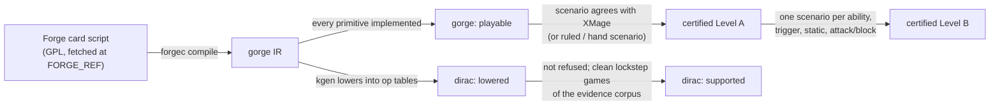

# Card support by set

Which *Magic* cards and sets each engine supports, and what "supported" means
at each tier. For players choosing a format, bot authors choosing a card pool,
and contributors looking for high-leverage card work.

!!! info "Where the numbers come from"
    Every table below is **generated at every docs build** from gorge-compliance's
    nightly per-set status and dirac's committed
    [`dirac/docs/support.md`](https://github.com/adams-shaun/gorge/blob/main/dirac/docs/support.md)
    (itself generated by `TestSupportDocIsCurrent`). Each table's caption gives
    the date and Forge corpus it measured, which can trail the current pin. No
    count is hand-written on this page; [Regenerating the tables](regenerating.md)
    gives the command behind each figure.

## Headline

gorge's corpus-wide playable count is what `make report` prints at the
`FORGE_REF` pin ([Getting started](../getting-started.md#1-fetch-and-compile-the-card-corpus));
the engine rows below carry the commits and corpus each figure was measured at.

--8<-- "support/_generated_sets.md:headline"

--8<-- "support/_generated_carddb.md:headline"

## At a glance

One tile per Standard set (the sets on dirac's support page). The tint and large
figure are the share of the set's cards dirac supports; the rest are unverified
(lowered, not yet evidenced by lockstep games) or refused. With gorge-compliance's
status, each tile also gives gorge's playable share.

--8<-- "support/_generated_sets.md:glance"

## What "supported" means, engine by engine

Each tier certifies more than the one before it, and each has its own check.
Don't read a number from one tier as a claim at another: *playable* says which
primitives are implemented, not that cards behave correctly.

| Engine | A card is supported when | Checked by |
|---|---|---|
| gorge, **playable** | every primitive its compiled script references is implemented | `make report` (`Registry.Coverage`) |
| gorge, **certified Level A** | it is playable and its cast-and-resolve (or play-land, or counter-spell) scenario agrees with XMage, carries a ruled divergence, or passes a hand-written Oracle scenario | gorge-compliance's gate |
| gorge, **certified Level B** | Level A plus one XMage-compared scenario per activated ability, trigger mode, static ability and attack/block | gorge-compliance's gate |
| dirac, **lowered** | its generator (`kgen`) can represent every ability in the engine's op tables | dirac's build ratchet |
| dirac, **supported** | it is lowered, not refused by name, and clean in the lockstep games of the evidence corpus, compared with gorge at every decision | dirac's lockstep oracle, [`dirac/docs/support.md`](https://github.com/adams-shaun/gorge/blob/main/dirac/docs/support.md) |



### gorge: playable

A card is **playable** when every [primitive](../contributing/glossary.md) its
compiled script references is implemented. That covers each `api:` effect,
`trig:` trigger mode, `kw:` keyword, `stat:` static mode, `repl:` replacement
and the `count:` value heads its SVars read. Clone-style enters-the-battlefield
replacements also have to pass a shape gate. The check is
[`Registry.Coverage`](https://github.com/adams-shaun/gorge/blob/main/engine/cards/validate.go)
against `effects.Supported()`, run by `make report` over the whole corpus.

Playable is necessary, not sufficient. A card can be playable and still
misbehave. The effect may not read one of its `$` parameters, or a primitive
may handle the common shape but not this card's. Two ratchets watch the cards
that matter most, the ones in the repository's own decks (see
[The repo-deck ratchet](#the-repo-deck-ratchet)).

### gorge certified: Levels A and B

[gorge-compliance](https://github.com/adams-shaun/gorge-compliance) is the
public compliance repository. It pins one gorge commit and checks it card by
card against independent references. One reference is hand-written scenarios
derived from the card's Oracle text and the Comprehensive Rules. The other is
**XMage**, an independent Java engine. For each card, gorge-compliance
generates scenarios, replays them in both engines, diffs the two engines'
snapshots at each checkpoint, and records a **verdict** per (card, template,
scenario hash). **Forge** runs as a third leg to adjudicate disagreements.

| Level | Not covered |
|---|---|
| **A** | activated abilities, trigger modes, attacks and blocks, statics. Basic lands are skipped. A card XMage does not implement needs a hand scenario |
| **B** | a requirement no scenario template serves yet is reported as a *template gap* and waits for its template |

The definitions are the gate's own wording,
[`gate.LevelMeaning`](https://github.com/adams-shaun/gorge-compliance/blob/main/oracle/compliance/gate/gate.go).
A verdict stays valid only while gorge still meets its frozen expectation and
the scenario's hash is unchanged. A moved scenario shows as a *stale verdict*
until XMage replays it. A *harness* problem means the test rig, not the
engine, could not express the scenario.

**Declared sets and the ratchet.** A set is *declared* at a level in
[`declared.json`](https://github.com/adams-shaun/gorge-compliance/blob/main/oracle/compliance/declared.json),
and CI fails if a declared set has any problem at that level. Only a set with
a full printed card list can be declared, because XMage's set manifests omit
the cards XMage lacks. The certification ratchet,
[`ratchet.json`](https://github.com/adams-shaun/gorge-compliance/blob/main/oracle/compliance/ratchet.json),
holds every other set's problem count, and that count may only fall. All of
these targets describe the pinned gorge commit. Bumping the pin is a pull
request that re-measures them.

The committed verdicts are counted by status (`agree`, `xmage_wrong`, `harness`, `diverge`, `gorge_wrong`)
with [the count's command](regenerating.md); the totals change with every pin bump, so none are written here. `xmage_wrong` is a ruled XMage error with a CR citation.

### dirac: lowered and supported

dirac is a second rules engine, and gorge is the reference it is checked against. It doesn't interpret
card scripts. Instead, a generator (`kgen`) **lowers** each card's gorge IR into fixed op tables, over the
whole Forge corpus. A ratchet pins the number of cards that lower, corpus-wide and per set. A fall fails,
and a rise is re-pinned.

Being lowered is much weaker than being **supported**. A supported card also isn't refused by name, and it
has evidence: **lockstep** games, which run dirac beside gorge on the same decks and seed and compare the
options offered at every decision and the state after every action, played it cleanly in the evidence corpus.
A game plays supported cards only. The counts come from
[`dirac/docs/support.md`](https://github.com/adams-shaun/gorge/blob/main/dirac/docs/support.md), which is generated.

Supported doesn't mean right or free of every difference. dirac shares gorge's bugs, because lockstep can't see
a mistake both engines make, and a sweep outside the evidence corpus can still find a difference on a pair of
supported cards. The FDN and BLB slices are the committed games a clone can replay (`make dirac-slices` plays the first 1,500 seeded pairs of each, on both surfaces). A game
that hits a capacity limit, with no disagreement up to that point, counts as *stalled*. See
[dirac](../architecture/dirac/index.md#what-it-supports).

dirac's per-set card list is the distinct card names in XMage's manifest
for the set that exist in the Forge corpus. It can differ by a few cards from
gorge-compliance's count, which uses the printed card list where one exists.
Each engine's column uses its own denominator, and dirac's corpus-wide count is
distinct card names while `make report` counts script files.

### XMage and Forge, as reference points

These are the two engines gorge measures against. Their numbers are their own
claims or a plain count, not certifications.

| Engine | Claim | Source |
|---|---|---|
| XMage | "over 32 000 unique cards and more than 91 000 reprints across official sets" | the [XMage README](https://github.com/magefree/mage), read 2026-10-20 |
| Forge | no card-count claim in its README; `forgec fetch` prints the card and token scripts its corpus holds at gorge's pin | `.cards/cards.lock` and `make report` |

Forge is where gorge's card scripts come from, so Forge's corpus is gorge's
denominator. XMage supplies the set manifests (one per set class; [Every set](#every-set)
counts them) and the second opinion behind every verdict.

## Charts by engine

One chart per engine over the Standard sets (the sets on dirac's support
page). The card-by-card detail is in the tables below and in
[`dirac/docs/support.md`](https://github.com/adams-shaun/gorge/blob/main/dirac/docs/support.md).

--8<-- "support/_generated_sets.md:charts"

## Per-set support

The table has one row for every set that gorge-compliance audits against a
full printed card list or that dirac's support page lists. It is sorted
newest first.

--8<-- "support/_generated_sets.md:sets"

- **Cards** is gorge-compliance's count: the printed card list for an audited
  set, otherwise XMage's manifest for the set.
- **Playable %** = 1 − (unsupported + not in corpus) / cards.
- **Level A %** and **Level B %** give the share of cards with no problem at
  that level. A set without a printed list can't be certified. Its Level A
  figure is marked ≥ because it is a hard lower bound: it counts the cards
  that already pass through a same-name verdict from an audited set, or as a
  basic land.
- **dirac supported** and **dirac lowered** are counts / cards over dirac's own
  card list for the set.
- **Lockstep games** is clean games / games in the set's committed slice, on
  `-surface full`, from the newest main run of the CI `dirac-slices` job
  (see [Lockstep slices](#lockstep-slices)). It says "—" when no run's summary
  was available to the build.

### carddb: abilities per set

Per set, how many abilities are agreed, owed or diverged between the engines,
from carddb's xproof data.

--8<-- "support/_generated_carddb.md:sets"

### carddb: data freshness

How fresh each carddb data writer is.

--8<-- "support/_generated_carddb.md:freshness"

## Lockstep slices

`dirac-slices` plays dirac beside gorge on each committed slice, on both surfaces, and the four-seat Commander pods
(`make dirac-pods`). Its job writes `slices-summary.json` from kfuzz's summary lines and uploads it as an artifact on
main runs. The docs build downloads the newest one. Games that hit a capacity limit with no disagreement up to that
point count as *capacity stalls*; a *two-seat* stall is a pod held to two seats by a declared limit. A build with no
artifact says "not measured".

--8<-- "support/_generated_sets.md:slices"

## Every set

gorge-compliance measures every XMage set manifest, not only the audited
ones. For every set without a printed list, the figures are estimates, not
certifications.

--8<-- "support/_generated_sets.md:rollup"

### Method and error bars

1. **Denominator.** XMage's manifests omit cards XMage has not implemented.
   Across the audited sets, the manifest differs from the printed list by −12
   to +5 cards (gorge-compliance `6108eb1`, 2026-11-04). Reality Fracture is 2.5%
   short and The Hobbit 6.2% short. So the newest unaudited sets may be
   overstated by a few points, and older sets by under one point.
2. **Name folding** between XMage and Forge names: about ±1 card per set.
3. **Playable is not correct.** An audit finds problems that playable can't
   see. Expect an unaudited set to land below its playable figure at Levels A and B.
4. **Corpus-wide versus per-set.** The corpus-wide share counts distinct
   cards, including Un-sets and Alchemy. The roll-up counts each printing in
   each set. Both are correct. They answer different questions.

## Commander decks

How much of real Commander play the support covers: the official precons and
the most-viewed public decks, measured by `forgec edhcover` (decklists are
fetched by `scripts/edh_decks.py` and never committed).

--8<-- "support/_generated_sets.md:edh"

## Corpus coverage at the pin

`make report` prints the corpus pin, the playable count and the missing
primitives ranked by how many cards each alone would unlock; `make coverage`
adds playable-by-type, colour and mana-value tables (`.coverage/`). The
[card coverage](https://github.com/adams-shaun/gorge/blob/main/.github/workflows/coverage.yml)
workflow publishes both on every push to `main`. `forgec compile` lists the
parse diagnostics. [Regenerating the tables](regenerating.md#gorge-corpus-coverage)
has the commands.

### Where the leverage is

Re-run `make report` for the live ranking. At the last measurement the top of it
was mostly non-tournament play: Alchemy (`api:MakeCard`, `api:Draft`),
Planechase (`trig:ChaosEnsues`, `trig:PlaneswalkedTo`), Archenemy
(`trig:SetInMotion`, `api:Abandon`), and Unfinity stickers and attractions with
Unstable's Contraptions. For cards that see tournament play, the leverage is in
the older keywords further down the list. A card can miss several primitives, so
the counts don't add up: implementing one primitive unlocks only the cards that
miss nothing else.

## The repo-deck ratchet

Two [ratchets](../contributing/glossary.md) hold the decks in
[`testkit/testutil/decks/`](https://github.com/adams-shaun/gorge/tree/main/testkit/testutil/decks)
(60-card constructed and Commander) to full support. Each keeps one file per card:

```text
$ make test-one PKG=./engine/rules RUN='TestEveryRepoDeckIsFullySupported|TestEveryRepoDeckParamsAreRead' V=1
ratchet: <outstanding> of <cards> distinct cards across the repo decks are not fully supported
param census: <outstanding> of <cards> distinct repo-deck cards carry at least one unread param or unmodelled cost token; ...
```

Each test's log line is the live count.

- **Not fully supported.** One file per outstanding card in
  `engine/rules/testdata/known-unsupported/`; the directory is absent when nothing is outstanding.
- **Parameter census.** A listed card would be playable with at least one `$` parameter
  or cost token that isn't read yet. One file per outstanding card in
  `engine/rules/testdata/paramcensus/`; the directory is absent when nothing is outstanding.

Both tests fail in **both** directions. A card that newly loses support fails,
and so does a table entry the build now supports. To fix a card, delete its
file.
