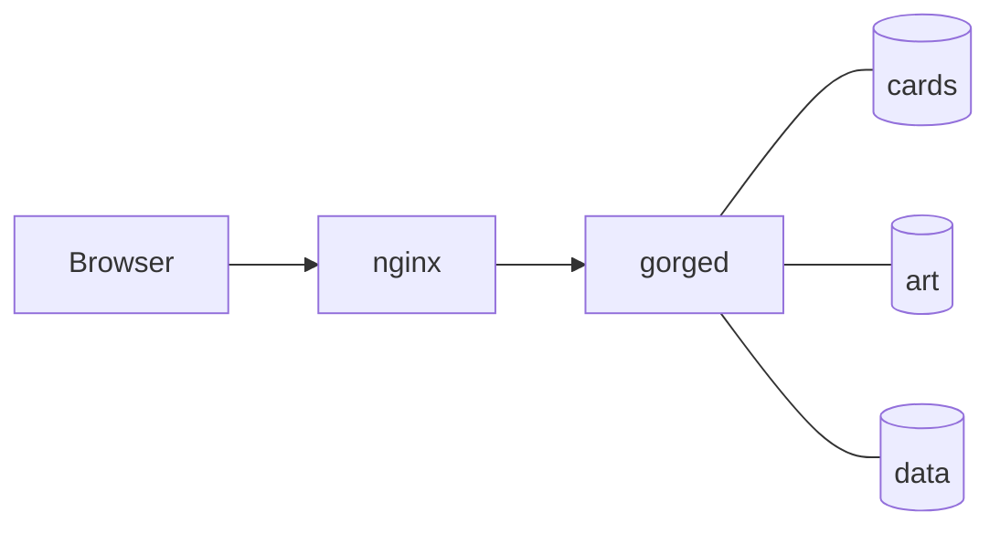

# Run the demo in Docker

Two containers serve the demo: nginx takes the browser's requests and gorged answers them. The card scripts and card art live in volumes, never in an image.
{ .gg-lede }



gorged serves the web client itself, because the build embeds it in the binary. nginx forwards every path to it and adds compression, long timeouts and unbuffered event streams. Only nginx publishes a port.

## Start it

You need Docker with the Compose plugin and `make`. The first start downloads about 140 MB of card scripts and compiles them, so give it a few minutes.

1. Clone the repository and enter it.

    ```sh
    git clone https://github.com/adams-shaun/gorge.git
    cd gorge
    ```

2. Copy the settings. Every line is optional.

    ```sh
    cp deploy/docker/.env.example deploy/docker/.env
    ```

3. Build and start both containers.

    ```sh
    make demo-up
    ```

4. Open <http://127.0.0.1:8090>. Watch the first start with `docker compose -f deploy/docker/compose.yaml logs -f gorged`.

`make demo-image` builds the images without starting them. `make demo-down` stops the containers and keeps the volumes.

## Settings

`deploy/docker/.env` sets everything below, and `deploy/docker/.env.example` lists the same names with their defaults. Table and bot settings take the same values as `deploy/demo.env.example`; each one becomes the gorged flag shown ([gorged flags](flags.md)).

| Variable | Default | Sets |
|---|---|---|
| `BIND_ADDR`, `HTTP_PORT` | `127.0.0.1`, `8090` | the address nginx publishes |
| `CARDS_DIR` | `gorge-cards` | the card scripts, `-cards` |
| `ART_DIR` | `gorge-art` | the card art cache, `-art-dir` |
| `DATA_DIR` | `gorge-data` | persistence, `-dir` |
| `FEEDBACK_DIR` | `gorge-feedback` | player bug reports, `-feedback` |
| `GORGE_UID`, `GORGE_GID` | `10001` | the user gorged runs as |
| `TABLES`, `SEATS`, `COMMANDER_SEATS`, `FORMATS` | `2`, `2`, `4`, `constructed,commander` | the startup tables |
| `PACE`, `SEED` | `50ms`, `1` | the delay after each bot decision; the first table's seed |
| `SPECTATOR`, `VSBOT_SPECTATOR` | `omniscient`, `public` | what spectators see of bot tables and of your games |
| `BOT_POLICY`, `COMMON_SENSE` | `bot`, `false` | the default bot and its guard |
| `PAIRED_BOT`, `PAIRED_BOT_SIMS`, `PAIRED_BOT_SEARCHES` | `az-closed`, `100`, `2` | the [bot beside you](paired-play.md) when you play bots alone (`off` turns it off), its simulations per decision and how many run at once |
| `PREWARM` | `true` | fill the art cache at start |
| `GOMEMLIMIT` | `6GiB` | gorged's Go memory limit |
| `GORGED_IMAGE`, `PROXY_IMAGE`, `GORGED_TAG` | `gorge/gorged-demo`, `gorge/gorged-demo-proxy`, `latest` | the image names compose builds |

A directory setting is a Docker named volume unless you give a host path. A host path must exist and be writable by `GORGE_UID:GORGE_GID`.

## Where cards and art come from

The Forge card scripts are GPL-3.0, so no image contains them. On first start the gorged container runs `forgec fetch` at the commit the Makefile pins (`FORGE_REF`), writes it to the cards volume, and gorged compiles its card cache there. The container records the commit it fetched, so a later image built from a new pin fetches again by itself.

Card art comes from Scryfall. gorged caches each image in the art volume and paces its requests, so a cold cache fills over a few minutes and a warm one survives upgrades. Art is cosmetic: an offline server plays fine without it, and `PREWARM=false` skips the fill.

## Stop, upgrade, reset

- **Stop:** `make demo-down`. Tables restart from their saved state.
- **Upgrade:** `git pull`, then `make demo-up`. It rebuilds both images and replaces the containers; volumes stay.
- **Reset the games:** `make demo-down`, then `docker volume rm gorge-demo_gorge-data`.
- **Publish elsewhere:** set `BIND_ADDR=0.0.0.0`, and put TLS in front of nginx. The demo has no accounts, and the default `SPECTATOR=omniscient` shows every hand on the bot-only tables.
