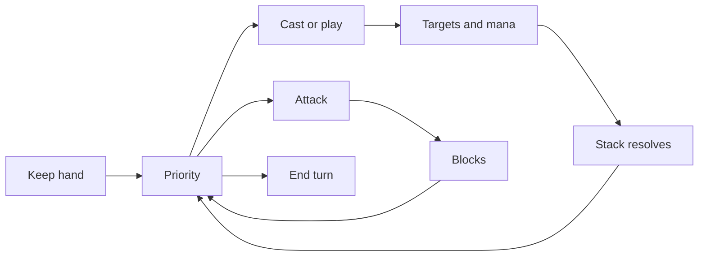

# Gameplay options

gorge asks for your input only where you can act. Auto-pass handles the rest, and you decide how much it skips. This page walks a turn from your seat, then covers each control and prompt in the client.

Everything below is client behaviour. The server validates every answer you send; the client decides no legality (`web/src/lib/prompts/combat.ts:3-9`).

## Auto-pass presets

Pick how much the game passes for you. The presets are in Game options (`web/src/components/PlaySettingsPanel.svelte:10-26`). Editing any setting shows the preset as **Custom**. The choice is yours across tables, not per table (`web/src/lib/playsettings.ts:11-15`).

-   **Casual**

    Stops only when you can do something: your main phases, an opponent's attack and end step, and opponent spells you can answer. Opponent triggers stop you only if they target you and you can respond.

-   **No tells**

    Also stops for every opponent spell, ability and trigger, so your pauses do not reveal your hand.

-   **Full control**

    Auto-pass is off. You stop at every priority window, on both turns, and on your own spells and abilities when you can respond (`web/src/lib/playsettings.ts:188-215`).

## Fine-tune the stops

-   **Step stops**

    Ten steps, upkeep through end, set separately for your turn and the opponent's. Each is **Off** (never stop), **Smart** (stop only if you have a play) or **Always** (stop even with nothing to do). The cell shows the word and a shape, never colour alone (`playsettings.ts:56-58`, `:34`, `:221-231`).

-   **Stop when an opponent...**

    Casts a spell, activates an ability or triggers one. Choose *If I can respond*, *Always* or *Never*. Triggers add *If it targets me or my stuff and I can respond* (`playsettings.ts:37-45`).

-   **My own spells and abilities**

    *Don't stop* lets your own object resolve. *Stop if I can respond* pauses when you have an answer (`playsettings.ts:48`).

-   **Pause when...**

    Breakpoints that stop auto-pass wherever the other rules would not: something targets you, creatures attack you, the stack reaches 2 to 5 objects, or an opponent plays a card on your watchlist of up to 50 names (`playsettings.ts:60-80`, `web/src/components/BreakpointsSection.svelte:23-56`). Presets never touch them.

-   **After you act**

    **Pass after I cast** passes your next window once after a real action. **Log auto-passes** records skipped windows in the game log. **Clear yields** drops every "always pass for..." choice from the stack menu (`PlaySettingsPanel.svelte:433-560`).

-   **Step delay**

    Pause between auto-passes: Off, Short (100 and 200 ms), Normal (200 and 400 ms), Slow (500 and 1000 ms), or your own values up to 10 seconds (`PlaySettingsPanel.svelte:119-126`, `playsettings.ts:235-245`).

## Priority controls

The strip along the centre bar holds the controls you use every turn (`web/src/components/HotButtonStrip.svelte`).

-   **AUTO**

    Shows the current mode: Casual, No tells, Full control or Custom, and while a run is live, END TURN, RESOLVE ALL or "Skipping turn". Click it to switch auto-pass on or off (`:232-243`, `:370-383`).

-   **PASS**

    Passes priority once. Key: `Space` (`:428`, `web/src/lib/keymap.ts:77`).

-   **END TURN**

    Passes until something needs you. Key: `Enter`. `Shift+Enter` skips the rest of the turn, and `Esc` stops either run (`:445`, `keymap.ts:78-80`).

-   **RESOLVE ALL**

    Resolves the whole stack. It is greyed out when there is nothing to resolve (`:465-470`).

-   **UNDO**

    Takes back your last action. It is available only when you are the table's sole human player (`:489-495`). Key: `Ctrl+Shift+Z` (`keymap.ts:81`).

-   **ACTIONS and DONE**

    ACTIONS lists every option the current decision offers. DONE submits a multi-pick selection (`:405`, `:510`).

Hold `Ctrl` while you click to hold priority. `Ctrl` alone is never a hotkey for that reason (`web/src/lib/hotkeys.ts:29-31`).

## Casting and paying for mana

-   **CAST on a hand card**

    A hand card you can cast shows a CAST button. With auto-pay on it casts with the suggested mana. With it off, the cast starts and you then choose the mana (`web/src/components/HandFan.svelte:321`).

-   **AUTO MANA**

    The switch beside AUTO. On: casts use a suggested mana plan. Off: you pick each source. `Shift+P` fills the mana being paid (`keymap.ts:98`). The switch is hidden at tables that only support auto-pay (`HotButtonStrip.svelte:385-397`, `web/src/lib/seatpanel.svelte.ts:197-198`). 

-   **Select mana**

    The payment panel shows the total cost, what is still owed and your pool, with the sources grouped. Tap sources on the board or in the panel, or press Auto-fill. If auto-fill stops, the panel says why and you finish by hand (`web/src/components/ManaPaymentPanel.svelte:10-20`, `:104`).

-   **Manual mana taps**

    Under auto-pay, a plain mana tap is hidden only when every play the window can reach works without it. Costs that need floating mana, such as X spells and equip, keep the taps visible (`web/src/lib/manualmana.ts:6-9`).

## Decisions you are asked

Each prompt has a title, a one-line instruction and, where the board can answer, clickable cards. The words come from `promptAnatomy` (`web/src/lib/prompts/anatomy.ts:130-222`).

-   **Keep this hand?**

    The London mulligan, in two steps: keep or mulligan, then pick cards to put on the bottom (`anatomy.ts:145-155`).

-   **Choose target**

    Click a highlighted card or player, or pick from the list. Multi-target spells show a running count such as "2 of 2 chosen" (`anatomy.ts:131-136`, `:253-262`).

-   **Declare attackers**

    Click your creatures to attack. Each line reads "creature to defender", and marks required attackers. `Shift+A` selects every creature that can attack; you still confirm (`anatomy.ts:137-140`, `combat.ts:34-58`, `keymap.ts:96`).

-   **Declare blockers**

    Click a creature to block with it, or pick a pairing in the list. `Shift+N` declares no blocks (`anatomy.ts:141-143`, `keymap.ts:97`).

-   **Order your triggers**

    The trigger you pick first goes on the stack first, so it resolves last. Turn on **Auto-order identical triggers**, or **all triggers**, to skip the question (`anatomy.ts:192-195`, `PlaySettingsPanel.svelte:455-480`).

-   **Use this ability?**

    For optional triggers. Tick "Remember this answer" and identical prompts are answered for you. Manage the list under **Remembered trigger answers** in Game options (`ListPrompt.svelte:76`, `PlaySettingsPanel.svelte:613-640`).

-   **Scry, surveil, discard, search, name**

    Scry and surveil: pick the cards to keep on top, in order. Discard: choose the cards. Search: choose cards and type to filter. Name a card: type to filter the names (`anatomy.ts:156-176`).

-   **Modes and other choices**

    Pick modes (some spells let you repeat one), choose who plays first, return a commander to the command zone, or choose which replacement effect applies first (`anatomy.ts:184-216`).

## Paired bot

A bot beside you: as each of your decisions arrives, gorge's search weighs it and marks the play it would make on the decision itself, with a dashed gold ring and *Bot's pick, 62%*. It is advice only: you still answer. The panel appears only when the server offers it, and its switch starts on when you play alone against bots and off at a table with another human (`web/src/lib/pairedbot.ts:26`, `web/src/components/PairedBotPanel.svelte:159`).

The panel lists up to five options with how many search lines went through each, an estimated win chance, and a Recommended tag (`PairedBotPanel.svelte:188`). Settings mark the bot's pick on your decision and what its plain rules would pick, and a note tells you when you answered differently (`PairedBotPanel.svelte:223-224`, `web/src/lib/botpick.svelte.ts:11`). It guesses your opponents' hidden cards from a set of decks, so it never sees them. [Play with a bot beside you](paired-play.md) has the whole picture.

## Replay controls

Open any finished game, or watch a live one, with a transport bar (`web/src/components/ReplayTransport.svelte:168`).

-   **Step**

    Step by event, decision or turn, back or forward. `Left` and `Right` step; `Shift` with an arrow jumps a turn (`web/src/lib/replay.ts:12-20`, `ReplayTransport.svelte:170-186`).

-   **Play**

    `Space` plays or pauses at 0.5x, 1x, 2x, 4x or 8x (`replay.ts:22`, `ReplayTransport.svelte:176`, `:269`).

-   **Skip trivial decisions**

    Skips decisions whose only options are Pass priority and Concede (`ReplayTransport.svelte:262`).

-   **Go live**

    On a live game, shows how far behind you are and returns you to the present (`ReplayTransport.svelte:191-193`).

See also [Replays](../guide/replays.md).

## Keyboard

All of these are rebindable under Game options, Keys, which also exports and imports your bindings as `gorge-keys.json` (`web/src/components/KeymapEditor.svelte:116-118`). The groups are Priority, Decisions, Profiles and View (`web/src/lib/keymap.ts:27-30`). Press `?` to see the sheet in the client. Hotkeys step aside while you type in a field or while a menu or dialog is open (`web/src/lib/hotkeys.ts:9-33`).

Next: [Table layouts](layouts.md).
