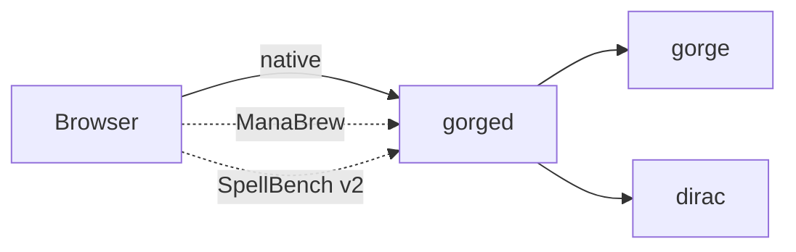

# Web client and server

`gorged` serves the browser client, the tables and the bots from one process. The client holds no rules; it shows what the server sends. { .gg-lede }

- [:material-play: **Play in the browser**](../guide/play.md)

    Start a game, tables, bots and undo.

- [:material-history: **How replays work**](replays.md)

    Events, the hash chain and divergence.

- [:material-cards-playing: **Draft simulator**](../guide/draft.md)

    Host a draft event and fill it with bots.

- [:material-wrench: **Troubleshooting**](../guide/troubleshooting.md)

    Startup, persistence and browser problems.

- [:material-tune: **gorged flags**](flags.md)

    Every startup flag, generated from the code.

- [:material-robot-outline: **Paired bot (planned)**](paired-play.md)

    A live advisor beside you.

