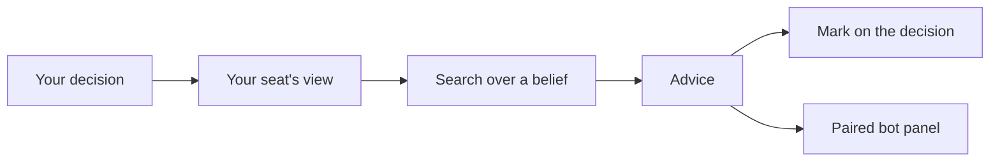

# Play with a bot beside you

When you play in the browser, a paired bot can sit beside you. As each decision reaches you, gorge's search weighs it and marks the play it would make, right on the decision. It only advises: you still answer. fair
{ .gg-lede }

## Turn it on

=== "In the browser"

    The **Paired bot** panel sits at the top of the rail, with an **On** / **Off** switch: *play with a bot beside you*.
    It starts on when you play alone against bots, and off at a table with another human. Your browser remembers what you choose for each.

    Two settings in the panel go with it: **Mark the bot's pick on your decision**, and **Mark what the bot's rules would do**.
    When you start a game against a bot, the **Paired bot** picker chooses the bot for that game, or none.

=== "On a server"

    Start `gorged -paired-bot az-closed`. `az-closed` is the search that needs no trained network; it plays two-seat constructed games.
    `-paired-bot-sims` sets its simulations per decision (100), and `-paired-bot-searches` how many run at once across the server (2).
    [A paired bot](../guide/play.md#a-paired-bot) has the full flag table.

=== "The demo"

    The demo turns it on: `scripts/deploy-demo.sh` and the [Docker demo](docker.md) pass `-paired-bot az-closed`.
    Set `PAIRED_BOT`, `PAIRED_BOT_SIMS` and `PAIRED_BOT_SEARCHES` to tune it, and `PAIRED_BOT=off` to turn it off.

## What you see

**The mark.** What the bot would press wears a dashed gold ring: a card in your hand or on the board, a prompt row, a target, the pass button or **No attack**. The controls in the prompt also carry its estimate, *Bot's pick, 62%*. A decision search doesn't weigh shows the bot's rules pick, with no number.

**The panel.** It lists the options the search weighed, with the share of its lines that went through each and an estimated chance of winning, then the line it expects to follow.

**Where you differ.** If you answer differently, a quiet note in the panel and your game log gives both estimates, once. The note stays in your browser.

A decision your auto-pass settings answer never asks. A newer decision cancels the search for the one before. When the server is busy with other searches, the panel says so and the advice arrives late; play on whenever you like.

## What it never sees

It sees what your seat sees: your deck list and everything you've seen this game. It can't see your opponent's hand or deck list, or the order of any library. It guesses those cards from a set of decks, so when that guess is wrong, so is its advice.

The advice goes to your seat alone, never to another player or a spectator. It is computed off the game's path: it is never replay input, never hashed, and a table no one asks about pays nothing for it. Each search stops after about two seconds, and the server caps how many run at once. It runs on the gorge engine only.
