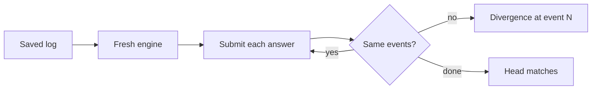

# How replays work

A replay is a game rebuilt, not a recording. The server saves the seed, the decks and every answer a player gave. Replaying
runs the engine again with those answers and checks that it makes the same events.

=== "The log"

    `events.Log` holds the seed, the events and the intents that produced them (`engine/events/log.go`). Every change to a game is an event,
    applied through `events.Apply`. Events carry results, not dice, so a shuffle logs the order it made.

=== "The hash chain"

    The chain starts at `sha256(seed)` and folds in each event. Its head, 16 hex digits, names the whole game, so two games compare by one
    string. `HeadAt(n)` gives the head after the first n events, which is how "replay to event N" is checked.

=== "Divergence"

    `engine/replay` replays by submitting each recorded intent and comparing events as it goes. `engine/eventdiff` names the first event
    that differs, or notes a stream that ended early or ran long. An engine that changed since the recording shows up here.

Golden chain heads in `engine/rules/testdata/heads/` pin this for the repo decks, so a rules change that alters a game fails a test.
The reader's side, with the review screen, is [Replays](../guide/replays.md). The detail is [Events and replay](../architecture/gorge/events.md).
